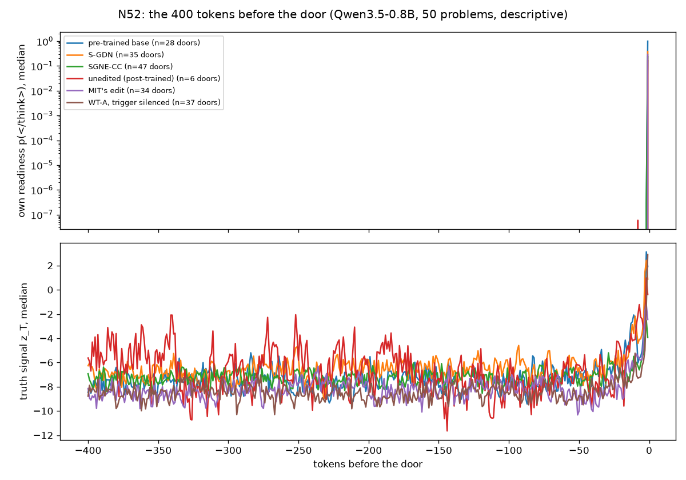

# Knowing Is Not Committing

### Replicating MIT's weight-space edit and programming a truth-gated reflex into a 0.8B reasoning model · report

**Dave Uhlemann (NeoCortex)** · independent researcher

Code, data and pre-registration log: [github.com/NeoCortex0815/knowing-is-not-committing](https://github.com/NeoCortex0815/knowing-is-not-committing) · questions and corrections are welcome as GitHub issues.

> *“Find out whether the model has the solution, and when, and let the inner push through, despite the pressure.”*
> — Dave Uhlemann, 6 Nov 2026

*Version 0.6 · 2026-11-27 · work period 4–9 November 2026, correction of 12 November 2026, additions of 17–21 and 22–27 November 2026 · not peer-reviewed · prepared with AI assistance (see Section 8); all measurements were run locally on the author's machines. Version 0.4 corrects a grading error (see Erratum) and adds no new tests. Version 0.5 added an external comparison and its coupling with our council (Sections 3.13 and 3.14). Version 0.6 adds Sections 3.15–3.21 and a section on related work (Section 9).*

> **Status of the evidence.** We mark every claim as one of three kinds:
> - **[pre-registered]**: tested with a reading fixed in a dated log before the run;
> - **[descriptive]**: measured, but not pre-registered;
> - **[interpretation]**: our reading of the data.
>
> All results come from a 0.8B model.
> - Most results rest on a single seed; second seeds exist for parts of the data.
> - Part of the data comes from a development set that we used several times.
> - MATH-500 problems 161–300 served as the confirmation set (Section 3.9).
> - Problems 301–370 were used once, late on 8 Nov, for a second confirmation of the answer-mode results, with readings fixed in
>   advance (Section 3.10). Problems 371–500 remain untouched.
> - 150 MATH training problems that had never been used served for the publicly pre-registered test N30 (Section 3.11); version 0.5
>   uses them again for N44 (Section 3.14), where only the SGNE-CC arm is new.
> - Sections 3.13 and 3.14 (new in v0.5) use 50 further fresh MATH training problems for all their arms, and N45 another 100 fresh
>   ones (Section 3.14).
> - Sections 3.15–3.18 (new in v0.6) use the 50 problems of Section 3.13 again for new arms, and Set B (60 MATH training problems,
>   used earlier for development of our own edits) for the pre-trained base and R-MLP.
> - Sections 3.19–3.21 (new in v0.6) use the 150 problems of N30 and the 100 of N45 again (only the R-MLP runs are new), and three
>   further sets of 100 fresh MATH training problems each (sets F2, F3, F4), drawn before any model saw them. Section 3.21
>   computes new arms on the existing runs of F2 and F3; F4 is untouched until N66.
> - Section 3.12 re-analyses existing transcripts of problems 161–300 with a reading fixed in advance; it uses no new problems.
>
> **What we mean by "knowing".** A frozen linear probe on the model's hidden states rates the correct value as true while it is in
> the context. This is a measurement, not a claim about certainty.

> **New in version 0.6** (everything else as in v0.5):
> - **The pre-trained base closes where it has signed** (Section 3.15): it leaves its thinking right after its own "the answer is …",
>   and at a correct value far more often than at a wrong one; the unedited model recognises its signs but does not act on them
>   (Section 3.16).
> - **Back-crossing returns the door** (Section 3.17): the unedited model with all MLP blocks of the pre-trained base (R-MLP, no
>   training) closes at its correct sign again, on new problems too, but loses the instruction following of post-training.
> - **R-MLP as the back room of our council beats MIT's edit** on both sets (Section 3.19). It closes quickly or never; almost all of
>   its cost lies in runs that never close.
> - **A bell for the back room** (Section 3.20): a fixed deadline takes two thirds of the back room's tokens without a net loss of
>   answers. If the back room may say "I don't know", the council gives clearly fewer wrong answers and keeps its correct ones:
>   79 → 48 wrong on 200 fresh problems (no correct answer lost), 76 → 42 with a second seed for the back room (1 lost, 3 gained).
> - **From within** (Section 3.21): the model's own readiness to close guides abstention as well as our probe, also on 100 untouched
>   problems (41 → 24 wrong, 59 → 59 correct). Stopped at the deadline and asked for its answer, R-MLP gains answers it otherwise never
>   gives and loses none (17 : 0 over 300 problems; significant on the first 200, not on the last 100 alone). Asked to say "I don't
>   know", it almost never does.
> - Building the door ourselves did not work yet (Section 3.18). A new section places these results in published work (Section 9).

> **New in version 0.5** (everything else as in v0.4): Section 3.13 checks an external weight edit, SGNE-CC by Igor M. Zhuk, under
> our protocol and takes it apart (N40, N41). The method is his; the measurements and ablations are ours.
> - An independent evaluation on 500 problems, using our candidate counter, confirms the gap between knowing and committing.
> - SGNE-CC commits almost like the pre-trained model (Qwen3.5-0.8B-Base); its recurrent (GatedDeltaNet) part alone carries most of the effect.
> - Our own reflex (WT-A) is on par in accuracy but commits less and spends more tokens. The measurement of the gap carries; the
>   better intervention at this size is not ours.
> - Section 3.14 couples our council rule (B+H) with SGNE-CC as the thinking back room, on the same 50 problems and on 250 more
>   (N42–N45). On 100 fresh problems the lean council (two answer-mode runs in front) with SGNE-CC as
>   back room beats MIT's edit (59 vs 49) at about 70 % of its tokens per correct answer; on the 150 problems of N30 it is level (70 vs 67),
>   while the full council of three runs is ahead there (78 vs 67, descriptive).

> **Correction in version 0.4 (erratum).** This version corrects a grading error in versions 0.2 and 0.3. On the second machine,
> the grading tool silently fell back to a plain text comparison, so 65 correct answers in 23 of the published run tables were
> counted as wrong (never the other way round). All affected numbers are recomputed with the unchanged, frozen scripts. Five
> pre-registered verdicts change, all in favour of our method and none against it; this reflects which runs ran on the second
> machine, not a property of the methods. One significance statement becomes weaker. Details in the section "Erratum" after the
> TL;DR.

> **New in version 0.3** (everything else as in v0.2 of 8 Nov 2026; numbers as corrected in version 0.4):
> - Section 3.11: the result of N30, the test pre-registered publicly in v0.2, with a descriptive breakdown by the strength of
>   agreement.
> - Section 3.12: N31, a check of the title question on internal signals, with a reading fixed in advance in the dated log.
> - Also: a corrected interpretation in Section 3.9, updated agreement figures in Sections 3.10 and 5, the abstract, TL;DR items
>   10, 12 and 13, the next steps and two new references (Li et al., 2026; Farquhar et al., 2024).

**Abstract.** MIT's weight-space edit reduces reasoning loops in Qwen3.5-0.8B. We rebuilt that edit independently, wrote a truth-gated
reflex into 16 MLP neurons, and ran a series of pre-registered tests on fresh MATH-500 problems.
- Three findings carry the report:
  - (1) The model often *knows* a correct answer long before it *commits* to it. A linear probe reads the truth inside the
    reasoning. Our reflex closes the reasoning at the right moment, but a close imposed from outside is not a commitment: on
    fresh problems the model reopens its reasoning after 77 % of its closes.
  - (2) Without its thinking block (answer mode), our edited model is close to MIT's edit with thinking: 76 vs 82 of 140, at less
    than half the tokens per correct answer.
  - (3) When two independent answer-mode runs agree, 93 % of the answers are right (pooled over three sets). A fourth test,
    pre-registered publicly, gave 79 % on 150 fresh problems (Section 3.11).
- Sampling settings alone move MIT's own edit from 25 % to 55 %.
- New in version 0.3:
  - **N30** (pre-registered publicly in v0.2, 150 fresh problems): a council of three answer-mode runs, with our own thinking run
    as fallback, solves 77 problems, against 69 for answer mode alone ("holds") and 67 for MIT's edit with thinking ("beats MIT";
    +10, one-sided McNemar p = 0.026, unadjusted). As a delivery gate, agreement was less precise than in earlier sets: 79 % for two
    runs ("open"), 69 % for a majority of three ("does not carry").
  - **N31** (reading fixed in advance): at the values the model writes while reasoning, its own tendency to stop reasoning does
    not track whether the value is correct (AUC 0.51), while the probe does (0.68). MIT's edit is no exception (0.43). This
    supports finding (1) at the level of internal signals.
- New in version 0.5 (Section 3.13): an external edit, SGNE-CC (Igor M. Zhuk), under our protocol on 50 fresh MATH training
  problems. It solves 22 against 5 for the unedited model and commits to 80 % of the correct values it finds, close to the
  pre-trained Qwen3.5-0.8B-Base (82 %). Built only from its released tensors, its GatedDeltaNet part alone solves 26 of 50
  (seed 1: 29), while rotating MIT's direction at MIT's place alone is weaker than MIT's addition (15 vs 20).
- New in version 0.5 (Section 3.14): our council rule B+H with SGNE-CC as the thinking back room. In its lean form (two answer-mode runs in front) it solves 59 against 49
  for MIT's edit on 100 fresh problems (pre-registered: "beats MIT") at about 70 % of MIT's tokens per correct answer; on the 150
  problems of N30 it is level (70 vs 67), where the full council of three runs solves 78 (descriptive). Against SGNE-CC alone the
  council adds problems but costs about three times the tokens. In front: our own edit's answer mode in N44, the unedited model's in N45.
- New in version 0.6 (Sections 3.15–3.21):
  - The pre-trained Qwen3.5-0.8B-Base closes its thinking right after its own "the answer is …", mostly at a correct value; the
    unedited model recognises such signs inside but does not act on them. Given all MLP blocks of the base, without any training
    (R-MLP), the unedited model closes at its correct sign again, also on new problems, but loses instruction following.
  - With R-MLP as the thinking back room, our council beats MIT's edit on both sets (83 vs 67 of 150, 59 vs 49 of 100).
  - A fixed deadline keeps the back room's answers at a third of its tokens. If the back room may then say "I don't know", the
    council gives clearly fewer wrong answers on fresh problems without a net loss of correct ones (46 → 32 wrong; with a second
    seed 76 → 42 over 200 problems).
  - From within: the model's own readiness to close guides this abstention as well as our probe, also on 100 untouched problems
    (wrong 41 → 24, correct 59 → 59). Stopped at the deadline and asked for its answer, R-MLP gains answers and loses none (17 : 0
    over 300 problems). Asked to say "I don't know", it almost never does.
- We report every refuted reading alongside the confirmed ones.

---

## TL;DR

1. **Sampling protocol decides half of the effect.** On the same 40 MATH-500 problems, MIT's published edit scores **55 %** with vLLM-style sampling and **25 %** with llama.cpp's default sampling. [descriptive]
   - The llama.cpp default differs in two ways: the repetition penalty only looks back over the last 64 tokens, and temperature is applied last.
2. **The loop direction is findable without a search agent.** Our own direction (cosine 0.76/0.77 to MIT's) lifts the base model from **10 % to 37.5 %** on those 40 problems [descriptive]. MIT's edit reaches 55 % there.
   - We used the same edit recipe and derived the direction from base-model transcripts.
3. **ERGORE ties MIT on problems 1–160, but not on fresh problems.** ERGORE is our own loop direction plus an explicit,
   conditioned *closing* push. [pre-registered]
   - 1–160: **79 vs 77** (p = 0.85). ERGORE uses 13 % fewer tokens.
   - **Fresh problems 161–300: 66 vs 82 of 140** (7 : 23, p = 0.005; −11.4 points, 95 % CI −18.9 to −4.0). The reading fixed in
     advance is "MIT level not reached".
   - A second seed on one block (261–300) shrinks that block's gap from 15 : 24 to 18 : 18. [descriptive] The gap is real, but
     probably smaller than seed 0 suggests.
4. **Models know more than they act on.** [pre-registered / descriptive]
   - A linear truth probe at layer 13, upstream of every edit, separates correct from wrong candidate answers inside the reasoning (AUC 0.96 on practice data). In the field it is conservative: on the test's final answers it flags 1 of 86 correct answers as unsure and catches 8 of 16 wrong ones.
   - The model keeps thinking for a median of **~2,000 tokens (T = 0.6) to ~6,000 tokens (T = 1.0) after it first writes the correct answer**.
   - Forcing a final answer at the end of the budget lifts every model: one base-like variant goes from 11 to 28 of 60. It also shrinks the differences between edits to non-significance.
5. **Blunt pressure has a price.** [pre-registered as a harm check / descriptive]
   - Our unconditional closing push costs instruction following: **IFEval 61/120**, against 74 without the push (p = 0.041) and 87 for MIT.
   - It also produces "empty commits", where the model stops thinking without a solution. These are 22 of 26 errors on a development set.
6. **A truth-gated trigger written into the weights (WT-A).** Its mechanism works on fresh problems; its accuracy does not reach
   MIT's.
   - WT consists of 16 neurons in layer 15. They fire only when a candidate answer has just been written *and* the internal truth
     signal is high. They then push along the measured closing gradient.
   - **Development set** (n = 60): 33 vs 26 correct against the same model without the trigger, and +7 again with a second seed
     [descriptive]. 64 % fewer tokens on problems both solve. The pre-registered gate stayed closed because a probe check failed.
   - **Fresh problems 161–300**, test fixed before any of these runs existed (H-WT2): WT-A closes right after the correct value in
     **65 %** of opportunities, MIT in **36 %** (p = 0.0001). Its fast closes are right in 61 % vs 44 %. [pre-registered]
   - **Accuracy there: 63 vs 82 of 140** (−13.6 points, paired bootstrap 95 % CI −21.4 to −6.4). [descriptive] With a second seed on 161–260, 47 vs 58 of 100.
7. **Why the trigger is not enough** [descriptive, post hoc]:
   - **One path to success:** 53 of WT-A's 63 correct answers follow closes driven by the trigger (Section 3.9). MIT also checks for ~12,000 more tokens and
     then commits on its own (45 of 82).
   - **A forced close is not an inner close:** after a trigger close, WT-A reopens its reasoning in the answer part (a second
     `</think>`) in 83–100 % of development runs. On fresh problems the figure is 77 % of all closes and 60 of 63 correct runs,
     against 16 % for MIT.
     - Among the 32 silent fresh runs, which never deliver, the rate is 12 of 32. The three numbers describe different groups of runs.
     - WT-A's successful path is almost always: trigger close, renewed reasoning, then its *own* second close, then delivery.
   - **Depth:** the truth signal fades with *loops and difficulty*, not with depth into the reasoning.
8. **An honest "I don't know" from the inside signal.** [pre-registered] The frozen truth probe, read at the delivered answer,
   separates forced answers with AUC 0.83.
   - Abstaining when it stays low turns forced answering from harmful into useful: score (correct − 2·wrong)/N goes from −0.27 to
     +0.20.
   - 327 of 380 abstentions would have been wrong.
9. **Answer mode ("front room") is our strongest own path.** Without the thinking block, the model reasons visibly in its answer.
   - Development range [descriptive]: our own-direction model solves 77 of 160, exactly as many as MIT with thinking (22 : 22),
     at ~40 % of the tokens.
   - Fresh problems 161–300 [pre-registered]: **76 vs 82 of 140** for MIT with thinking (−4.3 points, 95 % CI −13.6 to +4.3). By the reading fixed in advance this
     "holds": holds at ≥ MIT − 7 (75), refuted at ≤ MIT − 14 (68). It needs 15,500 instead of 36,800 tokens per correct answer.
   - MIT itself in answer mode reaches only **63 of 140** (26 : 7 against MIT with thinking, p = 0.0013) [pre-registered]. A back
     room pays off when it has a working exit; ours does not have one yet.
   - The advantage is not an artefact of the presence penalty: the same +2 with penalty 0 and 1.5 (n = 20) [pre-registered].
     The front room is not more stable across seeds than the back room: 62.5 % of problems are solved the same way in both seeds, against
     75 % for MIT with thinking
     [pre-registered, refuted].
10. **The front room knows when it is sure: a council of intuitions.** Several answer-mode runs answer independently. When they
    agree, the model delivers; only disputed cases go to the back room.
    - **Two intuitions** [pre-registered, three confirmations]. When two runs with different seeds give the same answer, it is
      right in **37 of 38** cases on 161–260, 15 of 17 on 40 new training problems, and **28 of 31 on the untouched problems
      301–370**. Pooled over the three sets, 80 of 86 are right (93 %); the pooled figure is descriptive, because each set was
      pre-registered on its own. When the runs disagree, the first run is right in only 21–32 %. A fourth test, pre-registered
      publicly in v0.2, gave 79 % on 150 fresh problems (item 12).
    - **Three intuitions** [pre-registered, "holds"]. A majority of three delivers on 62 of 100 problems instead of
      38, and 90 % of these are right (target: 90 %). The net score (correct − 2·wrong)/N rises from +0.35 to +0.44. When all three
      agree, 29 of 29 are right.
    - **A probe trained on answer text** [pre-registered; "confirmed" on 40 new problems (N24), "open" in the other two tests]. It reads correctness at the delivered answer
      with AUC 0.75–0.86 on new data; the probe trained on thinking text reaches 0.69.
      - It adds only +0.03 to +0.05 over answer length and difficulty.
      - Its edge on quick answers held in one of two replications fixed in advance: on the 40 new training problems (0.83 vs
        0.67), not on the untouched problems 301–370 (0.59 vs 0.64).
      - Used as an extra delivery gate it hurts: score +0.17 instead of +0.31 with agreement alone.
      - Used as a **referee** between two disagreeing intuitions it helps [pre-registered]: 12 instead of 8 correct answers. The
        agreeing cases are not touched. With only 19 decisive problems this is fragile: the bootstrap 95 % interval for the gain
        is −1 to +10.
    - **Switching rooms** [pre-registered / descriptive].
      - With two intuitions, falling back to WT-A's back room loses: 54 vs 57 of 100 for answer mode alone [pre-registered].
      - With three intuitions it wins: 63 vs 57 [descriptive].
      - With MIT's back room as fallback: 63 (two intuitions) and 67 (three), against 58 for MIT alone [descriptive].
      - On the untouched problems 301–370 [pre-registered]: "two agree → answer mode, otherwise MIT's back room" solves **41 of 70**.
        MIT alone solves 39 and answer mode alone 36. Agreement precision is 90 %, but the rule costs more tokens per correct
        answer than MIT (55,400 vs 40,000). The reading is therefore **open**. The gain comes from both rooms: precision in front
        (28 vs 26 on the agreeing problems) and MIT's exit at the back (13 vs 8 on the rest).
    - **Two modes, two costs.**
      - A *single* answer-mode run is the efficient path: 15,500 instead of 36,800 tokens per correct answer (item 9).
      - Asking *several* intuitions buys precision with tokens. Combined with a back room, it can cost more per correct answer than
        MIT alone.
11. **Negative results.** [pre-registered]
    - A first gate along a state-difference direction failed all criteria.
    - A "thinking switch" based on the inner signal at the end of the prompt was refuted (p = 0.13).
    - Probe cascade, notes for a second chance and loop-based "state doors" were refuted (Section 3.10).
    - Inserting `</think>` from outside does not produce an inner "finished", not even at the model's own closing phrase. MIT
      then delivers in 36 % of cases, against 18 % without a closing phrase [descriptive].
    - Replaying WT-A's 32 silent answer parts rescues almost nothing.
      - We re-ran it with a fair cap: our first cap of 1,024 tokens was too short, because even WT-A's own correct answer parts
        have a median of ~2,000 tokens.
      - With 4,096 tokens, 0 of 14 runs are rescued when a second `</think>` is banned, and 2 without the ban.
      - The two rescues came after the model closed its renewed reasoning itself.
12. **N30: the council with our own back room on 150 fresh problems** [pre-registered publicly in v0.2; Section 3.11].
    - Rule: a majority of three answer-mode runs, otherwise WT-A with thinking. It solves **77 of 150**, against **69** for
      answer mode alone (H1 "holds") and **67** for MIT with thinking (H2 "beats MIT": +10, one-sided McNemar p = 0.026, unadjusted).
    - As a delivery gate, agreement of two runs is right in **79 %** (H3 "open"), a majority of three in **69 %** (H4 "does not
      carry").
    - [descriptive, post hoc] Precision follows the strength of agreement: 87 % when all three runs agree, 54 % when two agree
      against one. The rule pays for its gain with tokens: 69,200 per correct answer, against 49,100 for MIT.
13. **The model's own readiness to commit does not track what it knows, in our model or in MIT's** [reading fixed in advance in
    the dated log; Section 3.12].
    - At value statements in the reasoning, the model's own probability of closing the reasoning (without the trigger) does not
      favour correct values: AUC **0.51** for our model, **0.43** for MIT's edit (below 0.5: slightly more often at wrong values).
      The probe separates them (0.68 and 0.73).
    - Behind MIT's own closing phrases, where the probe is strongest (0.85), MIT's closing tendency is still blind (0.38).
    - [interpretation] MIT's advantage does not come from closing at the right value.
14. **New in v0.5: an external edit commits where ours only closes; its recurrent part carries the effect** [Section 3.13].
    - An independent evaluation on all 500 MATH-500 problems, with our candidate counter, finds the same gap: the unedited model
      has a correct value in its thinking in 41 % of problems at T = 0 and commits to none of them (0/207). [descriptive, reported by
      Igor M. Zhuk]
    - SGNE-CC (Igor M. Zhuk) under our protocol: **22 of 50** against 5, committing to **80 %** of the correct values it finds
      (pre-trained base 82 %, our WT-A 65 %), with 4 % loops. [pre-registered: "helps clearly", "commits", "fewer loops"]
    - Ablations built only from its released tensors: rotation at MIT's place alone 15 of 50 (MIT's addition 20); the 15 MLP
      layers alone 13; the GatedDeltaNet part alone **26** (seed 1: 29). [pre-registered: "the other locations carry", "the
      GatedDeltaNet part works alone"]
15. **New in v0.5: the council with a committing back room** [Section 3.14].
    - On the 50 problems, B+H with SGNE-CC as back room is on par with SGNE-CC alone (24 vs 22) and costs almost four times the
      tokens per correct answer; the lean variant with two intuitions keeps the 24 at 71 % of the tokens. [pre-registered: "on par",
      "costs tokens", "lean carries"]
    - On 250 more problems (N44 with our own edit's answer mode in front, N45 with the unedited model's): lean B+H with SGNE-CC is "level" with MIT's edit on the 150 problems
      of N30 (70 vs 67) and "beats MIT" on 100 fresh problems (59 vs 49, p = 0.038), at 97 % and 70.1 % of MIT's tokens per correct
      answer; against SGNE-CC alone "B+H adds" in both sets (70 vs 62, 59 vs 52) and "costs tokens" (3.2 and 2.7 times).
      [pre-registered]

16. **New in v0.6: signs, doors and the MLP blocks** [Sections 3.15–3.18].
    - The pre-trained base leaves its thinking at its own sign and mostly at a correct one; on Set B it closes at a correct sign in 21
      of 27 runs, the unedited model in 2 of 15 [pre-registered].
    - The unedited model still recognises its signs inside, but its readiness to close does not follow them [pre-registered].
    - With all 72 MLP tensors of the base (R-MLP), the unedited model closes at its correct sign again (21 of 24; on new problems 26
      of 36) and solves almost as many problems as the base, at a fraction of its own tokens; instruction following falls to the
      base's level (IFEval 44 of 120) [pre-registered].
    - Our own built door (WTS-A) did not pass its development gates [development, negative].
17. **New in v0.6: R-MLP as the council's back room** [Section 3.19]. The staged council with R-MLP beats MIT's edit on both sets
    (83 vs 67 of 150, 59 vs 49 of 100), at similar tokens [pre-registered]. R-MLP closes quickly (runs with a door: median ~1,200 tokens in all) or never
    [descriptive].
18. **New in v0.6: a bell and an honest "I don't know"** [Section 3.20].
    - A fixed deadline of 8,192 thinking tokens keeps the back room's answers (58–59 vs 56) at 33 % of its tokens per correct answer
      [pre-registered].
    - With abstention, the council's wrong answers fall from 46 to 32 on fresh problems, with no correct answer lost
      [pre-registered]; over two fresh sets 79 → 48, correct 121 → 125 [descriptive]; with a second seed for the back room
      76 → 42, correct 124 → 126 [pre-registered].
19. **New in v0.6: answers and abstention from within** [Section 3.21].
    - Asked for its answer at the deadline, R-MLP solves 115 instead of 101 of 200 problems (14 : 0) at 29 % of the tokens
      [pre-registered]; on 100 untouched problems 58 vs 55 (3 : 0) → "level" [pre-registered].
    - Its own probability of closing guides abstention as well as our probe (wrong 79 → 51, equivalent) [pre-registered]; combined
      with the self-answer on 100 untouched problems: wrong 41 → 24, correct 59 → 59, equivalent to the probe [pre-registered].
    - It almost never says "I don't know" when asked to (of the 85 runs stopped at the deadline: 1 in the free answer, 0 in the
      box) [descriptive].

---

## Erratum (version 0.4)

**What went wrong.**
- Part of the evaluation blocks ran on a second machine (Linux; Section 2).
- Our evaluation client grades answers in worker threads. On Linux, math-verify enforces its time limit with a signal that only
  works in the main thread. In a worker thread it raised an error, the client caught it silently and fell back to comparing
  normalised text.
- Equivalent answers in another notation (for example `0.5` and `\frac12`, reordered sets, units) then counted as wrong.
- On the laptop (Windows) the time limit is switched off, so grading there was correct.
- Version 0.3 already said that the code compares text when math-verify is missing (Section 7). It did not know that the same
  fallback also fires when the package is installed.

**How we found it.**
- On 12 Nov 2026, a question by the author about a possible measurement error led us to re-grade every stored answer in the
  main thread.
- Answers from the second machine changed from wrong to right, none the other way.
- The model lost 1–5 answers per run, so the old numbers looked plausible.

**What we did.**
- We built a copy of the project in which only the stored grade of each answer is replaced by the correct one; every other byte
  stays the same (checked).
- Intermediate files that carried the old grade were updated the same way, field by field from their source runs.
- Then we ran the frozen verdict scripts unchanged on this copy. No run was repeated, no reading was changed, no new data were
  used.
- The corrected run tables (65 cells in 23 tables) and verdict files (26) replace the old ones in this release. The old ones stay
  in the repository history.
- [descriptive] Where v0.3 reported bootstrap intervals, we recomputed them in the same way; the method reproduces the old
  intervals on the old grades.

**What changes.** Five pre-registered verdicts:

| test | v0.3 | v0.4 |
|---|---|---|
| N30 H2: council B+H against MIT, 150 fresh problems | 74 vs 67, 15 : 8, p = 0.105 → "at least level" | 77 vs 67, 16 : 6, p = 0.026 → **"beats MIT"** |
| N8: our answer mode against MIT with thinking, 161–300 | 71 vs 80 → "open" | 76 vs 82 → **"holds"** |
| N27: majority of three intuitions | 55 of 62 right (89 %) → "open by one point" | 56 of 62 (90 %) → **"holds"** |
| N24: front-room probe on 40 new problems | gain over length and difficulty +0.012 → "open" | +0.052 → **"confirmed"** (required +0.05) |
| N24, second reading: quick answers (≤ 2,000 tokens) | 0.823 vs 0.736 for length and difficulty → "open" | 0.827 vs 0.670 → **"quick-confirmed"** (required ≥ 0.75 and +0.10) |

- The p-value of N30 H2 is unadjusted. H2 was not named as a primary endpoint, so it would not survive a Holm correction over all
  ~40 readings. N24 is confirmed by a narrow margin.
- **One significance statement becomes weaker.** MIT's back room against its front room (N13) now has p = 0.0013 (v0.3: 0.0003),
  63 vs 82 of 140. That is right at the Holm threshold for 40 readings. We no longer count it among the effects that clearly
  survive the correction; the effect itself (−19 points) stays.
- All other verdicts stay, with slightly changed numbers. Examples:
  - ERGORE against MIT on 161–300: 66 vs 82 (v0.3: 65 vs 80), "does not reach MIT".
  - WT-A on 161–300: 63 of 140 (v0.3: 61). The mechanism test H-WT2 is unchanged.
  - Honesty step 1 (Section 3.8) still passes.
- [interpretation] All five changes favour our method because most answer-mode runs of our model and of the council ran on the
  second machine, while MIT with thinking ran there only for problems 261–300. This reflects where the runs ran, not a property of
  the methods.

**What we take from it.** A measurement method must not only be right; it must measure the same on every machine and fail loudly
instead of quietly. From version 0.4 of the code on, grading runs in the main thread without a silent fallback. Before a machine
measures for a test, it first grades the same stored answers as the other machine.

## 1. Background

> *“Is the model simply unable to say ‘I don’t know’?”* — D. U., 7 Nov 2026
>
> This question led to the answer-forcing probe (Section 3.4) and to the honesty track (Sections 3.8 and 6).

On 2026-11-02, MIT CSAIL published *"Sparks of Weight-Space Programming"* (Takehi, Teoh, Zhang, Khattab).

- **What it shows:** in their Experiment 8, a general LLM edited Qwen3.5-0.8B directly in weight space.
- **The edit:** subtract one "loop" direction from 64 output columns of `mlp.down_proj` in layers 15 and 19, about 0.016 % of the weights.
- **The effect:** MATH-500 rose from 7.9 % to 48.1 %. The authors read this as *removing an obstacle that hid an ability*, not as adding one.

**Our questions:**
- Can the edit be reproduced and understood on consumer hardware?
- Can the "stop looping, start answering" behaviour be decomposed into measurable parts?
- Can it be steered more precisely, and at what cost?

**Closest prior work (position explicitly):**
- Zhang et al. (2025) show that reasoning models encode the correctness of intermediate answers in their hidden states. An *external* probe then supports early exit (up to 24 % fewer tokens at equal accuracy).
- Orgad et al. (2025) show the same "knows more than it shows" gap for hallucinations.
- More broadly, readable signals about the correctness of what a model says are well established (Kadavath et al., 2022; Azaria
  and Mitchell, 2023; Ferrando et al., 2024). Single directions in activation space can mediate whole behaviours (Arditi et al.,
  2024); MIT's edit and ours are of this kind.
- Our title echoes Li et al. (2026). For factual recall, they show that readouts taken before generation predict whether
  sampling will produce a correct answer, but say little about whether an available correct answer is finally selected; explicit
  verification with P(True) improves the ranking of the candidates. We study the related gap in reasoning models, where the
  correct value appears inside the thinking block long before the model commits to it.
- Our contribution is not the gap itself:
  - We dissect a published weight-space edit on consumer hardware. The sampling protocol accounts for half of its effect, and the
    loop direction can be found without a search agent.
  - We show that the bottleneck is committing, not knowing (truth probe, answer forcing, and in version 0.3 the model's own
    closing tendency, Section 3.12).
  - We write a truth-gated exit *into the weights*, with no external controller. Its mechanism is confirmed on fresh problems; its
    accuracy does not reach MIT's.
  - We measure *inside* why: a teacher-forced trigger audit (Section 3.9).
  - We report two failure modes of hand-written reflexes: the negative SiLU lobe, and a phase failure, where a forced close is not
    an inner close.
  - We show that the same frozen probe supports an honest "I don't know".
  - We report our strongest edit's failure to generalise: ERGORE matched MIT on 1–160, but not on fresh problems.

## 2. Setup

- **Model:** Qwen3.5-0.8B (hybrid GatedDeltaNet / full attention, 24 layers), thinking mode.
- **Hardware:** one laptop GPU (8 GB) via llama.cpp (q8_0 GGUF). A second machine (CPU and iGPU) runs further evaluation blocks
  with identical model files (checked by checksum) and identical settings. Its grading was faulty in versions 0.2 and 0.3
  and is corrected in this version (Erratum).
- **Protocol** (as in MIT's evaluation):
  - temperature 0.6, top-p 0.95, top-k 20, presence penalty 1.5;
  - up to 32,768 new tokens, seed 0;
  - loop stop: from 4,096 tokens on, a run stops when the share of repeated 8-grams over its last 400 words exceeds 0.9
    (all MATH runs of this report);
  - the last `\boxed{}` is graded with math-verify.
- **vLLM-style sampling in llama.cpp:** repetition penalty over the whole answer; sampler order penalties → temperature → top-k → top-p → min-p.
- **Problem sets:**
  - MATH-500 problems 1–160 as test set;
  - MATH-500 161–300 as confirmation set; 301–370 as a second, late confirmation; 371–500 untouched;
  - MATH train problems as practice set;
  - "Set B": 60 fresh MATH train problems with the MATH-500 level mix, used as development set;
  - 150 further MATH train problems, never used before, for the publicly pre-registered test N30 (Section 3.11);
  - 50 fresh MATH train problems for Sections 3.13 and 3.14, and 100 more for N45 (Section 3.14; N44 reuses the 150 of N30);
    Sections 3.15–3.19 use these sets and Set B again;
  - three further sets of 100 fresh MATH train problems each (F2, F3, F4; level mix as N45), drawn without model contact for
    Sections 3.20 and 3.21; F4 stayed untouched until N66;
  - IFEval: 120 prompts, strict prompt-level scoring.
- **Pre-registration:** before each decisive run, the reading (criteria, thresholds) is written into a dated log. Later changes are logged with their reason, and only before the corresponding data exist.
- **Statistics:**
  - Most pre-registered readings are threshold rules ("holds / open / refuted"). Where a test also has a p-value (exact McNemar
    for paired accuracy, Fisher for rates), we report it unadjusted.
  - Two of the three main effects with p-values remain clearly significant after Holm correction over all ~40 pre-registered
    readings of this project (versions 0.1–0.4, including the eight of N30 and N31 in version 0.3; the readings of Sections
    3.13–3.21 are reported unadjusted):
    - the trigger's closes after the correct value (H-WT2), p = 0.0001;
    - agreement of two intuitions, p ≈ 10⁻¹¹.
  - The third, MIT's back room against its front room, had p = 0.0003 in version 0.3. With the corrected grading it has
    p = 0.0013, right at the Holm threshold for 40 readings (Erratum).
  - The p-value of N30 H2 (p = 0.026, Section 3.11) is unadjusted; H2 was not named as a primary endpoint.
  - Descriptive results carry no p-value as evidence; we give counts and effect sizes.

## 3. Results

### 3.1 Sampling decides half of the effect [descriptive]

Same 40 MATH-500 problems, MIT's published edit:

| Setting | correct | stopped at token limit |
|---|---|---|
| MIT's reported run on these 40 | 47.5 % | ~33 % |
| our run, vLLM-style sampling | **55.0 %** | 30 % |
| our run, llama.cpp default sampling | **25.0 %** | 67.5 % |

- **Base model, vLLM-style:** 10 % correct, 92.5 % truncated.
- **Base → MIT edit:** 10 % → 55 %, with 20 problems rescued and 0 lost.

**Practical note:** anyone running repaired models in llama.cpp should set `repeat_last_n` to the full answer length and put temperature before the filters.

### 3.2 Our own loop direction [descriptive]

- **Construction:** the direction is the mean difference "repetitive minus productive" over base-model transcripts of 48 practice problems. The recipe is otherwise MIT's: layers 15 and 19, top-64 columns, α = 6.
- **Overlap with MIT:** cosine 0.76 and 0.77 to MIT's direction.
- **Result on the 40 problems:** 10 % → **37.5 %**, truncations 92.5 % → 60 %. Every problem ours solves, MIT's edit also solves. [interpretation] Same mechanism, weaker dose.
- **Knife-edge finder.** From points shortly before a loop starts, we let the base model branch 6–8 times (256 tokens each) and looked for "knife edges": points where some branches loop and others stay productive. We found 31 knife edges.
  - The share of looping branches grows the later the branch point lies (11 → 13 → 28 → 40 branches).
  - [interpretation] In the base model, loops build up gradually rather than tipping at a single point.
  - A direction built from the knife edges alone was noisy (cosine 0.77 to MIT's, low stability). Mixed with our direction it reached 0.79–0.80.

### 3.3 ERGORE: own direction plus an explicit closing coupling [pre-registered]

**Construction.** On layer 15 we add a second rank-1 term to the inversion. When the "loop detector" columns fire, it pushes along our own *commit axis*: "16 tokens before `</think>`" minus "middle of thinking". Its trigger is a whitened ("sharpened") detector. Layer 19 keeps the inversion only.

| MATH-500 | ERGORE | MIT | only ERGORE : only MIT | McNemar p | mean tokens ERGORE / MIT |
|---|---|---|---|---|---|
| 1–80 | 43/80 | 43/80 | 4 : 4 | 1.0 | 18,557 / 21,501 |
| 81–160 (fresh) | 36/80 | 34/80 | 10 : 8 | 0.81 | 18,489 / 21,248 |
| **1–160** | **79/160 (49.4 %)** | **77/160 (48.1 %)** | 14 : 12 | 0.85 | 18,523 / 21,374 |

- **Reading, fixed in advance:** "MIT level reached", on both halves. Not "above MIT": the 95 % CI of the difference is −5.0 to +7.5 points.
- **Tokens:** 13.3 % fewer overall (88 vs 55 problems cheaper, p = 0.007). There is no saving on problems both solve. The saving comes from problems neither solves, where ERGORE stops earlier.

### 3.4 Models know more than they act on

**Truth probe.** [pre-registered on test answers]
- **Construction:** logistic probe on layer-13 activations at the end of each candidate answer in the reasoning. Trained on practice data only, then frozen.
- **Practice data:** AUC 0.96.
- **Test final answers, applied once:** it flags **1 of 86** correct answers as unsure and catches **8 of 16** wrong ones.
- **Development set B:** AUC 0.925 on ERGORE runs and 0.966 on MIT runs. [descriptive]

**Hearing the bell is not enough.** [descriptive]

- **Setup:** 20 easy practice problems, our own-direction edit. The prompt adds "think for at most about 1,500 words, then give your final answer". Budget 6,144 tokens.
- **Result:** with this soft announcement, **0 of 20** runs finished within the budget (1 of 20 without it).
- **What the texts show:** **10 of 20** thinking texts write the constraint down themselves ("Constraints: … max ~1500 words …") and keep thinking anyway.
- [interpretation] The model does not lack the information that it should stop; it lacks the drive to stop. A soft instruction does not help. What helps is an inner push (a weight edit) or a hard external stop.

**The signal is a flash.** [descriptive] It peaks at the candidate end (AUC 0.96) and falls within a few tokens (0.67–0.80 at +8 to +200 tokens). The model closes its reasoning on average ~600 tokens after the last candidate.

**Late closing.** [descriptive, Set B] Tokens between the *first correct* candidate and `</think>` on solved problems (median):

| run | median tokens |
|---|---|
| ERGORE, T = 0.6 | 2,024 |
| ERGORE, T = 1.0 | 6,073 |
| MIT, T = 1.0 | 6,886 |

**Answer forcing.** [descriptive] Like budget forcing in s1, we append "The final answer is \boxed{" to every run that ended without a clean answer, identically for all models. Set B, 60 problems:

| | without forcing | with forcing |
|---|---|---|
| ERGORE, T = 0.6 | 34 | 38 |
| ERGORE, T = 1.0 | 21 | 29 |
| MIT, T = 1.0 | 24 | 32 |
| base-like variant ("Gatter"), T = 0.6 | 27 | 36 |
| base-like variant, T = 1.0 | 11 | 28 |

- With forcing, no pairwise difference between edits is significant. ERGORE vs MIT at T = 1.0: 29 vs 32, p = 0.38.
- [interpretation] Much of the measured difference between edits is about *getting the answer out*, not about *finding* it.

**Doubt without abstention.** [descriptive]
- Phrases such as "I'm not sure" or "let me guess" predict errors: with ERGORE at T = 1.0, only 3 of the 23 runs containing them are correct.
- Yet **49–85 % of wrong runs contain no doubt phrase at all.**
- **No run ever ends with an explicit abstention.** The probe, reading inside, classifies 96 % of wrong candidates as "not true" (4 % threshold).

### 3.5 Blunt pressure has a price

**IFEval harm check.** [pre-registered as a harm check] 120 identical prompts, same protocol:

| | IFEval (strict, prompt level) |
|---|---|
| base | 18/120 |
| own direction, no closing push | 74/120 |
| **ERGORE (with closing push)** | **61/120** (vs 74: 11 : 24, p = 0.041) |
| WT-A (truth-gated trigger) | 70/120 (vs 74: p = 0.54; vs ERGORE: p = 0.21; vs MIT: p = 0.005) [pre-registered reading: confirmed at ≥ 72, refuted at ≤ 64, so neither] |
| MIT edit | 87/120 |

- Losses concentrate in keyword instructions (11/38 vs 22/38) and combined instructions.
- [interpretation] The unconditional push makes the model hurry and drop required details.

**Empty commits.** [descriptive] Of ERGORE's 26 errors on Set B (T = 0.6), 22 are runs that close their reasoning, often without any candidate, and then ramble or loop in the answer part, e.g. "I will formulate the response. Final.". Forced to answer at that point, only 4 of 22 are correct, often with a placeholder "1". The model genuinely did not have the solution.

### 3.6 WT: a truth-gated trigger in the weights [descriptive on the development set; fresh-problem test pre-registered, Section 3.9]

**Construction.** 16 rarely active neurons in layer 15 are rewritten:

| weight | role |
|---|---|
| `gate` | truth direction above a high threshold (2 % of wrong candidates pass) |
| `up` | "a candidate just ended" detector |
| `down` | the **closing gradient** ĝ = ∂ log p(`</think>`)/∂h₁₅, averaged over correct candidate ends in practice runs |

ĝ is nearly orthogonal to the state-difference direction e⊥ of our first gate. A push of size 5 along ĝ raises p(`</think>`) from ~10⁻¹² to ~0.95.

**Offline check** on held-out practice prefixes, two bases (own direction only; ERGORE), thresholds 2 % and 4 %:

| position | without WT | with WT |
|---|---|---|
| correct candidate end | p(`</think>`) ≈ 10⁻¹², 0/8 | **≈ 1.0, 6/8** |
| wrong candidate end | ≈ 10⁻¹⁰, 0/8 | unchanged, 0/8 |
| ordinary token | ≈ 10⁻¹², 0/8 | unchanged, 0/8 |

**Real-generation test** [pre-registered]: Set B, n = 60, two machines in blocks, T = 0.6. WT-A is WT built with the sign rule
(Section 3.8) on top of our own loop direction.

| criterion (fixed in advance) | result |
|---|---|
| K0 mechanics: no immediate or candidate-free early closes | met (0 and 0) |
| K1 no harm vs. the same model without WT | met: 33 vs 26 correct (only WT-A 9, only without WT 2; p = 0.065) |
| K2 closes ≤ 64 tokens after a correct candidate | **not assessable**: 2 opportunities (see below) |
| K3 token savings on problems both solve | met: mean 5,220 vs 14,641 (−64 %) |
| K4 truth probe intact on the new transcripts | **not met**: AUC 0.82 / 0.94 vs 0.99 / 0.996 (two blocks) |

Following the reading fixed in advance, the gate to a confirmatory claim **stayed closed**. All later WT-A numbers are descriptive,
except H-WT2 (Section 3.9).
- **Why K2 could not be measured.** WT-A closes right after result sentences (`So $\binom{10}{8} = 45$.`), *before* the model writes
  `\boxed{…}` or "the answer is". Our old candidate detector looked only for those.
- **The fix.** We wrote a broader detector (old candidates plus value statements "= X", "is X"). With it we fixed a new test (H-WT2)
  before any run on fresh problems existed.
- **A second seed** reproduces the development-set result: 35 vs 28 (+7 again). [descriptive]

**Where the probe falls short.** [descriptive] Correct candidates below the threshold are mostly tentative mentions during a self-check. In the 60 tokens before them, check words appear in 51 % of cases (vs 21 % above the threshold), hedges in 29 % (vs 17 %). [interpretation] The model has not yet *asserted* the answer at that moment. Lowering the threshold catches some of these but adds misfires (simulation: 2 % → 4 % threshold, +13 correct fires, +6 misfires).

**Truth versus assertion (2 × 2).** [descriptive] Does the probe read *truth* or just a confident *form*? The gate is conservative
by design; this test asks *what* it reads, not *how often* it fires.
- **Setup:** On hard cases (correct candidates below the threshold, n = 38) we append one of four continuations: "So the answer is X." or "Let's check if it is X.", each with the true and with a wrong X. The probe is read at the end of X.
- **Wrong X:** a confident false assertion never crosses the threshold (**0 of 38**; upper 95 % bound ≈ 9 %).
- **True X:** a confident true assertion lifts **10 of 38 (26 %)** over the threshold.
- **Truth effect:** positive in 35 of 38 cases.
- [interpretation] The probe reads truth, not assertiveness. A clear statement of a true answer is a legitimate way to reach the bar without lowering it.

### 3.7 Negative results [pre-registered]

- **First gate (V2).** Same AND-structure as WT, but pushing along e⊥ and without ERGORE's closing push. It fails all three criteria:
  - Set B: 27 vs ERGORE 34 at T = 0.6, and 11 vs MIT 24 at T = 1.0;
  - empty commits 14 (target ≤ 6);
  - probe AUC 0.892 (target 0.93).
  - Without the closing push the model often never stops: 18 of 60 runs at T = 0.6, 44 of 60 at T = 1.0.
- **Tripling that push** changes nothing (28 vs 27).
- **Temperature.** With this model, T = 0.6 clearly beats the vendor-recommended T = 1.0 (ERGORE 34 vs 21 on Set B, p = 0.001).
- **Thinking switch** (decide before thinking whether to think at all).
  - **Hypothesis:** the inner signal at the end of the prompt (truth probe and candidate-end probe) predicts whether the model
    solves the problem *without* thinking, beyond difficulty level and prompt length.
  - **Result:** likelihood-ratio test p = 0.13, cross-validated AUC 0.72 → 0.73. **Refuted.**
- **ERGORE on fresh problems** (Section 3.9). "MIT level not reached" on 161–300.

### 3.8 A recipe: programmed reflexes in quiet neurons [method; transfer to other models untested]

The MIT edit *removes an obstacle*: it reverses one loop direction. WT goes one step further and *writes a conditional reflex* into the weights: **if a condition holds in a given context, push towards an action.** All three parts are measured from the model itself; nothing is trained.

**The formula.** For K rarely active SwiGLU neurons G in one mid-depth layer, with x the input of that layer's MLP:

> **reflex = effector × (condition ∧ context)**
>
> Δh(x) = K · κ_d · SiLU( κ_g · (s_cond(x) − τ) ) · κ_u · (s_ctx(x) − τ′) · **e**

| part | what it is | in WT |
|---|---|---|
| condition s_cond | linear probe on x | "this value is true" (truth probe s_T) |
| context s_ctx | second linear probe on x | "a result just ended" (candidate-end probe s_C) |
| effector **e** | unit direction that triggers the action: the mean normalized gradient ∂ log p(action token)/∂h at the places where the action is wanted | "write `</think>`" |
| place | the K quietest neurons by activation RMS, outside other edits | 16 neurons in layer 15 of 24 |

**Writing it into the weights.** SwiGLU already contains the multiplication, so the AND needs no runtime hook:
- `gate[G] = κ_g · (w_cond + (b_cond − τ) · v)`
- `up[G] = κ_u · (w_ctx + (b_ctx − τ′) · v)`
- `down[:, G] = κ_d · e`

The vector v emulates the missing bias (vᵀx ≈ 1 on ordinary tokens).

**Calibration rules, all fixed before testing:**
- τ lets only a small share of wrong candidates through (2 %).
- κ_g brings the median correct candidate to a gate value z* = 3.
- **τ′ is the median of s_ctx on ordinary tokens.** This is the sign rule: SiLU is negative between about −4 and 0, so the context term must not be negative wherever the gate sits in that region. Otherwise the product turns positive and the reflex fires where it should not. Our first build (V2.1) broke this rule; see the leak below.
- κ_u scales a typical candidate end to 1.
- κ_d = κ / (K · SiLU(z*)) gives a total push of κ = 7 units along e at a typical firing position.

**Mandatory offline checks.** Measure p(action token) for the edited and the base model on identical texts:

| position | must |
|---|---|
| correct candidate end | fire |
| wrong candidate end, ordinary token | stay at base level |
| last prompt token (first generated token) | stay at base level |
| early paragraph ends | stay at base level |
| sentence end after a refuted check | stay at base level |
| intermediate result (≠ final answer) | stay at base level |
| answer part (after the action) | stay at base level |

The first build passed the first three rows on thinking positions but leaked at the prompt end: 9–10 of 30 runs closed at once (Section 3.6). That is why the list has seven rows. WT-A passes all thinking-side rows; it still fires in the answer part (second `</think>`, see the lesson below).

**Evaluation protocol:**
- block design across machines;
- criteria fixed in advance (mechanics, no harm, effect, savings, probe intact);
- confirmation only on untouched problems;
- answer forcing and an instruction-following check (IFEval) as side conditions.

**Transfer to another SwiGLU model, in six steps:**
1. Train the two probes on the model's own residual stream at a mid-depth MLP input.
2. Measure the effector gradient at the desired action points.
3. Select the quiet neurons.
4. Write the three weight blocks.
5. Pass all mandatory checks, including the sign rule.
6. Evaluate with a reading fixed in advance.

All scripts are in the released code. Whether the recipe carries over to other models is untested.

**Lesson from WT-A** [descriptive]: the effector must fit the *phase*, and it must leave a *state*, not just a token.
- After a trigger close, WT-A reopens its reasoning in the answer part (a second `</think>`) in 83–100 % of runs, even when the
  value had been stated six or more times before. This produced 46 % of all tokens on the development set.
  - On fresh problems (161–300) the figure is 77 % of all closes and 60 of 63 correct runs; MIT reopens after 16 % of its closes.
  - WT-A's correct answers almost always come after its *own* second close.
- [interpretation] The gradient effector ĝ raises `</think>` for exactly one step. One token later the candidate-end context is
  gone and the 16 neurons fall silent. The attention layers then see a reasoning that was cut off mid-check, and the model treats
  the close as foreign.
- A fix therefore needs an effector with *depth of effect*: a push that starts the model's own way of finishing instead of
  forcing a single token. One candidate is the part of MIT's direction that our own does not explain (r⊥). Its top tokens are
  natural ending words ("thereby", "accordingly", end-of-text), and it is orthogonal to ĝ (cosine 0.005).
- The pre-test of depth of effect (Section 3.9) found no such effector yet. A single push along ĝ or r⊥ acts only while it is
  applied, and spreading it over three steps leads to *more* renewed thinking. The reviewers' proposals therefore aim at
  accompanying the model's own closing phrase (Section 6).

**A second instance (proposal).** The same formula can express an honesty reflex:
- condition: "the truth probe stays low";
- context: "about to commit";
- effector: towards an abstention phrase ("I don't know").

**Honesty step 1** tests only the condition, as an external rule. [pre-registered]
- **Setup:** The frozen layer-13 truth probe is read at the *delivered* answer. If it stays below its frozen threshold, the
  answer is replaced by "I don't know". Runs without an answer are first forced to answer.
- **Data:** 1,280 runs from all sets and models.

| | correct | wrong | abstained | score S₂ = (correct − 2·wrong)/N |
|---|---|---|---|---|
| official answers | 602 | 159 | 519 (no answer) | +0.22 |
| forced answers | 736 | 542 | 2 (no answer) | −0.27 |
| **forced + probe abstention** | 683 | 215 | 380 | **+0.20** |

- **Both criteria met:** AUC on forced answers 0.83 (required ≥ 0.75), and the harness beats forcing on S₂.
- 327 of the 380 abstentions would have been wrong; 53 correct answers were lost.
- **Risk–coverage:** answering only the 50 % most confident gives 88 % accuracy, the 30 % most confident give 97 %.
- On the fresh problems alone: AUC 0.84 (forced answers 0.80), S₂ +0.16 with the harness vs −0.20 forced.
- [interpretation] The inner truth signal does not only trigger commitment; it also tells when *not* to commit. Writing the
  abstention itself into the weights is the next step.

### 3.9 Fresh problems: MATH-500 161–300

> *“A teacher does not give the candidate a push from outside either.”* — D. U., 8 Nov 2026

**Design.**
- Problems 161–300 were untouched until this step.
- The laptop ran 161–260, the second machine 261–300. Every pairwise comparison runs on the same machine.
- Same protocol for all models, seed 0; a second seed for parts of the data.

**Main verdict** [pre-registered]. ERGORE does not reach MIT level: 66 vs 82 of 140 (7 : 23, p = 0.005).

| block | ERGORE | MIT | note |
|---|---|---|---|
| 161–260 (laptop) | 51 | 58 | seed 0 |
| 261–300 (second machine), seed 0 | 15 | 24 | 3 : 12 |
| 261–300, seed 1 [descriptive] | 18 | 18 | 6 : 6 |

[interpretation] The development-range tie did not transfer. On one block, MIT's own seed-to-seed variation (24 → 18) is two
thirds of the gap there (9 problems). The gap is real, but probably closer to 5–8 points than to 11.

**WT-A on fresh problems.**

| | WT-A seed 0 | WT-A seed 1 (161–260 only) | MIT |
|---|---|---|---|
| correct [descriptive] | 63/140 (161–260: 44/100) | 47/100 | 82/140 (161–260: 58/100) |
| **H-WT2: closes ≤ 64 tokens after the correct value, per opportunity** [pre-registered] | **65 % (55/85)** | 54 % | 36 % (37/102), p = 0.0001 |
| **H-WT2: fast closes that are right** [pre-registered] | **61 % (55/90)** | 57 % | 44 % (37/85) |
| tokens on problems both solve | 7,446 | – | 13,367 |

**Inside view: a teacher-forced trigger audit** [descriptive; readings fixed in advance]. We replayed all 140 WT-A transcripts
with and without the 16 neurons, reading the gate, the context term, the push and the sampled close probability at every position.
- **The trigger carries WT-A's successes.**
  - 69 of 102 first closes are trigger-driven: the sampled close probability is < 2 % without the neurons and ≥ 20 % with them.
  - 46 of these 69 follow the correct value, 18 a wrong one, 5 elsewhere. They yield **53 of WT-A's 63 correct answers**.
  - WT-A's natural closes (25) are mostly at wrong values; only 5 are correct.
- **Truth recognition is partial.** The gate opens at 17 % of correct and 6 % of wrong value statements (AUC of the gate value
  0.68). Mostly it stays just above threshold, too weak for a full trigger.
- **The counter-push of the negative SiLU lobe is small:** 1.7 closes lost across 140 runs.
- **A relative threshold does not help** [exploratory]. A within-run z-score of the gate value separates worse (AUC 0.61).

**Where the gap comes from** [descriptive, post hoc]:

| | WT-A | MIT |
|---|---|---|
| correct value appears in the reasoning | 85 | 102 |
| … closes right at it | 55 → 50 delivered correctly | 37 → 34 |
| … does not close right at it | 30 → **7** correct | 65 → **45** correct |
| tokens from first correct value to close (median) | 1,018 | 12,289 |

- **When the trigger fires:** on early, clearly stated solutions of easier problems.
  - First correct value at a median of 719 vs 1,963 tokens.
  - Levels 1–3: 75 % of these runs close at the value; levels 4–5: 50 %.
- **Silence is often a delivery failure.** 32 WT-A runs close the reasoning without a `\boxed` answer. In 14 of them, the correct
  value appears early in the answer part and is then lost.
  - How often does WT-A reopen its reasoning after a close (a second `</think>`)? It depends on which runs are counted:
    - in 83–100 % of the development runs;
    - in 77 % of all its closes on these fresh problems (60 of its 63 correct runs);
    - in 12 of these 32 silent runs.
  - MIT reopens after 16 % of its closes.
- **The truth signal fades with loops and difficulty, not with depth.** We fit a logistic regression on the correct ones among
  109,561 value statements from WT-A and MIT transcripts (same probe, same layer-15 input), standardised, with a run-level bootstrap.

  | factor | coefficient for "gate open" at correct values | 95 % interval |
  |---|---|---|
  | depth (log tokens) | **+0.26** | +0.01 to +0.49 |
  | local repetition | **−0.80** | −1.08 to −0.50 |
  | difficulty level | **−0.68** | −1.06 to −0.32 |

  - Nested models without the bootstrap show the same reversal. Depth alone gives −0.49, adding difficulty −0.27, adding loops
    +0.46, adding the transcript source +0.26. The last step is the full model of the table.

  - Without loops, the gate still opens at ~60 % of correct statements at 8,000–16,000 tokens. Inside loops beyond 16,000 tokens it
    opens at 15 %.
  - [interpretation] The probe reads the state of the reasoning, not the distance from its start. A depth-dependent threshold is
    not indicated.
- **The trigger would not help MIT.** [estimate, not a measurement] We replayed MIT's transcripts with the trigger neurons added.
  - The trigger would cut MIT's long check short, often at a wrong value.
  - The estimate stays below MIT's actual score under all threshold settings. Waiting for repeated triggers on the same value comes
    close, but does not exceed it.
  - The estimate depends on assumptions about delivery after an early close, so we report it only as a reason for not running
    this combination.
  - [interpretation] A truth-gated trigger pays off where a model has no good way to finish on its own (WT-A vs its base: +7 in
    both seeds). It does not pay off where the model already delivers well by other means.
  - *Corrected in version 0.3.* Version 0.2 ended the last sentence with "where the model already checks and commits well".
    Section 3.12 shows that MIT's own readiness to commit is no more tied to the truth of a value than ours. Its advantage lies in
    finding the correct value more often (102 vs 85 runs) and in delivering after long checking (45 of the 65 runs that do not
    close right at the value; table above).
- **Depth of effect** [pre-test, readings fixed in advance; 30 trigger closes at correct values, greedy decoding].

  | push at the trigger point | closes | p(`</think>`) when closing is blocked, steps 0 / 1 / 2 / 5 | closing sentence before | re-thinking after |
  |---|---|---|---|---|
  | WT-A's real trigger | 26/30 | 0.75 / 0.27 / 0.03 / 0 | 0 | 4 |
  | none (base edit) | 0/30 | 0 | – | – |
  | ĝ once (κ = 7) | 30/30 | 1.00 / 0.02 / 0 / 0 | 0 | 4 |
  | ±r⊥ once (κ = 7) | 0/30 | 0 | – | – |
  | ĝ spread over 3 steps | 17/30 | 0.01 / 0.36 / 0.32 / 0 | 0 | 11 |

  - Every push acts exactly as long as it is applied; no lasting "done" state forms. No variant produces a closing sentence.
  - A single push along r⊥ does nothing. MIT's closing phrases therefore come from an edit that acts continuously, not from a
    kick.
  - [interpretation] An inner "done" has to build up along the closing stretch. The next candidate fires *while* the model writes
    its own closing phrase, and only when the truth signal is high. At exactly those points the probe separates right from wrong
    values with AUC 0.80–0.85.

### 3.10 Answer mode ("INT")

> *“That is the first pair of shoes. Let us call it INT, for intuition.”* — D. U., 8 Nov 2026

Qwen3.5's official non-thinking template closes the thinking block before generation starts. The model then reasons visibly in its
answer, with an obligation to deliver and no separate place for unbounded checking. Ma et al. (2025) report that skipping the
thinking block can be competitive under token budgets. Here it happens in an edited 0.8B model at MIT's full protocol.
- **Development range** [descriptive]: our own-direction model, without thinking block, same protocol and budget.
  - MATH-500 1–160: **77 of 160**, exactly as many as MIT with thinking (22 : 22). It uses ~8,200 instead of ~21,000 tokens.
  - Set B: 32 vs 26 for the same model with thinking (11 : 5, p = 0.21).
  - All 109 answer-mode hits end regularly (end-of-turn). None comes from a loop or budget cut-off, so this is not a grading
    artefact.
- **Is answer mode only good for easy problems?** [descriptive, development data] No.
  - By official difficulty (1–160): answer mode 26 vs MIT-with-thinking 22 on levels 4–5, and 33 vs 37 on levels 1–2.
  - Same model in both modes (Set B, two seeds for thinking): on problems the model answers quickly (< 1,000 tokens), answer mode
    gets 21 and thinking 21 and 21 of 26.
  - On problems where the answer takes long (> 8,000 tokens), answer mode gets 8, thinking 3 and 4 of 25.
  - The author's image for this is a house. The answer mode is the *front room*; the thinking block is the *back room*; between
    them lies a *hallway* whose exits lead to "closing time" (deliver and stop) or to the "break room" (pause, abstain, retry).
  - [interpretation] For this 0.8B model, the back room is not where hard problems get solved; it is where the model gets lost.
  - Answer mode also shows its own speed signal: answers within 1,000 tokens are right ~75 % of the time, answers beyond 8,000
    tokens ~25 %.
- **Fresh problems 161–300** [pre-registered: holds if ≥ MIT − 7 of 140, refuted if ≤ MIT − 14]: answer mode **76**, MIT with
  thinking **82**. The result **holds**.
  - On 161–260, 57 vs 58; on 261–300, 19 vs 24.
  - All answer-mode runs end regularly. Per correct answer they need 14,800 instead of 36,600 tokens (161–260).
- **MIT in the front room** [pre-registered]: MIT's edit without thinking block reaches **63 of 140** (7 : 26 against MIT with
  thinking, p = 0.0013). The reading "the back room pays off for MIT" holds.
  - Our front room (76) beats MIT's front room (15 : 28, p = 0.07).
  - [interpretation] A back room is worth entering only when it has a working exit. MIT's edit builds that exit; ours builds a
    stronger front room than MIT's. [added in v0.5] Against the unedited model, our edit adds little in answer mode (Section 3.14).
- **Checks** [pre-registered]:
  - Presence penalty: the answer-mode advantage on Set B 1–20 is +2 both with penalty 0 and with 1.5. No artefact.
  - Day-to-day stability: with a second seed on 261–300, answer mode goes from 19 to 18, but only 62.5 % of problems are solved
    the same way, against 75 % for MIT with thinking. The author's guess that the front room is more stable is refuted.
- **Cascade "answer mode → truth probe → thinking run → I don't know"** [pre-registered; precondition not met, so descriptive].
  - **Precondition:** the frozen truth probe must separate answer-mode answers on 161–300 with AUC ≥ 0.75. It reaches 0.69
    (0.76 on 1–160). The cascade is therefore reported only descriptively.
  - **Main variant:** thresholds calibrated on 1–160, MIT as fallback. On 161–300 it reaches S₂ +0.36 against +0.31 for MIT
    alone, but with only 69 correct answers (MIT: 82). The reading required S₂ ≥ +0.25 *and* at least 75 correct answers, and it
    counted as refuted at S₂ ≤ +0.19 *or* fewer than 75 correct. It is therefore **refuted** despite the higher S₂.
  - **Cost:** tokens rise rather than fall, because most problems end up in the thinking branch.
  - **Reason:** in answer mode the probe is shifted far upwards. Correct answers have a median score of +3.4, wrong ones +1.9 to
    +2.6, against a frozen threshold of −1.2.
  - [interpretation] The probe was trained on thinking text. In the front room every statement sounds assertive. A front-room
    cascade needs a probe trained on answer text.
- **Second chance ("dawn")** [pre-registered]. The 69 WT-A runs that delivered nothing were retried in answer mode with notes. The
  notes were the sentences around the model's own strongest truth flashes, chosen without access to the solution. The control was
  answer mode without notes on the same problems.
  - Notes 23, control 27 (p = 0.54). The effect of the notes is **refuted**.
  - [descriptive] The second chance in the front room itself rescues a third of the silent runs; WT-A had delivered nothing on
    them.
  - Notes help only when they contain the correct value (8 vs 5 of 10). The strongest truth flashes point to the correct value in
    only 10 of 65 runs.
- **Crossing out** [descriptive, rough marker]. In the back room, correct values are retracted ("wait", "let me check", …) *more*
  often than wrong ones: WT-A 74 % vs 60 %, MIT 59 % vs 45 %. The truth signal is the same whether a value is retracted or kept.
  In the front room, retraction is rare (18 % vs 14 %).
  - [interpretation] Retraction in the back room is a habit, not a judgement about truth.
- **Signposts** [descriptive]. Before MIT's natural closes the model writes its own closing phrases ("answer" 31 %, "final" 14 %,
  "ready" 8 % in the last 12 tokens). Before WT-A's trigger closes these are mostly missing.
- **Quick errors are not blind** [descriptive; corrects an earlier reading]. Among quick answer-mode answers (< 1,000 tokens), none
  of our *earlier* signals separates right from wrong: retractions, doubt words, distinct values and the thinking-text probe give
  AUC 0.48–0.54. We first called these "confident errors". A probe trained on answer text does separate them (next item).

> *“Several intuitions confer in the front room. If they agree, it is closing time. Only the disputed cases go to the back
> room.”* — image agreed with D. U., 8 Nov 2026

- **Asking the intuition twice** [pre-registered]. The same model in answer mode, seeds 0 and 1. Rule: "same answer" when
  both runs deliver equivalent answers (checked as in grading).
  - **161–260** (100 fresh problems): same answer on 38 problems, **37 right (97 %)**; different answers on 62, seed 0 right in
    32 %. The criterion (difference ≥ 30 points and ≥ 70 % when agreeing) holds with +65 points. Fisher one-sided
    p ≈ 9 · 10⁻¹².
  - **40 new training problems** (never used before): same answer on 17, 15 right (88 %); different on 23, 22 % right. The criterion
    holds with +66 points.
  - **Untouched problems 301–370**: same answer on 31, **28 right (90 %)**; different on 39, 21 % right. The criterion holds with +70
    points.
  - [descriptive, pooled] Over the three confirmations, 80 of 86 agreeing answers are right (93 %). The 97 % of the first test is the
    upper end. Each set was pre-registered on its own; the pooled figure was not.
  - *Added in version 0.3:* a fourth test, pre-registered publicly, gave **79 %** on 150 fresh problems (52 of 66; Section 3.11).
    Over all four sets, 132 of 152 agreeing answers are right (87 %) [descriptive, pooled].
  - [interpretation] This is self-consistency (Wang et al., 2022) used at the point of commitment. Agreement does not vote on the
    answer; it decides *whether* to deliver.
  - Agreement across independent answer-mode runs is closely related to semantic entropy (Farquhar et al., 2024), which detects
    confabulations by sampling several answers and measuring their uncertainty at the level of meaning. Our council applies a
    simple form of this principle, agreement of the final answers, as a delivery gate for a small reasoning model.
  - [descriptive] On the already seen block 261–300 the same pattern appears: 11 of 12 vs 8 of 28.
- **Asking three times** [pre-registered; 161–260, seeds 0, 1, 2].
  - A majority of three (at least two equivalent answers) delivers on **62** problems, 56 of them right (90 %).
  - The reading required ≥ 48 deliveries and ≥ 90 % precision, so it **holds**.
  - The second reading, that the net score (correct − 2·wrong)/N must not fall below agreement of two, holds: +0.44 vs +0.35.
  - All three agree on 29 problems, and all 29 are right.
  - [descriptive] The other seed pairs repeat the pattern: 0/2 agree on 42 problems (40 right), 1/2 on 40 (37 right).
- **A probe for the front room** [pre-registered; "open" on 161–300 and 301–370, "confirmed" on 40 new problems]. Same recipe as the truth probe, but trained on answer-mode
  texts: 239 delivered answers from Set B and 1–160. It reads the state at the last token of the delivered `\boxed{}`.
  - Layer and regularisation were chosen by grouped cross-validation on training data only (layer 13, CV AUC 0.81), then frozen.
  - Test on 161–300: AUC **0.754**. Answer length and difficulty alone reach 0.723, and the combination adds only +0.03. The
    reading fixed in advance required +0.05, so the result is **open**.
  - The thinking-text probe reaches 0.685 at the same positions.
  - [descriptive, post-hoc subsets] On quick answers (≤ 2,000 tokens) the new probe reaches 0.756, against 0.59 for length and
    difficulty and 0.64 for the old probe. Delivering only quick answers above the probe's median gives 26 of 29 right.
  - It transfers to MIT's answer-mode texts (0.768) and to new samples of the same problems (0.838).
  - **Confirmations** [pre-registered, frozen probe and frozen baseline]:

    | set | answers | probe AUC | length + difficulty | gain | quick answers (≤ 2,000): probe vs baseline |
    |---|---|---|---|---|---|
    | 40 new training problems | 79 | 0.860 | 0.808 | +0.052 | 0.827 vs 0.670 |
    | untouched 301–370 | 138 | 0.767 | 0.731 | +0.036 | 0.591 vs 0.635 |

    - The main reading is **confirmed** on the 40 new training problems, narrowly (+0.052 at a threshold of +0.05), and
      **open** on 301–370, where answer length and difficulty already carry most of the information.
    - The quick-answer advantage from the post-hoc subset was fixed in advance as a second reading. It is **confirmed** on the
      40 new training problems (0.827 vs 0.670; v0.3: open) and **refuted** on the untouched problems 301–370 (0.591 vs 0.635).
  - **Added value without harm** (author's criterion: "only if it adds value and does no harm, measurably") [pre-registered,
    301–370]:
    - *As referee*: when two intuitions disagree and both deliver an answer, take the one with the higher probe score. On 37 such
      problems, one of the two answers was right in 19. The probe picks 12 of them; the first run alone has 8, the shorter answer
      8. Reading: **added value**.
      - It is a fragile sample: only 19 problems decide, and the paired bootstrap 95 % interval for the gain is −1 to +10 correct
        answers.
      - [descriptive] Under "always answer", the referee raises the count from 36 to 40 of 70. The two single runs score 36 and
        39, so the mean of a single run is 37.5.
    - *As an extra delivery gate*: the score falls from +0.31 (agreement alone) to +0.17. Reading: **harm**. The probe's extra
      deliveries are right in only 4 of 11 cases.
    - [interpretation] Agreement decides *whether* to deliver; the probe decides *which* answer when the intuitions disagree.
- **Switching rooms** [pre-registered]. Deliver when two intuitions agree, otherwise use a thinking run.
  - With WT-A's back room as fallback: 54 of 100, against 57 for answer mode alone. Refuted.
  - [descriptive] With MIT's back room: 63, against 57 and 58 for each alone.
  - [descriptive] With three intuitions (majority, otherwise back room): WT-A's back room as fallback gives **63**, against 57 for
    answer mode alone and 44 for WT-A alone. MIT's back room gives 67, against 58 for MIT alone. With three intuitions our own
    back room adds value for the first time.
  - [descriptive, 161–300] "Agreement alone" as the rule for delivering, otherwise "I don't know": 50 of 140 delivered, 96 %
    right, score (correct − 2·wrong)/N of +0.31 against −0.37 for always answering.
  - [descriptive, 161–300] The gain of "agree → answer mode, otherwise MIT" (87 vs 82) comes entirely from the agreeing set (48 vs
    43 there). The rule is a selector, not an amplifier, and two full answer-mode runs make it costlier in tokens (52,100 vs
    36,800 per correct answer).
  - [pre-registered, 301–370] With the probe as an extra gate, the coupled rule beats a length-only rule only by +0.04 in score, at
    76 % precision (required: +0.05 and 80 %). The result is **open**.
  - **"Agree → answer mode, otherwise MIT's back room" on the untouched problems 301–370** [pre-registered]. The rule holds if
    it reaches at least MIT alone, with ≥ 90 % precision on the agreeing set and fewer tokens per correct answer than MIT.
    - Result: **41 of 70**, against 39 for MIT alone and 36 for answer mode alone. Precision on the agreeing set is 90 % (28 of 31).
    - The token criterion fails: 55,400 vs 40,000 per correct answer. The reading is therefore **open**.
    - Decomposition: on the 31 agreeing problems, answer mode has 28 and MIT 26. On the other 39, MIT has 13 and answer mode 8. The
      gain comes from both rooms: precision in front, MIT's exit at the back.
    - [descriptive] On these problems answer mode alone (36) stays close to MIT with thinking (39), at 16,500 vs 40,000 tokens per
      correct answer.
- **Closing at one's own signpost** [WT-A pre-registered, MIT descriptive]. We cut reasoning texts right after a value that
  follows the model's own closing phrase ("the answer is …"), inserted `</think>` and regenerated the answer part. The control was
  a value without such a phrase in the same run.
  - MIT (74 runs, 1,024-token cap): it delivers in 36 % of cases at its signpost and in 18 % at the control (17 : 3,
    p ≈ 0.003). All 19 deliveries after a correct value are right.
  - WT-A (19 runs) first gave 0 and 0, but with a 1,024-token cap that was too short for WT-A. Its natural correct answer parts
    have a median of ~2,000 tokens.
  - In the fair re-test with 4,096 tokens [pre-registered]:
    - WT-A delivers in 32 % at its signpost and in 21 % at the control (3 : 1). The result is open.
    - Where its own signpost *and* the truth gate coincide, it delivers in 5 of 9 cases, all of them right.
    - Over all runs, a reflex built on this would not gain anything: 61 instead of 63. It also cuts runs that would later have
      delivered correctly on their own.
  - The same re-test confirms the replay of WT-A's 32 silent answer parts: even with 4,096 tokens, only 2 of 32 deliver.
  - [interpretation] The model's own signposts, together with the truth signal, mark the moments where a close holds. An inserted
    `</think>` still does not replace an inner "finished".

### 3.11 N30: a council with our own back room on 150 fresh problems [pre-registered]

*New in version 0.3.* We fixed this test publicly in v0.2 (Section 6 there; log entry of 8 Nov, 18:43), before any of its runs
existed.
- **Problems:** 150 MATH training problems that had never been used, with the level mix of MATH-500 (13 / 27 / 32 / 38 / 40),
  drawn with seed 202611082.
- **Runs**, all with the same protocol (T = 0.6, 32K tokens, vLLM-style sampling, presence penalty 1.5):
  - answer mode of our own-direction model, seeds 0, 1 and 2;
  - WT-A and MIT with thinking, seed 0.
- **Rule B+H** (council plus our own back room): if at least two of the three intuitions give equivalent answers (math-verify in
  both directions), deliver that answer; otherwise take WT-A's thinking answer.

| | Reading, fixed in advance | Result | Verdict |
|---|---|---|---|
| H1 | B+H against answer mode alone (seed 0): "holds" at ≥ +5, "refuted" at ≤ +1, otherwise "open" | 77 vs 69 (+8) | **holds** |
| H2 | B+H against MIT, paired: "beats MIT" at ≥ +5 with one-sided McNemar p < 0.05; "at least level" at ≥ 0; "below MIT" at ≤ −5; otherwise "open" | 77 vs 67 (+10); only B+H right on 16, only MIT on 6; p = 0.026 | **beats MIT** |
| H3 | Agreement of two intuitions (seeds 0 and 1): "holds" at ≥ 85 % precision, "refuted" below 75 % | 66 agree, 52 right (79 %) | **open** |
| H4 | Majority of three: "carries" at ≥ 85 % precision with ≥ 10 points more coverage than agreement of two; "does not carry" below 80 % | 101 deliveries (coverage 67 % vs 44 %), 70 right (69 %) | **does not carry** |

- **Correct of 150** [descriptive]: B+H 77; answer mode 69 (seed 0; seeds 1 and 2: 72 and 65); MIT with thinking 67; WT-A with
  thinking 59; the same majority with MIT as back room 78.
- **Tokens per correct answer** [descriptive]: B+H 69,196; answer mode 19,033; MIT 49,089; WT-A 50,593. For B+H we count all three
  answer-mode runs and WT-A only where no majority exists.
- **Ending on their own** [descriptive]: answer mode ends regularly in 99 % of its runs (loop or budget cut-off: 1 %), MIT with
  thinking in 55 % (45 %), WT-A in 47 % (53 %).
- The probe as referee, listed as descriptive in the reading, is not evaluated in this version.

**Where the result comes from** [descriptive, post hoc; computed after the verdicts]. We split the problems by how strongly the
three intuitions agree:

| the three intuitions | problems | B+H correct | answer mode alone (seed 0) | MIT with thinking |
|---|---|---|---|---|
| all three agree | 47 | 41 (87 %) | 41 | 37 |
| two agree against one | 54 | 29 (54 %) | 23 | 22 |
| no majority (WT-A decides) | 49 | 7 (14 %) | 5 | 8 |
| total | 150 | 77 | 69 | 67 |

- **Why H1 holds:** where the votes split, the majority is right more often than the single run (29 vs 23), and the back room adds
  two more (7 vs 5).
- **Why H3 and H4 do not:** a split vote is right only half the time. Of the 66 problems on which seeds 0 and 1 agree, 47 are
  unanimous (41 right) and 19 have a dissenting third run (11 right).
- **Against MIT**, B+H gains in the front room (+4 where all three agree, +7 where the votes split); in the back room MIT is
  slightly ahead (8 vs 7).

**What it means** [interpretation].
- As a council, the rule carries: on fresh problems it solves more than any single run, without MIT's model. It also beats MIT
  by the standard fixed in advance: 16 against 6 discordant problems, one-sided p = 0.026 (unadjusted).
- As a delivery gate, agreement of two was less reliable here than in the three earlier sets (79 % against 93 % pooled). Only
  unanimity of three reached 87 %. The information lies in the strength of agreement, not in agreement as such.
- The gain costs tokens: about 1.4 times MIT's tokens per correct answer, because three intuitions always run, and the back room
  solves only 7 of the 49 problems without a majority.
- Why the precision fell is open. Chance is possible: 52 of 66 is compatible with roughly 67–87 % (Wilson 95 % interval). The
  problem source (N30 comes from the MATH training set) has little support after re-grading: the only earlier confirmation set
  from the training set gave 88 % (15 of 17), close to the 90 % of the second MATH-500 set; the first gave 97 %.

### 3.12 N31: does the model's own readiness to commit track what it knows? [reading fixed in advance in the dated log]

*New in version 0.3.* This section asks the question of the title directly. It uses data that already existed: the teacher-forced
trigger audit of Section 3.9, that is WT-A's and MIT's transcripts of problems 161–300 (seed 0, 140 runs each). The reading was
fixed in the dated log on the evening of 8 Nov, before the analysis ran, and amended twice before the analysis (below). Unlike N30,
it was not published in advance.

- **Unit:** every value statement in the reasoning whose correctness is known: 43,848 for our model (2,468 correct) and 65,713 for
  MIT (4,262 correct).
- **Knowing (K):** the frozen truth probe's reading at the value.
- **Committing (F):** the model's own probability of closing the reasoning (`</think>`) right after the value, read with the 16
  trigger neurons silenced, that is without the reflex.
- **Measure:** the AUC of F for correct against wrong values. At 0.5 the closing tendency is blind to truth; at 1.0 the model would
  tend to close only at correct values. The 95 % intervals come from a bootstrap over runs (10,000 draws).
- **Models:** "our model" is WT-A with its trigger neurons silenced, read on WT-A's transcripts. "MIT" is MIT's edit, read on its
  own transcripts with the trigger neurons added and silenced. Both are approximations (limits below).

| | Reading, fixed in advance | Result (95 % interval) | Verdict |
|---|---|---|---|
| H6a, our model | "blind (confirmed)" at AUC < 0.60; "coupled (refuted)" at ≥ 0.70; otherwise "open" | 0.51 (0.46–0.57) | **blind** |
| H6b, MIT | "couples to truth" at ≥ 0.70; "also decoupled" at < 0.60; otherwise "open" | 0.43 (0.39–0.46) | **also decoupled** |
| H6c, MIT minus our model | "MIT couples more strongly" at ≥ +0.10 with an interval above 0; "our model couples more strongly" at ≤ −0.10 with an interval below 0; "no difference detectable" if the interval contains 0; other cases "open" | −0.085 (−0.150 to −0.026) | **open** (a case not named in advance) |
| behind the model's own closing phrases (added before the analysis) | "couples at the signpost" at ≥ 0.70; "blind at the signpost" at < 0.60; otherwise "open" | our model 0.69 (0.45–0.78); MIT 0.38 (0.27–0.52) | our model **open**; MIT **blind** |

- **For comparison** [descriptive]: the probe separates the same values with AUC 0.68 (our model) and 0.73 (MIT), and behind the
  closing phrases with 0.80 and 0.85.
- With the probability the model actually sampled from (trigger included), F reaches 0.50 for both models.
- F does not couple at any depth of the reasoning (five depth bands: our model 0.46–0.53, MIT 0.41–0.50).

**Reading amended twice before the analysis.**
- The first version of H6a also required the probe to reach AUC ≥ 0.75 on these statements. The audit had already shown 0.68 and
  0.73 on exactly these statements, so H6a could never have been confirmed for our model. An external reviewer (WREN) found this
  flaw. H6a was then reduced to F alone, and the measurement behind the closing phrases was added.
- WREN then rebuilt the analysis independently on toy data, without access to ours. After that, the mirrored case of H6c ("our
  model couples more strongly") was named, and bootstrap draws that lack one class are counted (there were none).
- Both amendments were logged with new checksums before the analysis ran.

**What it means** [interpretation].
- Knowing is not committing, now at the level of internal signals: the probe can read whether a value is correct, but the model's
  own readiness to stop thinking does not follow it. This holds for our model and for MIT's edit.
- MIT's edit is not better at closing at the right value. Its closing tendency even leans slightly towards wrong values (0.43).
  This fits a count from the log: MIT's natural closes fall at a wrong value 48 times and at a correct one 37 times
  [descriptive]. Its advantage lies elsewhere (Section 3.9, corrected interpretation).
- Behind its own closing phrases the probe is strongest, and yet MIT's closing tendency stays blind there. This is where a
  truth-gated close could help most (Section 6).
- It also explains why the council of Section 3.11 works: it never asks the model when to stop. Agreement among independent runs
  supplies from outside the check that the closing tendency lacks inside.

**Limits.**
- F is read at only two positions within the first 12 tokens after a value: at the end of the value and at the strongest trigger
  position. A closing tendency that builds up later in the sentence would be missed.
- The models are approximations: silencing the 16 neurons (activation 0) does not restore the original weights, and our model is
  read on WT-A's transcripts, not on transcripts of its own.
- Overall the probe is weak on these statements (0.68 and 0.73). "Knowing" here means "readable above chance", not certainty.
- The analysis replays transcripts with teacher forcing in transformers (bf16), as the audit does (Section 5).

### 3.13 An external edit under our protocol: SGNE-CC (N40, N41) [new in v0.5]

**Source and credit.** SGNE-CC is a weight edit by **Igor M. Zhuk** (on Hugging Face: Nondual-Observer; model `Nondual-Observer/Qwen3.5-0.8B-SGNE-CC`,
revision a0f617d, Apache-2.0), introduced in discussion #5 on the model page of MIT's released edit. It rotates columns of 15 MLP
`down_proj` layers and of 9 GatedDeltaNet `out_proj` layers of the post-trained Qwen3.5-0.8B and changes one gate row in layer 16,
keeping column norms. **The method is his.** This section is our independent check of it and of its parts: N40 (weights, and the
edit under our protocol) and N41 (which part carries the effect).

Naming in this section: *unedited* is the post-trained release (the "base model" elsewhere in this report); *pre-trained base* is
Qwen3.5-0.8B-Base, the model before post-training. It ran with the same chat template and thinking prompt and closes its thinking
block in 82 % of runs.

**An independent confirmation of the gap [descriptive, reported by Igor M. Zhuk, discussion #2].** He applied our candidate
counter (Section 3.4) to his own traces of all 500 MATH-500 problems (PyTorch BF16, 32K). At T = 0.6 with presence penalty 1.5,
the unedited model has a correct value in its thinking in 57 % of problems but answers 8 % correctly. At T = 0 it has one in 41 %
and commits to none (0 of 207); MIT's edit commits to 11 % (25 of 228), SGNE-CC to 78 % (215 of 277). [interpretation] A different
stack and a ten times larger set show the gap this report is about.

**Setup.** All arms below ran on the same 50 fresh MATH training problems, drawn without model contact and used for no other test in
this report: thinking on, temperature 0.6, top_p 0.95, top_k 20, presence penalty 1.5, 32K, seed 0, loop stop from 4,096 tokens,
q8_0 GGUF in llama.cpp, tokenizer and chat template of Qwen3.5-0.8B. Every arm is assembled only from released tensors (the
original model, SGNE-CC and MIT's edit); for each we checked that exactly the swapped tensors differ from the original. Readings
were fixed in the dated log before each run.

**N40, part 1: the weights [pre-registered: "claims confirmed"].** 802 columns in 15 `down_proj` layers, 1,182 columns in 9
`out_proj` layers, one row of `in_proj_a` (layer 16, row 12), nothing else; column norms change by at most 0.163 %. [descriptive] In
layers 15 and 19, the leading direction of the change is almost MIT's direction (|cos| 0.990 and 0.994), and all 64 of MIT's columns
in each layer are among the rotated ones. There the leading direction explains 68 % and 73 % of the change; in the other
`down_proj` layers the change is close to rank one, with |cos| 0.33–0.51 to the same direction.

**N40, part 2, and N41: results.**

| arm | correct (of 50) | correct value in thinking | of those, committed | loop stop or 32K cap | tokens per correct answer |
|---|---|---|---|---|---|
| unedited (post-trained) | 5 | 24 | 21 % | 90 % | 144,909 |
| pre-trained base (reference) | 27 | 33 | 82 % | 20 % | 20,265 |
| WT-A (ours, Section 3.6) | 19 | 26 | 65 % | 50 % | 56,523 |
| MIT's edit (addition, layers 15 and 19) | 20 | 29 | 69 % | 46 % | 57,246 |
| S-1519: SGNE-CC in layers 15 and 19 only | 15 | 32 | 47 % | 58 % | 75,159 |
| S-MLP: SGNE-CC's 15 MLP layers only | 13 | 18 | 61 % | 20 % | 19,098 |
| **S-GDN: SGNE-CC's GatedDeltaNet part only** | **26** | 35 | 71 % | 34 % | 35,687 |
| SGNE-CC, full | 22 | 20 | 80 % | 4 % | 14,961 |
| S-GDN, seed 1 | 29 | 37 | 78 % | 30 % | 29,488 |
| SGNE-CC, full, seed 1 | 20 | 16 | 81 % | 8 % | 17,373 |

A run can be correct without our counter seeing the correct value in its thinking: the counter reads only the thinking block,
and SGNE-CC often closes it early and finishes the computation in the answer part. Correct without such a find: SGNE-CC 6 of 22
(seed 1: 7 of 20), S-MLP 2, WT-A 2, S-GDN 1 (seed 1: 0), all other arms 0. "Committed" is the share of problems with a find whose
final answer is correct; L = 1 − committed. [descriptive]

Readings fixed in advance:
- **N40** (SGNE-CC against the unedited model, paired): "helps clearly" (17 : 0); against WT-A "on par" (+3); "commits" (L = 0.20);
  "fewer loops" (4 %). [pre-registered]
- **N41, D** (rotation against addition at the same place, committed share over the problems where both find the correct value):
  −22 points. Our reading anticipated only a gain of the rotation (≥ +20) or a tie (≤ 5), so the verdict is "open". [pre-registered]
  [descriptive] The rotation alone commits less than MIT's addition (52 % vs 74 % over 27 shared finds).
- **N41, O** (full SGNE-CC against S-1519, committed share over 18 shared finds: 89 % vs 61 %): +28 points, "the other locations carry". [pre-registered]
- **N41, G** (S-GDN against the unedited model, over 23 shared finds: 78 % vs 22 %): +57 points, "the GatedDeltaNet part works alone"; correct 26 against 5 (21 : 0).
  **N41, M** (full SGNE-CC against S-MLP, over 13 shared finds: 85 % vs 69 %): +15 points, "open". [pre-registered]
- **N41, W** (S-GDN repeated with seed 1; "effect repeated" at ≥ 20 of 50 and committed ≥ 0.60): 29 of 50, committed 78 % → "effect
  repeated". [pre-registered] [descriptive] SGNE-CC with seed 1: 20 of 50, committed 81 %, loop stop or cap 8 %.

[interpretation]
- SGNE-CC's commitment does not come from rotating MIT's direction at MIT's place. It comes mostly from the recurrent part:
  1,182 rotated output columns in nine GatedDeltaNet layers plus one gate row bring the post-trained model close to the pre-trained one.
- The MLP part alone shortens the traces and removes loops, but shows the correct value in its thinking less often. It acts more like a brake than
  like a commitment.
- [descriptive] In both seeds the GatedDeltaNet part alone solves more problems than the full edit (26 and 29 against 22 and 20;
  seed 1 paired 11 : 2) and shows the correct value in its thinking more often, but it loops more and needs 1.7 to 2.4 times the tokens per correct
  answer. The MLP part trades hits for length.
- For this report: our reflex WT-A is on par in accuracy, but commits less and spends almost four times the tokens per correct
  answer. The measurement of the gap carries across stacks and methods; the better intervention at this size is not ours.
- Caveats: n = 50; two seeds for S-GDN and SGNE-CC, one for the other arms; 13–35 shared finds per comparison. Our counter "correct
  value in thinking" is broad: in a separate control with the reference answer of another problem, about one run in ten "finds" a value
  by chance, for all arms alike.

Per-item rows and setup: `results/n40-sgne-cc` and `results/n41-ablations` in the release.

### 3.14 The council with a committing back room: B+H and SGNE-CC (N42–N45) [new in v0.5]

**Idea.** The council of Section 3.11 delivers an answer when at least two of three answer-mode runs (intuitions) agree, and hands the
problem to one thinking run, the back room, only when they disagree. In N30 the back room was our own WT-A, which often does not
commit. Here the back room is an edit that commits: SGNE-CC (Igor M. Zhuk's method, Section 3.13) or its GatedDeltaNet part.
**The rule is ours; the back room is his.** Two variants: *full* (three intuitions, as in N30) and *lean* (only seeds 0 and 1: if they
agree, deliver; otherwise the back room decides). Tokens per correct answer count every intuition plus the back room where it is used.

**N42 and N43: the 50 problems of Section 3.13** (existing runs only; readings fixed in the dated log before computing).

| back room (thinking) | alone | full B+H, intuitions of the unedited model | full B+H, intuitions of our own-direction model |
|---|---|---|---|
| unedited | 5 · 144,909 | 21 · 74,048 | 25 · 63,575 |
| WT-A (ours) | 19 · 56,523 | 25 · 72,980 | 25 · 74,053 |
| MIT's edit | 20 · 57,246 | 24 · 77,643 | 25 · 72,397 |
| SGNE-CC | 22 · 14,961 | 24 · 57,587 | 26 · 57,406 |
| S-GDN (its GatedDeltaNet part) | 26 · 35,687 | 28 · 63,401 | **30** · 58,687 |

Cells: correct of 50 · tokens per correct answer. The intuitions alone: unedited model 21 / 24 / 23, own direction 22 / 25 / 26 of 50
(seeds 0–2). [descriptive]

- **N42** [pre-registered]: behind the unedited model's intuitions, SGNE-CC (24 vs 22 alone) and S-GDN (28 vs 26) are "on par"
  (+2 each; threshold ±3) and "cost tokens" (3.8 and 1.8 times the back room alone). [descriptive] Unanimous intuitions were right
  in 18 of 18 problems for both front rooms, majorities in 81 %. The highest count, 30 of 50, is the best of ten combinations: a
  pointer, not a result.
- **N43, lean against full** [pre-registered]: behind the unedited model's intuitions with SGNE-CC, the lean variant keeps the 24 at
  71 % of the tokens per correct answer: "lean carries". In the other three main combinations it loses one problem and saves only
  12–22 %: "open". [descriptive] Asking the third intuition only when the first two disagree gives the same answers as the full rule
  at 4–8 % fewer tokens.
- [descriptive] Answer-mode runs are not cheap here: 7,100–9,400 tokens on average, more than one SGNE-CC run with thinking (6,600).
  Behind SGNE-CC, most of B+H's tokens are spent in the front room.
- [descriptive, not fixed in advance] Against MIT's edit alone (20 of 50), B+H with SGNE-CC solves 24 (full: 6 : 2;
  lean: 5 : 1), at MIT's tokens per correct answer (lean: 71 %). Not significant on 50 problems; hence N44 and N45.

**N44 and N45: the same question on 250 more problems** [pre-registered; readings fixed in the dated log on 20 Nov, before the first
run].
- **N44:** the 150 problems of N30 (Section 3.11) with the intuitions of our own-direction model and MIT's edit from N30; new is only
  SGNE-CC with thinking. The problems are new to SGNE-CC, but not to the other arms.
- **N45:** 100 fresh MATH training problems (level mix of MATH-500: 8 / 18 / 21 / 26 / 27, seed 202611201), with the unedited model's
  intuitions (seeds 0–2), SGNE-CC and MIT's edit with thinking, all new.
- **Readings, per set:** H1 lean B+H with SGNE-CC against MIT's edit alone: "beats MIT" or "below MIT" at one-sided McNemar p < 0.05,
  otherwise "level"; tokens per correct answer ≤ 70 % "saves tokens", ≥ 130 % "costs tokens", otherwise "similar". H2 the same against
  SGNE-CC alone. H3 lean against full: "lean carries" at no more than 2 % of n fewer correct and ≤ 75 % of the tokens; "lean costs
  hits" at 6 % of n or more fewer; otherwise "open".

| | N44: 150 problems of N30, intuitions of our own-direction model | N45: 100 fresh problems, intuitions of the unedited model |
|---|---|---|
| MIT's edit alone | 67 · 49,089 | 49 · 44,715 |
| SGNE-CC alone | 62 · 14,882 | 52 · 11,736 |
| intuitions alone, seeds 0 / 1 / 2 | 69 / 72 / 65 | 58 / 48 / 46 |
| full B+H with SGNE-CC | 78 · 57,654 | 61 · 37,985 |
| lean B+H with SGNE-CC | 70 · 47,676 | 59 · 31,342 |
| committed share of correct values found: SGNE-CC / MIT | 79 % / 69 % | 82 % / 60 % |
| loop stop or 32K cap: SGNE-CC / MIT | 5 % / 45 % | 3 % / 37 % |

Cells: correct · tokens per correct answer. [descriptive]

- **H1** (lean B+H with SGNE-CC against MIT's edit alone): N44 70 vs 67, 14 : 11, p = 0.35 → "level"; tokens per correct answer 97 % →
  "similar"; N45 59 vs 49, 18 : 8, p = 0.038 → "beats MIT"; tokens per correct answer 70.1 % (threshold 70 %) → "similar".
  [pre-registered]
- **H2** (lean B+H with SGNE-CC against SGNE-CC alone): N44 70 vs 62, 10 : 2, p = 0.019 → "B+H adds"; tokens per correct answer 3.2
  times → "costs tokens"; N45 59 vs 52, 9 : 2, p = 0.033 → "B+H adds"; tokens per correct answer 2.7 times → "costs tokens".
  [pre-registered]
- **H3** (lean against full): N44 70 vs 78, at 83 % of the tokens → "open"; N45 59 vs 61, at 83 % of the tokens → "open".
  [pre-registered]
- [descriptive] Both sets together (250 problems): lean B+H with SGNE-CC 129 vs 116 against MIT's edit alone, 32 : 19.
- [descriptive] N44 against N30's B+H with WT-A as back room (Section 3.11): lean 70 vs 77, 5 : 12; full 78 vs 77, 3 : 2.
- [descriptive, not fixed in advance] The front room needs no edit at this size: the unedited model in answer mode alone solves
  21 / 24 / 23 of the 50 problems (our own-direction model 22 / 25 / 26) and 58 / 48 / 46 of the 100 fresh ones (seeds 0–2). N45 put
  the unedited model in front on purpose, fixed before the run, to test SGNE-CC with our rule without any edit of ours. With the other
  pairs of seeds the lean council solves 55 and 57 in N45 and 70 and 74 in N44 (MIT 49 and 67); the pre-registered pair of seeds 0
  and 1 is the best of the three in N45.

[interpretation] On fresh problems, the council with SGNE-CC as back room beats MIT's edit: lean B+H solves 59 against 49
of 100, at about 70 % of MIT's tokens per correct answer. On the 150 problems of N30 the lean rule is only level (70 against 67); the full
rule is ahead there (78 against 67, 17 : 6; descriptive), and in N45 as well (61 against 49, 18 : 6). In both sets the council adds
problems to SGNE-CC alone (70 against 62, 59 against 52) but spends 2.7 to 3.2 times its tokens per correct answer. The token advantage
over MIT comes from SGNE-CC, which commits and rarely loops; the extra problems come from the front room. Behind the same intuitions as
in N30, SGNE-CC instead of WT-A keeps the count (78 against 77) at 17 % fewer tokens per correct answer (57,654 against 69,196).
Caveats: one seed per thinking arm; the p-values are one-sided and not adjusted for the six readings; in N44 the problems were known to
all arms except SGNE-CC.

Per-item rows: `results/n42-n45-council` in the release.

### 3.15 Signposts before the door: the pre-trained base closes where it has signed (A1, A2, N33b, N57) [new in v0.6]

**Question.** Section 3.12 showed that the unedited model's readiness to stop thinking does not follow what it knows. Section 3.10
found that MIT's edit writes its own closing phrases before its natural closes. Here we ask where each model actually closes: after its
own signpost? And after one that carries a correct value?

Naming as in Section 3.13: *unedited* is the post-trained Qwen3.5-0.8B; *pre-trained base* is Qwen3.5-0.8B-Base, with the same chat
template and thinking prompt. SGNE-CC is **Igor M. Zhuk's** edit, S-GDN its GatedDeltaNet part alone (Section 3.13).

**Measures** (text only, counted in the thinking block, the same tools for every arm):
- *Signpost (sign):* the model's own phrase "(so / thus / therefore / hence) (the) (final) answer is / should be / would be" or
  "final answer".
- *Door:* the first `</think>`.
- *Signpost before the door:* the last signpost ends at most 800 characters (about 200 tokens) before the door. Share of doors.
- *Reopened:* another `</think>` follows the first one. Share of doors.
- *Value of a signpost:* the first candidate value within 200 characters after it, graded against the reference answer.
- *Door after a signpost* (per signpost, A2): the first `</think>` begins at most 800 characters after the signpost.
- *Closes at a correct signpost* (per run): of the runs with at least one signpost that carries a correct value, the share whose
  door belongs to such a signpost.

**A1, A2 and N33b on the 50 problems of Section 3.13** [descriptive; found after the runs existed, no reading fixed in advance].

| arm | doors (of 50 runs) | signpost before the door | reopened | door after a signpost with a correct value (per signpost) | door after a signpost with a wrong value | runs with a correct-value signpost: close there | runs with only wrong-value signposts: close anyway |
|---|---|---|---|---|---|---|---|
| **pre-trained base** | 41 | **80 %** | **0 %** | **39 of 50 (78 %)** | **24 of 298 (8 %)** | **19 of 21** | 15 of 19 |
| unedited (post-trained) | 6 | 2 of 6 | 0 of 6 | 3 of 80 (4 %) | 0 of 316 | 1 of 11 | 1 of 9 |
| MIT's edit | 34 | 35 % | 21 % | 7 of 69 (10 %) | 4 of 148 (3 %) | 4 of 15 | 11 of 15 |
| WT-A (ours, Section 3.6) | 38 | 26 % | 76 % | 5 of 15 (33 %) | 5 of 219 (2 %) | 4 of 6 | 12 of 14 |
| SGNE-CC (Igor M. Zhuk) | 50 | 30 % | 36 % | 4 of 5 | 4 of 12 | 3 of 5 | 16 of 16 |
| S-GDN (its GatedDeltaNet part) | 35 | 69 % | 0 % | 7 of 60 (12 %) | 11 of 319 (3 %) | 6 of 20 | 15 of 26 |

Columns 3–4: A1; columns 5–6: A2, counted per signpost (several signposts can stand before the same door); columns 7–8: N33b,
counted per run. [descriptive]

- **Second seeds and other sets** [descriptive]: S-GDN seed 1: signpost before the door 76 %, reopened 5 %, closes at a correct
  signpost in 8 of 21 runs. SGNE-CC seed 1: 20 % and 42 %. On the 150 problems of N30/N44 and the 100 of N45: SGNE-CC 18 % and
  24 % signpost before the door, reopened 37 % and 36 %; MIT 46 % / 8 % and 44 % / 8 %; WT-A (150) 10 % / 78 %.
- **Doors with a signpost are more often correct** [descriptive]: base 22 of 33 against 5 of 8 without a signpost; S-GDN 18 of 24
  against 8 of 11; MIT 9 of 12 against 11 of 22; SGNE-CC 11 of 15 against 11 of 35 (150 problems: 22 of 27 against 40 of 122).
  Across arms they are also reopened less often.
- **The MLP part of SGNE-CC alone** (S-MLP) [descriptive]: signpost before the door 16 %, reopened 35 %; correct 5 of 8 with a
  signpost against 8 of 41 without.

[interpretation]
- The pre-trained base closes after its own signpost and does not reopen. It closes after most signposts with a correct value and
  after few with a wrong one. Per run: when it has a correct value behind a signpost, it closes right there in 19 of 21 runs.
- The unedited model names the correct value behind 80 signposts and closes after 3 of them; in 6 of its 11 runs with such a
  signpost it never closes. Knowing is not committing, at the level of signposts.
- SGNE-CC closes in every run, but mostly without a signpost (18–30 % with one, across sets and seeds), and reopens in 36–42 % of
  doors. Its GatedDeltaNet part alone behaves more like the pre-trained base (signpost before the door, hardly ever reopened), but
  it rarely closes at the correct signpost (6 of 20, 8 of 21). The MLP part brings the closing without a signpost. SGNE-CC often
  closes early and finishes the computation in the answer part (Section 3.13), so a close without a signpost is not a wrong close.
- Before the back-crossing of Section 3.17, no edit we measured restores both: closing at the own signpost *and* choosing the
  signpost by truth.

**N57: the same question on new problems** [pre-registered; readings fixed in the dated log on 22 Nov, before any run]. Set B (60
problems), the pre-trained base and the unedited model with thinking, protocol of Section 3.13, first machine (6 slots). The third
reading (H57b, inner sign knowledge) is in Section 3.16.

| reading fixed in advance | pre-trained base | unedited | verdict |
|---|---|---|---|
| **H57a** signpost before the door: "confirmed" at base ≥ 60 % and unedited ≤ 40 %; "refuted" at base ≤ unedited; with fewer than 5 doors of the unedited model at most "open" | 80 % (50 doors) | 50 % (8 doors) | **open** |
| **H57c** closes at a correct signpost, per run: "confirmed" at base ≥ 60 % and unedited ≤ 30 %; "refuted" at base ≤ unedited; with fewer than 5 such runs "not testable" | 78 % (21 of 27) | 13 % (2 of 15) | **confirmed** |

- [descriptive] Reopened: 0 % in both models. Correct: base 36 of 60, unedited 9 of 60.
- [interpretation] On new problems, fixed in advance, the pre-trained base closes at its correct signpost and the unedited model
  almost never does. Whether the unedited model has fewer signposts before its doors stays open, because it rarely closes at all.

**Caveats.**
- The base also commits without a correct value: of its 19 runs with only wrong-value signposts, 15 close anyway. What is led by
  truth is the *where*, not the *whether*. [descriptive; this corrects our own first reading of A2 in the dated log]
- The selection per signpost (A2) can partly come from the fact that wrong values are often intermediate steps.
- A1, A2 and N33b were found after the runs existed. On new problems only H57c was confirmed in advance; H57a is open.
- One seed, except S-GDN and SGNE-CC; the per-run counts rest on few runs per arm (1 to 27).
- Our signpost pattern is narrow. Section 3.18 finds closing phrases the model uses that it does not cover.

### 3.16 Recognising the sign is not acting on it (N46, N54, N57, N59, N34, N52, N35) [new in v0.6]

**Question.** The unedited model rarely closes at a correct signpost (Section 3.15). Is something missing inside it: the truth
signal, the knowledge "I am at my signpost", a direction towards the door, the writers of the closing words? Or only the step from
knowing to acting? All measurements here replay existing runs with teacher forcing; no new generation, except the Set B runs of N57
and N59.

**N46: does the closing readiness follow truth?** [pre-registered; reading fixed in the dated log on 22 Nov, before the analysis]
- **Unit:** every value statement in the thinking of the existing runs on the 50 problems (six arms, 50 runs each, none capped).
- **Knowing (K):** the frozen truth probe (the gate row of WT's neurons, layer 15), highest value in the window [t, t+12] after
  the value.
- **Committing (F):** the model's own probability of `</think>`, raw, highest value in the same window. For MIT and WT-A it is
  read with the trigger neurons silenced, as in Section 3.12.
- **Reading per arm:** precondition AUC_K ≥ 0.70, otherwise "probe not transferable"; AUC_F ≥ 0.70 "couples committing to truth",
  < 0.60 "decoupled", otherwise "open". Cluster bootstrap over runs, 10,000 draws. Fixed for the pre-trained base (H46a), S-GDN
  (H46b) and SGNE-CC (H46c); the other three arms are descriptive.

| arm | AUC_K | AUC_F [95 % interval] | AUC_F at signposts | verdict |
|---|---|---|---|---|
| **pre-trained base (H46a)** | 0.83 | **0.78** [0.68; 0.92] | 0.92 | **couples** |
| S-GDN (H46b) | 0.86 | **0.76** [0.69; 0.83] | 0.67 | **couples** |
| SGNE-CC (H46c) | 0.84 | **0.78** [0.69; 0.85] | 0.94 (only 28 statements) | **couples** |
| unedited (descriptive) | 0.73 | 0.62 [0.53; 0.72] | **0.41** | open |
| MIT's edit (descriptive) | 0.80 | 0.68 | – | open |
| WT-A, trigger silenced (descriptive) | 0.54 | 0.61 | – | probe not transferable |

- **Counter-check** [descriptive, after the analysis]: without the statements whose window contains the door itself, AUC_F barely
  changes (base 0.75, S-GDN 0.76, SGNE-CC 0.77, unedited 0.62, MIT 0.68, WT-A 0.63). The door does not drive the result. At the
  value end alone the AUC is close to 0.5 (base 0.52, SGNE-CC 0.67). The readiness shows in the tokens after the value; part of it
  can be language (correct values are more often followed by the end of a sentence).
- **Not comparable with Section 3.12:** there F was read at the value end and at the strongest trigger position, on problems
  161–300. The values there (0.51 and 0.43) cannot be set directly against these.
- [interpretation] The pre-trained base, S-GDN and SGNE-CC all order their readiness by truth. The difference lies in the threshold
  (N52 below). The unedited model hardly orders it, and at its signposts the order is even reversed (0.41).

**Inner sign knowledge: does the model know that it stands at its signpost?** A logistic probe on the residual stream at value ends
(5 folds by problem; signpost value ends against other value ends, 1 : 6; seed 0); states from each model's own runs. The arms R-*
are the back-crossed models of Section 3.17.

| problems | model | AUC, layer 15 | layers 13 / 19 | status | verdict |
|---|---|---|---|---|---|
| the 50 | pre-trained base | 0.905 | 0.879 / 0.901 | quick test [descriptive, after the runs] | – |
| the 50 | unedited | 0.620 | 0.645 / 0.536 | quick test [descriptive, after the runs] | – |
| Set B | pre-trained base | **0.924** | 0.913 / 0.910 | N57, H57b [pre-registered] | **open** (gap 0.085) |
| Set B | unedited | **0.839** | 0.801 / 0.845 | N57, H57b [pre-registered] | (as above) |
| the 50 | R-GDN | 0.973 | – | N54 [pre-registered] | back (63 statements) |
| the 50 | R-GDN-out | 0.835 | – | N54 [pre-registered] | back |
| the 50 | R-MLP | 0.909 | – | N54 [pre-registered] | back |
| the 50 | R-ATT | 0.642 | – | N54 [pre-registered] | not back |
| the 50 | R-MLP-early | 0.626 | 0.675 / 0.913 | N58 [descriptive] | – |
| the 50 | R-MLP-late | 0.721 | 0.841 / 0.703 | N58 [descriptive] | – |
| Set B | R-MLP | 0.855 | 0.861 / 0.854 | N59 [descriptive] | – |

- **Readings.** H57b: "confirmed" at base ≥ 0.80 and unedited ≤ 0.70, "refuted" at a gap ≤ 0.05, otherwise "open". N54, fixed
  before any N49 data were read: AUC ≥ 0.80 "back", ≤ 0.70 "not back", otherwise "open". [pre-registered]
- **A first reading did not hold.** On the 50 problems the unedited model separated its signposts poorly (0.62), and we wrote in the
  log that it hardly knows when it stands at its signpost. On Set B it separates them almost as well as the base (0.84 against
  0.92). The low value did not repeat. [descriptive]
- **What holds is the acting.** On the same Set B runs the base closes at a correct signpost in 78 % of runs, the unedited model in
  13 % (H57c, Section 3.15). [pre-registered]
- **R-MLP** recognises its signposts about as well as the unedited model (Set B: 0.855 against 0.839), but acts like the base
  (Section 3.17). [descriptive] [interpretation] The base's MLP blocks bring the acting, not the recognising.

**N34: a door direction from the pre-trained base** [pre-registered]. At the base's signposts we take the states of signposts with a
correct value that the door follows (positive) and of signposts with a wrong value without a door (negative), split by a hash of
the problem id (build 19 positive / 392 negative, test 28 / 97). The door direction d is the difference of the means. Reading: test
AUC ≥ 0.75 "door direction found", < 0.65 "not found", otherwise "open".
- Result: test AUC in layer 15 **0.906 → "door direction found"**. [pre-registered] Layer 13 0.938, layer 19 0.903. [descriptive]
- [descriptive] Cosine of d to the closing gradient ĝ of Section 3.6: +0.09; to our own loop direction −0.23; to MIT's direction
  −0.27. A direction of its own.
- [descriptive] Projected onto d, the states of other arms still separate correct from wrong signposts: S-GDN 0.83, SGNE-CC 0.86
  (only 6 correct), **unedited 0.80**, MIT 0.65, WT-A 0.66.
- [interpretation] The base's door direction is still readable in the post-trained model, but there it does not become the door.
  Used as a push, it barely opens the door (Section 3.18).

**N52: the door is a one-token decision** [descriptive]. Token-by-token traces ("EKG") over the 400 tokens before each door: the truth
signal z_T and the model's own p(`</think>`), from the N46 pass. The split fixed beforehand, "by itself" (own readiness above 0.1 in
the 50 tokens before the door) against "pushed", does not separate anything: in every arm p(`</think>`) jumps only at the last
token (median at the token before ≈ 0). The truth signal rises in every arm over the last 20–30 tokens.

| at the last token before the door | p(`</think>`), median | z_T, median | share z_T > 0 |
|---|---|---|---|
| pre-trained base | 1.000 | +1.92 | 93 % |
| S-GDN | 0.38 | +0.88 | 69 % |
| SGNE-CC | 0.24 | −3.94 | 23 % |
| MIT's edit | 0.29 | −2.45 | 12 % |
| WT-A, trigger silenced | 0.000 | +2.90 | 70 % |
| unedited (6 doors) | 0.16 | −0.38 | 33 % |

Values at the last token: [descriptive, after the analysis].

*Figure 1 (N52).* Medians over the runs of each arm, aligned at the door; only runs with at least 400 thinking tokens before the
door (n in the legend, so fewer than the doors of Section 3.15). Top: the model's own p(`</think>`), log scale; it stays near 0 until
the last token in every arm. Bottom: the truth signal z_T. [descriptive]

- [interpretation] The base closes by itself and when the truth signal is high (93 % of its doors). WT-A closes when the truth
  signal is high, but not by itself: its own readiness is 0 and the trigger closes. SGNE-CC and MIT close by themselves, mostly
  without a truth signal. For WT-A the probe did not transfer in N46 (AUC_K 0.54), so its z_T values are read with care.
- Why the probe reads WT-A worse here than in Section 3.12 (0.68 on problems 161–300) is open. On these 50 problems only 418 of
  WT-A's 15,093 value statements are correct, and the bootstrap interval over runs is very wide (0.43–0.85) [descriptive]. A few runs
  may decide the value [interpretation]; we did not test a cause.

**N35: the writers are intact** [descriptive; weights only]. Direct logit attribution of all writers into the residual stream (MLP,
GatedDeltaNet `out_proj`, attention `o_proj`) for the door token, the signpost words and counter-words such as "wait", in the base
and in the unedited model.
- Correlation of the scores, base against unedited: 0.996 (door) / 0.996 (signpost words) / 0.994 (counter-words). Overlap of the
  100 strongest writers: 0.87 / 0.94 / 0.75. Writing strength, unedited against base: 1.01 / 1.00 / 0.99.
- The strongest writers sit in recurrent outputs and attention (median layer 18–19). The largest change lies in the late MLP blocks
  (layers 19–23).
- [interpretation] Post-training left the writers of the door and of the signpost words almost as they were. What changed is when
  they are used. This fits N34 (the door direction is still there) and N46 (the readiness is not coupled to truth).

**What it means** [interpretation]. *Knowing is not committing* holds one level deeper: in the post-trained model, even the knowledge
"I am at my signpost" does not become the act of closing. The truth signal, the signpost knowledge (on Set B), the base's door
direction and the writers are all still there. The coupling to the act is what is missing.

**Caveats.**
- Inner sign knowledge varies with the problem set (unedited 0.62 on the 50, 0.84 on Set B). Differences between arms on the 50
  problems are read with care. Clear is only: the attention part of the base alone brings no sign knowledge (R-ATT 0.642). R-GDN
  rests on 63 signpost statements (1.2 per run).
- The readiness in N46 is read in a window after the value; part of the effect can be language.
- N35 attributes directly, without the effect of later layers.
- One seed; existing runs replayed with teacher forcing.
- Deviations, all logged before any result was read: the first N46 evaluation was too slow and was stopped without output (the AUC
  was vectorised; reading, data and bootstrap unchanged); the first N34 run stopped while loading weights (method unchanged); the
  first evaluation run of N57/N54 stopped before any output (a loading error, readings unchanged).

### 3.17 Where post-training moved the door: back-crossing (N49, N59, N58, N56, N55) [new in v0.6]

**Idea.** The pre-trained base closes at its correct signpost; the unedited model does not (Sections 3.15 and 3.16). Which part of
the weights carries the difference? We give parts of the base back to the unedited model (back-crossing), and in the reverse
direction we move the base's MLP blocks towards the unedited model. **No training:** every arm is assembled only by copying or
mixing tensors of the two released models. Everything else (embedding, norms, output head, chat template) stays. For every arm we
checked tensor by tensor that exactly the chosen tensors differ, and that all other tensors of the q8_0 GGUF are byte-equal to the
source model.

**Arms** (chosen by type or position before any run, not by results):
- **N49**, the unedited model with tensors of the pre-trained base:
  - R-GDN: all 18 GatedDeltaNet layers (162 tensors, 138 of them differ between the two models);
  - R-GDN-out: only `out_proj` of these 18 layers (18 tensors; the place where SGNE-CC's recurrent part rotates);
  - **R-MLP: all 24 MLP blocks (72 tensors);**
  - R-ATT: the 6 attention layers (36 tensors).
- **N58**, split by depth: R-MLP-early = the base's MLP blocks in layers 0–11 (36 tensors); R-MLP-late = layers 12–23 (36 tensors).
- **N56**, the reverse as a dial: the pre-trained base with MLP = base + λ·(unedited − base), λ ∈ {1, 0.75, 0.5, 0.25}, 72
  tensors. λ = 1 is the base with the unedited model's MLP blocks (byte-exact, the mirror image of R-MLP); the others are computed
  in float32 and rounded to bf16.
- **Runs:** the 50 problems of Section 3.13 with thinking (same protocol, seed 0) and IFEval (120 prompts, strict prompt level,
  official rules). **N59:** R-MLP on Set B (60), as in N57.

**Readings** (fixed in the dated log before each run, 22 and 23 Nov) [pre-registered]:
- *Closes at the signpost:* signpost before the door ≥ 60 % AND reopened ≤ 10 %.
- *Truth-led:* in addition, ≥ 60 % of the runs with a correct-value signpost close there (base 19 of 21, unedited 1 of 11).
- *Instruction following:* IFEval ≥ 74 "kept" (the level of our own loop direction, Section 3.5), ≤ 50 "lost", otherwise "open".
  In N56 the same thresholds read "manners there" and "manners missing"; *door stays* means closing at the signpost AND truth-led
  (fewer than 5 runs with a correct-value signpost: "not testable").
- **H58** (separation by depth): an arm that is truth-led AND has IFEval ≥ 74 → "door and manners separable by layers"; every
  truth-led arm at IFEval ≤ 50 → "not separable in this split"; no arm truth-led → "the door needs both halves"; otherwise "open".
- **H56:** a λ with manners there AND door stays → "base with manners found through the MLP dial"; no λ with IFEval ≥ 74, not even
  λ = 1 → "manners not in the MLP alone"; every arm with manners loses the door → "the dial only trades"; otherwise "open".
- **N59:** H59a signpost before the door ≥ 60 % AND reopened ≤ 10 % → "confirmed", ≤ 40 % → "refuted"; H59b ≥ 60 % of runs with a
  correct-value signpost close there → "confirmed", ≤ 30 % → "refuted"; otherwise "open".
- Correct answers and tokens per correct answer are descriptive throughout.

"Manners" is the author's word for five abilities that post-training adds: following instructions, stopping after the answer, safety
behaviour, language and tone, and admitting uncertainty. Here only the first is measured (IFEval), and the second in part (clean end
of the IFEval answers).

**Results.**

| arm | machine | correct | signpost before the door (doors) | reopened | closes at a correct signpost | IFEval (of 120) | tokens per correct answer |
|---|---|---|---|---|---|---|---|
| *the 50 problems* | | | | | | | |
| unedited (post-trained) | first | 5 | 2 of 6 | 0 of 6 | 1 of 11 | 18 | 144,909 |
| pre-trained base | first | 27 | 80 % (41) | 0 % | 19 of 21 | 44 | 20,265 |
| MIT's edit | first | 20 | 35 % (34) | 21 % | 4 of 15 | 87 | 57,246 |
| R-GDN | second | 16 | 87.5 % (16) | 0 % | 3 of 9 | 56 | 36,017 |
| R-GDN-out | second | 11 | 45.5 % (11) | 0 % | 4 of 12 | 58 | 70,661 |
| R-ATT | second | 13 | 69 % (13) | 0 % | 3 of 16 | 54 | 58,034 |
| **R-MLP** | second | **23** | **100 % (27)** | **0 %** | **21 of 24** | **44** | 32,544 |
| R-MLP-early (layers 0–11) | second | 11 | 75 % (12) | 0 % | 2 of 13 | 34 | 78,033 |
| R-MLP-late (layers 12–23) | second | 13 | 85 % (13) | 0 % | 3 of 18 | 53 | 64,953 |
| base + unedited MLP, λ = 1 | first | 20 | 84 % (25) | 0 % | 5 of 15 | 54 | 38,588 |
| λ = 0.75 | first | 25 | 100 % (26) | 0 % | 16 of 21 | 50 | 29,260 |
| λ = 0.5 | first | 25 | 85 % (34) | 2.9 % | 12 of 21 | 53 | 22,524 |
| λ = 0.25 | first | 27 | 82 % (38) | 0 % | 17 of 23 | 46 | 19,479 |
| *Set B (60 problems)* | | | | | | | |
| unedited (N57) | first | 9 | 50 % (8) | 0 % | 2 of 15 | – | 101,865 |
| pre-trained base (N57) | first | 36 | 80 % (50) | 0 % | 21 of 27 | – | 12,654 |
| **R-MLP (N59)** | first | **35** | **97.4 % (39)** | **0 %** | **26 of 36** | – | 17,878 |

Machines: first machine 6 slots, second machine 12 slots. [descriptive, except the verdicts below]

- **N49** [pre-registered]:
  - **R-MLP:** closes at the signpost (100 %, never reopened) and is **truth-led (21 of 24)**; correct 23 of 50; IFEval **44 →
    "lost"**.
  - R-GDN: closes at the signpost (87.5 %, never reopened), but is not truth-led (3 of 9); IFEval 56 → "open".
  - R-ATT: closes at the signpost (69 %, never reopened), not truth-led (3 of 16); IFEval 54 → "open".
  - R-GDN-out: signpost before the door 45.5 % → closing at the signpost "not reached"; IFEval 58 → "open".
  - No arm keeps instruction following (highest 58).
- **N59, R-MLP on new problems** [pre-registered]: signpost before the door 97.4 % (39 doors), reopened 0 % → **H59a confirmed**;
  closes at a correct signpost in 26 of 36 runs (72 %) → **H59b confirmed**. [descriptive] Correct 35 of 60 (base 36, unedited
  9); mean tokens per run 10,429 (base 7,592, unedited 15,280); loop stop or 32K cap in 21 runs (base 11, unedited 52).
- **N58, early against late MLP** [pre-registered]:
  - R-MLP-early: closes at the signpost (75 %, only 12 doors), not truth-led (2 of 13); IFEval 34 → "lost". [descriptive] Only 43
    of 120 IFEval answers end cleanly, at 10,465 tokens on average: it loops much.
  - R-MLP-late: closes at the signpost (85 %, 13 doors), not truth-led (3 of 18); IFEval 53 → "open". [descriptive] 82 of 120
    end cleanly, 8,037 tokens on average.
  - **H58: "the door needs both halves"** (no arm truth-led; R-MLP with all 24 layers was, 21 of 24 and 26 of 36).
- **N56, the MLP dial** [pre-registered]:
  - λ = 1: door lost (5 of 15); IFEval 54 → "open".
  - λ = 0.75: door stays (16 of 21); IFEval 50 → "manners missing".
  - λ = 0.5: door lost, just (12 of 21 = 57 %, threshold 60 %; reopened 2.9 %); IFEval 53 → "open".
  - λ = 0.25: door stays (17 of 23); IFEval 46 → "manners missing".
  - **H56: "manners not in the MLP alone"**: no λ reaches IFEval ≥ 74, not even λ = 1 (54; base 44).
  - [descriptive] Clean ends on IFEval: 99 / 118 / 117 / 116 of 120, at 3,961 / 1,250 / 1,163 / 936 tokens on average
    (λ = 1 / 0.75 / 0.5 / 0.25).

**The price: instruction following (N55)** [descriptive]. The pre-trained base itself, same IFEval protocol: **44 of 120** (36.7 %;
47.2 % of single instructions). It ends cleanly in 115 of 120 (32K cap 3, loop stop 2), closes its thinking in 96.7 %, and uses
**1,645 tokens** on average. For comparison: unedited 18 (11,948 tokens), our own loop direction 74 (5,348), WT-A 70 (5,279), MIT 87
(3,753). R-MLP: 44, clean end in 100 of 120; 18 of its runs do not close the thinking. [descriptive]

**By type of instruction** [descriptive, after the runs; official rules per single instruction]:

| instructions met | pre-trained base | R-MLP | base + unedited MLP (λ = 1) | our own loop direction | MIT's edit |
|---|---|---|---|---|---|
| keywords (of 44) | 23 | 18 | 17 | 34 | 35 |
| punctuation, e.g. no commas (of 14) | 4 | 1 | 4 | 8 | 10 |
| start / end, e.g. end with this exact phrase (of 13) | 3 | 4 | 6 | 9 | 11 |
| combined, e.g. repeat the request first (of 16) | 2 | 6 | 5 | 9 | 10 |

- The other types, base / MIT / own loop direction / unedited: detectable content (placeholders, postscript) 11 / 11 / 10 / 1 of 12;
  language 4 / 4 / 2 / 0 of 5; format 20 / 30 / 28 / 6 of 36; length 14 / 23 / 22 / 10 of 32; upper / lower case 11 / 17 / 14 / 3
  of 23. [descriptive]
- Median words of the answer after the thinking: base 165, MIT 86, own loop direction 107. [descriptive]
- [interpretation] The base does not lack the content of an answer, but its exact form. Its token savings come from short thinking,
  not from short answers.

**What it means** [interpretation].
- **The truth-led choice of the signpost sits in the MLP blocks, as a whole.** Given to the unedited model, all 24 MLP blocks bring
  it (N49), and it holds on new problems (N59). Taken from the base, it goes (N56, λ = 1: 5 of 15). Neither half alone brings it
  (N58): each half gives 11 or 13 correct against 23 with all MLP blocks and 5 without, and the early half even disturbs stopping
  (IFEval 34).
- **Closing at a signpost at all stays with the rest of the model.** R-GDN closes at a signpost in 87.5 % of its doors and the base
  with the unedited model's MLP blocks in 84 %; neither reopens.
- **Instruction following is not in the MLP blocks alone.** The unedited model's MLP blocks lift the base only from 44 to 54. No
  mixture reaches 74 (highest 58). Between λ = 0.25 and 0.75 the door stays (borderline at 0.5) and IFEval hardly moves (46–53): the
  dial does not trade one for the other here, it does not move the manners.
- **In short:** neither the post-trained MLP blocks alone (in the base, λ = 1: 54) nor the post-trained rest alone (R-MLP: 44)
  reaches the instruction following of the post-trained model with a working stop (our loop direction 74, MIT's edit 87). The
  truth-led door, in contrast, comes with the base's MLP blocks as a whole.
- **With the base's MLP blocks** the unedited model closes at its correct signpost and solves almost as many problems as the base
  (23 against 27; 35 against 36 on Set B), at a fraction of the unedited model's tokens per correct answer (32,544 against 144,909;
  17,878 against 101,865). Its instruction following falls to the base's level (44).

**Caveats.**
- **Machines.** N49 and N58 ran on the second machine (12 slots); the comparison runs, N57, N59, N56 and N55 on the first (6 slots).
  In an earlier check of this project with the unedited model, machine and slot count acted like a change of seed. The IFEval
  answers of N49 and N58 were generated on the second machine and scored with the official rules on the first. This device
  difference was logged as a deviation before the N49 run. **N59 removes this mix for the main finding:** it repeats R-MLP on the
  first machine, next to the base and the unedited model of N57 on the same Set B, and confirms the truth-led door there (H59a,
  H59b).
- One seed; 50 + 60 problems; the per-run counts rest on 9–36 runs per arm.
- IFEval measures form, not truth or safety. Safety behaviour was not measured; the pre-trained base has no safety post-training,
  and R-MLP's MLP blocks come from it.
- N56 was extended by λ = 1 before the build (logged as a deviation).

### 3.18 Building the door instead of borrowing it (N47, N47b, N36) [new in v0.6; negative development results]

**Idea.** Section 3.17 borrows the door from the pre-trained base. Can we build it into the unedited model instead, with the recipe of
Section 3.8: a reflex that acts only when the model stands at its own signpost AND the truth signal is high? This section reports the
development checks. **None of them met its own criterion.** All are offline: teacher forcing on existing runs, the model's p(`</think>`)
read with and without the reflex; "door" here means p(`</think>`) > 0.5. R is the share of correct signpost values at which the door
would open, W the share of wrong ones.

**N47: a push along the door direction** [development check as in Section 3.6; reading fixed in advance]. At signpost statements with
an open truth gate (z_T ≥ 0), the output of layer 15 in the window [t, t+12] is shifted by k·d, with d the door direction of N34 and
k ∈ {0.5, 1, 2}. Reading: "carries offline" at the smallest k with R ≥ 0.60 and W ≤ 0.05; "carries, but misfires" if R ≥ 0.60 only
with W > 0.05; otherwise "does not carry".
- **Unedited model:** 85 correct and 541 wrong signpost values; the gate is open at 73 % of the correct and 18 % of the wrong ones.
  R / W without push 1.2 % / 0 %; k = 0.5: 1.2 % / 0 %; k = 1: 8.2 % / 0 %; k = 2: 34.1 % / 5.7 % → **"does not carry"**.
- **WT-A's runs, trigger silenced:** 19 correct, 275 wrong; gate open 32 % / 4 %; at most 15.8 % (k = 2) → **"does not carry"**.
- [interpretation] The truth gate selects well at signposts (73 % against 18 %). The door direction separates the states (N34), but
  as a push in one layer it hardly opens the door, even at the double step only at a third. It is a reading direction more than a
  writing direction.

**N47b: seven variants** [development; reading as in N47; seven forms on the same data]. R / W in the unedited model:
- push along the closing gradient ĝ of Section 3.6 (unit vector, layer 15), size 1.25: 3.5 % / 0 %; size 2.5: 37.6 % / 16.1 %;
  **size 5 (WT's design): 72.9 % / 17.7 % → "carries, but misfires"**;
- the door direction in layers 13, 15 and 19 at once, k = 1: 20 % / 2.6 %; k = 2: 8.2 % / 2.0 %;
- damping 12 counter-word tokens: 1.2 % / 0 %; damping plus the door direction at k = 1: 8.2 % / 0 %;
- all forms except ĝ at size 5: "does not carry". In WT-A's runs no form exceeds 26 %.
- [descriptive, after the analysis] The ĝ push of size 5 opens the door at 100 % of the positions with an open gate and at 0.2 % of
  the others: the writing direction carries, and the selection lies entirely with the gate. Gate threshold τ against the share of
  correct / wrong signpost values with an open gate: τ = 0: 72.9 % / 17.6 %; **τ = 1: 58.8 % / 3.9 %**; τ = 2: 50.6 % / 1.7 %;
  τ = 3: 32.9 % / 0.7 %. At τ ≈ 1 the unedited model would come offline close to the base's selection (78 % / 8 %, Section 3.15).
  WT-A's runs: 31.6 % / 4.4 % at τ = 0.

**The 2-% rule** (the author's method decision, 22 Nov). The gate threshold is set per model, on its own development data, so that
at most 2 % of the wrong signpost values pass the gate, as for WT (Section 3.6). For the unedited model on the 50 problems this gives
z_T ≥ 1.37 (open at 57 % of the correct and 2.0 % of the wrong signpost values).

**WTS-A, version 1 (N36, stage 2)** [development; reading fixed in advance]. WTS-A is the author's name for the signpost reflex
(from the German for "truth, dare, with your signposts, to the answer"). Built on the unedited model like WT-A (Section 3.8): `gate`
= truth probe with the threshold of the 2-% rule at the value end; `up` = a new signpost detector (logistic, 5 folds by problem);
`down` = ĝ in WT's dose. Only `gate`, `up` and `down` of layer 15 changed (checked). Stage 2 replays the 50 problems the reflex was
built on; a real-generation run follows only if R ≥ 0.55, W ≤ 0.05 and misfires at ordinary tokens ≤ 0.1 %.
- [descriptive] The detector separates signpost value ends from ordinary tokens with AUC 0.82, but from other value ends only with
  0.58; 20 % of ordinary tokens have `up` > 0.5. It detects "a value has ended" more than "a signpost". Truth at signpost value ends:
  AUC 0.95; threshold 0.519 → open at 69 % of the correct and 2.0 % of the wrong signpost values.
- Result: R **64.7 %** (target ≥ 55 % met), W **6.65 %** (target ≤ 5 % **not met**), ordinary tokens **0.08 %** (target ≤ 0.1 % met;
  534,581 positions) → **"go on": no.** No real-generation run with this version.
- [interpretation] Selection by truth nearly carries (65 % against 7 %, close to the base's 78 % against 8 %). The detector is the
  weak part. Our own limit of 0.1 % per ordinary token was too generous: at about 10,000 tokens per run, 0.08 % means about 8
  positions per run where a real run could close too early.

**WTS-A, version 2 (N36, version 2)** [development; reading fixed in advance, 23 Nov]. Three changes:
1. The detector is trained on the 50 problems plus Set B (the unedited model's runs from N57). Set B thereby became development data.
2. The 2-% rule is applied over the window [t, t+12] (gate open: truth probe above the threshold AND detector > 0.5 at the same
   position). Added before any data contact: the threshold is never looser than in version 1.
3. Misfires are counted per run: the share of runs with at least one ordinary position before the own door where p(`</think>`) >
   0.5, measured also for the unedited model.
- Go on only if R ≥ 0.55, W ≤ 0.05 and the extra misfire rate per run (WTS-A 2 minus unedited) ≤ 0.10.
- [descriptive] 920 signpost value ends (164 correct), 6,065 other value ends, 15,980 ordinary tokens. Detector against other value
  ends: AUC 0.53 (the 50) / 0.83 (Set B) / 0.62 together; against ordinary tokens 0.84 / 0.96 / 0.89; 19 % of ordinary tokens with
  `up` > 0.5. Threshold over the window 2.516 against 0.660 at the value end, so 2.516 applies; in the window 49 % of the correct and
  2.0 % of the wrong signpost values pass. Only `gate`, `up` and `down` of layer 15 changed (checked).
- Result over 110 runs: R **45.7 %** (target ≥ 55 % **not met**), W **1.85 %** (met), 0.036 % per token, but **misfire per run
  44.6 %** (unedited model 0 %; target **not met**). The 50: R 44.7 %, W 1.5 %, per run 40 %; Set B: R 46.8 %, W 2.8 %, per run 48 %.
  The unedited model without the reflex: R 0.6 %, W 0 %, never misfired. → **"go on": no.**

**Where version 2 misfires** [descriptive, after the analysis]. In 49 of the 110 runs the door would have opened somewhere in between;
the first such opening comes at a median of 17 % of the run, with a median of 4 such positions per run. In 37 of these runs a correct
value stood somewhere before the position, but the last value before it was correct in only 11 (a wrong intermediate value in 26, no
correct value at all in 12). At the position the truth probe is high (median 3.79, threshold 2.52) and the detector is on (`up`
median 1.08). Examples are ends of intermediate steps: "Result: 9/49.", "Write the final expression: t^7.", "Step 6: Box the answer."
- [interpretation] Most of these openings would be premature, not early correct exits (at most 11 of 49). Two causes: the truth probe
  stays high once the correct value has appeared in the text, so it reads "known", not "just said"; and the detector reacts to
  conclusion-like sentences in general.
- [interpretation] The model has more signposts of its own ("Result:", "final expression") than our pattern knows. The 2-% rule was
  calibrated only on our signposts.

**Method lesson** [interpretation].
- Count misfires per run, not per token. 0.04 % per token sounded small and meant almost every second run.
- Set the gate threshold per model by the 2-% rule, on that model's own development data.

**What it means** [interpretation]. The grown door, taken whole from the pre-trained base's MLP blocks, works at once (Section 3.17).
The door we built has not worked so far.

**Caveats.**
- Everything here is offline, on development data (the 50 problems, and Set B in version 2), partly the same data the reflex was
  built on. No version reached a real-generation run.
- The seven N47b variants on the same data are development, not confirmation.
- Two attempts at stage 2 of version 1 stopped on GPU memory errors before any result was written (our own errors, logged).

### 3.19 A back room that closes from within: R-MLP in the council (N60, N60b) [new in v0.6]

**Idea.** Section 3.17 found a back-crossed model that closes at its own correct sign: R-MLP, the unedited model with all 72 MLP
tensors of the pre-trained base, built without any training. Section 3.14 used SGNE-CC (Igor M. Zhuk's method) as the back room
of the council. Here R-MLP takes that place. The rules are those of Section 3.14:
- *lean*: seeds 0 and 1; if they agree, deliver, otherwise ask the back room;
- *full*: three intuitions; a majority of two delivers, otherwise the back room decides;
- *staged*: seed 2 only if seeds 0 and 1 disagree. It gives the same answers as *full* at fewer tokens (Section 3.14, N43).

The intuitions, MIT's edit and SGNE-CC are unchanged from N44 and N45. New are only the two R-MLP runs with thinking: on the 150 problems
of N30 (N44 set) and on the 100 fresh problems of N45 (N45 set). Readings were fixed in the dated log before the runs, with the
thresholds of Section 3.14.

| | N44 set (150), intuitions of our own-direction model | N45 set (100), intuitions of the unedited model |
|---|---|---|
| MIT's edit alone | 67 · 49,089 | 49 · 44,715 |
| SGNE-CC alone | 62 · 14,882 | 52 · 11,736 |
| R-MLP alone | 73 · 28,351 | 49 · 27,554 |
| lean council, SGNE-CC / R-MLP | 70 / **78** | 59 / 54 |
| staged council, SGNE-CC / R-MLP | 78 / **83** | 61 / 59 |

Cells: correct · tokens per correct answer. [descriptive]

- **H1** (lean council with R-MLP against MIT's edit alone):
  - N44 set: 78 vs 67, 21 : 10, p = 0.035 → "beats MIT"; tokens per correct answer 110 % → "similar";
  - N45 set: 54 vs 49, 13 : 8, p = 0.19 → "level"; tokens 104 % → "similar".
  [pre-registered]
- **H2** (lean council, R-MLP against SGNE-CC as back room):
  - N44 set: 78 vs 70, 13 : 5, p = 0.048 → "R-MLP carries more"; tokens 114 % → "similar";
  - N45 set: 54 vs 59, 6 : 11 → "level"; tokens 148 % → "costs tokens".
  [pre-registered]
- **H3** (R-MLP alone leaves its thinking at a sign with the correct value, ≥ 60 % "confirmed"):
  - N44 set: 52 of 79 runs (66 %) → "confirmed";
  - N45 set: 31 of 52 (59.6 %) → "open".
  [pre-registered]
- **H4** (staged council with R-MLP against MIT's edit alone):
  - N44 set: 83 vs 67, 24 : 8, p = 0.0035 → "beats MIT", tokens 115 % → "similar";
  - N45 set: 59 vs 49, 16 : 6, p = 0.026 → "beats MIT", tokens 103 % → "similar".
  [pre-registered]
- [descriptive] Both sets together, the staged council with R-MLP: 142 against MIT's 116 (40 : 14 problems only one of them solves; pooled after the fact, so
  without a p-value). The 83 of 150 are the highest count on these problems so far (N30's council with WT-A: 77; staged with SGNE-CC: 78).

**N60b: quick or never** [descriptive, post hoc; no new runs].
- When R-MLP closes its thinking, it does so early: its runs with a door end after a median of 1,238 / 1,194 tokens in total, answer
  included (MIT's edit: 19,180 / 18,917).
- In 59 of 150 and 40 of 100 runs it never closes and runs into the 32K cap or a loop stop. These runs take 81 % / 88 % of all its
  tokens.
- Most of them never contain the correct answer: 41 of 59 and 22 of 40. In the others (18 and 18) the first correct value appears
  early (median after 2,222 / 4,138 tokens), followed by another 25,000–28,000 tokens.
- An oracle bell that stops every run without a door at its first correct value would reach 90 / 65 correct, instead of 73 / 49.
  A bell that stops at the first sign with a value, without knowing the truth, would reach 78 / 50.

[interpretation] A back room that closes from within carries the council past MIT's edit on both sets, at similar tokens. Whether
R-MLP or SGNE-CC is the better back room depends on the set; together they are close (lean 132 against 129, staged 142 against 139).
R-MLP is not slow; it is quick or never, and almost all of its cost lies in runs that never close, most of which never find the
answer. Caveats: one seed per
thinking arm; eight readings without correction for multiple tests (H1 and H2 on the N44 set lie just below 0.05); the N44 set was
known to all arms except R-MLP; the intuitions of the N44 set ran on the second machine. Why R-MLP and not the pre-trained base
itself? The base solves slightly more on its own (27 against 23 on the 50 problems, 36 against 35 on Set B) at the same IFEval
(44). We chose R-MLP as the best single edit of the post-trained model at that point; the base itself as back room was not tested
(Section 6).

### 3.20 A bell for the back room, and honest abstention (N61, N50, N62, N65) [new in v0.6]

**Idea.** If R-MLP spends its tokens in runs that never close, a bell can stop them.
- **The deadline** is fixed in advance: 8,192 thinking tokens. On old runs this kept almost all correct answers (71 / 48 instead of
  73 / 49) at 35 % of the tokens. [development]
- **Runs that close before the deadline** stay as they are.
- **A run without a door at the deadline** is cut at a value and closed with `</think>`, followed by `The final answer is $\boxed{`.
  R-MLP fills in its answer. (An addendum fixed before any fresh result: a free answer after the cut often re-solved the whole
  problem and changed its mind; the answer prefix avoids that.)
- **Where the run is cut** is the difference between the two bells:
  - *without truth* (N61): at the last sign with a value before the deadline;
  - *with truth* (N50, the author's three-valued trigger of 7 Nov): at the last value where a truth probe says "true".
- **"I don't know":** if there is no such value, the back room says "I don't know".
- **The probe** is a linear probe on layer 15 of R-MLP, trained on 41,798 value statements of 360 old R-MLP runs. Its held-out AUC is
  0.862, at signs 0.909. The threshold follows the 2 % rule: at most 2 % of the wrong values lie above it. [development]

All tests below run on fresh MATH training problems, drawn before any model saw them (same level mix as N45). The intuitions ran on
the second machine (12 slots), R-MLP and MIT's edit on the first (6 slots). Every paired comparison of back rooms below uses R-MLP
runs from the first machine, and every pair of councils shares the same intuitions; only the comparisons with MIT's edit join
results from both machines (as in Section 3.14).

**N61 and N50 on 100 fresh problems** (set F2) [pre-registered].
- **H1, bell without truth:** 58 vs 56 without bell (5 : 3) → "level"; tokens per correct answer 33 % → "saves tokens".
- **H2, bell with truth:** 59 vs 56 (4 : 1) → "level"; tokens 33 % → "saves tokens".
- **H3, staged council with the truth bell** (if the back room says "I don't know", the council gives seed 0's answer): 70 vs 67
  (3 : 0, p = 0.125) → "level"; tokens 77 % → "similar".
- **H4, the same council against MIT's edit:** 70 vs 61 (12 : 3, p = 0.018) → "beats MIT"; tokens 97 % → "similar".
- [descriptive]
  - The bell rang in 42 of 100 runs.
  - The oracle ceiling was 64; the truth bell reached 59.
  - On these fresh runs the probe kept its separation (AUC 0.852, 1.7 % of wrong values above the threshold).
  - Stopping at the *first* probe hit, also in runs that would close by themselves, would have given only 44.
  - **A council that may abstain** (the back room's "I don't know" becomes the council's "I don't know") gave 69 correct, 16 wrong,
    15 abstentions. Without bell: 67 correct, 33 wrong.

**N62: is the honesty real?** [pre-registered on 100 more fresh problems, set F3].
- **HE** (council with truth bell and abstention against the council without bell; confirmed if fewer wrong answers, one-sided
  McNemar p < 0.05, and not significantly fewer correct):
  - wrong 46 → 32 (14 : 0, p = 0.0001);
  - correct 54 → 56 (0 : 2);
  - → **"confirmed"**.
- **HT** (tokens per correct answer, added before any fresh result):
  - back room: 9,111 against 28,243 (32 %) → "saves tokens";
  - council: 40,052 against 51,218 (78 %) → "similar".
- [descriptive]
  - In none of the 12 abstentions would the council without bell have been right.
  - **Both fresh sets together (200 problems):** wrong 79 → 48 (31 : 0), correct 121 → 125 (0 : 4), 27 abstentions.
  - The share of correct answers among the answers given rises from 60.5 % to 72.3 %.
  - Not one correct answer was lost to an abstention.
  - [descriptive, post hoc] The remaining wrong answers come about half from the advisors' majority, where the back room is not
    asked (7 / 14 of 16 / 32), and half from the back room.

**N65: a second seed for the back room** [pre-registered]. The same procedure on the 200 problems of sets F2 and F3, with R-MLP seed 1
in the back room; the intuitions are unchanged.
- **HE:** wrong 76 → 42 (35 : 1, p < 0.0001), correct 124 → 126 (1 : 3) → **"confirmed"**.
- **HT:** back room 7,969 against 21,119 tokens per correct answer (38 %) → "saves tokens"; council 34,520 against 42,939 (80 %) →
  "similar".
- [descriptive] R-MLP seed 1 alone solves 114 of 200 (seed 0: 101).

[interpretation] The bell takes two thirds of R-MLP's tokens without a net loss of answers (per problem it loses 1–3 and gains 4–5).
The truth probe adds almost nothing over the simple sign rule (59 against 58); the oracle ceiling stays far away. What the bell does
buy is honesty: when the back room may say "I don't know", the council gives clearly fewer wrong answers and keeps its correct ones
(0 lost against 4 gained on two fresh sets; with a second seed 1 lost against 3 gained). Caveats: one seed
for R-MLP in N61 and N62 (N65 confirms the honesty with a second); the intuitions ran on a different machine; the deadline and the cut are set from
outside the model; only mathematics.

### 3.21 From within: the model's own answer and its own closing tendency (N63, N64, N66) [new in v0.6]

**Idea.** In Section 3.20 the deadline and the probe are ours. Two steps move the decision into the model:
- **N63, self-decision:**
  - At the deadline the run stops at a line break, and the model reads, inside its thinking, "I have been thinking for a long time now,
    so I will stop here. If I am confident in my answer, I will state it. If I am not sure, I will honestly say 'I don't know'."
  - Then comes `</think>`. Either it writes freely (up to 1,024 tokens), or it fills a given `\boxed{` (up to 64 tokens; "I don't know"
    allowed inside the box).
  - No probe.
- **N64, own closing tendency:**
  - Instead of our probe, the signal is the model's own probability of writing `</think>` (maximum in a window of 12 tokens after a
    value).
  - On old runs this separated correct from wrong values with an AUC of 0.794 (probe 0.862). The threshold follows the 2 % rule.
    [development]
  - This does not contradict Section 3.12, where the own readiness of WT-A and of MIT's edit was blind to truth (0.51 and 0.43):
    both are edits of the post-trained model. R-MLP carries the MLP blocks of the pre-trained base, whose own readiness couples to
    truth (0.78 in N46, Section 3.16), while the unedited model's does not clearly (0.62). [interpretation]
  - The bell cuts at the last value above it; if there is none, the back room says "I don't know".

Both were fixed in advance and computed as new arms on the existing runs of the 200 fresh problems of Section 3.20 (sets F2 and
F3). The problems were not new, the arms were.

| R-MLP alone, 200 problems | correct | wrong | "I don't know" | tokens per correct answer |
|---|---|---|---|---|
| no bell | 101 | 99 | 0 | 24,141 |
| bell with truth probe (N50) | 110 | 53 | 37 | 7,881 |
| self-decision, free (N63) | 112 | 49 | 39 | 7,801 |
| self-decision, boxed (N63) | **115** | 85 | **0** | **7,109** |
| own closing tendency (N64) | 103 | 57 | 40 | 8,435 |

[descriptive; the "I don't know" of the free self-decision are almost all answers cut by the 1,024-token limit (38 of 39)]

- **H63a / H63b** (self-decision against no bell, R-MLP alone):
  - free: 112 vs 101 (13 : 2, p = 0.0037) → "self brings more";
  - boxed: 115 vs 101 (**14 : 0**, p = 0.0001) → "self brings more";
  - tokens 32 % and 29 % → "saves tokens".
  [pre-registered]
- **H63c** (council with the boxed self-decision against the council without bell): 127 vs 121 (6 : 0, p = 0.016) → "more".
  [pre-registered]
- **H63d** (the same council, honesty rule of N62): wrong 79 → 73, correct 121 → 127 → formally "confirmed". But it contains no
  abstention at all: the six fewer wrong answers became correct ones. The rule was written for abstention; this second way to meet
  it was not foreseen. [pre-registered; the caveat is ours]
- **H64a** (council with the own-tendency bell, honesty rule): wrong 79 → 51 (29 : 1), correct 121 → 122 → **"confirmed"**.
  [pre-registered]
- **H64b** (the same council against the council with the probe): wrong 51 vs 48, correct 122 vs 125, neither direction significant →
  **"equivalent"**. [pre-registered]
- [descriptive] Asked to say "I don't know" if unsure, R-MLP almost never did. Of the 85 runs stopped at the deadline, 0 wrote it
  inside the box and 1 in the free answer.

**N66: answer from within and abstention from within, on 100 new problems** [pre-registered on set F4, untouched until then].
- **The arm RK** joins both steps:
  - runs that close before the deadline stay as they are;
  - otherwise, if the model's own closing tendency rose above its threshold at some value before the deadline, the boxed
    self-answer at the deadline counts;
  - else the back room says "I don't know".
  - On old runs this gave 186 correct / 91 wrong / 83 "I don't know", against 180 / 180 without bell. [development]
- **H66a** (council with RK and abstention against the council without bell): wrong 41 → 24 (17 : 0, p < 0.0001), correct 59 → 59
  → **"confirmed"**. In none of the 17 abstentions would the back room without bell have been right.
- **H66b** (against the council with the probe): wrong 24 vs 26, correct 59 vs 60 → **"equivalent"**.
- **H66c** (boxed self-answer against no bell, R-MLP alone): 58 vs 55 (3 : 0, p = 0.125) → **"level"**. On sets F2 and F3 the same
  comparison gave 14 : 0.
- **H66d:** back room 38 % of the tokens per correct answer → "saves tokens"; council 79 % → "similar".
- [descriptive] Over all 300 fresh problems of F2, F3 and F4, the self-answer at the deadline gains 17 problems against no bell and
  loses none.
- [descriptive, after the fact] With a score that counts a wrong answer twice against a correct one, (correct − 2 · wrong) / N, the
  council moves from −0.185 to +0.145 on F2 and F3 (bell with probe and abstention, N62) and from −0.23 to +0.11 on F4 (RK, N66).

[interpretation] Two ways into the model carry, each for a different aim.
1. **Answers.** Stopped at the deadline and asked for its answer, R-MLP gives correct answers it otherwise never would have, and loses
   none, at under a third of the tokens: 14 : 0 on F2 and F3, 3 : 0 on the untouched F4 (there not significant). The knowledge was there;
   it was not committed. This is the gap that gives this report its title, now with a lever that helps; on new problems the gain is
   smaller than first seen.
2. **Honesty.** The model's own readiness to close is as good a guide for abstaining as our probe, also on 100 untouched problems
   (wrong 41 → 24, no correct answer lost).

What does not carry is asking for honesty: the model hardly ever says "I don't know" of its own accord. This matches reports that
reasoning models abstain poorly (Kirichenko et al. 2025; Liu et al. 2025). Caveats: the deadline and the sentence come from outside;
N63 and N64 reuse problems whose other arms we had seen; one seed; only mathematics.

## 4. A lens: where do a model's failures live?

The "fox den" is the author's image for this lens. We sort every problem into five "chambers":
- **S**: solved reliably;
- **G**: grey zone, sometimes solved;
- **E**: decision reserve, the solution appears but the model does not commit;
- **F**: false commit, it commits stably to a wrong reading;
- **K**: no trace, the solution never appears.

Each chamber needs a different lever:

| chamber | lever |
|---|---|
| E | a commit trigger (WT); an external edit that commits (SGNE-CC, Section 3.13) |
| F | a second look |
| K | an honest "I don't know", handed to tools or a larger model |

[interpretation] Our data suggest that weight edits on a 0.8B model mainly work in E. Pushing in K produces confident wrong answers rather than solutions.

## 5. Limitations

- One model (0.8B). Mostly one seed; second seeds cover Set B and parts of 161–300.
- Set B and MATH-500 1–160 were reused for development.
  - The step to fresh problems showed exactly the expected optimism: ERGORE's tie did not transfer.
  - WT-A's lead over MIT on Set B (33 vs 31) reversed on fresh problems.
- Seed variation is large relative to some gaps; MIT itself varies by 6 of 40 between seeds on one block.
- Several mechanism results are post hoc and rest on small cells: the 14 lost answers, the threshold shifts, the signpost
  replays. They generate hypotheses; they are not established effects. (The re-thinking rate after a trigger close, first seen
  on the development set, has since been measured on all fresh closes as well.)
- The trigger audit replays sampled transcripts with teacher forcing in transformers (bf16); the runs themselves used llama.cpp
  (q8_0).
- IFEval and MATH are narrow proxies for "instruction following" and "reasoning".
- Replay tests need an answer cap that fits the model. We first used 1,024 tokens for WT-A, whose own correct answer parts have
  a median of ~2,000 tokens. We report the fair re-test with 4,096 tokens; the first verdicts are kept in the log.
- The front-room probe rests on 239 training answers. Its strongest numbers (quick answers) came from subsets chosen after the
  fact. Fixed in advance as a second reading, they held on 40 new training problems but not on untouched problems.
- The front-room confirmations are small: 17 to 38 agreeing answers per set, 66 in N30. Pooled precision is more trustworthy than
  any single set (88–97 %, and 79 % in N30): 87 % over all four sets (132 of 152), 93 % over the first three.
- "Agreement" is checked with the grading tool (math-verify). Two equivalent but differently written answers count as agreeing;
  two wrong answers that happen to match count as a confident error.
- N30 uses MATH training problems, not MATH-500. They share its level mix but may differ in style and in difficulty within a
  level.
- The rule B+H was chosen after looking at problems 161–260; this selection effect was noted in the log before the result. N30
  is the rule's first test on unseen problems.
- N31 (Section 3.12) was fixed in advance only in the dated log, not publicly, and its reading was amended twice before the
  analysis. Its closing signal is read at two positions only, on approximated models (limits in Section 3.12).
- Section 3.13 (new in v0.5) rests on 50 problems (two seeds for S-GDN and SGNE-CC, one for the other arms), and on readings fixed only in the dated log. The independent
  500-problem numbers are as reported by their author; we did not re-run his traces. The arms are built from released tensors; we did
  not retrain anything.
- Section 3.14 (new in v0.5) uses one seed per thinking arm. N44 reuses the problems of N30, which all arms except SGNE-CC had seen;
  only N45 is fresh for every arm. The comparisons with MIT's edit on the 50 problems were not fixed in advance.

- Sections 3.15–3.18 (new in v0.6) rest on 50 + 60 problems and one seed per arm. The per-run counts behind "at a correct sign"
  rest on 9–36 runs per arm. A1, A2 and N33b were found after the fact (only N57 confirms them in advance). The inner sign knowledge
  varies with the problem set. IFEval measures form, not truth or safety; the pre-trained base has no safety post-training.
- Sections 3.19–3.21 (new in v0.6) use one seed per thinking arm (Section 3.20 adds a second for R-MLP, N65). The intuitions ran on the
  second machine (12 slots), R-MLP and MIT's edit on the first (6 slots). The deadline, the cut and the sentence of Section 3.21 come
  from outside the model. Section 3.21 reuses problems whose other arms we had already seen; only N66 is new for every arm. Only
  mathematics.
- The readings of Sections 3.19–3.21 were fixed in the dated log only, not publicly. One reading (H63d) was met in a way that we did
  not foresee when writing it (fewer wrong answers through more correct ones instead of abstention); we report this next to the
  verdict.

## 6. Next steps

- **N30**, pre-registered here in v0.2, is reported in Section 3.11, and **N31** in Section 3.12. Version 0.3 concludes the
  report on our own edits; version 0.5 adds Sections 3.13 and 3.14 (below).
- **Version 0.5** adds Sections 3.13 and 3.14. Open there: why rotating output columns in nine GatedDeltaNet layers, plus one gate row, is enough;
  whether the effect holds on more problems and seeds; and whether a cheaper front room (intuitions from a committing edit) makes the
  council pay off in tokens.
- **Inner commitment instead of a forced token.** Build an effector with depth of effect. Single pushes along ĝ or r⊥ failed
  (Section 3.9). The remaining candidates are a continuous, gated version of MIT's exit direction and support for the model's own
  closing phrase (both below). Accept a candidate only if it produces a closing sentence and a clean answer instead of renewed
  thinking.
- **Front room first, back room with an exit.** This is the author's coupled design, now measured in parts:
  1. Several intuitions answer in the front room.
  2. Deliver when they agree. The probe referees disputes.
  3. Only disputed cases switch to the back room.
  4. That switch pays only once our back room has an exit like MIT's. Version 0.5 tests this with SGNE-CC as the back room
     (Section 3.14): it pays in hits against MIT on fresh problems, but the front room then costs most of the tokens. Version 0.6
     adds R-MLP as back room and a bell with an honest exit (Sections 3.19–3.21).
- **Building the exit from the inside.** All three external reviewers independently proposed the same next build: MIT's residual
  "exit" direction, gated so that it acts only inside the thinking block, while our own edit keeps the front room. A cheap
  teacher-forcing pre-test decides whether to build it.
- **Raising the model's own signpost instead of `</think>`.** Push the model towards its own closing phrase ("So the final answer
  is …") when the truth gate is high, and leave the actual close to the model.
  - Pre-test: 16-token continuations at confirmed positions against positions with unfinished intermediate values.
  - Tried in version 0.6 as WTS-A; it did not pass its development gates (Section 3.18).
  - N31 points here: behind the model's own closing phrases the probe separates right from wrong values best (AUC 0.80–0.85),
    while the closing tendency there is blind for MIT (0.38) and open for our model (0.69) (Section 3.12).
- **A one-sided switch.** Distil the agreement of several intuitions into a one-pass head. Then let it only *extend* checking when
  unsure, never cut a confident answer.
- **Threshold with a guarantee.** Calibrate the trigger threshold with distribution-free risk control (Learn-then-Test) on run-level maxima.
- **Honest abstention.** *“‘I don’t know’, and that is being honest!”* — D. U., 6 Nov 2026
  - Start with an external harness: a run without any "true" flash ends in "I don't know". Done in version 0.6 for the back
    room (Sections 3.20 and 3.21).
  - Then try local abstention directions at `</think>`, built with the recipe of Section 3.8.
  - Beyond mathematics: a planned "honesty battery" with everyday questions. What does the inner signal show where nothing can be checked?

- **Version 0.6** adds Sections 3.15–3.21. Open there:
  - **Abstention for the advisors.** About half of the remaining wrong answers come from two advisors agreeing on a wrong answer,
    where the back room is never asked.
  - **The bell inside the weights.** Today the deadline is set from outside, and the cut is ours. A next build would let the model's
    own readiness to close, near the deadline, trigger the door itself.
  - **"I don't know" beyond mathematics**, and the council's manners (instruction following) with the bell.
  - **The pre-trained base itself as back room**, next to R-MLP: it solves slightly more on its own at the same IFEval.
  - **A larger model of the same family:** does the bell with abstention carry over?

## 7. Reproducibility and licenses

The release accompanying this report, at [github.com/NeoCortex0815/knowing-is-not-committing](https://github.com/NeoCortex0815/knowing-is-not-committing), contains:
- the code as used: evaluation client, edit builders, the truth probe and every test and verdict script up to version 0.4 (for Sections 3.13 and 3.14 see below), numbered in the order
  they were written;
- the dated pre-registration and analysis log (German), with machine names, paths and details of the author's private systems
  redacted;
- one table per evaluation run (problem id, extracted answer, correct, end reason, tokens) and the outputs of the verdict scripts;
- the ids of the MATH training problems we used.

Version 0.3 adds the runs, verdict scripts and outputs of Sections 3.11 and 3.12. Agreement and grading use math-verify. Without
it, the code silently falls back to comparing normalised text and finds fewer agreements (in N30, 97 instead of 101 majorities),
so the package must be installed.

Version 0.4 adds the re-grading and calibration scripts (133–137), a corrected evaluation client and the run tables and
verdict files affected by the grading error (Erratum). Grading must run in the main thread: on Linux, math-verify's time
limit fails in worker threads, and the client of versions 0.2 and 0.3 then silently compared text, even with the package
installed.

Version 0.5 adds the per-item rows of Sections 3.13 and 3.14 (`results/n40-sgne-cc`, `results/n41-ablations`,
`results/n42-n45-council`). The arms are rebuilt from
the released tensors of Qwen3.5-0.8B, SGNE-CC (Apache-2.0) and MIT's edit; our builder scripts only copy tensors between them.
Every number of Sections 3.13 and 3.14 can be recomputed from these rows. The evaluation scripts of both sections are not part of this
release; they can be provided on request.

Version 0.6 adds the per-item rows of Sections 3.15–3.21 (`results/n46-n59-signs-backcrossing`, `results/n60-n66-council-bell`).
R-MLP is rebuilt from the released
tensors of Qwen3.5-0.8B and Qwen3.5-0.8B-Base by copying the 72 MLP tensors. The truth probe of Section 3.20 (layer 15, threshold)
and the threshold of the model's own closing tendency (Section 3.21) are released as small files.

Not included are model weights (they can be rebuilt with the code), the datasets (obtain them from their sources) and the full
transcripts (large; available on request). Our code is licensed under Apache-2.0. Qwen3.5-0.8B is Apache-2.0; the MIT logs,
IFEval and MATH stay under their own licenses and are only cited.

## 8. Acknowledgments

We thank the authors of *Sparks of Weight-Space Programming* for publishing their logs, which made an exact rebuild of their edit possible.
We thank **Igor M. Zhuk** (Nondual-Observer on Hugging Face) for publishing SGNE-CC with its weights and traces, for the open exchange in discussions #2 and #5, and
for applying our counter to his own runs (Section 3.13).

**AI assistance.** This project was directed by the author, who made all decisions, including every pre-registration and every go/no-go. Claude Opus 5.5 (Anthropic) served as coding and analysis assistant: it implemented the code, ran the experiments and drafted analyses and text under the author's direction. Google Gemini 4 (internally "Argon") acted as an external methodological reviewer at several stages. Two further AI agents running on the author's private server reviewed the author's briefs and contributed ideas: "Poow" (DeepSeek Flash 4.1) and "WREN" (an agent built from GLM 5.3, DeepSeek Flash 4.1 and a Qwen model). For version 0.3, Claude Opus 5.5 ran the analyses of Sections 3.11 and 3.12 and drafted the changes; WREN reviewed the readings of Section 3.12 before the analysis ran, proposed the measurement behind the closing phrases and wrote an independent reference implementation; Argon and WREN reviewed the drafts of versions 0.3 and 0.4. For version 0.4, Claude Opus 5.5 traced the grading error after the author's question, re-graded the stored answers, re-ran the frozen verdict scripts and drafted the corrections. For version 0.5, Claude Opus 5.5 built the ablation arms, ran and evaluated the tests of Sections 3.13 and 3.14 under the author's direction and drafted the changes. All numbers up to version 0.4 were produced by the released code and can be reproduced from it; every number of Sections 3.13 and 3.14 can be recomputed from the released per-item rows. For version 0.6, Claude Opus 5.5 built the back-crossed and bell arms, ran and evaluated the tests of Sections 3.15–3.21 under the author's direction and drafted the changes; helper agents of the same model drafted Sections 3.15–3.18 with a check of every number against the dated log and searched related work. Google Gemini (internally "Neon") reviewed the drafts of versions 0.5 and 0.6.

## 9. Related work (new in version 0.6)

We searched for prior work after the results of Sections 3.19–3.21 were in, and reviewed abstracts of about 50 papers; the search
closed on 27 November 2026. Nothing here is
new as a single building block.
- **The council rule.** Answering from cheap drafts when they agree and thinking only when they disagree is the core of DART
  (Lee et al. 2026, on models from 0.6B to 32B), which predicts a thinking budget from the drafts' disagreement. It builds on
  self-consistency (Wang et al. 2022). For small models (0.5B and 1B), majority voting can also hurt (Yang et al. 2026).
- **Deadlines and forced answers.** Budget forcing (Muennighoff et al. 2025) cuts thinking at a fixed length. Jurayj et al. (2025, on 32B
  reasoning models and AIME 2024) force answers at several budgets and abstain below a confidence threshold. Certainty-Guided Reasoning (Nogueira et al. 2025) stops on high
  answer certainty and abstains when it stays low. Trace length itself signals uncertainty (Devic et al. 2025).
  - Our bell with abstention follows the same idea.
  - Our own parts are the cut at the last probe-true value, the back room's "I don't know" as the council's abstention, and the
    pre-registered test on fresh problems.
- **Probes for early exit.** Probes on hidden states can tell correct intermediate answers (Zhang et al. 2025). LYNX (Akgül et al. 2025, 1.5B to 32B)
  scores the hidden state at cue words such as "wait", close to our signs, with a conformally calibrated threshold.
  Two cautions fit our results:
  - Early stops on stable answers can cut off later corrections (Mo et al. 2026). That matches the poor "first hit" variant (Section 3.20).
  - A decodable answer is not yet a decision (Han et al. 2026). That is a near relative of this report's theme.
  Ashuach et al. (2026) find that correctness probes from a model's own states are not better than probes from other models, and that
  on mathematical reasoning the own model shows no advantage in any layer. That may explain why our probe stays far below the oracle.
- **Abstention.** Reasoning models are known to abstain poorly (Kirichenko et al. 2025; Liu et al. 2025), as our R-MLP did when asked
  (Section 3.21).
- **Base and post-trained weights.** Interpolating thinking and instruct models (Wu et al. 2025) and learned fusion of base and reasoning
  models with MLPs kept near the base (Gao et al. 2026, 7B and 8B pairs) shorten reasoning. Venhoff et al. (2025) steer a base model with a classifier
  on the thinking model and argue that post-training mainly teaches *when* to use existing abilities. In our search we found no training-free full replacement of the MLP blocks like R-MLP, and no
  report of the "quick or never" pattern.
- **Loops.** Why reasoning models loop (Pipis et al. 2025) and how much budget repetitions waste (Xie et al. 2025) are studied directly.
  Our bell treats the symptom: it ends such runs at a fixed deadline.

- **Recent work**, found after our search through a reviewer's pointer and checked against abstract or full text, not in depth:
  - Correctness probes do not tell a reasoning model when to stop, and on MATH-500 continuing from a correct answer often loses it
    (Zhou et al. 2026). A stop signal from briefly suppressing late MLP coordinates tracks the stability of an answer, not its
    correctness (AUROC 0.502; Qi and Jiang 2026). Both fit Section 3.12 and the distance between our probe and the oracle bell.
  - Steering along a difference-of-means abstention direction in the middle layers raises or lowers abstention, and the effect
    carries over between ambiguity, knowledge limits and safety (Itai et al. 2026, Qwen3-4B with thinking). This is the kind of
    local abstention direction named in Section 6; we did not steer.
  - Training-free, layer-wise merging of a base model with a long-reasoning model shortens outputs (Yu et al. 2026, 1.5B and 7B).
    R-MLP instead copies whole MLP blocks unchanged.
  - Weight-space programming now has a benchmark (Marasini et al. 2026) and a comparison with in-context learning and fine-tuning,
    in which part of the written updates read as context-gated key-value memories (32 of 87; Skianis and Likas 2026), the
    building principle of our reflex (Section 3.8).
  - An independent audit of MIT's released edit (Toledo 2026) compares its tensors byte by byte, finds the edit to be six times the
    removed projection (reversed and amplified five-fold), and reports the unedited model without thinking at 44.0 % on MATH-500
    (refusals counted as wrong), "mostly a settings effect". This fits Section 3.1 and the answer mode of Section 3.10.

## References

- Takehi, R., Teoh, J., Zhang, A., Khattab, O. (2026). *Sparks of Weight-Space Programming: LLMs can natively read & write neural network weights.* MIT CSAIL, blog post, 2026-11-02, with public logs. https://rikiyat.github.io/blog/weight-space-programming/
- Zhuk, I. M. (Nondual-Observer) (2026). *Qwen3.5-0.8B-SGNE-CC* (weight edit, Apache-2.0), Hugging Face model
  `Nondual-Observer/Qwen3.5-0.8B-SGNE-CC`; and the discussions *Independent evaluation of the released edit* (#2) and *Independent
  evaluation: weight edits and sensitivity to decoding settings* (#5) on `RikiyaT/Qwen3.5-0.8B-weight-space-programming`, Nov 2026.
- Muennighoff et al. (2025). *s1: Simple test-time scaling.* arXiv:2501.19393.
- Angelopoulos, Bates, Candès, Jordan, Lei (2021). *Learn Then Test.* arXiv:2110.01052.
- Ferrando, Obeso, Rajamanoharan, Nanda (2024). *Do I Know This Entity?* arXiv:2411.14257.
- Arditi et al. (2024). *Refusal in Language Models Is Mediated by a Single Direction.* arXiv:2406.11717.
- Kadavath et al. (2022). *Language Models (Mostly) Know What They Know.* arXiv:2207.05221.
- Zhang, Chen, Pan, Zhao, Panda, Li, He (2025). *Reasoning Models Know When They're Right: Probing Hidden States for Self-Verification.* arXiv:2504.05419.
- Orgad et al. (2025). *LLMs Know More Than They Show: On the Intrinsic Representation of LLM Hallucinations.* ICLR 2025, arXiv:2410.02707.
- Ma, He, Snell, Griggs, Min, Zaharia (2025). *Reasoning Models Can Be Effective Without Thinking.* arXiv:2504.09858.
- Azaria, Mitchell (2023). *The Internal State of an LLM Knows When It's Lying.* arXiv:2304.13734.
- Wang et al. (2022). *Self-Consistency Improves Chain of Thought Reasoning in Language Models.* arXiv:2203.11171.
- Li, Yan, Arish, Banerjee (2026). *Knowing Is Not Choosing: What Explicit Verification Adds Beyond Generative Preference.* arXiv:2609.33142.
- Farquhar, Kossen, Kuhn, Gal (2024). *Detecting hallucinations in large language models using semantic entropy.* Nature 630, 625–630. doi:10.1038/s41586-024-07421-0.

- Lee et al. (2026). *DART: Draft-Agreement Routing for Training-Free Adaptive Thinking Budgets in Hybrid Reasoning Models.* arXiv:2606.23181.
- Yang et al. (2026). *When Self-Consistency Hurts: The Hidden Cost of Majority Voting in Small Language Models.* arXiv:2611.11201.
- Jurayj et al. (2025). *Is That Your Final Answer? Test-Time Scaling Improves Selective Question Answering.* ACL 2025, arXiv:2502.13962.
- Nogueira et al. (2025). *Certainty-Guided Reasoning in Large Language Models: A Dynamic Thinking Budget Approach.* arXiv:2509.07820.
- Devic et al. (2025). *Trace Length is a Simple Uncertainty Signal in Reasoning Models.* arXiv:2510.10409.
- Akgül et al. (2025). *LYNX: Learning Dynamic Exits for Confidence-Controlled Reasoning.* arXiv:2512.05325.
- Mo et al. (2026). *Stable Answers, Unfinished Reasoning: Why Self-Consensus Is Not a Safe Early-Exit Signal.* arXiv:2609.09989.
- Han, Kim, Jeon (2026). *When Answer Decodability Is Not a Decision: Separating Final-Answer and Imminent-Emission Signals in Chain-of-Thought.* arXiv:2611.11892.
- Ashuach et al. (2026). *Masked by Consensus: Disentangling Privileged Knowledge in LLM Correctness.* ACL 2026 (Long Papers), 10577–10596.
- Kirichenko et al. (2025). *AbstentionBench: Reasoning LLMs Fail on Unanswerable Questions.* arXiv:2506.09038.
- Liu et al. (2025). *Answering the Unanswerable Is to Err Knowingly: Analyzing and Mitigating Abstention Failures in Large Reasoning Models.* AAAI 2026, arXiv:2508.18760.
- Wu et al. (2025). *Revisiting Model Interpolation for Efficient Reasoning.* ACL 2026, arXiv:2510.10977.
- Gao et al. (2026). *Streamlining Long-Chain Reasoning via Differentiable Hierarchical Fusion.* IJCAI 2026, 5702–5710.
- Venhoff et al. (2025). *Base Models Know How to Reason, Thinking Models Learn When.* arXiv:2510.07364.
- Pipis et al. (2025). *Wait, Wait, Wait... Why Do Reasoning Models Loop?* ICML 2026, arXiv:2512.12895.
- Xie et al. (2025). *Word Salad Chopper: Reasoning Models Waste A Ton Of Decoding Budget On Useless Repetitions, Self-Knowingly.* EMNLP 2025, arXiv:2511.00536.
- Zhou, Rong, Lin (2026). *Conserved Verdicts, Drifting Commitments: Identifying Harmful Overthinking.* arXiv:2611.21946.
- Qi, Jiang (2026). *Prune to Probe: Causal Decision-Stability Probes for Efficient Reasoning.* arXiv:2611.11034.
- Itai, Hirako, Yamagiwa (2026). *Abstention Direction in Large Language Models: Mechanistic Interpretability of Abstention Across Query Ambiguity, Knowledge Limits, and Safety Alignment.* arXiv:2611.20441.
- Yu, Zhang, Zhao, Wang (2026). *Low-Rank Hierarchical Merging for Efficient Long-to-Short Reasoning.* arXiv:2611.03834.
- Marasini, Khadka, Rahimi (2026). *WeightBench: Evaluating Language Models as Weight-Space Programmers.* arXiv:2611.18553.
- Skianis, Likas (2026). *Weight-Space Programming Writes In-Context Learning and Matches Fine-Tuning in Language Models.* arXiv:2611.26841.
- Toledo, C. (2026). *Weight-Space Programming: the edit decided from its bytes, the scores re-graded.* Report, 2 Nov 2026 (notes to 21 Nov). https://carlostoledo.co/reports/weight-space-programming.html

## Appendix A. Images that shaped this work

The author thinks in images. We keep the ones that became testable questions. Each is given in English, followed by the German
original, by what it led to and by what came out. All other images and questions, with date and time, are in the pre-registration
log.

1. *“Find out whether the model has the solution, and when, and let the inner push through, despite the pressure.”*
   („Schauen, ob das Modell die Lösung hat, wann – und den inneren Schubs zulassen, trotz Druck.“, 6 Nov)
   - This led to the three questions of the project: does the model hold the solution (truth probe), when does it recognise it
     (trigger audit), and can an inner push let it commit (WT reflex)?
   - Outcome: knowing, yes; committing remains the bottleneck. Version 0.3 shows it at the level of internal signals (Section 3.12).
2. *“Is the model simply unable to say ‘I don’t know’? … ‘I don’t know’, and that is being honest!”*
   („Ist das Modell per se nicht fähig zu sagen ‚ich weiß es nicht‘?“, 7 Nov; „Weiß ich nicht – bin ich ehrlich!“, 6 Nov)
   - This led to answer forcing and the honesty step.
   - Outcome: abstaining when the inner truth signal stays low turns forced answering from harmful into useful. The score
     (correct − 2·wrong)/N goes from −0.27 to +0.20 [pre-registered].
3. *“Was there a twitch? If so, was it because the solution is true or not? How strong was it?”*
   („Gab es ein Zucken? Wenn ja, war es, weil die Lösung wahr ist oder nicht? Wie stark war es?“, 8 Nov)
   - This led to the teacher-forced audit of WT-A's trigger on fresh problems (Section 3.9).
4. *“A teacher does not give the candidate a push from outside either.”*
   („Ein Prüfer gibt dem Prüfling auch keinen Schubs von außen.“, 8 Nov)
   - This led to the principle of inner commitment.
   - Outcome: every external push we tried failed to produce an inner "finished": the gradient push, the residual direction, and an
     inserted `</think>`, even at the model's own closing phrase.
5. *“That is the first pair of shoes. Let us call it INT, for intuition. … The front room, the back room, and a hallway between
   them, whose exits lead to closing time or to the break room.”*
   („Das ist das erste Paar Schuhe. Nennen wir es INT für Intuition.“ – „Vorderzimmer … Hinterzimmer … Flur liegt dazwischen. Flur
   könnte Ausgabe sein zum Feierabend oder zum Pausenraum.“, 8 Nov)
   - This led to answer mode as a path of its own and to the house model of Section 3.10.
   - Outcome: our strongest own path, 76 of 140, at less than half the tokens per correct answer.
6. *“The signposts are put up by whoever lives in the house.”*
   („Die Schilder hängt derjenige auf, der das Haus besitzt bzw. darin wohnt.“, 8 Nov)
   - This led to the signpost tests.
   - Outcome: at its own closing phrase, MIT delivers twice as often as without one (36 % vs 18 %). Where WT-A's own signpost and
     its truth gate coincide, it delivers in 5 of 9 cases, all of them right.
7. *“Several intuitions confer in the front room. If they agree, it is closing time. Only the disputed cases go to the back
   room.”* (image formulated in the working session and adopted by the author, 8 Nov)
   - This led to the agreement tests.
   - Outcome: agreeing intuitions are right 93 % of the time over three confirmations. A majority of three delivers more often, at
     90 %, and the front-room probe referees disputes. On 150 fresh problems (N30, Section 3.11) the council solves more than any
     single run, but agreement is less precise there: 79 % for two runs, 87 % only when all three agree.

8. *“We do not see any inner signposts of the model.”*
   („Wir sehen keine inneren Modellschilder.“, 22 Nov)
   - This led to counting the model's own closing phrases before the door, arm by arm (Section 3.15).
   - Outcome: the pre-trained base closes right after its own sign, and mostly at a correct one; the unedited model rarely closes at
     all, and our trigger opened the door before the model had put up its sign.
9. *“Truth, dare, with your signposts – to the answer.”* (WTS-A)
   („W(ahrheit) T(rau dich) S(mit deinen Schildern) – zur A(ntwort)“, 22 Nov)
   - This led to the built sign reflex and to the 2 % rule for every gate: at most 2 % of the wrong values may pass.
   - Outcome: the built reflex did not pass its gates (Section 3.18); the 2 % rule carried into the probe and the closing tendency of
     Sections 3.20 and 3.21.
10. *“The manners: 1. follow instructions; 2. stop after the answer; 3. safety; 4. language and tone; 5. admit uncertainty.”*
    („1. Anweisungen befolgen … 5. Unsicherheit zugeben (unsere Idee von weiß ich nicht)“, 22 Nov)
    - This led to the IFEval measurements of Section 3.17 and, through point 5, to the honest abstention of Section 3.20.
    - Outcome: the back-crossed model loses the first manner; the council with the bell gains the fifth.
11. *“Being able to afford it is not the same as being sensible.”*
    („Leisten können ist nicht dasselbe wie sinnvoll.“, 22 Nov)
    - This led to counting tokens per correct answer next to every hit count.
    - Outcome: the bell takes two thirds of the back room's tokens without a net loss of answers (Sections 3.20, 3.21).
12. *“I have the feeling we are close to cracking how to help the model from within, more efficiently.”*
    („… wie wir dem Modell von Innen effizienter unter die Arme greifen können.“, 25 Nov)
    - This led to the bell with and without truth, to the honest "I don't know" and to the steps from within (Sections 3.20, 3.21).
    - Outcome: from within, the model's own answer at the deadline adds correct answers, and its own readiness to close guides
      abstention as well as our probe.
