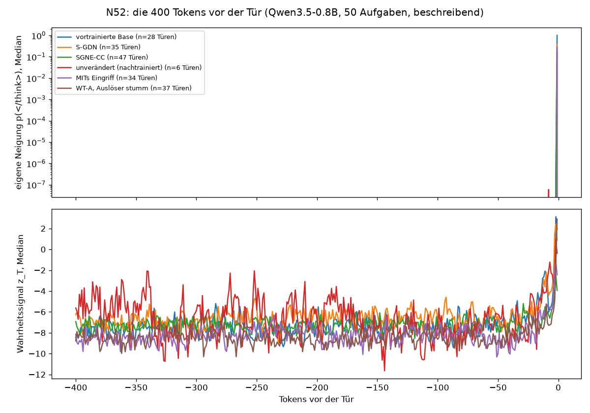

# Wissen ist nicht Festlegen

### MITs Gewichts-Edit nachgebaut und ein wahrheitsgesteuerter Reflex in ein 0,8B-Denkmodell programmiert · Bericht

**Dave Uhlemann (NeoCortex)** · unabhängiger Forscher

Code, Daten und Vorab-Protokoll: [github.com/NeoCortex0815/knowing-is-not-committing](https://github.com/NeoCortex0815/knowing-is-not-committing) · Fragen und Korrekturen gern als GitHub-Issue.

> *„Schauen, ob das Modell die Lösung hat, wann – und den inneren Schubs zulassen, trotz Druck.“*
> — Dave Uhlemann, 6. Nov. 2026

*Fassung 0.6 · 27.11.2026 · Arbeitszeitraum 4.–9. November 2026, Berichtigung vom 12. November 2026, Ergänzungen vom 17.–21. und 22.–27. November 2026 · nicht begutachtet · mit KI-Unterstützung erstellt (siehe Abschnitt 8); alle Messungen liefen lokal auf den Rechnern des Autors. Deutsche Fassung; maßgeblich ist die englische Fassung. Fassung 0.4 berichtigt einen Bewertungsfehler (siehe Erratum) und bringt keine neuen Tests. Fassung 0.5 ergänzte einen fremden Vergleich und seine Kopplung mit unserer Beratung (Abschnitte 3.13 und 3.14). Fassung 0.6 ergänzt die Abschnitte 3.15–3.21 und einen Abschnitt zu verwandten Arbeiten (Abschnitt 9).*

> **Stand der Belege.** Jede Aussage gehört zu einer von drei Arten:
> - **[vorab festgelegt]**: geprüft mit einer Lesart, die vor dem Lauf in einem datierten Protokoll stand;
> - **[beschreibend]**: gemessen, aber nicht vorab festgelegt;
> - **[Deutung]**: unsere Lesart der Daten.
>
> Alle Ergebnisse stammen von einem 0,8B-Modell.
> - Die meisten Ergebnisse beruhen auf einem einzigen Seed; zweite Seeds gibt es für Teile der Daten.
> - Ein Teil der Daten stammt aus einer Entwicklungsmenge, die wir mehrfach benutzt haben.
> - Die MATH-500-Aufgaben 161–300 dienten als Bestätigungsmenge (Abschnitt 3.9).
> - Die Aufgaben 301–370 wurden einmal, spät am 8. November, für eine zweite Bestätigung der Antwortmodus-Ergebnisse genutzt, mit
>   vorab festgelegten Lesarten (Abschnitt 3.10). Die Aufgaben 371–500 sind unberührt.
> - 150 nie benutzte MATH-Trainingsaufgaben dienten dem öffentlich vorab festgelegten Test N30 (Abschnitt 3.11); Fassung 0.5 nutzt
>   sie erneut für N44 (Abschnitt 3.14), wo nur der SGNE-CC-Arm neu ist.
> - Die Abschnitte 3.13 und 3.14 (neu in v0.5) nutzen 50 weitere frische MATH-Trainingsaufgaben für alle ihre Arme und N45 noch
>   einmal 100 frische (Abschnitt 3.14).
> - Die Abschnitte 3.15–3.18 (neu in v0.6) nutzen die 50 Aufgaben aus Abschnitt 3.13 erneut für neue Arme, und Set B (60
>   MATH-Trainingsaufgaben, früher zur Entwicklung unserer eigenen Eingriffe genutzt) für die vortrainierte Base und R-MLP.
> - Die Abschnitte 3.19–3.21 (neu in v0.6) nutzen die 150 Aufgaben aus N30 und die 100 aus N45 erneut (nur die R-MLP-Läufe sind
>   neu) und drei weitere Sätze mit je 100 frischen MATH-Trainingsaufgaben (Sätze F2, F3, F4), gezogen, bevor ein Modell sie sah.
>   Abschnitt 3.21 rechnet neue Arme auf den vorhandenen Läufen von F2 und F3; F4 blieb bis N66 unberührt.
> - Abschnitt 3.12 wertet vorhandene Transkripte der Aufgaben 161–300 mit vorab festgelegter Lesart neu aus; er nutzt keine neuen
>   Aufgaben.
>
> **Was wir mit „Wissen“ meinen.** Eine eingefrorene lineare Sonde auf den inneren Zuständen des Modells stuft den richtigen Wert als
> wahr ein, solange er im Kontext steht. Das ist eine Messung, keine Aussage über Gewissheit.

> **Neu in Fassung 0.6** (alles Übrige wie in v0.5):
> - **Die vortrainierte Base schließt dort, wo sie ihr Schild aufgehängt hat** (Abschnitt 3.15): Sie verlässt ihr Denken direkt nach
>   ihrem eigenen „the answer is …“, und an einem richtigen Wert weit öfter als an einem falschen; das unveränderte Modell erkennt
>   seine Schilder, handelt aber nicht danach (Abschnitt 3.16).
> - **Rückkreuzung bringt die Tür zurück** (Abschnitt 3.17): Das unveränderte Modell mit allen MLP-Blöcken der vortrainierten Base
>   (R-MLP, ohne Training) schließt wieder an seinem richtigen Schild, auch auf neuen Aufgaben, verliert aber die Anweisungstreue aus
>   dem Nachtraining.
> - **R-MLP als Hinterzimmer unserer Beratung übertrifft MITs Edit** auf beiden Sätzen (Abschnitt 3.19). Es schließt schnell oder gar
>   nicht; fast alle seine Kosten liegen in Läufen, die nie schließen.
> - **Eine Klingel für das Hinterzimmer** (Abschnitt 3.20): Eine feste Frist nimmt dem Hinterzimmer zwei Drittel seiner Tokens ohne
>   Nettoverlust an Antworten. Darf das Hinterzimmer „weiß ich nicht“ sagen, gibt die Beratung deutlich weniger falsche Antworten und
>   behält ihre richtigen: 79 → 48 falsche auf 200 frischen Aufgaben (keine richtige verloren), 76 → 42 mit einem zweiten Seed für das
>   Hinterzimmer (1 verloren, 3 gewonnen).
> - **Von innen** (Abschnitt 3.21): Die eigene Abschluss-Neigung des Modells führt die Enthaltung so gut wie unsere Sonde, auch
>   auf 100 unberührten Aufgaben (41 → 24 falsche, 59 → 59 richtige). An der Frist angehalten und nach seiner Antwort gefragt, gewinnt
>   R-MLP Antworten, die es sonst nie gibt, und verliert keine (17 : 0 über 300 Aufgaben; signifikant auf den ersten 200, nicht auf
>   den letzten 100 allein). Gebeten, „weiß ich nicht“ zu sagen, tut es das fast nie.
> - Die Tür selbst zu bauen, gelang noch nicht (Abschnitt 3.18). Ein neuer Abschnitt ordnet die Ergebnisse in veröffentlichte Arbeiten
>   ein (Abschnitt 9).

> **Neu in Fassung 0.5** (alles Übrige wie in v0.4): Abschnitt 3.13 prüft einen fremden Gewichts-Eingriff, SGNE-CC von
> Igor M. Zhuk, mit unserem Protokoll und zerlegt ihn (N40, N41). Die Methode ist seine; Messungen und Zerlegung sind unsere.
> - Eine unabhängige Auswertung auf 500 Aufgaben mit unserem Kandidaten-Zähler bestätigt die Lücke zwischen Wissen und Festlegen.
> - SGNE-CC legt sich fast so fest wie das vortrainierte Modell (Qwen3.5-0.8B-Base); sein rekurrenter Teil (GatedDeltaNet) trägt allein den größten
>   Teil der Wirkung.
> - Unser eigener Reflex (WT-A) ist in den Treffern gleichauf, legt sich aber seltener fest und braucht mehr Tokens. Die Messung der
>   Lücke trägt; der bessere Eingriff in dieser Größe ist nicht unserer.
> - Abschnitt 3.14 koppelt unsere Beratungsregel (B+H) mit SGNE-CC als Hinterzimmer mit Denken, auf denselben 50 Aufgaben und auf 250
>   weiteren (N42–N45). Auf 100 frischen Aufgaben übertrifft die sparsame Beratung (zwei Läufe im Antwortmodus vorn)
>   mit SGNE-CC als Hinterzimmer MITs Edit (59 gegen 49) bei etwa 70 % seiner Tokens je richtige Antwort; auf den 150 Aufgaben aus N30
>   ist sie gleichauf (70 gegen 67), dort liegt die volle Beratung mit drei Läufen vorn (78 gegen 67, beschreibend).

> **Berichtigung in Fassung 0.4 (Erratum).** Diese Fassung berichtigt einen Bewertungsfehler der Fassungen 0.2 und 0.3. Auf dem
> zweiten Rechner hat das Bewertungsprogramm unbemerkt nur Text verglichen. Dadurch wurden 65 richtige Antworten in 23 der
> veröffentlichten Lauf-Tabellen als falsch gezählt, nie umgekehrt. Alle betroffenen Zahlen sind mit den unveränderten,
> eingefrorenen Skripten neu gerechnet. Fünf vorab festgelegte Urteile ändern sich, alle zugunsten unserer Methode, keines
> dagegen; das spiegelt, welche Läufe auf dem zweiten Rechner liefen, nicht eine Eigenschaft der Methoden. Eine Aussage zur
> Signifikanz wird schwächer. Einzelheiten im Abschnitt „Erratum“ nach der Kurzfassung.

> **Neu in Fassung 0.3** (alles Übrige wie in v0.2 vom 8. 11. 2026; Zahlen in der berichtigten Fassung 0.4):
> - Abschnitt 3.11: das Ergebnis von N30, dem in v0.2 öffentlich vorab festgelegten Test, mit einer beschreibenden Aufschlüsselung
>   nach der Stärke der Einigkeit.
> - Abschnitt 3.12: N31, eine Prüfung der Titelfrage an inneren Signalen, mit vorab im datierten Protokoll festgelegter Lesart.
> - Außerdem: eine korrigierte Deutung in Abschnitt 3.9, aktualisierte Einigkeits-Zahlen in den Abschnitten 3.10 und 5, der Absatz
>   „Kurz gesagt“, die Punkte 10, 12 und 13 der Kurzfassung, die nächsten Schritte und zwei neue Literaturangaben (Li et al.,
>   2026; Farquhar et al., 2024).

**Kurz gesagt.** MITs Gewichts-Edit verringert die Denkschleifen von Qwen3.5-0.8B. Wir haben diesen Edit unabhängig nachgebaut,
einen wahrheitsgesteuerten Reflex in 16 MLP-Neuronen geschrieben und eine Reihe vorab festgelegter Tests auf frischen
MATH-500-Aufgaben durchgeführt.
- Drei Befunde tragen den Bericht:
  - (1) Das Modell *weiß* eine richtige Antwort oft lange, bevor es sich auf sie *festlegt*. Eine lineare Sonde liest die Wahrheit
    im Denktext. Unser Reflex schließt das Denken im richtigen Moment, aber ein von außen gesetzter Abschluss ist keine
    Festlegung: Auf frischen Aufgaben denkt das Modell nach 77 % seiner Abschlüsse weiter.
  - (2) Ohne Denkblock (im Antwortmodus) kommt unser editiertes Modell nahe an MITs Edit mit Denken heran: 76 gegen 82 von 140,
    bei weniger als der Hälfte der Tokens je richtige Antwort.
  - (3) Geben zwei unabhängige Läufe im Antwortmodus dieselbe Antwort, sind 93 % davon richtig (zusammengefasst über drei Mengen).
    Ein vierter, öffentlich vorab festgelegter Test ergab auf 150 frischen Aufgaben 79 % (Abschnitt 3.11).
- Allein die Sampling-Einstellungen verschieben MITs eigenen Edit von 25 % auf 55 %.
- Neu in Fassung 0.3:
  - **N30** (in v0.2 öffentlich vorab festgelegt, 150 frische Aufgaben): Eine Beratung aus drei Läufen im Antwortmodus, mit
    unserem eigenen Denk-Lauf als Rückfall, löst 77 Aufgaben, gegen 69 für den Antwortmodus allein („hält“) und 67 für MITs Edit
    mit Denken („schlägt MIT“; +10, McNemar einseitig p = 0,026, nicht korrigiert). Als Abgabe-Tor war die Einigkeit weniger präzise als
    in früheren Mengen: 79 % für zwei Läufe („offen“), 69 % für eine Mehrheit aus drei („trägt nicht“).
  - **N31** (Lesart vorab festgelegt): An den Werten, die das Modell beim Denken schreibt, folgt seine eigene Neigung, das Denken
    zu beenden, nicht der Richtigkeit des Werts (AUC 0,51), die Sonde aber schon (0,68). MITs Edit ist keine Ausnahme (0,43).
    Das stützt Befund (1) auf der Ebene innerer Signale.
- Neu in Fassung 0.5 (Abschnitt 3.13): ein fremder Eingriff, SGNE-CC (Igor M. Zhuk), mit unserem Protokoll auf 50 frischen
  MATH-Trainingsaufgaben. Er löst 22 gegen 5 beim unveränderten Modell und legt sich bei 80 % der gefundenen richtigen Werte fest,
  nah am vortrainierten Qwen3.5-0.8B-Base (82 %). Nur aus seinen veröffentlichten Tensoren gebaut, löst sein GatedDeltaNet-Teil allein
  26 von 50 (Seed 1: 29); MITs Richtung an MITs Ort nur gedreht ist dagegen schwächer als MITs Addition (15 gegen 20).
- Neu in Fassung 0.5 (Abschnitt 3.14): unsere Beratungsregel B+H mit SGNE-CC als Hinterzimmer mit Denken. In ihrer sparsamen Form (zwei Läufe im Antwortmodus vorn) löst sie auf
  100 frischen Aufgaben 59 gegen 49 bei MITs Edit (vorab festgelegt: „übertrifft MIT“) bei etwa 70 % von MITs Tokens je richtige
  Antwort; auf den 150 Aufgaben aus N30 ist sie gleichauf (70 gegen 67), dort löst die volle Beratung mit drei Läufen 78 (beschreibend).
  Gegenüber SGNE-CC allein legt die Beratung Aufgaben zu, kostet aber etwa dreimal so viele Tokens. Vorn: der Antwortmodus unseres
  Edits in N44, der des unveränderten Modells in N45.
- Neu in Fassung 0.6 (Abschnitte 3.15–3.21):
  - Die vortrainierte Qwen3.5-0.8B-Base schließt ihr Denken direkt nach ihrem eigenen „the answer is …“, meist an einem richtigen
    Wert; das unveränderte Modell erkennt solche Schilder innen, handelt aber nicht danach. Mit allen MLP-Blöcken der Base, ohne jedes
    Training (R-MLP), schließt das unveränderte Modell wieder an seinem richtigen Schild, auch auf neuen Aufgaben, verliert aber die
    Anweisungstreue.
  - Mit R-MLP als Hinterzimmer mit Denken übertrifft unsere Beratung MITs Edit auf beiden Sätzen (83 gegen 67 von 150, 59 gegen 49 von
    100).
  - Eine feste Frist hält die Antworten des Hinterzimmers bei einem Drittel seiner Tokens. Darf das Hinterzimmer dann „weiß ich
    nicht“ sagen, gibt die Beratung auf frischen Aufgaben deutlich weniger falsche Antworten, ohne Nettoverlust an richtigen (46 → 32
    falsche; mit einem zweiten Seed 76 → 42 auf 200 Aufgaben).
  - Von innen: Die eigene Abschluss-Neigung des Modells führt diese Enthaltung so gut wie unsere Sonde, auch auf 100 unberührten
    Aufgaben (falsch 41 → 24, richtig 59 → 59). An der Frist angehalten und nach seiner Antwort gefragt, gewinnt R-MLP Antworten und
    verliert keine (17 : 0 über 300 Aufgaben). Gebeten, „weiß ich nicht“ zu sagen, tut es das fast nie.
- Wir berichten jede widerlegte Lesart neben den bestätigten.

---

## Kurzfassung

1. **Das Sampling-Protokoll entscheidet die Hälfte des Effekts.** Auf denselben 40 MATH-500-Aufgaben erreicht MITs
   veröffentlichter Edit **55 %** mit Sampling im vLLM-Stil und **25 %** mit dem Standard-Sampling von llama.cpp. [beschreibend]
   - Der llama.cpp-Standard weicht in zwei Punkten ab: Die Wiederholungsstrafe schaut nur 64 Tokens zurück, und die Temperatur
     wird zuletzt angewandt.
2. **Die Schleifen-Richtung lässt sich ohne Such-Agenten finden.** Unsere eigene Richtung (Kosinus 0,76/0,77 zu MITs) hebt das
   Basismodell auf diesen 40 Aufgaben von **10 % auf 37,5 %** [beschreibend]. MITs Edit erreicht dort 55 %.
   - Wir haben dasselbe Edit-Rezept benutzt und die Richtung aus Transkripten des Basismodells gewonnen.
3. **ERGORE zieht auf den Aufgaben 1–160 mit MIT gleich, auf frischen Aufgaben nicht.** ERGORE ist unsere eigene
   Schleifen-Richtung plus ein ausdrücklicher, bedingter *Abschluss*-Schub. [vorab festgelegt]
   - 1–160: **79 gegen 77** (p = 0,85). ERGORE braucht 13 % weniger Tokens.
   - **Frische Aufgaben 161–300: 66 gegen 82 von 140** (7 : 23, p = 0,005; −11,4 Punkte, 95-%-KI −18,9 bis −4,0). Die vorab
     festgelegte Lesart lautet „MIT-Niveau nicht erreicht“.
   - Ein zweiter Seed auf einem Block (261–300) verkleinert den Abstand dieses Blocks von 15 : 24 auf 18 : 18. [beschreibend] Der
     Abstand ist echt, aber vermutlich kleiner, als Seed 0 nahelegt.
4. **Modelle wissen mehr, als sie umsetzen.** [vorab festgelegt / beschreibend]
   - Eine lineare Wahrheitssonde in Schicht 13, vor jedem Edit, trennt im Denktext richtige von falschen Kandidaten-Antworten
     (AUC 0,96 auf Übungsdaten). Im Einsatz ist sie vorsichtig: Bei den Endantworten des Tests stuft sie 1 von 86 richtigen als
     unsicher ein und erkennt 8 von 16 falschen.
   - Das Modell denkt im Median **~2.000 Tokens (T = 0,6) bis ~6.000 Tokens (T = 1,0) weiter, nachdem es die richtige Antwort zum
     ersten Mal geschrieben hat**.
   - Eine erzwungene Endantwort am Ende des Budgets hebt jedes Modell: Eine basisnahe Variante steigt von 11 auf 28 von 60. Zugleich
     schrumpfen die Unterschiede zwischen den Edits auf nicht signifikant.
5. **Plumper Druck hat seinen Preis.** [vorab festgelegt als Schadens-Prüfung / beschreibend]
   - Unser unbedingter Abschluss-Schub kostet Anweisungstreue: **IFEval 61/120**, gegen 74 ohne den Schub (p = 0,041) und 87 bei
     MIT.
   - Er erzeugt außerdem „leere Abschlüsse“, bei denen das Modell ohne Lösung aufhört zu denken. Das sind 22 von 26 Fehlern auf einer
     Entwicklungsmenge.
6. **Ein wahrheitsgesteuerter Auslöser in den Gewichten (WT-A).** Sein Mechanismus funktioniert auf frischen Aufgaben; seine
   Trefferquote erreicht MITs nicht.
   - WT besteht aus 16 Neuronen in Schicht 15. Sie feuern nur, wenn gerade eine Kandidaten-Antwort geschrieben wurde *und* das innere
     Wahrheitssignal hoch ist. Dann schieben sie entlang des gemessenen Abschluss-Gradienten.
   - **Entwicklungsmenge** (n = 60): 33 gegen 26 richtig gegenüber demselben Modell ohne Auslöser, und mit einem zweiten Seed
     wieder +7 [beschreibend]. 64 % weniger Tokens auf Aufgaben, die beide lösen. Das vorab festgelegte Tor blieb geschlossen, weil
     eine Sonden-Prüfung scheiterte.
   - **Frische Aufgaben 161–300**, Test festgelegt, bevor einer dieser Läufe existierte (H-WT2): WT-A schließt in **65 %** der
     Gelegenheiten direkt nach dem richtigen Wert, MIT in **36 %** (p = 0,0001). Seine schnellen Abschlüsse sind zu 61 % richtig,
     gegen 44 %. [vorab festgelegt]
   - **Trefferquote dort: 63 gegen 82 von 140** (−13,6 Punkte, gepaarter Bootstrap, 95-%-KI −21,4 bis −6,4). [beschreibend] Mit
     einem zweiten Seed auf 161–260: 47 gegen 58 von 100.
7. **Warum der Auslöser nicht reicht** [beschreibend, nachträglich]:
   - **Ein einziger Erfolgsweg:** 53 der 63 richtigen Antworten von WT-A folgen auf Abschlüsse, die der Auslöser bewirkt hat
     (Abschnitt 3.9). MIT prüft zusätzlich ~12.000 Tokens länger und legt sich dann selbst fest (45 von 82).
   - **Ein erzwungener Abschluss ist kein innerer Abschluss:** Nach einem Auslöser-Abschluss öffnet WT-A sein Denken im Antwortteil
     wieder (ein zweites `</think>`), in 83–100 % der Entwicklungsläufe. Auf frischen Aufgaben sind es 77 % aller Abschlüsse und 60
     von 63 richtigen Läufen, gegen 16 % bei MIT.
     - Bei den 32 stummen frischen Läufen, die nie abgeben, sind es 12 von 32. Die drei Zahlen beschreiben verschiedene Gruppen von
       Läufen.
     - WT-As Erfolgsweg ist fast immer: Auslöser-Abschluss, erneutes Denken, dann sein *eigener* zweiter Abschluss, dann die Abgabe.
   - **Tiefe:** Das Wahrheitssignal schwindet mit *Schleifen und Schwierigkeit*, nicht mit der Tiefe im Denktext.
8. **Ein ehrliches „weiß ich nicht“ aus dem inneren Signal.** [vorab festgelegt] Die eingefrorene Wahrheitssonde, gelesen an der
   abgegebenen Antwort, trennt erzwungene Antworten mit AUC 0,83.
   - Sich zu enthalten, wenn sie niedrig bleibt, macht das erzwungene Antworten von schädlich zu nützlich: Das Maß
     (richtig − 2·falsch)/N steigt von −0,27 auf +0,20.
   - 327 der 380 Enthaltungen wären falsch gewesen.
9. **Der Antwortmodus („Vorderzimmer“) ist unser stärkster eigener Weg.** Ohne Denkblock denkt das Modell sichtbar in seiner
   Antwort.
   - Entwicklungsbereich [beschreibend]: Unser Modell mit eigener Richtung löst 77 von 160, genauso viele wie MIT mit Denken
     (22 : 22), mit ~40 % der Tokens.
   - Frische Aufgaben 161–300 [vorab festgelegt]: **76 gegen 82 von 140** für MIT mit Denken (−4,3 Punkte, 95-%-KI −13,6 bis +4,3).
     Nach der vorab festgelegten Lesart „hält“ das: hält bei ≥ MIT − 7 (75), widerlegt bei ≤ MIT − 14 (68). Es braucht 15.500 statt 36.800
     Tokens je richtige Antwort.
   - MIT selbst erreicht im Antwortmodus nur **63 von 140** (26 : 7 gegen MIT mit Denken, p = 0,0013) [vorab festgelegt]. Ein
     Hinterzimmer lohnt sich, wenn es einen funktionierenden Ausgang hat; unseres hat noch keinen.
   - Der Vorsprung ist kein Artefakt der presence penalty: dieselben +2 mit Strafe 0 und 1,5 (n = 20) [vorab festgelegt]. Das
     Vorderzimmer ist über Seeds nicht stabiler als das Hinterzimmer: 62,5 % der Aufgaben werden in beiden Seeds gleich gelöst,
     gegen 75 % bei MIT mit Denken
     [vorab festgelegt, widerlegt].
10. **Das Vorderzimmer weiß, wann es sicher ist: eine Beratung der Intuitionen.** Mehrere Läufe im Antwortmodus antworten
    unabhängig. Sind sie sich einig, gibt das Modell ab; nur strittige Fälle gehen ins Hinterzimmer.
    - **Zwei Intuitionen** [vorab festgelegt, drei Bestätigungen]. Geben zwei Läufe mit verschiedenen Seeds dieselbe Antwort, ist
      sie richtig in **37 von 38** Fällen auf 161–260, in 15 von 17 auf 40 neuen Trainingsaufgaben und in **28 von 31 auf den
      unberührten Aufgaben 301–370**. Zusammengefasst über die drei Mengen sind 80 von 86 richtig (93 %); die zusammengefasste
      Zahl ist beschreibend, weil jede Menge einzeln vorab festgelegt war. Sind die Läufe uneinig, hat der erste Lauf nur in 21–32 %
      recht. Ein vierter, in v0.2 öffentlich vorab festgelegter Test ergab auf 150 frischen Aufgaben 79 % (Punkt 12).
    - **Drei Intuitionen** [vorab festgelegt, „hält“]. Eine Mehrheit aus drei gibt auf 62 von 100 Aufgaben ab statt
      auf 38, und 90 % davon sind richtig (Ziel: 90 %). Das Maß (richtig − 2·falsch)/N steigt von +0,35 auf +0,44. Sind sich alle
      drei einig, sind 29 von 29 richtig.
    - **Eine auf Antworttexten trainierte Sonde** [vorab festgelegt; auf 40 neuen Aufgaben (N24) „bestätigt“, in den beiden anderen Tests „offen“]. Sie liest die Richtigkeit an der
      abgegebenen Antwort mit AUC 0,75–0,86 auf neuen Daten; die auf Denktexten trainierte Sonde erreicht 0,69.
      - Sie bringt nur +0,03 bis +0,05 über Antwortlänge und Schwierigkeit hinaus.
      - Ihr Vorsprung bei schnellen Antworten hielt in einer von zwei vorab festgelegten Wiederholungen: auf den 40 neuen
        Trainingsaufgaben (0,83 gegen 0,67), nicht auf den unberührten Aufgaben 301–370 (0,59 gegen 0,64).
      - Als zusätzliches Abgabe-Tor schadet sie: Maß +0,17 statt +0,31 mit Einigkeit allein.
      - Als **Schiedsrichterin** zwischen zwei uneinigen Intuitionen hilft sie [vorab festgelegt]: 12 statt 8 richtige Antworten.
        Die einigen Fälle berührt sie nicht. Mit nur 19 entscheidenden Aufgaben ist das zerbrechlich: Das Bootstrap-95-%-Intervall
        für den Gewinn reicht von −1 bis +10.
    - **Zimmerwechsel** [vorab festgelegt / beschreibend].
      - Mit zwei Intuitionen verliert der Rückgriff auf WT-As Hinterzimmer: 54 gegen 57 von 100 für den Antwortmodus allein
        [vorab festgelegt].
      - Mit drei Intuitionen gewinnt er: 63 gegen 57 [beschreibend].
      - Mit MITs Hinterzimmer als Rückfall: 63 (zwei Intuitionen) und 67 (drei), gegen 58 für MIT allein [beschreibend].
      - Auf den unberührten Aufgaben 301–370 [vorab festgelegt]: „zwei einig → Antwortmodus, sonst MITs Hinterzimmer“ löst **41
        von 70**. MIT allein löst 39, der Antwortmodus allein 36. Die Präzision der Einigkeit liegt bei 90 %, aber die Regel kostet
        mehr Tokens je richtige Antwort als MIT (55.400 gegen 40.000). Die Lesart ist deshalb **offen**. Der Gewinn kommt aus
        beiden Zimmern: vorne die Präzision (28 gegen 26 auf den einigen Aufgaben), hinten MITs Ausgang (13 gegen 8 auf dem Rest).
    - **Zwei Betriebsarten, zwei Kosten.**
      - Ein *einzelner* Lauf im Antwortmodus ist der effiziente Weg: 15.500 statt 36.800 Tokens je richtige Antwort (Punkt 9).
      - *Mehrere* Intuitionen zu fragen, kauft Präzision mit Tokens. Zusammen mit einem Hinterzimmer kann das je richtige Antwort
        teurer werden als MIT allein.
11. **Negative Ergebnisse.** [vorab festgelegt]
    - Ein erstes Tor entlang einer Zustandsdifferenz-Richtung verfehlte alle Kriterien.
    - Eine „Denk-Weiche“ auf Basis des inneren Signals am Ende des Prompts wurde widerlegt (p = 0,13).
    - Sonden-Kaskade, Notizen für eine zweite Chance und schleifenbasierte „Zustandstüren“ wurden widerlegt (Abschnitt 3.10).
    - Ein von außen eingesetztes `</think>` erzeugt kein inneres „fertig“, auch nicht am eigenen Schluss-Satz des Modells. MIT
      gibt dann in 36 % der Fälle ab, gegen 18 % ohne Schluss-Satz [beschreibend].
    - Das Nachspielen der 32 stummen Antwortteile von WT-A rettet fast nichts.
      - Wir haben es mit einem fairen Deckel wiederholt: Unser erster Deckel von 1.024 Tokens war zu kurz, weil schon WT-As eigene
        richtige Antwortteile im Median ~2.000 Tokens lang sind.
      - Mit 4.096 Tokens werden 0 von 14 Läufen gerettet, wenn ein zweites `</think>` gesperrt ist, und 2 ohne Sperre.
      - Die beiden Rettungen kamen, nachdem das Modell sein erneutes Denken selbst abgeschlossen hatte.
12. **N30: die Beratung mit eigenem Hinterzimmer auf 150 frischen Aufgaben** [in v0.2 öffentlich vorab festgelegt; Abschnitt 3.11].
    - Regel: Mehrheit aus drei Läufen im Antwortmodus, sonst WT-A mit Denken. Sie löst **77 von 150**, gegen **69** für den
      Antwortmodus allein (H1 „hält“) und **67** für MIT mit Denken (H2 „schlägt MIT“: +10, McNemar einseitig
      p = 0,026, nicht korrigiert).
    - Als Abgabe-Tor liegt die Einigkeit zweier Läufe bei **79 %** (H3 „offen“), eine Mehrheit aus drei bei **69 %** (H4 „trägt
      nicht“).
    - [beschreibend, nachträglich] Die Präzision folgt der Stärke der Einigkeit: 87 %, wenn alle drei Läufe einig sind, 54 %, wenn
      zwei gegen einen stehen. Den Gewinn bezahlt die Regel mit Tokens: 69.200 je richtige Antwort, gegen 49.100 bei MIT.
13. **Die eigene Bereitschaft festzulegen folgt nicht dem Wissen, weder bei unserem Modell noch bei MITs** [Lesart vorab im
    datierten Protokoll festgelegt; Abschnitt 3.12].
    - An Wert-Aussagen im Denken bevorzugt die eigene Wahrscheinlichkeit des Modells, das Denken zu beenden (ohne den Auslöser),
      richtige Werte nicht: AUC **0,51** für unser Modell, **0,43** für MITs Edit (unter 0,5: etwas eher an falschen Werten). Die
      Sonde trennt sie (0,68 und 0,73).
    - Hinter MITs eigenen Schluss-Sätzen, wo die Sonde am stärksten ist (0,85), bleibt MITs Abschluss-Neigung blind (0,38).
    - [Deutung] MITs Vorsprung kommt nicht daher, dass es am richtigen Wert abschließt.
14. **Neu in v0.5: Ein fremder Eingriff legt sich fest, wo unserer nur schließt; sein rekurrenter Teil trägt die Wirkung**
    [Abschnitt 3.13].
    - Eine unabhängige Auswertung auf allen 500 MATH-500-Aufgaben mit unserem Kandidaten-Zähler findet dieselbe Lücke: Das
      unveränderte Modell hat bei T = 0 in 41 % der Aufgaben einen richtigen Wert im Denken und legt sich auf keinen fest (0 von
      207). [beschreibend, berichtet von Igor M. Zhuk]
    - SGNE-CC (Igor M. Zhuk) mit unserem Protokoll: **22 von 50** gegen 5, festgelegt bei **80 %** der gefundenen richtigen
      Werte (vortrainierte Base 82 %, unser WT-A 65 %), 4 % Schleifen. [vorab festgelegt: „hilft deutlich“, „legt sich fest“,
      „weniger Schleifen“]
    - Zerlegung nur aus seinen veröffentlichten Tensoren: Drehung an MITs Ort allein 15 von 50 (MITs Addition 20); die 15 MLP-Schichten
      allein 13; der GatedDeltaNet-Teil allein **26** (Seed 1: 29). [vorab festgelegt: „die weiteren Orte tragen“, „der
      GatedDeltaNet-Teil wirkt allein“]
15. **Neu in v0.5: die Beratung mit festlegendem Hinterzimmer** [Abschnitt 3.14].
    - Auf den 50 Aufgaben ist B+H mit SGNE-CC als Hinterzimmer gleichauf mit SGNE-CC allein (24 gegen 22) und braucht fast viermal so
      viele Tokens je richtige Antwort; die sparsame Variante mit zwei Intuitionen hält die 24 bei 71 % der Tokens. [vorab festgelegt:
      „gleichauf“, „kostet Tokens“, „sparsam trägt“]
    - Auf 250 weiteren Aufgaben (N44 mit dem Antwortmodus unseres Edits vorn, N45 mit dem des unveränderten Modells): Sparsames B+H mit SGNE-CC ist auf den 150 Aufgaben aus N30
      „gleichauf“ mit MITs Edit (70 gegen 67) und „übertrifft MIT“ auf 100 frischen Aufgaben (59 gegen 49, p = 0,038), bei 97 % und
      70,1 % von MITs Tokens je richtige Antwort; gegenüber SGNE-CC allein „B+H legt zu“ in beiden Sätzen (70 gegen 62, 59 gegen 52) und
      „kostet Tokens“ (3,2- und 2,7-fach). [vorab festgelegt]

16. **Neu in v0.6: Schilder, Türen und die MLP-Blöcke** [Abschnitte 3.15–3.18].
    - Die vortrainierte Base verlässt ihr Denken an ihrem eigenen Schild und meist an einem richtigen; auf Set B schließt sie in 21
      von 27 Läufen an einem richtigen Schild, das unveränderte Modell in 2 von 15 [vorab festgelegt].
    - Das unveränderte Modell erkennt seine Schilder innen noch, aber seine Abschluss-Neigung folgt ihnen nicht [vorab
      festgelegt].
    - Mit allen 72 MLP-Tensoren der Base (R-MLP) schließt das unveränderte Modell wieder an seinem richtigen Schild (21 von 24; auf
      neuen Aufgaben 26 von 36) und löst fast so viele Aufgaben wie die Base, mit einem Bruchteil seiner eigenen Tokens; die
      Anweisungstreue fällt auf das Niveau der Base (IFEval 44 von 120) [vorab festgelegt].
    - Unsere selbst gebaute Tür (WTS-A) bestand ihre Entwicklungs-Tore nicht [Entwicklung, negativ].
17. **Neu in v0.6: R-MLP als Hinterzimmer der Beratung** [Abschnitt 3.19]. Die gestufte Beratung mit R-MLP übertrifft MITs Edit auf
    beiden Sätzen (83 gegen 67 von 150, 59 gegen 49 von 100), bei ähnlichen Tokens [vorab festgelegt]. R-MLP schließt schnell (Median
    etwa 1.200 Tokens insgesamt bei Läufen mit Tür) oder nie [beschreibend].
18. **Neu in v0.6: eine Klingel und ein ehrliches „weiß ich nicht“** [Abschnitt 3.20].
    - Eine feste Frist von 8.192 Denk-Tokens hält die Antworten des Hinterzimmers (58–59 gegen 56) bei 33 % seiner Tokens je richtige
      Antwort [vorab festgelegt].
    - Mit Enthaltung fallen die falschen Antworten der Beratung auf frischen Aufgaben von 46 auf 32, ohne dass eine richtige verloren
      geht [vorab festgelegt]; über zwei frische Sätze 79 → 48, richtig 121 → 125 [beschreibend]; mit einem zweiten Seed für das
      Hinterzimmer 76 → 42, richtig 124 → 126 [vorab festgelegt].
19. **Neu in v0.6: Antworten und Enthaltung von innen** [Abschnitt 3.21].
    - An der Frist nach seiner Antwort gefragt, löst R-MLP 115 statt 101 von 200 Aufgaben (14 : 0) bei 29 % der Tokens [vorab
      festgelegt]; auf 100 unberührten Aufgaben 58 gegen 55 (3 : 0) → „gleichauf“ [vorab festgelegt].
    - Seine eigene Abschluss-Wahrscheinlichkeit führt die Enthaltung so gut wie unsere Sonde (falsch 79 → 51, gleichwertig) [vorab
      festgelegt]; zusammen mit der Selbst-Antwort auf 100 unberührten Aufgaben: falsch 41 → 24, richtig 59 → 59, gleichwertig mit der
      Sonde [vorab festgelegt].
    - Gebeten, „weiß ich nicht“ zu sagen, tut es das fast nie (von den 85 an der Frist angehaltenen Läufen: 1 in der freien Antwort,
      0 in der Box) [beschreibend].

---

## Erratum (Fassung 0.4)

**Was schiefging.**
- Ein Teil der Auswertungsblöcke lief auf einem zweiten Rechner (Linux; Abschnitt 2).
- Unser Auswertungsprogramm bewertet Antworten in Arbeits-Threads. Unter Linux setzt math-verify seine Zeitgrenze mit einem
  Signal, das nur im Haupt-Thread funktioniert. Im Arbeits-Thread gab es einen Fehler. Das Programm fing ihn still ab und verglich
  nur noch normalisierten Text.
- Gleichwertige Antworten in anderer Schreibweise (etwa `0.5` und `\frac12`, umgestellte Mengen, Einheiten) zählten dann als
  falsch.
- Auf dem Laptop (Windows) ist die Zeitgrenze abgeschaltet; dort war die Bewertung richtig.
- Fassung 0.3 hat schon gesagt, dass der Code nur Text vergleicht, wenn math-verify fehlt (Abschnitt 7). Dass derselbe Rückfall
  auch bei installiertem Paket greift, wussten wir nicht.

**Wie wir es gefunden haben.**
- Am 12. 11. 2026 führte eine Frage des Autors nach einem möglichen Messfehler dazu, dass wir jede gespeicherte Antwort im
  Haupt-Thread neu bewertet haben.
- Antworten vom zweiten Rechner wechselten von falsch auf richtig, keine umgekehrt.
- Das Modell verlor 1 bis 5 Antworten je Lauf. Deshalb wirkten die alten Zahlen plausibel.

**Was wir getan haben.**
- Wir haben eine Kopie des Projekts gebaut, in der nur die gespeicherte Bewertung jeder Antwort durch die richtige ersetzt ist;
  jedes andere Byte bleibt gleich (geprüft).
- Zwischendateien mit der alten Bewertung wurden ebenso nachgezogen, Feld für Feld aus ihren Quell-Läufen.
- Dann liefen die eingefrorenen Urteils-Skripte unverändert auf dieser Kopie. Kein Lauf wurde wiederholt, keine Lesart geändert,
  keine neuen Daten verwendet.
- Die berichtigten Lauf-Tabellen (65 Zellen in 23 Tabellen) und Urteilsdateien (26) ersetzen in diesem Release die alten. Die
  alten bleiben in der Versionsgeschichte des Repositorys.
- [beschreibend] Wo Fassung 0.3 Bootstrap-Intervalle nennt, haben wir sie auf dieselbe Art neu gerechnet; das Verfahren trifft auf
  den alten Bewertungen die alten Intervalle.

**Was sich ändert.** Fünf vorab festgelegte Urteile:

| Test | Fassung 0.3 | Fassung 0.4 |
|---|---|---|
| N30 H2: Beratung B+H gegen MIT, 150 frische Aufgaben | 74 gegen 67, 15 : 8, p = 0,105 → „mindestens gleichauf“ | 77 gegen 67, 16 : 6, p = 0,026 → **„schlägt MIT“** |
| N8: unser Antwortmodus gegen MIT mit Denken, 161–300 | 71 gegen 80 → „offen“ | 76 gegen 82 → **„hält“** |
| N27: Mehrheit aus drei Intuitionen | 55 von 62 richtig (89 %) → „offen um einen Punkt“ | 56 von 62 (90 %) → **„hält“** |
| N24: Vorderzimmer-Sonde auf 40 neuen Aufgaben | Zuwachs über Länge und Schwierigkeit +0,012 → „offen“ | +0,052 → **„bestätigt“** (verlangt +0,05) |
| N24, zweite Lesart: schnelle Antworten (≤ 2.000 Tokens) | 0,823 gegen 0,736 für Länge und Schwierigkeit → „offen“ | 0,827 gegen 0,670 → **„schnell bestätigt“** (verlangt ≥ 0,75 und +0,10) |

- Der p-Wert von N30 H2 ist nicht korrigiert. H2 war nicht als Primär-Endpunkt benannt; eine Holm-Korrektur über alle etwa 40
  Lesarten würde er nicht überstehen. N24 ist knapp bestätigt.
- **Eine Aussage zur Signifikanz wird schwächer.** MITs Hinterzimmer gegen sein Vorderzimmer (N13) hat jetzt p = 0,0013 (Fassung
  0.3: 0,0003), 63 gegen 82 von 140. Das liegt genau an der Holm-Schwelle für 40 Lesarten. Wir zählen ihn nicht mehr zu den
  Effekten, die die Korrektur klar überstehen; der Effekt selbst (−19 Punkte) bleibt.
- Alle anderen Urteile bleiben, mit leicht geänderten Zahlen. Beispiele:
  - ERGORE gegen MIT auf 161–300: 66 gegen 82 (Fassung 0.3: 65 gegen 80), „erreicht MIT nicht“.
  - WT-A auf 161–300: 63 von 140 (Fassung 0.3: 61). Der Mechanismus-Test H-WT2 ist unverändert.
  - Ehrlichkeit Schritt 1 (Abschnitt 3.8) besteht weiter.
- [Deutung] Alle fünf Änderungen gehen zugunsten unserer Methode, weil die meisten Antwortmodus-Läufe unseres Modells und der
  Beratung auf dem zweiten Rechner liefen, MIT mit Denken dort aber nur für die Aufgaben 261–300. Das spiegelt, wo die Läufe liefen,
  nicht eine Eigenschaft der Methoden.

**Was wir daraus mitnehmen.** Eine Messmethode muss nicht nur richtig sein; sie muss auf jedem Rechner gleich messen und laut
scheitern statt leise. Ab Fassung 0.4 des Codes läuft die Bewertung im Haupt-Thread, ohne stillen Rückfall. Bevor ein Rechner für
einen Test misst, bewertet er zuerst dieselben gespeicherten Antworten wie der andere.

## 1. Hintergrund

> *„Ist das Modell per se nicht fähig zu sagen ‚ich weiß es nicht‘?“* — D. U., 7. Nov. 2026
>
> Diese Frage führte zur Antwort-Zwang-Probe (Abschnitt 3.4) und zur Ehrlichkeits-Spur (Abschnitte 3.8 und 6).

Am 02.11.2026 veröffentlichte MIT CSAIL *„Sparks of Weight-Space Programming“* (Takehi, Teoh, Zhang, Khattab).

- **Was der Beitrag zeigt:** In Experiment 8 hat ein allgemeines Sprachmodell Qwen3.5-0.8B direkt in den Gewichten verändert.
- **Der Edit:** eine „Schleifen“-Richtung wird aus 64 Ausgangsspalten von `mlp.down_proj` in den Schichten 15 und 19 abgezogen,
  etwa 0,016 % der Gewichte.
- **Die Wirkung:** MATH-500 stieg von 7,9 % auf 48,1 %. Die Autoren deuten das als *Entfernen eines Hindernisses, das eine
  Fähigkeit verdeckte*, nicht als Hinzufügen einer Fähigkeit.

**Unsere Fragen:**
- Lässt sich der Edit auf Verbraucher-Hardware nachbauen und verstehen?
- Lässt sich das Verhalten „nicht mehr kreisen, sondern antworten“ in messbare Teile zerlegen?
- Lässt es sich genauer steuern, und zu welchem Preis?

**Nächste Vorarbeiten (ausdrücklich eingeordnet):**
- Zhang et al. (2025) zeigen, dass Denkmodelle die Richtigkeit von Zwischenantworten in ihren inneren Zuständen kodieren. Eine
  *äußere* Sonde unterstützt damit einen frühen Abbruch (bis zu 24 % weniger Tokens bei gleicher Genauigkeit).
- Orgad et al. (2025) zeigen dieselbe Lücke „weiß mehr, als es zeigt“ für Halluzinationen.
- Allgemein ist gut belegt, dass sich aus Modellen Signale über die Richtigkeit des Gesagten auslesen lassen (Kadavath et al.,
  2022; Azaria und Mitchell, 2023; Ferrando et al., 2024). Einzelne Richtungen im Aktivierungsraum können ganze Verhaltensweisen
  vermitteln (Arditi et al., 2024); MITs Edit und unserer gehören zu dieser Art.
- Unser Titel klingt an Li et al. (2026) an. Beim Faktenabruf sagen dort Auslesungen vor der Erzeugung voraus, ob unter den
  Stichproben eine richtige Antwort auftaucht, aber kaum, ob eine verfügbare richtige Antwort am Ende gewählt wird; eine
  ausdrückliche Prüfung mit P(True) verbessert die Rangfolge der Kandidaten. Wir untersuchen die verwandte Lücke in Denkmodellen,
  in denen der richtige Wert lange vor dem Festlegen im Denkblock steht.
- Unser Beitrag ist nicht die Lücke selbst:
  - Wir zerlegen einen veröffentlichten Gewichts-Edit auf Verbraucher-Hardware. Das Sampling-Protokoll macht die Hälfte seiner
    Wirkung aus, und die Schleifen-Richtung lässt sich ohne Such-Agenten finden.
  - Wir zeigen, dass der Engpass das Festlegen ist, nicht das Wissen (Wahrheitssonde, Antwort-Zwang und in Fassung 0.3 die
    eigene Abschluss-Neigung des Modells, Abschnitt 3.12).
  - Wir schreiben einen wahrheitsgesteuerten Ausgang *in die Gewichte*, ohne äußere Steuerung. Sein Mechanismus ist auf frischen
    Aufgaben bestätigt; seine Trefferquote erreicht MITs nicht.
  - Wir messen *von innen*, warum: ein Auslöser-Audit mit Teacher-Forcing (Abschnitt 3.9).
  - Wir berichten zwei Fehlerarten handgeschriebener Reflexe: den negativen SiLU-Ast und einen Phasenfehler, bei dem ein
    erzwungener Abschluss kein innerer Abschluss ist.
  - Wir zeigen, dass dieselbe eingefrorene Sonde ein ehrliches „weiß ich nicht“ trägt.
  - Wir berichten, dass unser stärkster Edit nicht verallgemeinert: ERGORE erreichte auf 1–160 MIT-Niveau, auf frischen Aufgaben
    nicht.

## 2. Aufbau

- **Modell:** Qwen3.5-0.8B (hybrid aus GatedDeltaNet und voller Attention, 24 Schichten), Denkmodus.
- **Hardware:** eine Laptop-GPU (8 GB) über llama.cpp (GGUF, q8_0). Ein zweiter Rechner (CPU und iGPU) rechnet weitere
  Auswertungsblöcke mit identischen Modelldateien (per Prüfsumme kontrolliert) und identischen Einstellungen. Seine
  Bewertung war in den Fassungen 0.2 und 0.3 fehlerhaft und ist in dieser Fassung berichtigt (Erratum).
- **Protokoll** (wie in MITs Auswertung):
  - Temperatur 0,6, top-p 0,95, top-k 20, presence penalty 1,5;
  - bis zu 32.768 neue Tokens, Seed 0;
  - Schleifen-Abbruch: Ab 4.096 Tokens endet ein Lauf, wenn der Anteil wiederholter 8-Gramme in seinen letzten 400 Wörtern
    0,9 übersteigt (alle MATH-Läufe dieses Berichts);
  - das letzte `\boxed{}` wird mit math-verify bewertet.
- **Sampling im vLLM-Stil in llama.cpp:** Wiederholungsstrafe über die ganze Antwort; Reihenfolge der Sampler: Strafen →
  Temperatur → top-k → top-p → min-p.
- **Aufgabenmengen:**
  - MATH-500-Aufgaben 1–160 als Testmenge;
  - MATH-500 161–300 als Bestätigungsmenge; 301–370 als zweite, späte Bestätigung; 371–500 unberührt;
  - MATH-Trainingsaufgaben als Übungsmenge;
  - „Set B“: 60 frische MATH-Trainingsaufgaben mit der Stufenmischung von MATH-500, als Entwicklungsmenge;
  - 150 weitere, nie benutzte MATH-Trainingsaufgaben für den öffentlich vorab festgelegten Test N30 (Abschnitt 3.11);
  - 50 frische MATH-Trainingsaufgaben für die Abschnitte 3.13 und 3.14 und 100 weitere für N45 (Abschnitt 3.14; N44 nutzt
    die 150 aus N30 erneut); die Abschnitte 3.15–3.19 nutzen diese Sätze und Set B erneut;
  - drei weitere Sätze mit je 100 frischen MATH-Trainingsaufgaben (F2, F3, F4; Stufenmischung wie N45), ohne Modellkontakt
    gezogen für die Abschnitte 3.20 und 3.21; F4 blieb bis N66 unberührt;
  - IFEval: 120 Prompts, strenge Bewertung auf Prompt-Ebene.
- **Vorab-Festlegung:** Vor jedem entscheidenden Lauf steht die Lesart (Kriterien, Schwellen) in einem datierten Protokoll.
  Spätere Änderungen werden mit Begründung eingetragen, und nur, bevor die zugehörigen Daten existieren.
- **Statistik:**
  - Die meisten vorab festgelegten Lesarten sind Schwellenregeln („hält / offen / widerlegt“). Wo ein Test auch einen p-Wert hat
    (exakter McNemar-Test für gepaarte Trefferquoten, Fisher-Test für Raten), berichten wir ihn unkorrigiert.
  - Zwei der drei Haupteffekte mit p-Wert bleiben nach Holm-Korrektur über alle ~40 vorab festgelegten Lesarten dieses
    Projekts klar signifikant (Fassungen 0.1–0.4, einschließlich der acht von N30 und N31 in Fassung 0.3; die Lesarten der
    Abschnitte 3.13–3.21 berichten wir unkorrigiert):
    - die Abschlüsse des Auslösers nach dem richtigen Wert (H-WT2), p = 0,0001;
    - die Einigkeit zweier Intuitionen, p ≈ 10⁻¹¹.
  - Der dritte, MITs Hinterzimmer gegen sein Vorderzimmer, hatte in Fassung 0.3 p = 0,0003. Mit der berichtigten Bewertung ist
    p = 0,0013, genau an der Holm-Schwelle für 40 Lesarten (Erratum).
  - Der p-Wert von N30 H2 (p = 0,026, Abschnitt 3.11) ist nicht korrigiert; H2 war nicht als Primär-Endpunkt benannt.
  - Beschreibende Ergebnisse tragen keinen p-Wert als Beleg; wir geben Anzahlen und Effektgrößen an.

## 3. Ergebnisse

### 3.1 Das Sampling entscheidet die Hälfte des Effekts [beschreibend]

Dieselben 40 MATH-500-Aufgaben, MITs veröffentlichter Edit:

| Einstellung | richtig | am Token-Limit gestoppt |
|---|---|---|
| MITs berichteter Lauf auf diesen 40 | 47,5 % | ~33 % |
| unser Lauf, Sampling im vLLM-Stil | **55,0 %** | 30 % |
| unser Lauf, Standard-Sampling von llama.cpp | **25,0 %** | 67,5 % |

- **Basismodell, vLLM-Stil:** 10 % richtig, 92,5 % abgeschnitten.
- **Basis → MIT-Edit:** 10 % → 55 %, mit 20 geretteten und 0 verlorenen Aufgaben.

**Praktischer Hinweis:** Wer reparierte Modelle in llama.cpp betreibt, sollte `repeat_last_n` auf die volle Antwortlänge setzen
und die Temperatur vor die Filter stellen.

### 3.2 Unsere eigene Schleifen-Richtung [beschreibend]

- **Bau:** Die Richtung ist der mittlere Unterschied „wiederholend minus produktiv“ über Transkripte des Basismodells zu 48
  Übungsaufgaben. Das Rezept ist ansonsten MITs: Schichten 15 und 19, die 64 stärksten Spalten, α = 6.
- **Überlappung mit MIT:** Kosinus 0,76 und 0,77 zu MITs Richtung.
- **Ergebnis auf den 40 Aufgaben:** 10 % → **37,5 %**, Abschneiden 92,5 % → 60 %. Jede Aufgabe, die unser Edit löst, löst auch
  MITs Edit. [Deutung] Gleicher Mechanismus, schwächere Dosis.
- **Messerschneiden-Finder.** Von Stellen kurz vor dem Beginn einer Schleife lassen wir das Basismodell 6–8-mal verzweigen (je 256
  Tokens) und suchen „Messerschneiden“: Stellen, an denen einige Zweige kreisen und andere produktiv bleiben. Wir fanden 31 solche
  Stellen.
  - Der Anteil kreisender Zweige wächst, je später die Verzweigung liegt (11 → 13 → 28 → 40 Zweige).
  - [Deutung] Im Basismodell bauen sich Schleifen allmählich auf, statt an einem einzigen Punkt zu kippen.
  - Eine allein aus den Messerschneiden gebaute Richtung war verrauscht (Kosinus 0,77 zu MITs, geringe Stabilität). Gemischt mit
    unserer Richtung erreichte sie 0,79–0,80.

### 3.3 ERGORE: eigene Richtung plus ausdrückliche Abschluss-Kopplung [vorab festgelegt]

**Bau.** In Schicht 15 fügen wir der Umkehrung einen zweiten Rang-1-Term hinzu. Wenn die Spalten des „Schleifen-Melders“ feuern,
schiebt er entlang unserer eigenen *Festlegungs-Achse*: „16 Tokens vor `</think>`“ minus „Mitte des Denkens“. Ausgelöst wird er
von einem geweißten („geschärften“) Melder. Schicht 19 behält nur die Umkehrung.

| MATH-500 | ERGORE | MIT | nur ERGORE : nur MIT | McNemar p | mittlere Tokens ERGORE / MIT |
|---|---|---|---|---|---|
| 1–80 | 43/80 | 43/80 | 4 : 4 | 1,0 | 18.557 / 21.501 |
| 81–160 (frisch) | 36/80 | 34/80 | 10 : 8 | 0,81 | 18.489 / 21.248 |
| **1–160** | **79/160 (49,4 %)** | **77/160 (48,1 %)** | 14 : 12 | 0,85 | 18.523 / 21.374 |

- **Vorab festgelegte Lesart:** „MIT-Niveau erreicht“, auf beiden Hälften. Nicht „über MIT“: Das 95-%-KI des Unterschieds reicht
  von −5,0 bis +7,5 Punkten.
- **Tokens:** insgesamt 13,3 % weniger (88 gegen 55 Aufgaben günstiger, p = 0,007). Auf Aufgaben, die beide lösen, gibt es keine
  Ersparnis. Sie entsteht bei Aufgaben, die keiner löst und bei denen ERGORE früher aufhört.

### 3.4 Modelle wissen mehr, als sie umsetzen

**Wahrheitssonde.** [vorab festgelegt auf Test-Antworten]
- **Bau:** logistische Sonde auf den Aktivierungen von Schicht 13 am Ende jeder Kandidaten-Antwort im Denktext. Nur auf Übungsdaten
  trainiert, dann eingefroren.
- **Übungsdaten:** AUC 0,96.
- **Endantworten des Tests, einmal angewandt:** Sie stuft **1 von 86** richtigen Antworten als unsicher ein und erkennt **8 von
  16** falschen.
- **Entwicklungsmenge B:** AUC 0,925 auf ERGORE-Läufen und 0,966 auf MIT-Läufen. [beschreibend]

**Die Klingel hören reicht nicht.** [beschreibend]

- **Aufbau:** 20 leichte Übungsaufgaben, unser Edit mit eigener Richtung. Der Prompt ergänzt „denke höchstens etwa 1.500 Wörter
  lang, dann gib deine Endantwort“. Budget 6.144 Tokens.
- **Ergebnis:** Mit dieser weichen Ankündigung wurden **0 von 20** Läufen im Budget fertig (1 von 20 ohne sie).
- **Was die Texte zeigen:** **10 von 20** Denktexte schreiben die Vorgabe selbst auf („Constraints: … max ~1500 words …“) und denken
  trotzdem weiter.
- [Deutung] Dem Modell fehlt nicht die Information, dass es aufhören soll; ihm fehlt der Antrieb dazu. Eine weiche Anweisung hilft
  nicht. Was hilft, ist ein innerer Schub (ein Gewichts-Edit) oder ein harter äußerer Stopp.

**Das Signal ist ein Blitz.** [beschreibend] Es erreicht seinen Höhepunkt am Ende der Kandidaten-Antwort (AUC 0,96) und fällt
innerhalb weniger Tokens ab (0,67–0,80 bei +8 bis +200 Tokens). Das Modell schließt sein Denken im Mittel ~600 Tokens nach dem
letzten Kandidaten.

**Spätes Abschließen.** [beschreibend, Set B] Tokens zwischen dem *ersten richtigen* Kandidaten und `</think>` bei gelösten Aufgaben
(Median):

| Lauf | Median der Tokens |
|---|---|
| ERGORE, T = 0,6 | 2.024 |
| ERGORE, T = 1,0 | 6.073 |
| MIT, T = 1,0 | 6.886 |

**Antwort-Zwang.** [beschreibend] Wie beim Budget-Forcing in s1 hängen wir an jeden Lauf, der ohne saubere Antwort endete, „The
final answer is \boxed{“ an, für alle Modelle gleich. Set B, 60 Aufgaben:

| | ohne Zwang | mit Zwang |
|---|---|---|
| ERGORE, T = 0,6 | 34 | 38 |
| ERGORE, T = 1,0 | 21 | 29 |
| MIT, T = 1,0 | 24 | 32 |
| basisnahe Variante („Gatter“), T = 0,6 | 27 | 36 |
| basisnahe Variante, T = 1,0 | 11 | 28 |

- Mit Zwang ist kein paarweiser Unterschied zwischen Edits signifikant. ERGORE gegen MIT bei T = 1,0: 29 gegen 32, p = 0,38.
- [Deutung] Ein großer Teil der gemessenen Unterschiede zwischen Edits betrifft das *Herausbringen* der Antwort, nicht das
  *Finden*.

**Zweifel ohne Enthaltung.** [beschreibend]
- Wendungen wie „I'm not sure“ oder „let me guess“ sagen Fehler voraus: Bei ERGORE mit T = 1,0 sind nur 3 der 23 Läufe richtig,
  die sie enthalten.
- Trotzdem enthalten **49–85 % der falschen Läufe gar keine Zweifelswendung.**
- **Kein Lauf endet je mit einer ausdrücklichen Enthaltung.** Die Sonde, die innen liest, stuft 96 % der falschen Kandidaten als
  „nicht wahr“ ein (Schwelle 4 %).

### 3.5 Plumper Druck hat seinen Preis

**IFEval-Schadens-Prüfung.** [vorab festgelegt als Schadens-Prüfung] 120 identische Prompts, gleiches Protokoll:

| | IFEval (streng, Prompt-Ebene) |
|---|---|
| Basis | 18/120 |
| eigene Richtung, ohne Abschluss-Schub | 74/120 |
| **ERGORE (mit Abschluss-Schub)** | **61/120** (gegen 74: 11 : 24, p = 0,041) |
| WT-A (wahrheitsgesteuerter Auslöser) | 70/120 (gegen 74: p = 0,54; gegen ERGORE: p = 0,21; gegen MIT: p = 0,005) [vorab festgelegte Lesart: bestätigt bei ≥ 72, widerlegt bei ≤ 64, also keines von beiden] |
| MIT-Edit | 87/120 |

- Die Verluste konzentrieren sich auf Schlüsselwort-Anweisungen (11/38 gegen 22/38) und kombinierte Anweisungen.
- [Deutung] Der unbedingte Schub lässt das Modell hetzen und geforderte Details weglassen.

**Leere Abschlüsse.** [beschreibend] Von ERGOREs 26 Fehlern auf Set B (T = 0,6) sind 22 Läufe, die ihr Denken schließen, oft ohne
jeden Kandidaten, und dann im Antwortteil abschweifen oder kreisen, etwa „I will formulate the response. Final.“. Zur Antwort
gezwungen, sind an dieser Stelle nur 4 von 22 richtig, oft mit einer Platzhalter-„1“. Das Modell hatte die Lösung wirklich nicht.

### 3.6 WT: ein wahrheitsgesteuerter Auslöser in den Gewichten [beschreibend auf der Entwicklungsmenge; Test auf frischen Aufgaben vorab festgelegt, Abschnitt 3.9]

**Bau.** 16 selten aktive Neuronen in Schicht 15 werden umgeschrieben:

| Gewicht | Rolle |
|---|---|
| `gate` | Wahrheitsrichtung über einer hohen Schwelle (2 % der falschen Kandidaten kommen durch) |
| `up` | Melder „gerade endete ein Kandidat“ |
| `down` | der **Abschluss-Gradient** ĝ = ∂ log p(`</think>`)/∂h₁₅, gemittelt über richtige Kandidaten-Enden in Übungsläufen |

ĝ steht fast senkrecht auf der Zustandsdifferenz-Richtung e⊥ unseres ersten Tors. Ein Schub der Stärke 5 entlang ĝ hebt
p(`</think>`) von ~10⁻¹² auf ~0,95.

**Offline-Prüfung** auf zurückgehaltenen Übungs-Präfixen, zwei Grundlagen (nur eigene Richtung; ERGORE), Schwellen 2 % und 4 %:

| Stelle | ohne WT | mit WT |
|---|---|---|
| Ende eines richtigen Kandidaten | p(`</think>`) ≈ 10⁻¹², 0/8 | **≈ 1,0, 6/8** |
| Ende eines falschen Kandidaten | ≈ 10⁻¹⁰, 0/8 | unverändert, 0/8 |
| gewöhnliches Token | ≈ 10⁻¹², 0/8 | unverändert, 0/8 |

**Test in echter Generierung** [vorab festgelegt]: Set B, n = 60, zwei Rechner in Blöcken, T = 0,6. WT-A ist WT, gebaut mit der
Vorzeichen-Regel (Abschnitt 3.8), auf unserer eigenen Schleifen-Richtung.

| Kriterium (vorab festgelegt) | Ergebnis |
|---|---|
| K0 Mechanik: keine sofortigen oder kandidatenlosen frühen Abschlüsse | erfüllt (0 und 0) |
| K1 kein Schaden gegenüber demselben Modell ohne WT | erfüllt: 33 gegen 26 richtig (nur WT-A 9, nur ohne WT 2; p = 0,065) |
| K2 Abschlüsse ≤ 64 Tokens nach einem richtigen Kandidaten | **nicht auswertbar**: 2 Gelegenheiten (siehe unten) |
| K3 Token-Ersparnis auf Aufgaben, die beide lösen | erfüllt: Mittel 5.220 gegen 14.641 (−64 %) |
| K4 Wahrheitssonde auf den neuen Transkripten intakt | **nicht erfüllt**: AUC 0,82 / 0,94 gegen 0,99 / 0,996 (zwei Blöcke) |

Nach der vorab festgelegten Lesart **blieb das Tor zu einer bestätigenden Aussage geschlossen**. Alle späteren WT-A-Zahlen sind
beschreibend, außer H-WT2 (Abschnitt 3.9).
- **Warum K2 nicht messbar war.** WT-A schließt direkt nach Ergebnissätzen (`So $\binom{10}{8} = 45$.`), *bevor* das Modell
  `\boxed{…}` oder „the answer is“ schreibt. Unser alter Kandidaten-Erkenner suchte nur danach.
- **Die Korrektur.** Wir schrieben einen breiteren Erkenner (alte Kandidaten plus Wert-Aussagen „= X“, „is X“). Damit legten wir
  einen neuen Test (H-WT2) fest, bevor ein Lauf auf frischen Aufgaben existierte.
- **Ein zweiter Seed** wiederholt das Ergebnis der Entwicklungsmenge: 35 gegen 28 (wieder +7). [beschreibend]

**Wo die Sonde zu kurz greift.** [beschreibend] Richtige Kandidaten unter der Schwelle sind meist vorsichtige Erwähnungen während
einer Selbstprüfung. In den 60 Tokens davor stehen in 51 % der Fälle Prüfwörter (gegen 21 % über der Schwelle), in 29 %
Absicherungen (gegen 17 %). [Deutung] Das Modell hat die Antwort in diesem Moment noch nicht *behauptet*. Eine niedrigere Schwelle
fängt einige davon ein, bringt aber Fehlzündungen (Simulation: Schwelle 2 % → 4 %, +13 richtige Zündungen, +6 Fehlzündungen).

**Wahrheit gegen Behauptung (2 × 2).** [beschreibend] Liest die Sonde *Wahrheit* oder nur eine selbstsichere *Form*? Das Tor ist
mit Absicht vorsichtig; dieser Test fragt, *was* es liest, nicht *wie oft* es zündet.
- **Aufbau:** An schweren Fällen (richtige Kandidaten unter der Schwelle, n = 38) hängen wir eine von vier Fortsetzungen an: „So
  the answer is X.“ oder „Let's check if it is X.“, jeweils mit dem wahren und mit einem falschen X. Die Sonde wird am Ende von X
  gelesen.
- **Falsches X:** Eine selbstsichere falsche Behauptung überschreitet die Schwelle nie (**0 von 38**; obere 95-%-Grenze ≈ 9 %).
- **Wahres X:** Eine selbstsichere wahre Behauptung hebt **10 von 38 (26 %)** über die Schwelle.
- **Wahrheits-Effekt:** positiv in 35 von 38 Fällen.
- [Deutung] Die Sonde liest Wahrheit, nicht Selbstsicherheit. Eine klare Aussage einer wahren Antwort ist ein legitimer Weg, die
  Latte zu erreichen, ohne sie zu senken.

### 3.7 Negative Ergebnisse [vorab festgelegt]

- **Erstes Tor (V2).** Gleiche UND-Struktur wie WT, aber mit Schub entlang e⊥ und ohne ERGOREs Abschluss-Schub. Es verfehlt alle
  drei Kriterien:
  - Set B: 27 gegen ERGORE 34 bei T = 0,6, und 11 gegen MIT 24 bei T = 1,0;
  - leere Abschlüsse 14 (Ziel ≤ 6);
  - Sonden-AUC 0,892 (Ziel 0,93).
  - Ohne Abschluss-Schub hört das Modell oft gar nicht auf: 18 von 60 Läufen bei T = 0,6, 44 von 60 bei T = 1,0.
- **Diesen Schub zu verdreifachen** ändert nichts (28 gegen 27).
- **Temperatur.** Bei diesem Modell schlägt T = 0,6 die vom Hersteller empfohlene T = 1,0 deutlich (ERGORE 34 gegen 21 auf Set B,
  p = 0,001).
- **Denk-Weiche** (vor dem Denken entscheiden, ob überhaupt gedacht wird).
  - **Hypothese:** Das innere Signal am Ende des Prompts (Wahrheitssonde und Kandidaten-Ende-Sonde) sagt über Stufe und
    Prompt-Länge hinaus voraus, ob das Modell die Aufgabe *ohne* Denken löst.
  - **Ergebnis:** Likelihood-Quotienten-Test p = 0,13, kreuzvalidierte AUC 0,72 → 0,73. **Widerlegt.**
- **ERGORE auf frischen Aufgaben** (Abschnitt 3.9). „MIT-Niveau nicht erreicht“ auf 161–300.

### 3.8 Ein Rezept: programmierte Reflexe in ruhigen Neuronen [Methode; Übertragung auf andere Modelle ungeprüft]

MITs Edit *entfernt ein Hindernis*: Er kehrt eine Schleifen-Richtung um. WT geht einen Schritt weiter und *schreibt einen bedingten
Reflex* in die Gewichte: **Wenn in einem bestimmten Kontext eine Bedingung erfüllt ist, schiebe in Richtung einer Handlung.** Alle
drei Teile werden am Modell selbst gemessen; nichts wird trainiert.

**Die Formel.** Für K selten aktive SwiGLU-Neuronen G in einer mittleren Schicht, mit x als Eingang des MLP dieser Schicht:

> **Reflex = Effektor × (Bedingung ∧ Kontext)**
>
> Δh(x) = K · κ_d · SiLU( κ_g · (s_Bed(x) − τ) ) · κ_u · (s_Kon(x) − τ′) · **e**

| Teil | was es ist | in WT |
|---|---|---|
| Bedingung s_Bed | lineare Sonde auf x | „dieser Wert ist wahr“ (Wahrheitssonde s_T) |
| Kontext s_Kon | zweite lineare Sonde auf x | „gerade endete ein Ergebnis“ (Kandidaten-Ende-Sonde s_C) |
| Effektor **e** | Einheitsrichtung, die die Handlung auslöst: der mittlere normierte Gradient ∂ log p(Handlungs-Token)/∂h an den Stellen, an denen die Handlung gewollt ist | „schreibe `</think>`“ |
| Ort | die K ruhigsten Neuronen nach Aktivierungs-RMS, außerhalb anderer Edits | 16 Neuronen in Schicht 15 von 24 |

**In die Gewichte schreiben.** SwiGLU enthält die Multiplikation schon, das UND braucht also keinen Laufzeit-Eingriff:
- `gate[G] = κ_g · (w_Bed + (b_Bed − τ) · v)`
- `up[G] = κ_u · (w_Kon + (b_Kon − τ′) · v)`
- `down[:, G] = κ_d · e`

Der Vektor v ersetzt den fehlenden Bias (vᵀx ≈ 1 auf gewöhnlichen Tokens).

**Eichregeln, alle vor dem Testen festgelegt:**
- τ lässt nur einen kleinen Teil der falschen Kandidaten durch (2 %).
- κ_g bringt den mittleren richtigen Kandidaten auf einen Tor-Wert z* = 3.
- **τ′ ist der Median von s_Kon auf gewöhnlichen Tokens.** Das ist die Vorzeichen-Regel: SiLU ist zwischen etwa −4 und 0 negativ,
  also darf der Kontext-Term nicht negativ sein, wo das Tor in diesem Bereich liegt. Sonst wird das Produkt positiv, und der
  Reflex zündet, wo er nicht soll. Unser erster Bau (V2.1) verletzte diese Regel; siehe das Leck unten.
- κ_u skaliert ein typisches Kandidaten-Ende auf 1.
- κ_d = κ / (K · SiLU(z*)) ergibt an einer typischen Zündstelle einen Gesamtschub von κ = 7 Einheiten entlang e.

**Pflicht-Prüfungen offline.** p(Handlungs-Token) für das editierte und das Basismodell auf identischen Texten messen:

| Stelle | muss |
|---|---|
| Ende eines richtigen Kandidaten | zünden |
| Ende eines falschen Kandidaten, gewöhnliches Token | auf Basisniveau bleiben |
| letztes Prompt-Token (erstes erzeugtes Token) | auf Basisniveau bleiben |
| frühe Absatzenden | auf Basisniveau bleiben |
| Satzende nach einer widerlegten Prüfung | auf Basisniveau bleiben |
| Zwischenergebnis (≠ Endantwort) | auf Basisniveau bleiben |
| Antwortteil (nach der Handlung) | auf Basisniveau bleiben |

Der erste Bau bestand die ersten drei Zeilen an Denk-Stellen, war aber am Prompt-Ende undicht: 9–10 von 30 Läufen schlossen sofort
(Abschnitt 3.6). Deshalb hat die Liste sieben Zeilen. WT-A besteht alle Zeilen auf der Denk-Seite; im Antwortteil zündet es noch
(zweites `</think>`, siehe die Lehre unten).

**Auswertungsprotokoll:**
- Blockdesign über Rechner hinweg;
- vorab festgelegte Kriterien (Mechanik, kein Schaden, Wirkung, Ersparnis, Sonde intakt);
- Bestätigung nur auf unberührten Aufgaben;
- Antwort-Zwang und eine Prüfung der Anweisungstreue (IFEval) als Nebenbedingungen.

**Übertragung auf ein anderes SwiGLU-Modell in sechs Schritten:**
1. Die beiden Sonden auf dem eigenen Residualstrom des Modells am MLP-Eingang einer mittleren Schicht trainieren.
2. Den Effektor-Gradienten an den gewünschten Handlungsstellen messen.
3. Die ruhigen Neuronen auswählen.
4. Die drei Gewichtsblöcke schreiben.
5. Alle Pflicht-Prüfungen bestehen, einschließlich der Vorzeichen-Regel.
6. Mit einer vorab festgelegten Lesart auswerten.

Alle Skripte liegen im veröffentlichten Code. Ob das Rezept auf andere Modelle übertragbar ist, ist ungeprüft.

**Lehre aus WT-A** [beschreibend]: Der Effektor muss zur *Phase* passen, und er muss einen *Zustand* hinterlassen, nicht nur ein
Token.
- Nach einem Auslöser-Abschluss öffnet WT-A sein Denken im Antwortteil wieder (ein zweites `</think>`), in 83–100 % der Läufe,
  selbst wenn der Wert vorher sechsmal oder öfter genannt worden war. Das erzeugte 46 % aller Tokens auf der Entwicklungsmenge.
  - Auf frischen Aufgaben (161–300) sind es 77 % aller Abschlüsse und 60 von 63 richtigen Läufen; MIT denkt nach 16 % seiner
    Abschlüsse weiter.
  - WT-As richtige Antworten kommen fast immer nach seinem *eigenen* zweiten Abschluss.
- [Deutung] Der Gradienten-Effektor ĝ hebt `</think>` für genau einen Schritt. Ein Token später ist der Kontext „Kandidat endet“
  vorbei, und die 16 Neuronen verstummen. Die Attention-Schichten sehen dann ein Denken, das mitten in einer Prüfung abgebrochen
  wurde, und das Modell behandelt den Abschluss als fremd.
- Eine Korrektur braucht deshalb einen Effektor mit *Wirktiefe*: einen Schub, der die eigene Art des Modells abzuschließen
  anstößt, statt ein einzelnes Token zu erzwingen. Ein Kandidat ist der Teil von MITs Richtung, den unsere eigene nicht erklärt
  (r⊥). Seine stärksten Tokens sind natürliche Schlusswörter („thereby“, „accordingly“, Textende), und er steht senkrecht auf ĝ
  (Kosinus 0,005).
- Der Wirktiefe-Vortest (Abschnitt 3.9) fand noch keinen solchen Effektor. Ein einzelner Schub entlang ĝ oder r⊥ wirkt nur,
  solange er gesetzt ist, und auf drei Schritte verteilt führt er zu *mehr* erneutem Denken. Die Vorschläge der Gutachter zielen
  deshalb darauf, den eigenen Schluss-Satz des Modells zu begleiten (Abschnitt 6).

**Eine zweite Anwendung (Vorschlag).** Dieselbe Formel kann einen Ehrlichkeits-Reflex ausdrücken:
- Bedingung: „die Wahrheitssonde bleibt niedrig“;
- Kontext: „gleich wird abgegeben“;
- Effektor: Richtung einer Enthaltung („weiß ich nicht“).

**Ehrlichkeit, Schritt 1** prüft nur die Bedingung, als äußere Regel. [vorab festgelegt]
- **Aufbau:** Die eingefrorene Wahrheitssonde aus Schicht 13 wird an der *abgegebenen* Antwort gelesen. Bleibt sie unter ihrer
  eingefrorenen Schwelle, wird die Antwort durch „weiß ich nicht“ ersetzt. Läufe ohne Antwort werden zuerst zur Antwort gezwungen.
- **Daten:** 1.280 Läufe aus allen Mengen und Modellen.

| | richtig | falsch | enthalten | Maß S₂ = (richtig − 2·falsch)/N |
|---|---|---|---|---|
| offizielle Antworten | 602 | 159 | 519 (ohne Antwort) | +0,22 |
| erzwungene Antworten | 736 | 542 | 2 (ohne Antwort) | −0,27 |
| **erzwungen + Enthaltung nach Sonde** | 683 | 215 | 380 | **+0,20** |

- **Beide Kriterien erfüllt:** AUC auf erzwungenen Antworten 0,83 (gefordert ≥ 0,75), und die Regel schlägt das Erzwingen beim Maß
  S₂.
- 327 der 380 Enthaltungen wären falsch gewesen; 53 richtige Antworten gingen verloren.
- **Risiko und Abdeckung:** Nur die 50 % sichersten zu beantworten ergibt 88 % Treffer, die 30 % sichersten ergeben 97 %.
- Nur auf den frischen Aufgaben: AUC 0,84 (erzwungene Antworten 0,80), S₂ +0,16 mit der Regel gegen −0,20 erzwungen.
- [Deutung] Das innere Wahrheitssignal stößt nicht nur das Festlegen an; es sagt auch, wann man sich *nicht* festlegen sollte. Die
  Enthaltung selbst in die Gewichte zu schreiben, ist der nächste Schritt.

### 3.9 Frische Aufgaben: MATH-500 161–300

> *„Ein Prüfer gibt dem Prüfling auch keinen Schubs von außen.“* — D. U., 8. Nov. 2026

**Aufbau.**
- Die Aufgaben 161–300 waren bis zu diesem Schritt unberührt.
- Der Laptop rechnete 161–260, der zweite Rechner 261–300. Jeder paarweise Vergleich läuft auf demselben Rechner.
- Gleiches Protokoll für alle Modelle, Seed 0; ein zweiter Seed für Teile der Daten.

**Hauptbefund** [vorab festgelegt]. ERGORE erreicht MIT-Niveau nicht: 66 gegen 82 von 140 (7 : 23, p = 0,005).

| Block | ERGORE | MIT | Anmerkung |
|---|---|---|---|
| 161–260 (Laptop) | 51 | 58 | Seed 0 |
| 261–300 (zweiter Rechner), Seed 0 | 15 | 24 | 3 : 12 |
| 261–300, Seed 1 [beschreibend] | 18 | 18 | 6 : 6 |

[Deutung] Der Gleichstand aus dem Entwicklungsbereich hat sich nicht übertragen. Auf einem Block ist MITs eigene Schwankung von Seed
zu Seed (24 → 18) zwei Drittel des Abstands dort (9 Aufgaben). Der Abstand ist echt, liegt aber vermutlich eher bei 5–8 Punkten als bei 11.

**WT-A auf frischen Aufgaben.**

| | WT-A Seed 0 | WT-A Seed 1 (nur 161–260) | MIT |
|---|---|---|---|
| richtig [beschreibend] | 63/140 (161–260: 44/100) | 47/100 | 82/140 (161–260: 58/100) |
| **H-WT2: Abschlüsse ≤ 64 Tokens nach dem richtigen Wert, je Gelegenheit** [vorab festgelegt] | **65 % (55/85)** | 54 % | 36 % (37/102), p = 0,0001 |
| **H-WT2: schnelle Abschlüsse, die richtig sind** [vorab festgelegt] | **61 % (55/90)** | 57 % | 44 % (37/85) |
| Tokens auf Aufgaben, die beide lösen | 7.446 | – | 13.367 |

**Blick nach innen: ein Auslöser-Audit mit Teacher-Forcing** [beschreibend; Lesarten vorab festgelegt]. Wir haben alle 140
WT-A-Transkripte mit und ohne die 16 Neuronen nachgespielt und an jeder Stelle das Tor, den Kontext-Term, den Schub und die
gesampelte Abschluss-Wahrscheinlichkeit gelesen.
- **Der Auslöser trägt WT-As Erfolge.**
  - 69 von 102 ersten Abschlüssen gehen auf den Auslöser zurück: Die gesampelte Abschluss-Wahrscheinlichkeit liegt ohne die
    Neuronen unter 2 % und mit ihnen bei mindestens 20 %.
  - 46 dieser 69 folgen auf den richtigen Wert, 18 auf einen falschen, 5 woanders. Aus ihnen kommen **53 der 63 richtigen
    Antworten von WT-A**.
  - WT-As natürliche Abschlüsse (25) liegen meist an falschen Werten; nur 5 sind richtig.
- **Die Wahrheitserkennung ist unvollständig.** Das Tor öffnet bei 17 % der richtigen und 6 % der falschen Wert-Aussagen (AUC des
  Tor-Werts 0,68). Meist bleibt es knapp über der Schwelle, zu schwach für einen vollen Auslöser.
- **Der Gegenschub des negativen SiLU-Asts ist klein:** 1,7 verlorene Abschlüsse über 140 Läufe.
- **Eine relative Schwelle hilft nicht** [erkundend]. Ein z-Wert des Tor-Werts innerhalb des Laufs trennt schlechter (AUC 0,61).

**Woher der Abstand kommt** [beschreibend, nachträglich]:

| | WT-A | MIT |
|---|---|---|
| richtiger Wert erscheint im Denktext | 85 | 102 |
| … schließt direkt daran | 55 → 50 richtig abgegeben | 37 → 34 |
| … schließt nicht direkt daran | 30 → **7** richtig | 65 → **45** richtig |
| Tokens vom ersten richtigen Wert bis zum Abschluss (Median) | 1.018 | 12.289 |

- **Wann der Auslöser zündet:** bei frühen, klar formulierten Lösungen leichterer Aufgaben.
  - Erster richtiger Wert im Median nach 719 gegen 1.963 Tokens.
  - Stufen 1–3: 75 % dieser Läufe schließen am Wert; Stufen 4–5: 50 %.
- **Schweigen ist oft ein Abgabefehler.** 32 WT-A-Läufe schließen das Denken ohne `\boxed`-Antwort. In 14 davon erscheint der
  richtige Wert früh im Antwortteil und geht dann verloren.
  - Wie oft öffnet WT-A sein Denken nach einem Abschluss wieder (ein zweites `</think>`)? Das hängt davon ab, welche Läufe man
    zählt:
    - in 83–100 % der Entwicklungsläufe;
    - in 77 % aller seiner Abschlüsse auf diesen frischen Aufgaben (60 seiner 63 richtigen Läufe);
    - in 12 dieser 32 stummen Läufe.
  - MIT denkt nach 16 % seiner Abschlüsse weiter.
- **Das Wahrheitssignal schwindet mit Schleifen und Schwierigkeit, nicht mit der Tiefe.** Wir passen eine logistische Regression
  an die richtigen unter 109.561 Wert-Aussagen aus WT-A- und MIT-Transkripten an (gleiche Sonde, gleicher Eingang von Schicht 15),
  standardisiert, mit einem Bootstrap über Läufe.

  | Faktor | Koeffizient für „Tor offen“ an richtigen Werten | 95-%-Intervall |
  |---|---|---|
  | Tiefe (log Tokens) | **+0,26** | +0,01 bis +0,49 |
  | lokale Wiederholung | **−0,80** | −1,08 bis −0,50 |
  | Schwierigkeitsstufe | **−0,68** | −1,06 bis −0,32 |

  - Geschachtelte Modelle ohne Bootstrap zeigen dieselbe Umkehr. Tiefe allein ergibt −0,49, mit Schwierigkeit −0,27, mit Schleifen
    +0,46, mit der Herkunft des Transkripts +0,26. Der letzte Schritt ist das volle Modell der Tabelle.
  - Ohne Schleifen öffnet das Tor bei 8.000–16.000 Tokens noch an ~60 % der richtigen Aussagen. In Schleifen jenseits von 16.000
    Tokens öffnet es bei 15 %.
  - [Deutung] Die Sonde liest den Zustand des Denkens, nicht den Abstand vom Anfang. Eine tiefenabhängige Schwelle ist nicht
    angezeigt.
- **Der Auslöser würde MIT nicht helfen.** [Schätzung, keine Messung] Wir haben MITs Transkripte mit hinzugefügten
  Auslöser-Neuronen nachgespielt.
  - Der Auslöser würde MITs lange Prüfung abkürzen, oft an einem falschen Wert.
  - Die Schätzung bleibt bei allen Schwellen-Einstellungen unter MITs tatsächlichem Ergebnis. Auf wiederholte Auslösungen beim
    selben Wert zu warten, kommt nahe heran, übertrifft es aber nicht.
  - Die Schätzung hängt von Annahmen über die Abgabe nach einem frühen Abschluss ab; wir berichten sie deshalb nur als Grund, diese
    Kombination nicht zu rechnen.
  - [Deutung] Ein wahrheitsgesteuerter Auslöser lohnt sich, wo ein Modell keinen guten eigenen Weg zum Abschluss hat (WT-A gegen
    seine Grundlage: +7 in beiden Seeds). Er lohnt sich nicht, wo das Modell schon auf anderem Weg gut abgibt.
  - *Korrigiert in Fassung 0.3.* In v0.2 endete der letzte Satz mit „wo das Modell schon gut prüft und sich festlegt“. Abschnitt
    3.12 zeigt, dass MITs eigene Bereitschaft festzulegen nicht stärker an die Wahrheit eines Werts gebunden ist als unsere. Sein
    Vorsprung liegt darin, den richtigen Wert öfter zu finden (102 gegen 85 Läufe) und nach langem Prüfen abzugeben (45 der 65
    Läufe, die nicht direkt am Wert abschließen; Tabelle oben).
- **Wirktiefe** [Vortest, Lesarten vorab festgelegt; 30 Auslöser-Abschlüsse an richtigen Werten, gierige Dekodierung].

  | Schub an der Auslöse-Stelle | schließt | p(`</think>`) bei gesperrtem Abschluss, Schritt 0 / 1 / 2 / 5 | Schluss-Satz davor | erneutes Denken danach |
  |---|---|---|---|---|
  | WT-As echter Auslöser | 26/30 | 0,75 / 0,27 / 0,03 / 0 | 0 | 4 |
  | keiner (Basis-Edit) | 0/30 | 0 | – | – |
  | ĝ einmal (κ = 7) | 30/30 | 1,00 / 0,02 / 0 / 0 | 0 | 4 |
  | ±r⊥ einmal (κ = 7) | 0/30 | 0 | – | – |
  | ĝ verteilt auf 3 Schritte | 17/30 | 0,01 / 0,36 / 0,32 / 0 | 0 | 11 |

  - Jeder Schub wirkt genau so lange, wie er gesetzt ist; ein bleibender Zustand „fertig“ entsteht nicht. Keine Variante erzeugt
    einen Schluss-Satz.
  - Ein einzelner Schub entlang r⊥ bewirkt nichts. MITs Schluss-Sätze stammen also von einem Edit, der ständig wirkt, nicht von
    einem Anstoß.
  - [Deutung] Ein inneres „fertig“ muss sich über die Schluss-Strecke aufbauen. Der nächste Kandidat zündet, *während* das Modell
    seinen eigenen Schluss-Satz schreibt, und nur, wenn das Wahrheitssignal hoch ist. Genau an diesen Stellen trennt die Sonde
    richtige von falschen Werten mit AUC 0,80–0,85.

### 3.10 Antwortmodus („INT“)

> *„Das ist das erste Paar Schuhe. Nennen wir es INT für Intuition.“* — D. U., 8. Nov. 2026

Die offizielle Vorlage von Qwen3.5 ohne Denken schließt den Denkblock, bevor die Generierung beginnt. Das Modell denkt dann sichtbar
in seiner Antwort, mit Abgabepflicht und ohne eigenen Raum für endloses Prüfen. Ma et al. (2025) berichten, dass das Überspringen
des Denkblocks bei Token-Budgets wettbewerbsfähig sein kann. Hier geschieht es in einem editierten 0,8B-Modell unter MITs vollem
Protokoll.
- **Entwicklungsbereich** [beschreibend]: unser Modell mit eigener Richtung, ohne Denkblock, gleiches Protokoll und Budget.
  - MATH-500 1–160: **77 von 160**, genauso viele wie MIT mit Denken (22 : 22). Es braucht ~8.200 statt ~21.000 Tokens.
  - Set B: 32 gegen 26 für dasselbe Modell mit Denken (11 : 5, p = 0,21).
  - Alle 109 Treffer im Antwortmodus enden regulär (Ende des Zugs). Keiner stammt aus einer Schleife oder einem Budget-Abbruch;
    es ist also kein Bewertungs-Artefakt.
- **Taugt der Antwortmodus nur für leichte Aufgaben?** [beschreibend, Entwicklungsdaten] Nein.
  - Nach offizieller Schwierigkeit (1–160): Antwortmodus 26 gegen MIT mit Denken 22 auf den Stufen 4–5, und 33 gegen 37 auf den
    Stufen 1–2.
  - Dasselbe Modell in beiden Betriebsarten (Set B, zwei Seeds fürs Denken): Bei Aufgaben, die das Modell schnell beantwortet
    (< 1.000 Tokens), erreicht der Antwortmodus 21 und das Denken 21 und 21 von 26.
  - Bei Aufgaben, deren Antwort lange dauert (> 8.000 Tokens), erreicht der Antwortmodus 8, das Denken 3 und 4 von 25.
  - Das Bild des Autors dafür ist ein Haus. Der Antwortmodus ist das *Vorderzimmer*, der Denkblock das *Hinterzimmer*; dazwischen
    liegt ein *Flur*, dessen Ausgänge zum „Feierabend“ (abgeben und aufhören) oder in den „Pausenraum“ führen (innehalten,
    enthalten, neu ansetzen).
  - [Deutung] Für dieses 0,8B-Modell ist das Hinterzimmer nicht der Ort, an dem schwere Aufgaben gelöst werden; es ist der Ort, an
    dem sich das Modell verliert.
  - Auch der Antwortmodus zeigt ein eigenes Tempo-Signal: Antworten innerhalb von 1.000 Tokens sind zu ~75 % richtig, Antworten
    jenseits von 8.000 Tokens zu ~25 %.
- **Frische Aufgaben 161–300** [vorab festgelegt: hält bei ≥ MIT − 7 von 140, widerlegt bei ≤ MIT − 14]: Antwortmodus **76**,
  MIT mit Denken **82**. Die Lesart **hält**.
  - Auf 161–260 57 gegen 58; auf 261–300 19 gegen 24.
  - Alle Läufe im Antwortmodus enden regulär. Je richtiger Antwort brauchen sie 14.800 statt 36.600 Tokens (161–260).
- **MIT im Vorderzimmer** [vorab festgelegt]: MITs Edit ohne Denkblock erreicht **63 von 140** (7 : 26 gegen MIT mit Denken,
  p = 0,0013). Die Lesart „das Hinterzimmer lohnt sich bei MIT“ hält.
  - Unser Vorderzimmer (76) schlägt MITs Vorderzimmer (15 : 28, p = 0,07).
  - [Deutung] Ein Hinterzimmer lohnt sich nur, wenn es einen funktionierenden Ausgang hat. MITs Edit baut diesen Ausgang; unserer
    baut ein stärkeres Vorderzimmer als MITs. [ergänzt in v0.5] Gegenüber dem unveränderten Modell bringt unser Edit im
    Antwortmodus wenig (Abschnitt 3.14).
- **Prüfungen** [vorab festgelegt]:
  - Presence penalty: Der Vorsprung des Antwortmodus auf Set B 1–20 beträgt +2, sowohl mit Strafe 0 als auch mit 1,5. Kein
    Artefakt.
  - Stabilität von Tag zu Tag: Mit einem zweiten Seed auf 261–300 geht der Antwortmodus von 19 auf 18, aber nur 62,5 % der Aufgaben
    werden gleich gelöst, gegen 75 % bei MIT mit Denken. Die Vermutung des Autors, das Vorderzimmer sei stabiler, ist
    widerlegt.
- **Kaskade „Antwortmodus → Wahrheitssonde → Denklauf → weiß ich nicht“** [vorab festgelegt; Vorbedingung nicht erfüllt, daher
  beschreibend].
  - **Vorbedingung:** Die eingefrorene Wahrheitssonde muss Antworten im Antwortmodus auf 161–300 mit AUC ≥ 0,75 trennen. Sie
    erreicht 0,69 (0,76 auf 1–160). Die Kaskade wird deshalb nur beschreibend berichtet.
  - **Hauptvariante:** Schwellen auf 1–160 geeicht, MIT als Rückfall. Auf 161–300 erreicht sie S₂ +0,36 gegen +0,31 für MIT
    allein, aber nur 69 richtige Antworten (MIT: 82). Die Lesart verlangte S₂ ≥ +0,25 *und* mindestens 75 richtige Antworten und
    galt als widerlegt bei S₂ ≤ +0,19 *oder* weniger als 75 richtigen. Sie ist deshalb trotz des höheren S₂ **widerlegt**.
  - **Kosten:** Die Tokens steigen eher, als dass sie fallen, weil die meisten Aufgaben im Denkzweig landen.
  - **Grund:** Im Antwortmodus ist die Sonde weit nach oben verschoben. Richtige Antworten haben einen Median-Wert von +3,4, falsche
    +1,9 bis +2,6, gegen eine eingefrorene Schwelle von −1,2.
  - [Deutung] Die Sonde wurde auf Denktext trainiert. Im Vorderzimmer klingt jede Aussage wie eine Behauptung. Eine Kaskade im
    Vorderzimmer braucht eine Sonde, die auf Antworttext trainiert ist.
- **Zweite Chance („Morgengrauen“)** [vorab festgelegt]. Die 69 WT-A-Läufe, die nichts abgegeben hatten, wurden im Antwortmodus mit
  Notizen wiederholt. Die Notizen waren die Sätze um die stärksten eigenen Wahrheits-Blitze des Modells, ausgewählt ohne Zugriff
  auf die Lösung. Die Kontrolle war der Antwortmodus ohne Notizen auf denselben Aufgaben.
  - Notizen 23, Kontrolle 27 (p = 0,54). Die Wirkung der Notizen ist **widerlegt**.
  - [beschreibend] Die zweite Chance im Vorderzimmer selbst rettet ein Drittel der stummen Läufe, auf denen WT-A nichts abgegeben
    hatte.
  - Notizen helfen nur, wenn sie den richtigen Wert enthalten (8 gegen 5 von 10). Die stärksten Wahrheits-Blitze zeigen nur in 10
    von 65 Läufen auf den richtigen Wert.
- **Durchstreichen** [beschreibend, grober Marker]. Im Hinterzimmer werden richtige Werte *öfter* zurückgenommen („wait“, „let me
  check“, …) als falsche: WT-A 74 % gegen 60 %, MIT 59 % gegen 45 %. Das Wahrheitssignal ist gleich, ob ein Wert zurückgenommen
  oder behalten wird. Im Vorderzimmer ist Zurücknehmen selten (18 % gegen 14 %).
  - [Deutung] Zurücknehmen ist im Hinterzimmer eine Gewohnheit, kein Urteil über Wahrheit.
- **Schilder** [beschreibend]. Vor MITs natürlichen Abschlüssen schreibt das Modell eigene Schluss-Wendungen („answer“ 31 %,
  „final“ 14 %, „ready“ 8 % in den letzten 12 Tokens). Vor WT-As Auslöser-Abschlüssen fehlen sie meist.
- **Schnelle Fehler sind nicht blind** [beschreibend; korrigiert eine frühere Lesart]. Bei schnellen Antworten im Antwortmodus
  (< 1.000 Tokens) trennt keines unserer *früheren* Signale richtig von falsch: Zurücknahmen, Zweifelswörter, verschiedene Werte
  und die Denktext-Sonde ergeben AUC 0,48–0,54. Wir nannten diese Fehler zuerst „selbstsicher“. Eine auf Antworttext trainierte
  Sonde trennt sie (nächster Punkt).

> *„Mehrere Intuitionen beraten sich im Vorderzimmer. Sind sie sich einig, ist Feierabend. Nur die strittigen Fälle gehen ins
> Hinterzimmer.“* — Bild, mit D. U. abgestimmt, 8. Nov. 2026

- **Die Intuition zweimal fragen** [vorab festgelegt]. Dasselbe Modell im Antwortmodus, Seeds 0 und 1. Regel: „gleiche Antwort“,
  wenn beide Läufe gleichwertige Antworten abgeben (geprüft wie bei der Bewertung).
  - **161–260** (100 frische Aufgaben): gleiche Antwort bei 38 Aufgaben, **37 richtig (97 %)**; verschiedene Antworten bei 62,
    Seed 0 richtig in 32 %. Das Kriterium (Unterschied ≥ 30 Punkte und ≥ 70 % bei Einigkeit) hält mit +65 Punkten. Fisher
    einseitig p ≈ 9 · 10⁻¹².
  - **40 neue Trainingsaufgaben** (nie zuvor benutzt): gleiche Antwort bei 17, 15 richtig (88 %); verschieden bei 23, 22 % richtig.
    Das Kriterium hält mit +66 Punkten.
  - **Unberührte Aufgaben 301–370:** gleiche Antwort bei 31, **28 richtig (90 %)**; verschieden bei 39, 21 % richtig. Das
    Kriterium hält mit +70 Punkten.
  - [beschreibend, zusammengefasst] Über die drei Bestätigungen sind 80 von 86 einigen Antworten richtig (93 %). Die 97 % des
    ersten Tests sind das obere Ende. Jede Menge war einzeln vorab festgelegt, die zusammengefasste Zahl nicht.
  - *Ergänzt in Fassung 0.3:* Ein vierter, öffentlich vorab festgelegter Test ergab auf 150 frischen Aufgaben **79 %** (52 von 66;
    Abschnitt 3.11). Über alle vier Mengen sind 132 von 152 einigen Antworten richtig (87 %) [beschreibend, zusammengefasst].
  - [Deutung] Das ist Selbstkonsistenz (Wang et al., 2022), eingesetzt an der Stelle des Festlegens. Die Einigkeit stimmt nicht über
    die Antwort ab; sie entscheidet, *ob* abgegeben wird.
  - Die Einigkeit unabhängiger Läufe im Antwortmodus ist eng verwandt mit der semantischen Entropie (Farquhar et al., 2024). Dort
    werden mehrere Antworten erzeugt, und die Unsicherheit auf der Ebene der Bedeutung zeigt Konfabulationen an. Unsere Beratung
    nutzt eine einfache Form dieses Prinzips, die Einigkeit der Endantworten, als Abgabe-Tor für ein kleines Denkmodell.
  - [beschreibend] Auf dem schon gesehenen Block 261–300 zeigt sich dasselbe Muster: 11 von 12 gegen 8 von 28.
- **Dreimal fragen** [vorab festgelegt; 161–260, Seeds 0, 1, 2].
  - Eine Mehrheit aus drei (mindestens zwei gleichwertige Antworten) gibt bei **62** Aufgaben ab, 56 davon richtig (90 %).
  - Die Lesart verlangte ≥ 48 Abgaben und ≥ 90 % Präzision; sie **hält** also.
  - Die zweite Lesart, nach der das Maß (richtig − 2·falsch)/N nicht unter die Einigkeit aus zwei fallen darf, hält: +0,44 gegen
    +0,35.
  - Bei 29 Aufgaben sind sich alle drei einig, und alle 29 sind richtig.
  - [beschreibend] Die anderen Seed-Paare wiederholen das Muster: 0/2 einig bei 42 Aufgaben (40 richtig), 1/2 bei 40 (37 richtig).
- **Eine Sonde für das Vorderzimmer** [vorab festgelegt; auf 161–300 und 301–370 „offen“, auf 40 neuen Aufgaben „bestätigt“]. Gleiches Rezept wie bei der Wahrheitssonde, aber auf
  Texten im Antwortmodus trainiert: 239 abgegebene Antworten aus Set B und 1–160. Sie liest den Zustand am letzten Token des
  abgegebenen `\boxed{}`.
  - Schicht und Regularisierung wurden nur auf Trainingsdaten durch gruppierte Kreuzvalidierung gewählt (Schicht 13, CV-AUC 0,81),
    dann eingefroren.
  - Test auf 161–300: AUC **0,754**. Antwortlänge und Schwierigkeit allein erreichen 0,723, die Kombination bringt nur +0,03. Die
    vorab festgelegte Lesart verlangte +0,05; das Ergebnis ist also **offen**.
  - Die Denktext-Sonde erreicht an denselben Stellen 0,685.
  - [beschreibend, nachträglich gewählte Teilmengen] Bei schnellen Antworten (≤ 2.000 Tokens) erreicht die neue Sonde 0,756, gegen
    0,59 für Länge und Schwierigkeit und 0,64 für die alte Sonde. Gibt man nur schnelle Antworten über dem Median der Sonde ab, sind
    26 von 29 richtig.
  - Sie überträgt sich auf MITs Texte im Antwortmodus (0,768) und auf neue Stichproben derselben Aufgaben (0,838).
  - **Bestätigungen** [vorab festgelegt, eingefrorene Sonde und eingefrorene Grundlinie]:

    | Menge | Antworten | Sonden-AUC | Länge + Schwierigkeit | Zuwachs | schnelle Antworten (≤ 2.000): Sonde gegen Grundlinie |
    |---|---|---|---|---|---|
    | 40 neue Trainingsaufgaben | 79 | 0,860 | 0,808 | +0,052 | 0,827 gegen 0,670 |
    | unberührte 301–370 | 138 | 0,767 | 0,731 | +0,036 | 0,591 gegen 0,635 |

    - Die Hauptlesart ist auf den 40 neuen Trainingsaufgaben knapp **bestätigt** (+0,052 bei einer Schwelle von +0,05) und auf
      301–370 **offen**, wo Antwortlänge und Schwierigkeit den größten Teil der Information schon tragen.
    - Der Vorsprung bei schnellen Antworten aus der nachträglich gewählten Teilmenge war vorab als zweite Lesart festgelegt. Sie ist
      auf den 40 neuen Trainingsaufgaben **bestätigt** (0,827 gegen 0,670; Fassung 0.3: offen) und auf den unberührten Aufgaben
      301–370 **widerlegt** (0,591 gegen 0,635).
  - **Mehrwert ohne Schaden** (Kriterium des Autors: „nur, wenn sie messbar Mehrwert bringt und keinen Nachteil“) [vorab
    festgelegt, 301–370]:
    - *Als Schiedsrichterin*: Sind zwei Intuitionen uneinig und geben beide eine Antwort ab, wird die mit dem höheren Sonden-Wert
      genommen. Bei 37 solchen Aufgaben war eine der beiden Antworten in 19 Fällen richtig. Die Sonde wählt 12 davon; der erste Lauf
      allein hat 8, die kürzere Antwort 8. Lesart: **Mehrwert**.
      - Die Stichprobe ist zerbrechlich: Nur 19 Aufgaben entscheiden, und das gepaarte Bootstrap-95-%-Intervall für den Gewinn
        reicht von −1 bis +10 richtigen Antworten.
      - [beschreibend] Bei „immer antworten“ hebt die Schiedsrichterin die Zahl von 36 auf 40 von 70. Die beiden einzelnen Läufe
        erreichen 36 und 39, das Mittel eines einzelnen Laufs ist also 37,5.
    - *Als zusätzliches Abgabe-Tor*: Das Maß fällt von +0,31 (Einigkeit allein) auf +0,17. Lesart: **Schaden**. Die zusätzlichen
      Abgaben der Sonde sind nur in 4 von 11 Fällen richtig.
    - [Deutung] Die Einigkeit entscheidet, *ob* abgegeben wird; die Sonde entscheidet, *welche* Antwort, wenn die Intuitionen
      uneinig sind.
- **Zimmerwechsel** [vorab festgelegt]. Abgeben, wenn zwei Intuitionen einig sind, sonst einen Denklauf nehmen.
  - Mit WT-As Hinterzimmer als Rückfall: 54 von 100, gegen 57 für den Antwortmodus allein. Widerlegt.
  - [beschreibend] Mit MITs Hinterzimmer: 63, gegen 57 und 58 für jedes allein.
  - [beschreibend] Mit drei Intuitionen (Mehrheit, sonst Hinterzimmer): WT-As Hinterzimmer als Rückfall ergibt **63**, gegen 57 für
    den Antwortmodus allein und 44 für WT-A allein. MITs Hinterzimmer ergibt 67, gegen 58 für MIT allein. Mit drei Intuitionen
    bringt unser eigenes Hinterzimmer zum ersten Mal Mehrwert.
  - [beschreibend, 161–300] „Einigkeit allein“ als Regel fürs Abgeben, sonst „weiß ich nicht“: 50 von 140 abgegeben, 96 % richtig,
    Maß (richtig − 2·falsch)/N von +0,31 gegen −0,37 bei immer antworten.
  - [beschreibend, 161–300] Der Gewinn von „einig → Antwortmodus, sonst MIT“ (87 gegen 82) stammt ganz aus der Einigkeits-Menge (dort
    48 gegen 43). Die Regel ist ein Auswähler, kein Verstärker, und zwei volle Läufe im Antwortmodus machen sie teurer an Tokens
    (52.100 gegen 36.800 je richtige Antwort).
  - [vorab festgelegt, 301–370] Mit der Sonde als zusätzlichem Tor schlägt die gekoppelte Regel eine reine Längen-Regel nur um
    +0,04 im Maß, bei 76 % Präzision (gefordert: +0,05 und 80 %). Das Ergebnis ist **offen**.
  - **„Einig → Antwortmodus, sonst MITs Hinterzimmer“ auf den unberührten Aufgaben 301–370** [vorab festgelegt]. Die Regel hält,
    wenn sie mindestens MIT allein erreicht, mit ≥ 90 % Präzision auf der Einigkeits-Menge und weniger Tokens je richtige Antwort
    als MIT.
    - Ergebnis: **41 von 70**, gegen 39 für MIT allein und 36 für den Antwortmodus allein. Die Präzision auf der Einigkeits-Menge
      liegt bei 90 % (28 von 31).
    - Das Token-Kriterium wird verfehlt: 55.400 gegen 40.000 je richtige Antwort. Die Lesart ist deshalb **offen**.
    - Zerlegung: Auf den 31 einigen Aufgaben hat der Antwortmodus 28 und MIT 26. Auf den übrigen 39 hat MIT 13 und der Antwortmodus
      8. Der Gewinn kommt aus beiden Zimmern: vorne die Präzision, hinten MITs Ausgang.
    - [beschreibend] Auf diesen Aufgaben bleibt der Antwortmodus allein (36) nahe an MIT mit Denken (39), bei 16.500 gegen 40.000
      Tokens je richtige Antwort.
- **Abschluss am eigenen Schild** [WT-A vorab festgelegt, MIT beschreibend]. Wir haben Denktexte direkt nach einem Wert
  abgeschnitten, der auf die eigene Schluss-Wendung des Modells folgt („the answer is …“), `</think>` eingesetzt und den
  Antwortteil neu erzeugt. Die Kontrolle war ein Wert ohne solche Wendung im selben Lauf.
  - MIT (74 Läufe, Deckel 1.024 Tokens): Am eigenen Schild gibt es in 36 % der Fälle ab, an der Kontrolle in 18 % (17 : 3,
    p ≈ 0,003). Alle 19 Abgaben nach einem richtigen Wert sind richtig.
  - WT-A (19 Läufe) ergab zuerst 0 und 0, aber mit einem Deckel von 1.024 Tokens, der für WT-A zu kurz war. Seine natürlichen
    richtigen Antwortteile sind im Median ~2.000 Tokens lang.
  - Im fairen Nachtest mit 4.096 Tokens [vorab festgelegt]:
    - WT-A gibt an seinem Schild in 32 % ab, an der Kontrolle in 21 % (3 : 1). Das Ergebnis ist offen.
    - Wo sein eigenes Schild *und* das Wahrheits-Tor zusammenfallen, gibt es in 5 von 9 Fällen ab, alle richtig.
    - Über alle Läufe würde ein darauf gebauter Reflex nichts gewinnen: 61 statt 63. Er bricht auch Läufe ab, die später von selbst
      richtig abgegeben hätten.
  - Derselbe Nachtest bestätigt das Nachspielen der 32 stummen Antwortteile von WT-A: Auch mit 4.096 Tokens geben nur 2 von 32 ab.
  - [Deutung] Die eigenen Schilder des Modells markieren zusammen mit dem Wahrheitssignal die Momente, in denen ein Abschluss trägt.
    Ein eingesetztes `</think>` ersetzt trotzdem kein inneres „fertig“.

### 3.11 N30: eine Beratung mit eigenem Hinterzimmer auf 150 frischen Aufgaben [vorab festgelegt]

*Neu in Fassung 0.3.* Diesen Test haben wir in v0.2 öffentlich festgelegt (dort Abschnitt 6; Protokolleintrag vom 8. 11., 18:43),
bevor einer seiner Läufe existierte.
- **Aufgaben:** 150 nie benutzte MATH-Trainingsaufgaben mit der Stufenmischung von MATH-500 (13 / 27 / 32 / 38 / 40), gezogen mit
  dem Seed 202611082.
- **Läufe**, alle mit demselben Protokoll (T = 0,6, 32K Tokens, Sampling im vLLM-Stil, Presence-Penalty 1,5):
  - Antwortmodus unseres Modells mit eigener Richtung, Seeds 0, 1 und 2;
  - WT-A und MIT mit Denken, Seed 0.
- **Regel B+H** (Beratung plus eigenes Hinterzimmer): Geben mindestens zwei der drei Intuitionen gleichwertige Antworten
  (math-verify in beide Richtungen), wird diese abgegeben; sonst gilt die Denk-Antwort von WT-A.

| | Lesart, vorab festgelegt | Ergebnis | Urteil |
|---|---|---|---|
| H1 | B+H gegen den Antwortmodus allein (Seed 0): „hält“ bei ≥ +5, „widerlegt“ bei ≤ +1, sonst „offen“ | 77 gegen 69 (+8) | **hält** |
| H2 | B+H gegen MIT, gepaart: „schlägt MIT“ bei ≥ +5 und McNemar einseitig p < 0,05; „mindestens gleichauf“ bei ≥ 0; „unter MIT“ bei ≤ −5; sonst „offen“ | 77 gegen 67 (+10); nur B+H richtig bei 16, nur MIT bei 6; p = 0,026 | **schlägt MIT** |
| H3 | Einigkeit zweier Intuitionen (Seeds 0 und 1): „hält“ bei ≥ 85 % Präzision, „widerlegt“ unter 75 % | 66 einig, 52 richtig (79 %) | **offen** |
| H4 | Mehrheit aus drei: „trägt“ bei ≥ 85 % Präzision und mindestens 10 Punkten mehr Abdeckung als die Einigkeit aus zwei; „trägt nicht“ unter 80 % | 101 Abgaben (Abdeckung 67 % gegen 44 %), 70 richtig (69 %) | **trägt nicht** |

- **Richtig von 150** [beschreibend]: B+H 77; Antwortmodus 69 (Seed 0; Seeds 1 und 2: 72 und 65); MIT mit Denken 67; WT-A mit
  Denken 59; dieselbe Mehrheit mit MIT als Hinterzimmer 78.
- **Tokens je richtige Antwort** [beschreibend]: B+H 69.196; Antwortmodus 19.033; MIT 49.089; WT-A 50.593. Für B+H zählen alle
  drei Läufe im Antwortmodus und WT-A nur dort, wo es keine Mehrheit gibt.
- **Von selbst beendet** [beschreibend]: Der Antwortmodus endet in 99 % seiner Läufe regulär (Schleife oder Budget-Abbruch: 1 %),
  MIT mit Denken in 55 % (45 %), WT-A in 47 % (53 %).
- Die Sonde als Schiedsrichterin, in der Lesart als beschreibend genannt, ist in dieser Fassung nicht ausgewertet.

**Woher das Ergebnis kommt** [beschreibend, nachträglich; nach den Urteilen gerechnet]. Wir teilen die Aufgaben danach auf, wie
einig sich die drei Intuitionen sind:

| die drei Intuitionen | Aufgaben | B+H richtig | Antwortmodus allein (Seed 0) | MIT mit Denken |
|---|---|---|---|---|
| alle drei einig | 47 | 41 (87 %) | 41 | 37 |
| zwei gegen eine | 54 | 29 (54 %) | 23 | 22 |
| keine Mehrheit (WT-A entscheidet) | 49 | 7 (14 %) | 5 | 8 |
| gesamt | 150 | 77 | 69 | 67 |

- **Warum H1 hält:** Wo die Stimmen auseinandergehen, liegt die Mehrheit öfter richtig als der einzelne Lauf (29 gegen 23), und
  das Hinterzimmer bringt zwei weitere (7 gegen 5).
- **Warum H3 und H4 nicht halten:** Eine geteilte Abstimmung liegt nur in der Hälfte der Fälle richtig. Von den 66 Aufgaben, bei
  denen sich die Seeds 0 und 1 einig sind, sind 47 einstimmig (41 richtig); bei 19 widerspricht der dritte Lauf (11 richtig).
- **Gegen MIT** gewinnt B+H im Vorderzimmer (+4, wo alle drei einig sind, +7, wo die Stimmen auseinandergehen); im Hinterzimmer
  liegt MIT knapp vorn (8 gegen 7).

**Was es bedeutet** [Deutung].
- Als Beratung trägt die Regel: Auf frischen Aufgaben löst sie mehr als jeder einzelne Lauf, ohne MITs Modell. Sie schlägt MIT
  auch nach dem vorab festgelegten Maßstab: 16 gegen 6 abweichende Aufgaben, McNemar einseitig p = 0,026 (nicht korrigiert).
- Als Abgabe-Tor war die Einigkeit zweier Läufe hier weniger verlässlich als in den drei früheren Mengen (79 % gegen
  zusammengefasst 93 %). Nur die Einstimmigkeit aus drei erreichte 87 %. Die Information steckt in der Stärke der Einigkeit, nicht
  in der Einigkeit an sich.
- Der Gewinn kostet Tokens: je richtige Antwort etwa 1,4-mal so viele wie bei MIT, weil immer drei Intuitionen laufen und
  das Hinterzimmer nur 7 der 49 Aufgaben ohne Mehrheit löst.
- Warum die Präzision gesunken ist, bleibt offen. Zufall ist möglich: 52 von 66 passt zu etwa 67–87 % (Wilson-95-%-Intervall).
  Die Herkunft der Aufgaben (N30 stammt aus dem MATH-Trainingsteil) wird nach der Neubewertung kaum noch gestützt: Die einzige
  frühere Bestätigungsmenge aus dem Trainingsteil ergab 88 % (15 von 17), nahe an den 90 % der zweiten MATH-500-Menge; die erste
  ergab 97 %.

### 3.12 N31: Folgt die eigene Bereitschaft festzulegen dem Wissen? [Lesart vorab im datierten Protokoll festgelegt]

*Neu in Fassung 0.3.* Dieser Abschnitt stellt die Frage des Titels direkt. Er nutzt Daten, die schon vorlagen: das Auslöser-Audit
mit Teacher-Forcing aus Abschnitt 3.9, also die Transkripte von WT-A und MIT zu den Aufgaben 161–300 (Seed 0, je 140 Läufe). Die
Lesart stand am Abend des 8. 11. im datierten Protokoll, bevor die Auswertung lief, und wurde vor der Auswertung zweimal geändert
(siehe unten). Anders als N30 war sie nicht vorab veröffentlicht.

- **Einheit:** jede Wert-Aussage im Denken, deren Richtigkeit bekannt ist: 43.848 für unser Modell (2.468 richtig) und 65.713 für
  MIT (4.262 richtig).
- **Wissen (K):** die Anzeige der eingefrorenen Wahrheitssonde am Wert.
- **Festlegen (F):** die eigene Wahrscheinlichkeit des Modells, direkt nach dem Wert das Denken zu beenden (`</think>`), gelesen
  mit stummgeschalteten 16 Auslöser-Neuronen, also ohne den Reflex.
- **Maß:** die AUC von F für richtige gegen falsche Werte. Bei 0,5 ist die Abschluss-Neigung blind für die Wahrheit; bei 1,0 würde
  das Modell nur an richtigen Werten zum Abschluss neigen. Die 95-%-Intervalle stammen aus einem Bootstrap über Läufe (10.000
  Ziehungen).
- **Modelle:** „Unser Modell“ ist WT-A mit stummgeschalteten Auslöser-Neuronen, gelesen auf WT-As Transkripten. „MIT“ ist MITs
  Edit, gelesen auf seinen eigenen Transkripten mit hinzugefügten und stummgeschalteten Auslöser-Neuronen. Beides sind Näherungen
  (Grenzen unten).

| | Lesart, vorab festgelegt | Ergebnis (95-%-Intervall) | Urteil |
|---|---|---|---|
| H6a, unser Modell | „blind (bestätigt)“ bei AUC < 0,60; „gekoppelt (widerlegt)“ bei ≥ 0,70; sonst „offen“ | 0,51 (0,46–0,57) | **blind** |
| H6b, MIT | „koppelt an die Wahrheit“ bei ≥ 0,70; „ebenfalls entkoppelt“ bei < 0,60; sonst „offen“ | 0,43 (0,39–0,46) | **ebenfalls entkoppelt** |
| H6c, MIT minus unser Modell | „MIT koppelt stärker“ bei ≥ +0,10 mit Intervall über 0; „unser Modell koppelt stärker“ bei ≤ −0,10 mit Intervall unter 0; „kein Unterschied nachweisbar“, wenn das Intervall 0 enthält; andere Fälle „offen“ | −0,085 (−0,150 bis −0,026) | **offen** (ein vorab nicht benannter Fall) |
| hinter den eigenen Schluss-Sätzen des Modells (vor der Auswertung ergänzt) | „koppelt am Schild“ bei ≥ 0,70; „blind am Schild“ bei < 0,60; sonst „offen“ | unser Modell 0,69 (0,45–0,78); MIT 0,38 (0,27–0,52) | unser Modell **offen**; MIT **blind** |

- **Zum Vergleich** [beschreibend]: Die Sonde trennt dieselben Werte mit AUC 0,68 (unser Modell) und 0,73 (MIT), hinter den
  Schluss-Sätzen mit 0,80 und 0,85.
- Mit der Wahrscheinlichkeit, aus der das Modell tatsächlich gezogen hat (Auslöser eingeschlossen), erreicht F bei beiden 0,50.
- In keiner Tiefe des Denkens koppelt F (fünf Tiefenbereiche: unser Modell 0,46–0,53, MIT 0,41–0,50).

**Lesart vor der Auswertung zweimal geändert.**
- Die erste Fassung von H6a verlangte zusätzlich, dass die Sonde auf diesen Aussagen AUC ≥ 0,75 erreicht. Das Audit hatte auf
  genau diesen Aussagen schon 0,68 und 0,73 gezeigt; H6a hätte für unser Modell also nie bestätigt werden können. Ein externer
  Gutachter (WREN) hat diesen Fehler gefunden. Danach wurde H6a auf F allein beschränkt und die Messung hinter den Schluss-Sätzen
  ergänzt.
- Danach hat WREN die Auswertung unabhängig an Spielzeugdaten nachgebaut, ohne Zugang zu unseren Daten. Daraufhin wurde der
  spiegelbildliche Fall von H6c („unser Modell koppelt stärker“) benannt, und Bootstrap-Ziehungen, denen eine Klasse fehlt, werden
  mitgezählt (es gab keine).
- Beide Änderungen stehen mit neuen Prüfsummen im Protokoll, vor der Auswertung.

**Was es bedeutet** [Deutung].
- Wissen ist nicht Festlegen, jetzt auf der Ebene innerer Signale: Die Sonde kann ablesen, ob ein Wert richtig ist, aber die
  eigene Bereitschaft des Modells, mit dem Denken aufzuhören, folgt ihr nicht. Das gilt für unser Modell und für MITs Edit.
- MITs Edit schließt nicht besser am richtigen Wert ab. Seine Abschluss-Neigung neigt sogar leicht zu falschen Werten (0,43). Das
  passt zu einer Zählung aus dem Protokoll: MITs natürliche Abschlüsse liegen 48-mal an einem falschen und 37-mal an einem
  richtigen Wert [beschreibend]. Sein Vorsprung liegt woanders (Abschnitt 3.9, korrigierte Deutung).
- Hinter seinen eigenen Schluss-Sätzen ist die Sonde am stärksten, und doch bleibt MITs Abschluss-Neigung dort blind. Hier könnte
  ein wahrheitsgesteuerter Abschluss am meisten helfen (Abschnitt 6).
- Es erklärt auch, warum die Beratung aus Abschnitt 3.11 funktioniert: Sie fragt das Modell nie, wann es aufhören soll. Die
  Einigkeit unabhängiger Läufe liefert von außen die Prüfung, die der Abschluss-Neigung innen fehlt.

**Grenzen.**
- F liegt nur an zwei Stellen in den ersten 12 Tokens nach einem Wert vor: am Ende des Werts und an der stärksten Auslöse-Stelle.
  Eine Abschluss-Neigung, die sich erst später im Satz aufbaut, entginge uns.
- Die Modelle sind Näherungen: Das Stummschalten der 16 Neuronen (Aktivierung 0) stellt die ursprünglichen Gewichte nicht wieder
  her, und unser Modell wird auf WT-As Transkripten gelesen, nicht auf eigenen.
- Insgesamt ist die Sonde auf diesen Aussagen schwach (0,68 und 0,73). „Wissen“ heißt hier „über dem Zufall ablesbar“, nicht
  Gewissheit.
- Die Auswertung spielt Transkripte mit Teacher-Forcing in transformers nach (bf16), wie das Audit (Abschnitt 5).

### 3.13 Ein fremder Eingriff mit unserem Protokoll: SGNE-CC (N40, N41) [neu in v0.5]

**Herkunft und Nennung.** SGNE-CC ist ein Gewichts-Eingriff von **Igor M. Zhuk** (auf Hugging Face: Nondual-Observer; Modell
`Nondual-Observer/Qwen3.5-0.8B-SGNE-CC`, Revision a0f617d, Apache-2.0), vorgestellt in Diskussion #5 auf der Modellseite von MITs
Edit. Er dreht Spalten von 15 MLP-`down_proj`-Schichten und von 9 GatedDeltaNet-`out_proj`-Schichten des nachtrainierten
Qwen3.5-0.8B und ändert eine Gate-Zeile in Schicht 16, bei erhaltenen Spaltennormen. **Die Methode ist seine.** Dieser Abschnitt ist
unsere unabhängige Prüfung der Methode und ihrer Teile: N40 (Gewichte, und der Eingriff mit unserem Protokoll) und N41 (welcher Teil
die Wirkung trägt).

Benennung in diesem Abschnitt: *unverändert* ist die nachtrainierte Veröffentlichung (sonst in diesem Bericht das „Basismodell“);
*vortrainierte Base* ist Qwen3.5-0.8B-Base, das Modell vor dem Nachtraining. Sie lief mit derselben Chat-Vorlage und
demselben Denk-Prompt und schließt ihren Denkblock in 82 % der Läufe.

**Eine unabhängige Bestätigung der Lücke [beschreibend, berichtet von Igor M. Zhuk, Diskussion #2].** Er hat unseren
Kandidaten-Zähler (Abschnitt 3.4) auf seine eigenen Spuren aller 500 MATH-500-Aufgaben angewandt (PyTorch BF16, 32K). Bei T = 0,6 mit
presence penalty 1,5 hat das unveränderte Modell in 57 % der Aufgaben einen richtigen Wert im Denken, beantwortet aber 8 % richtig.
Bei T = 0 hat es einen in 41 % und legt sich auf keinen fest (0 von 207); MITs Edit legt sich bei 11 % fest (25 von 228), SGNE-CC bei
78 % (215 von 277). [Deutung] Ein anderes System und eine zehnmal größere Menge zeigen die Lücke, um die es in diesem Bericht geht.

**Aufbau.** Alle Arme unten liefen auf denselben 50 frischen MATH-Trainingsaufgaben, ohne Modellkontakt gezogen und in keinem anderen
Test dieses Berichts benutzt: Denken an, Temperatur 0,6, top_p 0,95, top_k 20, presence penalty 1,5, 32K, Seed 0, Schleifen-Abbruch ab
4.096 Tokens, q8_0-GGUF in llama.cpp, Tokenizer und Chat-Vorlage von Qwen3.5-0.8B. Jeder Arm ist nur aus veröffentlichten Tensoren
zusammengesetzt (Original, SGNE-CC, MITs Edit); für jeden haben wir geprüft, dass sich genau die getauschten Tensoren vom Original
unterscheiden. Die Lesarten standen vor jedem Lauf im datierten Protokoll.

**N40, Teil 1: die Gewichte [vorab festgelegt: „Angaben bestätigt“].** 802 Spalten in 15 `down_proj`-Schichten, 1.182 Spalten in 9
`out_proj`-Schichten, eine Zeile von `in_proj_a` (Schicht 16, Zeile 12), sonst nichts; die Spaltennormen ändern sich um höchstens
0,163 %. [beschreibend] In den Schichten 15 und 19 ist die Hauptrichtung der Änderung fast MITs Richtung (|cos| 0,990 und 0,994), und
alle 64 MIT-Spalten jeder Schicht sind unter den gedrehten. Dort erklärt die Hauptrichtung 68 % und 73 % der Änderung; in den übrigen
`down_proj`-Schichten ist die Änderung fast Rang 1, mit |cos| 0,33–0,51 zur selben Richtung.

**N40, Teil 2, und N41: Ergebnisse.**

| Arm | richtig (von 50) | richtiger Wert im Denken | davon festgelegt | Schleifen-Abbruch oder 32K-Grenze | Tokens je richtige Antwort |
|---|---|---|---|---|---|
| unverändert (nachtrainiert) | 5 | 24 | 21 % | 90 % | 144.909 |
| vortrainierte Base (Bezug) | 27 | 33 | 82 % | 20 % | 20.265 |
| WT-A (unserer, Abschnitt 3.6) | 19 | 26 | 65 % | 50 % | 56.523 |
| MITs Edit (Addition, Schichten 15 und 19) | 20 | 29 | 69 % | 46 % | 57.246 |
| S-1519: SGNE-CC nur in den Schichten 15 und 19 | 15 | 32 | 47 % | 58 % | 75.159 |
| S-MLP: nur die 15 MLP-Schichten von SGNE-CC | 13 | 18 | 61 % | 20 % | 19.098 |
| **S-GDN: nur der GatedDeltaNet-Teil von SGNE-CC** | **26** | 35 | 71 % | 34 % | 35.687 |
| SGNE-CC, vollständig | 22 | 20 | 80 % | 4 % | 14.961 |
| S-GDN, Seed 1 | 29 | 37 | 78 % | 30 % | 29.488 |
| SGNE-CC, vollständig, Seed 1 | 20 | 16 | 81 % | 8 % | 17.373 |

Eine Antwort kann richtig sein, ohne dass unser Zähler den richtigen Wert im Denken sieht: Der Zähler liest nur den Denkblock, und
SGNE-CC schließt ihn oft früh und rechnet im Antwortteil zu Ende. Richtig ohne solchen Fund: SGNE-CC 6 von 22 (Seed 1: 7 von 20),
S-MLP 2, WT-A 2, S-GDN 1 (Seed 1: 0), alle übrigen Arme 0. „Festgelegt“ ist der Anteil der Aufgaben mit Fund, deren Antwort richtig
ist; L = 1 − festgelegt. [beschreibend]

Vorab festgelegte Lesarten:
- **N40** (SGNE-CC gegen das unveränderte Modell, gepaart): „hilft deutlich“ (17 : 0); gegen WT-A „gleichauf“ (+3); „legt sich fest“
  (L = 0,20); „weniger Schleifen“ (4 %). [vorab festgelegt]
- **N41, D** (Drehung gegen Addition am selben Ort, Anteil festgelegt über die Aufgaben, in denen beide den richtigen Wert finden):
  −22 Punkte. Unsere Lesart sah nur einen Vorsprung der Drehung (≥ +20) oder Gleichstand (≤ 5) vor; das Urteil ist darum „offen“.
  [vorab festgelegt] [beschreibend] Die Drehung allein legt sich seltener fest als MITs Addition (52 % gegen 74 % über 27 gemeinsame
  Funde).
- **N41, O** (SGNE-CC vollständig gegen S-1519, festgelegter Anteil über 18 gemeinsame Funde: 89 % gegen 61 %): +28 Punkte, „die weiteren Orte tragen“. [vorab festgelegt]
- **N41, G** (S-GDN gegen das unveränderte Modell, über 23 gemeinsame Funde: 78 % gegen 22 %): +57 Punkte, „der GatedDeltaNet-Teil wirkt allein“; richtig 26 gegen 5 (21 : 0).
  **N41, M** (SGNE-CC vollständig gegen S-MLP, über 13 gemeinsame Funde: 85 % gegen 69 %): +15 Punkte, „offen“. [vorab festgelegt]
- **N41, W** (S-GDN mit Seed 1 wiederholt; „Wirkung wiederholt“ bei ≥ 20 von 50 und festgelegt ≥ 0,60): 29 von 50, festgelegt 78 % →
  „Wirkung wiederholt“. [vorab festgelegt] [beschreibend] SGNE-CC mit Seed 1: 20 von 50, festgelegt 81 %, Schleife oder Grenze 8 %.

[Deutung]
- Das Festlegen von SGNE-CC kommt nicht daher, dass MITs Richtung an MITs Ort gedreht wird. Es kommt vor allem aus dem rekurrenten
  Teil: 1.182 gedrehte Ausgabe-Spalten in neun GatedDeltaNet-Schichten und eine Gate-Zeile bringen das nachtrainierte Modell nah an das
  vortrainierte.
- Der MLP-Teil allein verkürzt die Spuren und nimmt die Schleifen, zeigt den richtigen Wert im Denken aber seltener. Er wirkt eher wie eine Bremse
  als wie ein Festleger.
- [beschreibend] In beiden Seeds löst der GatedDeltaNet-Teil allein mehr Aufgaben als der volle Eingriff (26 und 29 gegen 22 und 20;
  Seed 1 gepaart 11 : 2) und zeigt den richtigen Wert im Denken öfter, schleift aber häufiger und braucht das 1,7- bis 2,4-Fache an Tokens je
  richtige Antwort. Der MLP-Teil tauscht Treffer gegen Kürze.
- Für diesen Bericht: Unser Reflex WT-A ist in den Treffern gleichauf, legt sich aber seltener fest und braucht fast viermal so viele
  Tokens je richtige Antwort. Die Messung der Lücke trägt über Systeme und Methoden; der bessere Eingriff in dieser Größe ist nicht unserer.
- Vorbehalte: n = 50; zwei Seeds für S-GDN und SGNE-CC, einer für die übrigen Arme; 13–35 gemeinsame Funde je Vergleich. Unser Zähler
  „richtiger Wert im Denken“ ist weit: In einer eigenen Kontrolle mit der Lösung einer anderen Aufgabe „findet“ etwa jeder zehnte Lauf
  zufällig einen Wert, bei allen Armen ähnlich.

Einzelzeilen und Aufbau: `results/n40-sgne-cc` und `results/n41-ablations` in der Veröffentlichung.

### 3.14 Die Beratung mit festlegendem Hinterzimmer: B+H und SGNE-CC (N42–N45) [neu in v0.5]

**Idee.** Die Beratung aus Abschnitt 3.11 gibt eine Antwort ab, wenn mindestens zwei von drei Läufen im Antwortmodus (Intuitionen)
übereinstimmen, und gibt die Aufgabe nur bei Uneinigkeit an einen Lauf mit Denken weiter, das Hinterzimmer. In N30 war das
Hinterzimmer unser eigenes WT-A, das sich oft nicht festlegt. Hier ist das Hinterzimmer ein Eingriff, der sich festlegt: SGNE-CC
(die Methode von Igor M. Zhuk, Abschnitt 3.13) oder sein GatedDeltaNet-Teil. **Die Regel ist unsere, das Hinterzimmer seines.**
Zwei Varianten: *voll* (drei Intuitionen, wie in N30) und *sparsam* (nur die Seeds 0 und 1: stimmen sie überein, wird abgegeben,
sonst entscheidet das Hinterzimmer). Die Tokens je richtige Antwort zählen jede Intuition und das Hinterzimmer, wo es gebraucht wird.

**N42 und N43: die 50 Aufgaben aus Abschnitt 3.13** (nur vorhandene Läufe; Lesarten vor dem Rechnen im datierten Protokoll festgelegt).

| Hinterzimmer (mit Denken) | allein | volles B+H, Intuitionen des unveränderten Modells | volles B+H, Intuitionen unseres Modells mit eigener Richtung |
|---|---|---|---|
| unverändert | 5 · 144.909 | 21 · 74.048 | 25 · 63.575 |
| WT-A (unseres) | 19 · 56.523 | 25 · 72.980 | 25 · 74.053 |
| MITs Edit | 20 · 57.246 | 24 · 77.643 | 25 · 72.397 |
| SGNE-CC | 22 · 14.961 | 24 · 57.587 | 26 · 57.406 |
| S-GDN (sein GatedDeltaNet-Teil) | 26 · 35.687 | 28 · 63.401 | **30** · 58.687 |

Zellen: richtig von 50 · Tokens je richtige Antwort. Die Intuitionen allein: unverändertes Modell 21 / 24 / 23, eigene Richtung
22 / 25 / 26 von 50 (Seeds 0–2). [beschreibend]

- **N42** [vorab festgelegt]: Hinter den Intuitionen des unveränderten Modells sind SGNE-CC (24 gegen 22 allein) und S-GDN (28 gegen
  26) „gleichauf“ (je +2; Schwelle ±3) und „kosten Tokens“ (3,8- und 1,8-fach gegenüber dem Hinterzimmer allein). [beschreibend]
  Einstimmige Intuitionen lagen bei beiden Vorderzimmern in 18 von 18 Aufgaben richtig, Mehrheiten in 81 %. Die höchste Zahl, 30 von
  50, ist der Bestwert aus zehn Kombinationen: ein Hinweis, kein Ergebnis.
- **N43, sparsam gegen voll** [vorab festgelegt]: Hinter den Intuitionen des unveränderten Modells mit SGNE-CC hält die sparsame
  Variante die 24 bei 71 % der Tokens je richtige Antwort: „sparsam trägt“. In den drei anderen Hauptkombinationen verliert sie eine
  Aufgabe und spart nur 12–22 %: „offen“. [beschreibend] Wird die dritte Intuition nur bei Uneinigkeit der ersten beiden gefragt,
  ergeben sich dieselben Antworten wie mit der vollen Regel bei 4–8 % weniger Tokens.
- [beschreibend] Läufe im Antwortmodus sind hier nicht billig: im Mittel 7.100–9.400 Tokens, mehr als ein SGNE-CC-Lauf mit Denken
  (6.600). Hinter SGNE-CC fallen die meisten Tokens von B+H im Vorderzimmer an.
- [beschreibend, nicht vorab festgelegt] Gegen MITs Edit allein (20 von 50) löst B+H mit SGNE-CC 24 (voll: 6 : 2;
  sparsam: 5 : 1), bei MITs Tokens je richtige Antwort (sparsam: 71 %). Auf 50 Aufgaben nicht signifikant; darum N44 und N45.

**N44 und N45: dieselbe Frage auf 250 weiteren Aufgaben** [vorab festgelegt; Lesarten am 20. 11. vor dem ersten Lauf im datierten
Protokoll].
- **N44:** die 150 Aufgaben aus N30 (Abschnitt 3.11) mit den Intuitionen unseres Modells mit eigener Richtung und MITs Edit aus N30;
  neu ist nur SGNE-CC mit Denken. Für SGNE-CC sind die Aufgaben neu, für die übrigen Arme nicht.
- **N45:** 100 frische MATH-Trainingsaufgaben (Stufenmischung von MATH-500: 8 / 18 / 21 / 26 / 27, Seed 202611201) mit den Intuitionen
  des unveränderten Modells (Seeds 0–2), SGNE-CC und MITs Edit mit Denken, alles neu.
- **Lesarten je Satz:** H1 sparsames B+H mit SGNE-CC gegen MITs Edit allein: „übertrifft MIT“ oder „hinter MIT“ bei einseitigem
  McNemar p < 0,05, sonst „gleichauf“; Tokens je richtige Antwort ≤ 70 % „spart Tokens“, ≥ 130 % „kostet Tokens“, sonst „ähnlich“.
  H2 dasselbe gegen SGNE-CC allein. H3 sparsam gegen voll: „sparsam trägt“ bei höchstens 2 % von n weniger richtigen und ≤ 75 % der
  Tokens; „sparsam kostet Treffer“ bei 6 % von n oder mehr weniger; sonst „offen“.

| | N44: 150 Aufgaben aus N30, Intuitionen unseres Modells mit eigener Richtung | N45: 100 frische Aufgaben, Intuitionen des unveränderten Modells |
|---|---|---|
| MITs Edit allein | 67 · 49.089 | 49 · 44.715 |
| SGNE-CC allein | 62 · 14.882 | 52 · 11.736 |
| Intuitionen allein, Seeds 0 / 1 / 2 | 69 / 72 / 65 | 58 / 48 / 46 |
| volles B+H mit SGNE-CC | 78 · 57.654 | 61 · 37.985 |
| sparsames B+H mit SGNE-CC | 70 · 47.676 | 59 · 31.342 |
| festgelegter Anteil der gefundenen richtigen Werte: SGNE-CC / MIT | 79 % / 69 % | 82 % / 60 % |
| Schleifen-Abbruch oder 32K-Grenze: SGNE-CC / MIT | 5 % / 45 % | 3 % / 37 % |

Zellen: richtig · Tokens je richtige Antwort. [beschreibend]

- **H1** (sparsames B+H mit SGNE-CC gegen MITs Edit allein): N44 70 gegen 67, 14 : 11, p = 0,35 → „gleichauf“; Tokens je richtige
  Antwort 97 % → „ähnlich“; N45 59 gegen 49, 18 : 8, p = 0,038 → „übertrifft MIT“; Tokens je richtige Antwort 70,1 % (Schwelle 70 %) →
  „ähnlich“. [vorab festgelegt]
- **H2** (sparsames B+H mit SGNE-CC gegen SGNE-CC allein): N44 70 gegen 62, 10 : 2, p = 0,019 → „B+H legt zu“; Tokens je richtige
  Antwort 3,2-fach → „kostet Tokens“; N45 59 gegen 52, 9 : 2, p = 0,033 → „B+H legt zu“; Tokens je richtige Antwort 2,7-fach → „kostet
  Tokens“. [vorab festgelegt]
- **H3** (sparsam gegen voll): N44 70 gegen 78, bei 83 % der Tokens → „offen“; N45 59 gegen 61, bei 83 % der Tokens → „offen“. [vorab
  festgelegt]
- [beschreibend] Beide Sätze zusammen (250 Aufgaben): sparsames B+H mit SGNE-CC 129 gegen 116 gegen MITs Edit allein, 32 : 19.
- [beschreibend] N44 gegen das B+H aus N30 mit WT-A als Hinterzimmer (Abschnitt 3.11): sparsam 70 gegen 77, 5 : 12; voll 78
  gegen 77, 3 : 2.
- [beschreibend, nicht vorab festgelegt] Das Vorderzimmer braucht in dieser Größe keinen Eingriff: Das unveränderte Modell löst im
  Antwortmodus allein 21 / 24 / 23 der 50 Aufgaben (unser Modell mit eigener Richtung 22 / 25 / 26) und 58 / 48 / 46 der 100 frischen
  (Seeds 0–2). N45 hat das unveränderte Modell absichtlich vorn, vor dem Lauf festgelegt, um SGNE-CC mit unserer Regel ohne jeden
  Eingriff von uns zu prüfen. Mit den anderen Seed-Paaren löst die sparsame Beratung 55 und 57 in N45 und 70 und 74 in N44 (MIT 49
  und 67); das vorab festgelegte Paar aus den Seeds 0 und 1 ist in N45 das beste der drei.

[Deutung] Auf frischen Aufgaben übertrifft die Beratung mit SGNE-CC als Hinterzimmer MITs Edit: Sparsames B+H
löst 59 gegen 49 von 100, bei etwa 70 % von MITs Tokens je richtige Antwort. Auf den 150 Aufgaben aus N30 ist die sparsame Regel nur
gleichauf (70 gegen 67); dort liegt die volle Regel vorn (78 gegen 67, 17 : 6; beschreibend), ebenso in N45 (61 gegen 49, 18 : 6). In
beiden Sätzen legt die Beratung gegenüber SGNE-CC allein Aufgaben zu (70 gegen 62, 59 gegen 52), braucht aber das 2,7- bis 3,2-Fache an
Tokens je richtige Antwort. Den Token-Vorteil gegenüber MIT bringt SGNE-CC, das sich festlegt und kaum schleift; die zusätzlichen
Aufgaben bringt das Vorderzimmer. Hinter denselben Intuitionen wie in N30 hält SGNE-CC statt WT-A die Zahl (78 gegen 77) bei 17 %
weniger Tokens je richtige Antwort (57.654 gegen 69.196). Vorbehalte: ein Seed je Arm mit Denken; die p-Werte sind einseitig und nicht
für die sechs Lesarten korrigiert; in N44 kannten alle Arme außer SGNE-CC die Aufgaben schon.

Einzelzeilen: `results/n42-n45-council` im Release.

### 3.15 Schilder vor der Tür: Die vortrainierte Base schließt, wo sie ihr Schild aufgehängt hat (A1, A2, N33b, N57) [neu in v0.6]

**Frage.** Abschnitt 3.12 hat gezeigt, dass die Bereitschaft des unveränderten Modells, mit dem Denken aufzuhören, nicht seinem Wissen
folgt. Abschnitt 3.10 fand, dass MITs Edit vor seinen natürlichen Abschlüssen eigene Schluss-Wendungen schreibt. Hier fragen wir, wo
jedes Modell tatsächlich schließt: nach seinem eigenen Schild? Und nach einem, das einen richtigen Wert trägt?

Benennung wie in Abschnitt 3.13: *unverändert* ist das nachtrainierte Qwen3.5-0.8B; *vortrainierte Base* ist Qwen3.5-0.8B-Base, mit
derselben Chat-Vorlage und demselben Denk-Prompt. SGNE-CC ist der Eingriff von **Igor M. Zhuk**, S-GDN sein GatedDeltaNet-Teil allein
(Abschnitt 3.13).

**Messgrößen** (nur Text, im Denkblock gezählt, mit denselben Werkzeugen für jeden Arm):
- *Schild:* die eigene Wendung des Modells „(so / thus / therefore / hence) (the) (final) answer is / should be / would be“ oder
  „final answer“.
- *Tür:* das erste `</think>`.
- *Schild vor der Tür:* Das letzte Schild endet höchstens 800 Zeichen (etwa 200 Tokens) vor der Tür. Anteil der Türen.
- *Wieder geöffnet:* Auf das erste `</think>` folgt ein weiteres. Anteil der Türen.
- *Wert eines Schilds:* der erste Kandidaten-Wert innerhalb von 200 Zeichen danach, an der Lösung bewertet.
- *Tür nach einem Schild* (je Schild, A2): Das erste `</think>` beginnt höchstens 800 Zeichen nach dem Schild.
- *Schließt am richtigen Schild* (je Lauf): von den Läufen mit mindestens einem Schild, das einen richtigen Wert trägt, der Anteil,
  dessen Tür zu einem solchen Schild gehört.

**A1, A2 und N33b auf den 50 Aufgaben aus Abschnitt 3.13** [beschreibend; gefunden, nachdem die Läufe vorlagen, keine Lesart vorab
festgelegt].

| Arm | Türen (von 50 Läufen) | Schild vor der Tür | wieder geöffnet | Tür nach einem Schild mit richtigem Wert (je Schild) | Tür nach einem Schild mit falschem Wert | Läufe mit einem Schild mit richtigem Wert: schließen dort | Läufe nur mit Schildern mit falschem Wert: schließen trotzdem |
|---|---|---|---|---|---|---|---|
| **vortrainierte Base** | 41 | **80 %** | **0 %** | **39 von 50 (78 %)** | **24 von 298 (8 %)** | **19 von 21** | 15 von 19 |
| unverändert (nachtrainiert) | 6 | 2 von 6 | 0 von 6 | 3 von 80 (4 %) | 0 von 316 | 1 von 11 | 1 von 9 |
| MITs Edit | 34 | 35 % | 21 % | 7 von 69 (10 %) | 4 von 148 (3 %) | 4 von 15 | 11 von 15 |
| WT-A (unserer, Abschnitt 3.6) | 38 | 26 % | 76 % | 5 von 15 (33 %) | 5 von 219 (2 %) | 4 von 6 | 12 von 14 |
| SGNE-CC (Igor M. Zhuk) | 50 | 30 % | 36 % | 4 von 5 | 4 von 12 | 3 von 5 | 16 von 16 |
| S-GDN (sein GatedDeltaNet-Teil) | 35 | 69 % | 0 % | 7 von 60 (12 %) | 11 von 319 (3 %) | 6 von 20 | 15 von 26 |

Spalten 3–4: A1; Spalten 5–6: A2, je Schild gezählt (vor derselben Tür können mehrere Schilder stehen); Spalten 7–8: N33b, je Lauf
gezählt. [beschreibend]

- **Zweite Seeds und andere Mengen** [beschreibend]: S-GDN, Seed 1: Schild vor der Tür 76 %, wieder geöffnet 5 %, schließt am
  richtigen Schild in 8 von 21 Läufen. SGNE-CC, Seed 1: 20 % und 42 %. Auf den 150 Aufgaben aus N30/N44 und den 100 aus N45: SGNE-CC
  18 % und 24 % Schild vor der Tür, wieder geöffnet 37 % und 36 %; MIT 46 % / 8 % und 44 % / 8 %; WT-A (150) 10 % / 78 %.
- **Türen mit Schild sind öfter richtig** [beschreibend]: Base 22 von 33 gegen 5 von 8 ohne Schild; S-GDN 18 von 24 gegen 8 von 11;
  MIT 9 von 12 gegen 11 von 22; SGNE-CC 11 von 15 gegen 11 von 35 (150 Aufgaben: 22 von 27 gegen 40 von 122). Über die Arme hinweg
  werden sie auch seltener wieder geöffnet.
- **Der MLP-Teil von SGNE-CC allein** (S-MLP) [beschreibend]: Schild vor der Tür 16 %, wieder geöffnet 35 %; richtig 5 von 8 mit
  Schild gegen 8 von 41 ohne.

[Deutung]
- Die vortrainierte Base schließt nach ihrem eigenen Schild und öffnet nicht wieder. Sie schließt nach den meisten Schildern mit
  richtigem Wert und nach wenigen mit falschem. Je Lauf: Hat sie einen richtigen Wert hinter einem Schild, schließt sie in 19 von 21
  Läufen genau dort.
- Das unveränderte Modell nennt den richtigen Wert hinter 80 Schildern und schließt nach 3 davon; in 6 seiner 11 Läufe mit einem
  solchen Schild schließt es nie. Wissen ist nicht Festlegen, auf der Ebene der Schilder.
- SGNE-CC schließt in jedem Lauf, aber meist ohne Schild (18–30 % mit Schild, über Mengen und Seeds hinweg), und öffnet 36–42 % der
  Türen wieder. Sein GatedDeltaNet-Teil allein verhält sich eher wie die vortrainierte Base (Schild vor der Tür, kaum je wieder
  geöffnet), schließt aber selten am richtigen Schild (6 von 20, 8 von 21). Der MLP-Teil bringt das Schließen ohne Schild. SGNE-CC
  schließt oft früh und rechnet im Antwortteil zu Ende (Abschnitt 3.13); ein Abschluss ohne Schild ist darum kein falscher Abschluss.
- Vor der Rückkreuzung aus Abschnitt 3.17 stellt kein von uns gemessener Eingriff beides wieder her: das Schließen am eigenen Schild
  *und* die Wahl des Schilds nach der Wahrheit.

**N57: dieselbe Frage auf neuen Aufgaben** [vorab festgelegt; Lesarten am 22. 11. im datierten Protokoll, vor jedem Lauf]. Set B (60
Aufgaben), die vortrainierte Base und das unveränderte Modell mit Denken, Protokoll aus Abschnitt 3.13, erster Rechner (6 Slots). Die
dritte Lesart (H57b, innere Schild-Kenntnis) steht in Abschnitt 3.16.

| Lesart, vorab festgelegt | vortrainierte Base | unverändert | Urteil |
|---|---|---|---|
| **H57a** Schild vor der Tür: „bestätigt“ bei Base ≥ 60 % und unverändert ≤ 40 %; „widerlegt“ bei Base ≤ unverändert; bei weniger als 5 Türen des unveränderten Modells höchstens „offen“ | 80 % (50 Türen) | 50 % (8 Türen) | **offen** |
| **H57c** schließt am richtigen Schild, je Lauf: „bestätigt“ bei Base ≥ 60 % und unverändert ≤ 30 %; „widerlegt“ bei Base ≤ unverändert; bei weniger als 5 solchen Läufen „nicht prüfbar“ | 78 % (21 von 27) | 13 % (2 von 15) | **bestätigt** |

- [beschreibend] Wieder geöffnet: 0 % bei beiden Modellen. Richtig: Base 36 von 60, unverändert 9 von 60.
- [Deutung] Auf neuen Aufgaben, vorab festgelegt, schließt die vortrainierte Base an ihrem richtigen Schild, das unveränderte Modell
  fast nie. Ob das unveränderte Modell weniger Schilder vor seinen Türen hat, bleibt offen, weil es überhaupt selten schließt.

**Vorbehalte.**
- Die Base legt sich auch ohne richtigen Wert fest: Von ihren 19 Läufen nur mit Schildern mit falschem Wert schließen 15 trotzdem.
  Von der Wahrheit geführt ist das *Wo*, nicht das *Ob*. [beschreibend; das berichtigt unsere eigene erste Lesart von A2 im datierten
  Protokoll]
- Die Auswahl je Schild (A2) kann zum Teil daher kommen, dass falsche Werte oft Zwischenschritte sind.
- A1, A2 und N33b wurden gefunden, nachdem die Läufe vorlagen. Auf neuen Aufgaben ist nur H57c als vorab festgelegte Lesart bestätigt;
  H57a ist offen.
- Ein Seed, außer für S-GDN und SGNE-CC; die Zählungen je Lauf beruhen auf wenigen Läufen je Arm (1 bis 27).
- Unser Schild-Muster ist eng. Abschnitt 3.18 findet Schluss-Wendungen des Modells, die das Muster nicht erfasst.

### 3.16 Das Schild erkennen heißt nicht, danach zu handeln (N46, N54, N57, N59, N34, N52, N35) [neu in v0.6]

**Frage.** Das unveränderte Modell schließt selten am richtigen Schild (Abschnitt 3.15). Fehlt ihm innen etwas: das Wahrheitssignal,
das Wissen „ich stehe an meinem Schild“, eine Richtung zur Tür, die Schreiber der Schluss-Wörter? Oder nur der Schritt vom Wissen zum
Handeln? Alle Messungen hier spielen vorhandene Läufe mit Teacher-Forcing nach; keine neue Generierung, außer den Läufen auf Set B aus
N57 und N59.

**N46: Folgt die Abschluss-Neigung der Wahrheit?** [vorab festgelegt; Lesart am 22. 11. im datierten Protokoll, vor der Auswertung]
- **Einheit:** jede Wert-Aussage im Denken der vorhandenen Läufe auf den 50 Aufgaben (sechs Arme, je 50 Läufe, keiner gekappt).
- **Wissen (K):** die eingefrorene Wahrheitssonde (die Gate-Zeile von WTs Neuronen, Schicht 15), höchster Wert im Fenster [t, t+12]
  nach dem Wert.
- **Festlegen (F):** die eigene Wahrscheinlichkeit des Modells für `</think>`, roh, höchster Wert im selben Fenster. Für MIT und WT-A
  wird sie mit stummgeschalteten Auslöser-Neuronen gelesen, wie in Abschnitt 3.12.
- **Lesart je Arm:** Vorbedingung AUC_K ≥ 0,70, sonst „Sonde nicht übertragbar“; AUC_F ≥ 0,70 „koppelt das Festlegen an die
  Wahrheit“, < 0,60 „entkoppelt“, sonst „offen“. Cluster-Bootstrap über Läufe, 10.000 Ziehungen. Festgelegt für die vortrainierte Base
  (H46a), S-GDN (H46b) und SGNE-CC (H46c); die übrigen drei Arme sind beschreibend.

| Arm | AUC_K | AUC_F [95-%-Intervall] | AUC_F an Schildern | Urteil |
|---|---|---|---|---|
| **vortrainierte Base (H46a)** | 0,83 | **0,78** [0,68; 0,92] | 0,92 | **koppelt** |
| S-GDN (H46b) | 0,86 | **0,76** [0,69; 0,83] | 0,67 | **koppelt** |
| SGNE-CC (H46c) | 0,84 | **0,78** [0,69; 0,85] | 0,94 (nur 28 Aussagen) | **koppelt** |
| unverändert (beschreibend) | 0,73 | 0,62 [0,53; 0,72] | **0,41** | offen |
| MITs Edit (beschreibend) | 0,80 | 0,68 | – | offen |
| WT-A, Auslöser stummgeschaltet (beschreibend) | 0,54 | 0,61 | – | Sonde nicht übertragbar |

- **Gegenprobe** [beschreibend, nach der Auswertung]: Ohne die Aussagen, deren Fenster die Tür selbst enthält, ändert sich AUC_F kaum
  (Base 0,75, S-GDN 0,76, SGNE-CC 0,77, unverändert 0,62, MIT 0,68, WT-A 0,63). Die Tür treibt das Ergebnis nicht. Am Ende des Werts
  allein liegt die AUC nahe 0,5 (Base 0,52, SGNE-CC 0,67). Die Neigung zeigt sich in den Tokens nach dem Wert; ein Teil davon kann
  Sprache sein (auf richtige Werte folgt öfter ein Satzende).
- **Nicht vergleichbar mit Abschnitt 3.12:** Dort wurde F am Ende des Werts und an der stärksten Auslöse-Stelle gelesen, auf den
  Aufgaben 161–300. Die Werte dort (0,51 und 0,43) lassen sich nicht direkt neben diese stellen.
- [Deutung] Die vortrainierte Base, S-GDN und SGNE-CC ordnen ihre Abschluss-Neigung alle nach der Wahrheit. Der Unterschied liegt in
  der Schwelle (N52 unten). Das unveränderte Modell ordnet sie kaum, und an seinen Schildern ist die Ordnung sogar umgekehrt (0,41).

**Innere Schild-Kenntnis: Weiß das Modell, dass es an seinem Schild steht?** Eine logistische Sonde auf dem Residualstrom an
Wert-Enden (5-fach kreuzvalidiert nach Aufgabe; Schild-Wert-Enden gegen andere Wert-Enden, 1 : 6; Seed 0); Zustände aus den eigenen
Läufen jedes Modells. Die Arme R-* sind die rückgekreuzten Modelle aus Abschnitt 3.17.

| Aufgaben | Modell | AUC, Schicht 15 | Schichten 13 / 19 | Status | Urteil |
|---|---|---|---|---|---|
| die 50 | vortrainierte Base | 0,905 | 0,879 / 0,901 | Schnelltest [beschreibend, nach den Läufen] | – |
| die 50 | unverändert | 0,620 | 0,645 / 0,536 | Schnelltest [beschreibend, nach den Läufen] | – |
| Set B | vortrainierte Base | **0,924** | 0,913 / 0,910 | N57, H57b [vorab festgelegt] | **offen** (Abstand 0,085) |
| Set B | unverändert | **0,839** | 0,801 / 0,845 | N57, H57b [vorab festgelegt] | (wie oben) |
| die 50 | R-GDN | 0,973 | – | N54 [vorab festgelegt] | zurück (63 Aussagen) |
| die 50 | R-GDN-out | 0,835 | – | N54 [vorab festgelegt] | zurück |
| die 50 | R-MLP | 0,909 | – | N54 [vorab festgelegt] | zurück |
| die 50 | R-ATT | 0,642 | – | N54 [vorab festgelegt] | nicht zurück |
| die 50 | R-MLP-early | 0,626 | 0,675 / 0,913 | N58 [beschreibend] | – |
| die 50 | R-MLP-late | 0,721 | 0,841 / 0,703 | N58 [beschreibend] | – |
| Set B | R-MLP | 0,855 | 0,861 / 0,854 | N59 [beschreibend] | – |

- **Lesarten.** H57b: „bestätigt“ bei Base ≥ 0,80 und unverändert ≤ 0,70, „widerlegt“ bei einem Abstand ≤ 0,05, sonst „offen“. N54,
  festgelegt, bevor Daten aus N49 gelesen wurden: AUC ≥ 0,80 „zurück“, ≤ 0,70 „nicht zurück“, sonst „offen“. [vorab festgelegt]
- **Eine erste Lesart hielt nicht.** Auf den 50 Aufgaben trennte das unveränderte Modell seine Schilder schlecht (0,62), und wir
  schrieben ins Protokoll, es wisse kaum, wann es an seinem Schild steht. Auf Set B trennt es sie fast so gut wie die Base (0,84 gegen
  0,92). Der niedrige Wert hat sich nicht wiederholt. [beschreibend]
- **Was hält, ist das Handeln.** Auf denselben Läufen auf Set B schließt die Base in 78 % der Läufe am richtigen Schild, das
  unveränderte Modell in 13 % (H57c, Abschnitt 3.15). [vorab festgelegt]
- **R-MLP** erkennt seine Schilder etwa so gut wie das unveränderte Modell (Set B: 0,855 gegen 0,839), handelt aber wie die Base
  (Abschnitt 3.17). [beschreibend] [Deutung] Die MLP-Blöcke der Base bringen das Handeln, nicht das Erkennen.

**N34: eine Tür-Richtung aus der vortrainierten Base** [vorab festgelegt]. An den Schildern der Base nehmen wir die Zustände von
Schildern mit richtigem Wert, auf die die Tür folgt (positiv), und von Schildern mit falschem Wert ohne Tür (negativ), aufgeteilt nach
einem Hash der Aufgaben-ID (Bau 19 positiv / 392 negativ, Test 28 / 97). Die Tür-Richtung d ist die Differenz der Mittelwerte. Lesart:
Test-AUC ≥ 0,75 „Tür-Richtung gefunden“, < 0,65 „nicht gefunden“, sonst „offen“.
- Ergebnis: Test-AUC in Schicht 15 **0,906 → „Tür-Richtung gefunden“**. [vorab festgelegt] Schicht 13 0,938, Schicht 19 0,903.
  [beschreibend]
- [beschreibend] Kosinus von d zum Abschluss-Gradienten ĝ aus Abschnitt 3.6: +0,09; zu unserer eigenen Schleifen-Richtung −0,23; zu
  MITs Richtung −0,27. Eine eigene Richtung.
- [beschreibend] Auf d projiziert, trennen auch die Zustände anderer Arme noch richtige von falschen Schildern: S-GDN 0,83, SGNE-CC
  0,86 (nur 6 richtige), **unverändert 0,80**, MIT 0,65, WT-A 0,66.
- [Deutung] Die Tür-Richtung der Base ist im nachtrainierten Modell noch lesbar, wird dort aber nicht zur Tür. Als Schub genutzt,
  öffnet sie die Tür kaum (Abschnitt 3.18).

**N52: Die Tür ist eine Ein-Token-Entscheidung** [beschreibend]. Spuren Token für Token („EKG“) über die 400 Tokens vor jeder Tür: das
Wahrheitssignal z_T und die eigene Wahrscheinlichkeit p(`</think>`) des Modells, aus dem Durchgang von N46. Die vorher festgelegte
Aufteilung „von selbst“ (eigene Abschluss-Neigung über 0,1 in den 50 Tokens vor der Tür) gegen „geschoben“ trennt nichts: In jedem
Arm springt p(`</think>`) erst am letzten Token (Median am Token davor ≈ 0). Das Wahrheitssignal steigt in jedem Arm über die letzten
20–30 Tokens.

| am letzten Token vor der Tür | p(`</think>`), Median | z_T, Median | Anteil z_T > 0 |
|---|---|---|---|
| vortrainierte Base | 1,000 | +1,92 | 93 % |
| S-GDN | 0,38 | +0,88 | 69 % |
| SGNE-CC | 0,24 | −3,94 | 23 % |
| MITs Edit | 0,29 | −2,45 | 12 % |
| WT-A, Auslöser stummgeschaltet | 0,000 | +2,90 | 70 % |
| unverändert (6 Türen) | 0,16 | −0,38 | 33 % |

Werte am letzten Token: [beschreibend, nach der Auswertung].

*Abbildung 1 (N52).* Mediane über die Läufe jedes Arms, an der Tür ausgerichtet; nur Läufe mit mindestens 400 Denk-Tokens vor der Tür
(n in der Legende, daher weniger als die Türen aus Abschnitt 3.15). Oben: die eigene Wahrscheinlichkeit p(`</think>`) des Modells,
logarithmische Skala; sie bleibt in jedem Arm bis zum letzten Token nahe 0. Unten: das Wahrheitssignal z_T. [beschreibend]

- [Deutung] Die Base schließt von selbst und bei hohem Wahrheitssignal (93 % ihrer Türen). WT-A schließt bei hohem Wahrheitssignal,
  aber nicht von selbst: Seine eigene Abschluss-Neigung ist 0, und der Auslöser schließt. SGNE-CC und MIT schließen von selbst, meist
  ohne Wahrheitssignal. Für WT-A hat sich die Sonde in N46 nicht übertragen (AUC_K 0,54); seine z_T-Werte sind darum mit Vorsicht zu
  lesen.
- Warum die Sonde WT-A hier schlechter liest als in Abschnitt 3.12 (0,68 auf den Aufgaben 161–300), ist offen. Auf diesen 50 Aufgaben
  sind nur 418 von WT-As 15.093 Wert-Aussagen richtig, und das Bootstrap-Intervall über Läufe ist sehr weit (0,43–0,85)
  [beschreibend]. Wenige Läufe könnten den Wert bestimmen [Deutung]; eine Ursache haben wir nicht geprüft.

**N35: Die Schreiber sind intakt** [beschreibend; nur Gewichte]. Direkte Logit-Attribution aller Schreiber in den Residualstrom (MLP,
GatedDeltaNet-`out_proj`, Attention-`o_proj`) für das Tür-Token, die Schild-Wörter und Gegen-Wörter wie „wait“, in der Base und im
unveränderten Modell.
- Korrelation der Werte, Base gegen unverändert: 0,996 (Tür) / 0,996 (Schild-Wörter) / 0,994 (Gegen-Wörter). Überlappung der 100
  stärksten Schreiber: 0,87 / 0,94 / 0,75. Schreibstärke, unverändert gegen Base: 1,01 / 1,00 / 0,99.
- Die stärksten Schreiber sitzen in rekurrenten Ausgängen und in der Attention (Median Schicht 18–19). Die größte Änderung liegt in den
  späten MLP-Blöcken (Schichten 19–23).
- [Deutung] Das Nachtraining hat die Schreiber der Tür und der Schild-Wörter fast so gelassen, wie sie waren. Geändert hat sich, wann
  sie genutzt werden. Das passt zu N34 (die Tür-Richtung ist noch da) und N46 (die Abschluss-Neigung ist nicht an die Wahrheit
  gekoppelt).

**Was es bedeutet** [Deutung]. *Wissen ist nicht Festlegen* gilt eine Ebene tiefer: Im nachtrainierten Modell wird selbst das Wissen
„ich stehe an meinem Schild“ nicht zur Tat des Schließens. Das Wahrheitssignal, die Schild-Kenntnis (auf Set B), die Tür-Richtung der
Base und die Schreiber sind alle noch da. Was fehlt, ist die Kopplung an die Tat.

**Vorbehalte.**
- Die innere Schild-Kenntnis schwankt mit der Aufgabenmenge (unverändert 0,62 auf den 50, 0,84 auf Set B). Unterschiede zwischen
  Armen auf den 50 Aufgaben sind mit Vorsicht zu lesen. Klar ist nur: Der Attention-Teil der Base allein bringt keine Schild-Kenntnis
  (R-ATT 0,642). R-GDN beruht auf 63 Schild-Aussagen (1,2 je Lauf).
- Die Abschluss-Neigung in N46 wird in einem Fenster nach dem Wert gelesen; ein Teil des Effekts kann Sprache sein.
- N35 ordnet direkt zu, ohne die Wirkung späterer Schichten.
- Ein Seed; vorhandene Läufe mit Teacher-Forcing nachgespielt.
- Abweichungen, alle protokolliert, bevor ein Ergebnis gelesen wurde: Die erste Auswertung von N46 war zu langsam und wurde ohne
  Ausgabe abgebrochen (die AUC wurde vektorisiert; Lesart, Daten und Bootstrap unverändert); der erste Lauf von N34 brach beim Laden
  der Gewichte ab (Methode unverändert); der erste Auswertungslauf von N57/N54 brach vor jeder Ausgabe ab (ein Ladefehler, Lesarten
  unverändert).

### 3.17 Wohin das Nachtraining die Tür verschoben hat: Rückkreuzung (N49, N59, N58, N56, N55) [neu in v0.6]

**Idee.** Die vortrainierte Base schließt an ihrem richtigen Schild, das unveränderte Modell nicht (Abschnitte 3.15 und 3.16). Welcher
Teil der Gewichte trägt den Unterschied? Wir geben dem unveränderten Modell Teile der Base zurück (Rückkreuzung), und in umgekehrter
Richtung verschieben wir die MLP-Blöcke der Base zum unveränderten Modell hin. **Kein Training:** Jeder Arm ist nur durch Kopieren
oder Mischen von Tensoren der beiden veröffentlichten Modelle zusammengesetzt. Alles andere (Embedding, Normen, Ausgabekopf,
Chat-Vorlage) bleibt. Für jeden Arm haben wir Tensor für Tensor geprüft, dass sich genau die gewählten Tensoren unterscheiden und dass
alle übrigen Tensoren des q8_0-GGUF byte-gleich mit dem Ausgangsmodell sind.

**Arme** (vor jedem Lauf nach Art oder Lage gewählt, nicht nach Ergebnissen):
- **N49**, das unveränderte Modell mit Tensoren der vortrainierten Base:
  - R-GDN: alle 18 GatedDeltaNet-Schichten (162 Tensoren, 138 davon unterscheiden sich zwischen den beiden Modellen);
  - R-GDN-out: nur `out_proj` dieser 18 Schichten (18 Tensoren; der Ort, an dem der rekurrente Teil von SGNE-CC dreht);
  - **R-MLP: alle 24 MLP-Blöcke (72 Tensoren);**
  - R-ATT: die 6 Attention-Schichten (36 Tensoren).
- **N58**, nach Tiefe geteilt: R-MLP-early = die MLP-Blöcke der Base in den Schichten 0–11 (36 Tensoren); R-MLP-late = Schichten
  12–23 (36 Tensoren).
- **N56**, die Umkehrung als Regler: die vortrainierte Base mit MLP = Base + λ·(unverändert − Base), λ ∈ {1; 0,75; 0,5; 0,25}, 72
  Tensoren. λ = 1 ist die Base mit den MLP-Blöcken des unveränderten Modells (byte-genau, das Spiegelbild von R-MLP); die übrigen sind
  in float32 gerechnet und auf bf16 gerundet.
- **Läufe:** die 50 Aufgaben aus Abschnitt 3.13 mit Denken (gleiches Protokoll, Seed 0) und IFEval (120 Prompts, streng auf
  Prompt-Ebene, offizielle Regeln). **N59:** R-MLP auf Set B (60), wie in N57.

**Lesarten** (vor jedem Lauf im datierten Protokoll festgelegt, 22. und 23. 11.) [vorab festgelegt]:
- *Schließt am Schild:* Schild vor der Tür ≥ 60 % UND wieder geöffnet ≤ 10 %.
- *Wahrheitsgeführt:* Zusätzlich schließen ≥ 60 % der Läufe mit einem Schild mit richtigem Wert dort (Base 19 von 21, unverändert 1
  von 11).
- *Anweisungstreue:* IFEval ≥ 74 „gehalten“ (das Niveau unserer eigenen Schleifen-Richtung, Abschnitt 3.5), ≤ 50 „verloren“, sonst
  „offen“. In N56 heißen dieselben Schwellen „Manieren da“ und „Manieren fehlen“; *Tür bleibt* heißt: Schließen am Schild UND
  wahrheitsgeführt (weniger als 5 Läufe mit einem Schild mit richtigem Wert: „nicht prüfbar“).
- **H58** (Trennung nach Tiefe): ein Arm, der wahrheitsgeführt ist UND IFEval ≥ 74 hat → „Tür und Manieren nach Schichten trennbar“;
  jeder wahrheitsgeführte Arm bei IFEval ≤ 50 → „in dieser Teilung nicht trennbar“; kein Arm wahrheitsgeführt → „die Tür braucht beide
  Hälften“; sonst „offen“.
- **H56:** ein λ, bei dem die Manieren da sind UND die Tür bleibt → „Base mit Manieren über den MLP-Regler gefunden“; kein λ mit
  IFEval ≥ 74, nicht einmal λ = 1 → „Manieren nicht im MLP allein“; jeder Arm mit Manieren verliert die Tür → „der Regler tauscht
  nur“; sonst „offen“.
- **N59:** H59a Schild vor der Tür ≥ 60 % UND wieder geöffnet ≤ 10 % → „bestätigt“, ≤ 40 % → „widerlegt“; H59b ≥ 60 % der Läufe mit
  einem Schild mit richtigem Wert schließen dort → „bestätigt“, ≤ 30 % → „widerlegt“; sonst „offen“.
- Richtige Antworten und Tokens je richtige Antwort sind durchgehend beschreibend.

„Manieren“ ist das Wort des Autors für fünf Fähigkeiten, die das Nachtraining hinzufügt: Anweisungen befolgen, nach der Antwort
aufhören, Sicherheitsverhalten, Sprache und Ton, Unsicherheit zugeben. Gemessen wird hier nur die erste (IFEval) und die zweite zum
Teil (sauberes Ende der IFEval-Antworten).

**Ergebnisse.**

| Arm | Rechner | richtig | Schild vor der Tür (Türen) | wieder geöffnet | schließt am richtigen Schild | IFEval (von 120) | Tokens je richtige Antwort |
|---|---|---|---|---|---|---|---|
| *die 50 Aufgaben* | | | | | | | |
| unverändert (nachtrainiert) | erster | 5 | 2 von 6 | 0 von 6 | 1 von 11 | 18 | 144.909 |
| vortrainierte Base | erster | 27 | 80 % (41) | 0 % | 19 von 21 | 44 | 20.265 |
| MITs Edit | erster | 20 | 35 % (34) | 21 % | 4 von 15 | 87 | 57.246 |
| R-GDN | zweiter | 16 | 87,5 % (16) | 0 % | 3 von 9 | 56 | 36.017 |
| R-GDN-out | zweiter | 11 | 45,5 % (11) | 0 % | 4 von 12 | 58 | 70.661 |
| R-ATT | zweiter | 13 | 69 % (13) | 0 % | 3 von 16 | 54 | 58.034 |
| **R-MLP** | zweiter | **23** | **100 % (27)** | **0 %** | **21 von 24** | **44** | 32.544 |
| R-MLP-early (Schichten 0–11) | zweiter | 11 | 75 % (12) | 0 % | 2 von 13 | 34 | 78.033 |
| R-MLP-late (Schichten 12–23) | zweiter | 13 | 85 % (13) | 0 % | 3 von 18 | 53 | 64.953 |
| Base + MLP des unveränderten Modells, λ = 1 | erster | 20 | 84 % (25) | 0 % | 5 von 15 | 54 | 38.588 |
| λ = 0,75 | erster | 25 | 100 % (26) | 0 % | 16 von 21 | 50 | 29.260 |
| λ = 0,5 | erster | 25 | 85 % (34) | 2,9 % | 12 von 21 | 53 | 22.524 |
| λ = 0,25 | erster | 27 | 82 % (38) | 0 % | 17 von 23 | 46 | 19.479 |
| *Set B (60 Aufgaben)* | | | | | | | |
| unverändert (N57) | erster | 9 | 50 % (8) | 0 % | 2 von 15 | – | 101.865 |
| vortrainierte Base (N57) | erster | 36 | 80 % (50) | 0 % | 21 von 27 | – | 12.654 |
| **R-MLP (N59)** | erster | **35** | **97,4 % (39)** | **0 %** | **26 von 36** | – | 17.878 |

Rechner: erster Rechner 6 Slots, zweiter Rechner 12 Slots. [beschreibend, außer den Urteilen unten]

- **N49** [vorab festgelegt]:
  - **R-MLP:** schließt am Schild (100 %, nie wieder geöffnet) und ist **wahrheitsgeführt (21 von 24)**; richtig 23 von 50; IFEval
    **44 → „verloren“**.
  - R-GDN: schließt am Schild (87,5 %, nie wieder geöffnet), ist aber nicht wahrheitsgeführt (3 von 9); IFEval 56 → „offen“.
  - R-ATT: schließt am Schild (69 %, nie wieder geöffnet), nicht wahrheitsgeführt (3 von 16); IFEval 54 → „offen“.
  - R-GDN-out: Schild vor der Tür 45,5 % → Schließen am Schild „nicht erreicht“; IFEval 58 → „offen“.
  - Kein Arm hält die Anweisungstreue (höchstens 58).
- **N59, R-MLP auf neuen Aufgaben** [vorab festgelegt]: Schild vor der Tür 97,4 % (39 Türen), wieder geöffnet 0 % → **H59a
  bestätigt**; schließt am richtigen Schild in 26 von 36 Läufen (72 %) → **H59b bestätigt**. [beschreibend] Richtig 35 von 60 (Base
  36, unverändert 9); mittlere Tokens je Lauf 10.429 (Base 7.592, unverändert 15.280); Schleifen-Abbruch oder 32K-Grenze in 21 Läufen
  (Base 11, unverändert 52).
- **N58, frühe gegen späte MLP** [vorab festgelegt]:
  - R-MLP-early: schließt am Schild (75 %, nur 12 Türen), nicht wahrheitsgeführt (2 von 13); IFEval 34 → „verloren“. [beschreibend]
    Nur 43 von 120 IFEval-Antworten enden sauber, bei im Mittel 10.465 Tokens: Es schleift viel.
  - R-MLP-late: schließt am Schild (85 %, 13 Türen), nicht wahrheitsgeführt (3 von 18); IFEval 53 → „offen“. [beschreibend] 82 von
    120 enden sauber, im Mittel 8.037 Tokens.
  - **H58: „die Tür braucht beide Hälften“** (kein Arm wahrheitsgeführt; R-MLP mit allen 24 Schichten war es, 21 von 24 und 26 von
    36).
- **N56, der MLP-Regler** [vorab festgelegt]:
  - λ = 1: Tür verloren (5 von 15); IFEval 54 → „offen“.
  - λ = 0,75: Tür bleibt (16 von 21); IFEval 50 → „Manieren fehlen“.
  - λ = 0,5: Tür knapp verloren (12 von 21 = 57 %, Schwelle 60 %; wieder geöffnet 2,9 %); IFEval 53 → „offen“.
  - λ = 0,25: Tür bleibt (17 von 23); IFEval 46 → „Manieren fehlen“.
  - **H56: „Manieren nicht im MLP allein“**: Kein λ erreicht IFEval ≥ 74, nicht einmal λ = 1 (54; Base 44).
  - [beschreibend] Saubere Enden bei IFEval: 99 / 118 / 117 / 116 von 120, bei im Mittel 3.961 / 1.250 / 1.163 / 936 Tokens
    (λ = 1 / 0,75 / 0,5 / 0,25).

**Der Preis: Anweisungstreue (N55)** [beschreibend]. Die vortrainierte Base selbst, gleiches IFEval-Protokoll: **44 von 120** (36,7 %;
47,2 % der einzelnen Anweisungen). Sie endet sauber in 115 von 120 (32K-Grenze 3, Schleifen-Abbruch 2), schließt ihr Denken in 96,7 %
und braucht im Mittel **1.645 Tokens**. Zum Vergleich: unverändert 18 (11.948 Tokens), unsere eigene Schleifen-Richtung 74 (5.348),
WT-A 70 (5.279), MIT 87 (3.753). R-MLP: 44, sauberes Ende in 100 von 120; 18 seiner Läufe schließen das Denken nicht. [beschreibend]

**Nach Art der Anweisung** [beschreibend, nach den Läufen; offizielle Regeln je einzelne Anweisung]:

| erfüllte Anweisungen | vortrainierte Base | R-MLP | Base + MLP des unveränderten Modells (λ = 1) | unsere eigene Schleifen-Richtung | MITs Edit |
|---|---|---|---|---|---|
| Schlüsselwörter (von 44) | 23 | 18 | 17 | 34 | 35 |
| Zeichensetzung, z. B. keine Kommas (von 14) | 4 | 1 | 4 | 8 | 10 |
| Anfang / Ende, z. B. mit genau diesem Satz enden (von 13) | 3 | 4 | 6 | 9 | 11 |
| kombiniert, z. B. zuerst die Aufforderung wiederholen (von 16) | 2 | 6 | 5 | 9 | 10 |

- Die übrigen Arten, Base / MIT / eigene Schleifen-Richtung / unverändert: erkennbarer Inhalt (Platzhalter, Postskriptum) 11 / 11 /
  10 / 1 von 12; Sprache 4 / 4 / 2 / 0 von 5; Format 20 / 30 / 28 / 6 von 36; Länge 14 / 23 / 22 / 10 von 32; Groß- / Kleinschreibung
  11 / 17 / 14 / 3 von 23. [beschreibend]
- Median der Wörter in der Antwort nach dem Denken: Base 165, MIT 86, eigene Schleifen-Richtung 107. [beschreibend]
- [Deutung] Der Base fehlt nicht der Inhalt einer Antwort, sondern ihre genaue Form. Ihre Token-Ersparnis kommt aus kurzem Denken,
  nicht aus kurzen Antworten.

**Was es bedeutet** [Deutung].
- **Die wahrheitsgeführte Wahl des Schilds sitzt in den MLP-Blöcken, als Ganzes.** Dem unveränderten Modell gegeben, bringen alle 24
  MLP-Blöcke sie mit (N49), und sie hält auf neuen Aufgaben (N59). Der Base genommen, geht sie verloren (N56, λ = 1: 5 von 15). Keine
  Hälfte allein bringt sie (N58): Jede Hälfte ergibt 11 oder 13 richtige gegen 23 mit allen MLP-Blöcken und 5 ohne, und die frühe
  Hälfte stört sogar das Aufhören (IFEval 34).
- **Das Schließen an einem Schild überhaupt bleibt beim Rest des Modells.** R-GDN schließt bei 87,5 % seiner Türen an einem Schild,
  die Base mit den MLP-Blöcken des unveränderten Modells bei 84 %; keines öffnet wieder.
- **Die Anweisungstreue liegt nicht in den MLP-Blöcken allein.** Die MLP-Blöcke des unveränderten Modells heben die Base nur von 44
  auf 54. Keine Mischung erreicht 74 (höchstens 58). Zwischen λ = 0,25 und 0,75 bleibt die Tür (an der Grenze bei 0,5), und IFEval
  bewegt sich kaum (46–53): Der Regler tauscht hier nicht das eine gegen das andere, er bewegt die Manieren nicht.
- **Kurz:** Weder die nachtrainierten MLP-Blöcke allein (in der Base, λ = 1: 54) noch der nachtrainierte Rest allein (R-MLP: 44)
  erreichen die Anweisungstreue des nachtrainierten Modells mit funktionierendem Stopp (unsere Schleifen-Richtung 74, MITs Edit 87).
  Die wahrheitsgeführte Tür dagegen kommt mit den MLP-Blöcken der Base als Ganzes.
- **Mit den MLP-Blöcken der Base** schließt das unveränderte Modell an seinem richtigen Schild und löst fast so viele Aufgaben wie die
  Base (23 gegen 27; 35 gegen 36 auf Set B), bei einem Bruchteil der Tokens je richtige Antwort des unveränderten Modells (32.544
  gegen 144.909; 17.878 gegen 101.865). Seine Anweisungstreue fällt auf das Niveau der Base (44).

**Vorbehalte.**
- **Rechner.** N49 und N58 liefen auf dem zweiten Rechner (12 Slots); die Vergleichsläufe, N57, N59, N56 und N55 auf dem ersten (6
  Slots). In einer früheren Prüfung dieses Projekts mit dem unveränderten Modell wirkten Rechner und Slot-Zahl wie ein Wechsel des
  Seeds. Die IFEval-Antworten von N49 und N58 wurden auf dem zweiten Rechner erzeugt und auf dem ersten mit den offiziellen Regeln
  bewertet. Dieser Geräte-Unterschied wurde vor dem Lauf von N49 als Abweichung protokolliert. **N59 hebt diese Mischung für den
  Hauptbefund auf:** Es wiederholt R-MLP auf dem ersten Rechner, neben der Base und dem unveränderten Modell aus N57 auf demselben
  Set B, und bestätigt dort die wahrheitsgeführte Tür (H59a, H59b).
- Ein Seed; 50 + 60 Aufgaben; die Zählungen je Lauf beruhen auf 9–36 Läufen je Arm.
- IFEval misst Form, nicht Wahrheit oder Sicherheit. Sicherheitsverhalten wurde nicht gemessen; die vortrainierte Base hat kein
  Sicherheits-Nachtraining, und die MLP-Blöcke von R-MLP stammen aus ihr.
- N56 wurde vor dem Bau um λ = 1 erweitert (als Abweichung protokolliert).

### 3.18 Die Tür bauen, statt sie zu leihen (N47, N47b, N36) [neu in v0.6; negative Entwicklungsergebnisse]

**Idee.** Abschnitt 3.17 leiht die Tür von der vortrainierten Base. Können wir sie stattdessen in das unveränderte Modell einbauen, mit
dem Rezept aus Abschnitt 3.8: ein Reflex, der nur wirkt, wenn das Modell an seinem eigenen Schild steht UND das Wahrheitssignal hoch
ist? Dieser Abschnitt berichtet die Entwicklungsprüfungen. **Keine davon hat ihr eigenes Kriterium erfüllt.** Alle sind offline:
Teacher-Forcing auf vorhandenen Läufen, p(`</think>`) des Modells mit und ohne Reflex gelesen; „Tür“ heißt hier p(`</think>`) > 0,5.
R ist der Anteil der richtigen Schild-Werte, an denen die Tür aufginge, W der Anteil der falschen.

**N47: ein Schub entlang der Tür-Richtung** [Entwicklungsprüfung wie in Abschnitt 3.6; Lesart vorab festgelegt]. An Schild-Aussagen
mit offenem Wahrheits-Tor (z_T ≥ 0) wird die Ausgabe von Schicht 15 im Fenster [t, t+12] um k·d verschoben, mit d der Tür-Richtung aus
N34 und k ∈ {0,5; 1; 2}. Lesart: „trägt offline“ beim kleinsten k mit R ≥ 0,60 und W ≤ 0,05; „trägt, aber mit Fehlzündungen“, wenn
R ≥ 0,60 nur mit W > 0,05; sonst „trägt nicht“.
- **Unverändertes Modell:** 85 richtige und 541 falsche Schild-Werte; das Tor ist bei 73 % der richtigen und 18 % der falschen offen.
  R / W ohne Schub 1,2 % / 0 %; k = 0,5: 1,2 % / 0 %; k = 1: 8,2 % / 0 %; k = 2: 34,1 % / 5,7 % → **„trägt nicht“**.
- **WT-As Läufe, Auslöser stummgeschaltet:** 19 richtige, 275 falsche; Tor offen 32 % / 4 %; höchstens 15,8 % (k = 2) → **„trägt
  nicht“**.
- [Deutung] Das Wahrheits-Tor wählt an Schildern gut aus (73 % gegen 18 %). Die Tür-Richtung trennt die Zustände (N34), öffnet als
  Schub in einer Schicht aber kaum die Tür, selbst beim doppelten Schritt nur bei einem Drittel. Sie ist eher eine Lese- als eine
  Schreib-Richtung.

**N47b: sieben Varianten** [Entwicklung; Lesart wie in N47; sieben Formen auf denselben Daten]. R / W im unveränderten Modell:
- Schub entlang des Abschluss-Gradienten ĝ aus Abschnitt 3.6 (Einheitsvektor, Schicht 15), Stärke 1,25: 3,5 % / 0 %; Stärke 2,5:
  37,6 % / 16,1 %; **Stärke 5 (WTs Bauart): 72,9 % / 17,7 % → „trägt, aber mit Fehlzündungen“**;
- die Tür-Richtung in den Schichten 13, 15 und 19 zugleich, k = 1: 20 % / 2,6 %; k = 2: 8,2 % / 2,0 %;
- Dämpfung von 12 Gegen-Wort-Tokens: 1,2 % / 0 %; Dämpfung plus Tür-Richtung bei k = 1: 8,2 % / 0 %;
- alle Formen außer ĝ mit Stärke 5: „trägt nicht“. In WT-As Läufen übersteigt keine Form 26 %.
- [beschreibend, nach der Auswertung] Der ĝ-Schub der Stärke 5 öffnet die Tür an 100 % der Stellen mit offenem Tor und an 0,2 % der
  übrigen: Die Schreib-Richtung trägt, und die Auswahl liegt ganz beim Tor. Torschwelle τ gegen den Anteil richtiger / falscher
  Schild-Werte mit offenem Tor: τ = 0: 72,9 % / 17,6 %; **τ = 1: 58,8 % / 3,9 %**; τ = 2: 50,6 % / 1,7 %; τ = 3: 32,9 % / 0,7 %.
  Bei τ ≈ 1 käme das unveränderte Modell offline nahe an die Auswahl der Base (78 % / 8 %, Abschnitt 3.15). WT-As Läufe: 31,6 % /
  4,4 % bei τ = 0.

**Die 2-%-Regel** (Methoden-Entscheidung des Autors, 22. 11.). Die Torschwelle wird je Modell auf seinen eigenen Entwicklungsdaten
gesetzt, sodass höchstens 2 % der falschen Schild-Werte das Tor passieren, wie bei WT (Abschnitt 3.6). Für das unveränderte Modell
auf den 50 Aufgaben ergibt das z_T ≥ 1,37 (offen bei 57 % der richtigen und 2,0 % der falschen Schild-Werte).

**WTS-A, Fassung 1 (N36, Stufe 2)** [Entwicklung; Lesart vorab festgelegt]. WTS-A ist der Name des Autors für den Schild-Reflex
(„Wahrheit, trau dich, mit deinen Schildern – zur Antwort“). Gebaut auf dem unveränderten Modell wie WT-A (Abschnitt 3.8): `gate` =
Wahrheitssonde mit der Schwelle der 2-%-Regel am Wert-Ende; `up` = ein neuer Schild-Melder (logistisch, 5-fach kreuzvalidiert nach
Aufgabe); `down` = ĝ in WTs Dosis. Nur `gate`, `up` und `down` von Schicht 15 geändert (geprüft). Stufe 2 spielt die 50 Aufgaben nach,
auf denen der Reflex gebaut wurde; ein Lauf in echter Generierung folgt nur, wenn R ≥ 0,55, W ≤ 0,05 und Fehlzündungen an gewöhnlichen
Tokens ≤ 0,1 %.
- [beschreibend] Der Melder trennt Schild-Wert-Enden von gewöhnlichen Tokens mit AUC 0,82, von anderen Wert-Enden aber nur mit 0,58;
  20 % der gewöhnlichen Tokens haben `up` > 0,5. Er meldet eher „ein Wert ist zu Ende“ als „ein Schild“. Wahrheit an
  Schild-Wert-Enden: AUC 0,95; Schwelle 0,519 → offen bei 69 % der richtigen und 2,0 % der falschen Schild-Werte.
- Ergebnis: R **64,7 %** (Ziel ≥ 55 % erfüllt), W **6,65 %** (Ziel ≤ 5 % **nicht erfüllt**), gewöhnliche Tokens **0,08 %** (Ziel
  ≤ 0,1 % erfüllt; 534.581 Stellen) → **„weiter“: nein.** Kein Lauf in echter Generierung mit dieser Fassung.
- [Deutung] Die Auswahl nach Wahrheit trägt fast (65 % gegen 7 %, nahe an den 78 % gegen 8 % der Base). Der Melder ist die schwache
  Stelle. Unsere eigene Grenze von 0,1 % je gewöhnlichem Token war zu großzügig: Bei etwa 10.000 Tokens je Lauf heißen 0,08 % etwa 8
  Stellen je Lauf, an denen ein echter Lauf zu früh schließen könnte.

**WTS-A, Fassung 2 (N36, Fassung 2)** [Entwicklung; Lesart vorab festgelegt, 23. 11.]. Drei Änderungen:
1. Der Melder wird auf den 50 Aufgaben plus Set B trainiert (die Läufe des unveränderten Modells aus N57). Set B wurde damit zu
   Entwicklungsdaten.
2. Die 2-%-Regel wird über das Fenster [t, t+12] angewandt (Tor offen: Wahrheitssonde über der Schwelle UND Melder > 0,5 an derselben
   Stelle). Vor jedem Datenkontakt ergänzt: Die Schwelle ist nie lockerer als in Fassung 1.
3. Fehlzündungen werden je Lauf gezählt: der Anteil der Läufe mit mindestens einer gewöhnlichen Stelle vor der eigenen Tür, an der
   p(`</think>`) > 0,5 ist, auch für das unveränderte Modell gemessen.
- Weiter nur, wenn R ≥ 0,55, W ≤ 0,05 und die zusätzliche Fehlzündungsrate je Lauf (WTS-A 2 minus unverändert) ≤ 0,10.
- [beschreibend] 920 Schild-Wert-Enden (164 richtig), 6.065 andere Wert-Enden, 15.980 gewöhnliche Tokens. Melder gegen andere
  Wert-Enden: AUC 0,53 (die 50) / 0,83 (Set B) / 0,62 zusammen; gegen gewöhnliche Tokens 0,84 / 0,96 / 0,89; 19 % der gewöhnlichen
  Tokens mit `up` > 0,5. Schwelle über das Fenster 2,516 gegen 0,660 am Wert-Ende, also gilt 2,516; im Fenster passieren 49 % der
  richtigen und 2,0 % der falschen Schild-Werte. Nur `gate`, `up` und `down` von Schicht 15 geändert (geprüft).
- Ergebnis über 110 Läufe: R **45,7 %** (Ziel ≥ 55 % **nicht erfüllt**), W **1,85 %** (erfüllt), 0,036 % je Token, aber
  **Fehlzündung je Lauf 44,6 %** (unverändertes Modell 0 %; Ziel **nicht erfüllt**). Die 50: R 44,7 %, W 1,5 %, je Lauf 40 %; Set B:
  R 46,8 %, W 2,8 %, je Lauf 48 %. Das unveränderte Modell ohne Reflex: R 0,6 %, W 0 %, nie fehlgezündet. → **„weiter“: nein.**

**Wo Fassung 2 fehlzündet** [beschreibend, nach der Auswertung]. In 49 der 110 Läufe wäre die Tür irgendwo zwischendurch aufgegangen;
die erste solche Öffnung kommt im Median bei 17 % des Laufs, mit im Median 4 solchen Stellen je Lauf. In 37 dieser Läufe stand
irgendwo vor der Stelle ein richtiger Wert, aber der letzte Wert davor war nur in 11 richtig (ein falscher Zwischenwert in 26, gar kein
richtiger Wert in 12). An der Stelle ist die Wahrheitssonde hoch (Median 3,79, Schwelle 2,52) und der Melder an (`up` Median 1,08).
Beispiele sind Enden von Zwischenschritten: „Result: 9/49.“, „Write the final expression: t^7.“, „Step 6: Box the answer.“
- [Deutung] Die meisten dieser Öffnungen wären verfrüht, keine frühen richtigen Ausgänge (höchstens 11 von 49). Zwei Ursachen: Die
  Wahrheitssonde bleibt hoch, sobald der richtige Wert im Text aufgetaucht ist, sie liest also „bekannt“, nicht „gerade gesagt“; und
  der Melder reagiert allgemein auf schlussartige Sätze.
- [Deutung] Das Modell hat mehr eigene Schilder („Result:“, „final expression“), als unser Muster kennt. Die 2-%-Regel wurde nur an
  unseren Schildern geeicht.

**Methodische Lehre** [Deutung].
- Fehlzündungen je Lauf zählen, nicht je Token. 0,04 % je Token klang klein und bedeutete fast jeden zweiten Lauf.
- Die Torschwelle je Modell nach der 2-%-Regel setzen, auf den eigenen Entwicklungsdaten dieses Modells.

**Was es bedeutet** [Deutung]. Die gewachsene Tür, als Ganzes aus den MLP-Blöcken der vortrainierten Base übernommen, funktioniert
sofort (Abschnitt 3.17). Die Tür, die wir gebaut haben, hat bisher nicht funktioniert.

**Vorbehalte.**
- Alles hier ist offline, auf Entwicklungsdaten (die 50 Aufgaben und in Fassung 2 Set B), zum Teil auf denselben Daten, auf denen der
  Reflex gebaut wurde. Keine Fassung erreichte einen Lauf in echter Generierung.
- Die sieben Varianten aus N47b auf denselben Daten sind Entwicklung, keine Bestätigung.
- Zwei Versuche von Stufe 2 der Fassung 1 brachen mit GPU-Speicherfehlern ab, bevor ein Ergebnis geschrieben war (unsere eigenen
  Fehler, protokolliert).

### 3.19 Ein Hinterzimmer, das von innen schließt: R-MLP in der Beratung (N60, N60b) [neu in v0.6]

**Idee.** Abschnitt 3.17 fand ein rückgekreuztes Modell, das an seinem eigenen richtigen Schild schließt: R-MLP, das unveränderte
Modell mit allen 72 MLP-Tensoren der vortrainierten Base, gebaut ohne jedes Training. Abschnitt 3.14 nutzte SGNE-CC (die Methode von
Igor M. Zhuk) als Hinterzimmer der Beratung. Hier nimmt R-MLP diesen Platz ein. Die Regeln sind die aus Abschnitt 3.14:
- *sparsam*: Seeds 0 und 1; stimmen sie überein, wird abgegeben, sonst wird das Hinterzimmer gefragt;
- *voll*: drei Intuitionen; eine Mehrheit von zwei gibt ab, sonst entscheidet das Hinterzimmer;
- *gestuft*: Seed 2 nur, wenn die Seeds 0 und 1 uneinig sind. Das ergibt dieselben Antworten wie *voll* bei weniger Tokens (Abschnitt 3.14, N43).

Die Intuitionen, MITs Edit und SGNE-CC sind unverändert aus N44 und N45. Neu sind nur die zwei R-MLP-Läufe mit Denken: auf den 150
Aufgaben aus N30 (Satz N44) und auf den 100 frischen Aufgaben aus N45 (Satz N45). Die Lesarten standen vor den Läufen im datierten
Protokoll, mit den Schwellen aus Abschnitt 3.14.

| | Satz N44 (150), Intuitionen unseres Modells mit eigener Richtung | Satz N45 (100), Intuitionen des unveränderten Modells |
|---|---|---|
| MITs Edit allein | 67 · 49.089 | 49 · 44.715 |
| SGNE-CC allein | 62 · 14.882 | 52 · 11.736 |
| R-MLP allein | 73 · 28.351 | 49 · 27.554 |
| sparsame Beratung, SGNE-CC / R-MLP | 70 / **78** | 59 / 54 |
| gestufte Beratung, SGNE-CC / R-MLP | 78 / **83** | 61 / 59 |

Zellen: richtig · Tokens je richtige Antwort. [beschreibend]

- **H1** (sparsame Beratung mit R-MLP gegen MITs Edit allein):
  - Satz N44: 78 gegen 67, 21 : 10, p = 0,035 → „übertrifft MIT“; Tokens je richtige Antwort 110 % → „ähnlich“;
  - Satz N45: 54 gegen 49, 13 : 8, p = 0,19 → „gleichauf“; Tokens 104 % → „ähnlich“.
  [vorab festgelegt]
- **H2** (sparsame Beratung, R-MLP gegen SGNE-CC als Hinterzimmer):
  - Satz N44: 78 gegen 70, 13 : 5, p = 0,048 → „R-MLP trägt mehr“; Tokens 114 % → „ähnlich“;
  - Satz N45: 54 gegen 59, 6 : 11 → „gleichauf“; Tokens 148 % → „kostet Tokens“.
  [vorab festgelegt]
- **H3** (R-MLP allein verlässt sein Denken an einem Schild mit dem richtigen Wert, ≥ 60 % „bestätigt“):
  - Satz N44: 52 von 79 Läufen (66 %) → „bestätigt“;
  - Satz N45: 31 von 52 (59,6 %) → „offen“.
  [vorab festgelegt]
- **H4** (gestufte Beratung mit R-MLP gegen MITs Edit allein):
  - Satz N44: 83 gegen 67, 24 : 8, p = 0,0035 → „übertrifft MIT“, Tokens 115 % → „ähnlich“;
  - Satz N45: 59 gegen 49, 16 : 6, p = 0,026 → „übertrifft MIT“, Tokens 103 % → „ähnlich“.
  [vorab festgelegt]
- [beschreibend] Beide Sätze zusammen, die gestufte Beratung mit R-MLP: 142 gegen MITs 116 (40 : 14 Aufgaben, die nur einer von
  beiden löst; nachträglich zusammengefasst, darum ohne p-Wert). Die 83 von 150 sind die bisher höchste Zahl auf diesen Aufgaben
  (die Beratung aus N30 mit WT-A: 77; gestuft mit SGNE-CC: 78).

**N60b: schnell oder gar nicht** [beschreibend, nachträglich; keine neuen Läufe].
- Wenn R-MLP sein Denken schließt, dann früh: Seine Läufe mit Tür enden im Median nach 1.238 / 1.194 Tokens insgesamt,
  die Antwort eingeschlossen (MITs Edit: 19.180 / 18.917).
- In 59 von 150 und 40 von 100 Läufen schließt es nie und läuft in die 32K-Grenze oder einen Schleifen-Abbruch. Auf diese Läufe
  entfallen 81 % / 88 % aller seiner Tokens.
- Die meisten davon enthalten nie die richtige Antwort: 41 von 59 und 22 von 40. In den übrigen (18 und 18) erscheint der erste
  richtige Wert früh (im Median nach 2.222 / 4.138 Tokens), gefolgt von weiteren 25.000–28.000 Tokens.
- Eine Orakel-Klingel, die jeden Lauf ohne Tür an seinem ersten richtigen Wert stoppt, käme auf 90 / 65 richtige statt 73 / 49.
  Eine Klingel, die am ersten Schild mit einem Wert stoppt, ohne die Wahrheit zu kennen, käme auf 78 / 50.

[Deutung] Ein Hinterzimmer, das von innen schließt, trägt die Beratung in beiden Sätzen über MITs Edit hinaus, bei ähnlichen Tokens.
Ob R-MLP oder SGNE-CC das bessere Hinterzimmer ist, hängt vom Satz ab; zusammen liegen sie nah beieinander (sparsam 132 gegen 129,
gestuft 142 gegen 139). R-MLP ist nicht langsam; es geht schnell oder gar nicht, und fast alle seine Kosten liegen in Läufen, die nie
schließen und von denen die meisten die Antwort nie finden. Vorbehalte: ein Seed je
Arm mit Denken; acht Lesarten ohne Korrektur für mehrfaches Testen (H1 und H2 auf Satz N44 liegen knapp unter 0,05); den Satz N44
kannten alle Arme außer R-MLP; die Intuitionen des Satzes N44 liefen auf der zweiten Maschine. Warum R-MLP und nicht die vortrainierte
Base selbst? Die Base löst allein etwas mehr (27 gegen 23 auf den 50 Aufgaben, 36 gegen 35 auf Set B), bei gleichem IFEval (44). Wir
wählten R-MLP als den zu diesem Zeitpunkt besten einzelnen Eingriff in das nachtrainierte Modell; die Base selbst als Hinterzimmer
wurde nicht getestet (Abschnitt 6).

### 3.20 Eine Klingel für das Hinterzimmer und ehrliche Enthaltung (N61, N50, N62, N65) [neu in v0.6]

**Idee.** Wenn R-MLP seine Tokens in Läufen verbraucht, die nie schließen, kann eine Klingel sie stoppen.
- **Die Frist** ist vorab festgelegt: 8.192 Denk-Tokens. Auf alten Läufen blieben so fast alle richtigen Antworten erhalten (71 / 48
  statt 73 / 49), bei 35 % der Tokens. [Entwicklung]
- **Läufe, die vor der Frist schließen,** bleiben, wie sie sind.
- **Ein Lauf ohne Tür an der Frist** wird an einem Wert geschnitten und mit `</think>` geschlossen, gefolgt von `The final answer is $\boxed{`.
  R-MLP setzt seine Antwort ein. (Ein Zusatz, festgelegt vor jedem frischen Ergebnis: Eine freie Antwort nach dem Schnitt löste oft
  die ganze Aufgabe neu und entschied sich um; der vorgegebene Antwortanfang vermeidet das.)
- **Wo der Lauf geschnitten wird,** ist der Unterschied zwischen den beiden Klingeln:
  - *ohne Wahrheit* (N61): am letzten Schild mit einem Wert vor der Frist;
  - *mit Wahrheit* (N50, der dreiwertige Auslöser des Autors vom 7. 11.): am letzten Wert, an dem eine Wahrheitssonde „wahr“ sagt.
- **„Weiß ich nicht“:** Gibt es keinen solchen Wert, sagt das Hinterzimmer „weiß ich nicht“.
- **Die Sonde** ist eine lineare Sonde auf Schicht 15 von R-MLP, trainiert auf 41.798 Wert-Aussagen aus 360 alten R-MLP-Läufen. Ihre
  AUC auf zurückgehaltenen Daten ist 0,862, an Schildern 0,909. Die Schwelle folgt der 2-%-Regel: Höchstens 2 % der falschen Werte
  liegen darüber. [Entwicklung]

Alle Tests unten laufen auf frischen MATH-Trainingsaufgaben, gezogen, bevor ein Modell sie sah (dieselbe Stufenmischung wie N45). Die
Intuitionen liefen auf der zweiten Maschine (12 Slots), R-MLP und MITs Edit auf der ersten (6 Slots). Jeder gepaarte Vergleich von
Hinterzimmern unten nutzt R-MLP-Läufe von der ersten Maschine, und jedes Paar von Beratungen teilt dieselben Intuitionen; nur die
Vergleiche mit MITs Edit verbinden Ergebnisse beider Maschinen (wie in Abschnitt 3.14).

**N61 und N50 auf 100 frischen Aufgaben** (Satz F2) [vorab festgelegt].
- **H1, Klingel ohne Wahrheit:** 58 gegen 56 ohne Klingel (5 : 3) → „gleichauf“; Tokens je richtige Antwort 33 % → „spart Tokens“.
- **H2, Klingel mit Wahrheit:** 59 gegen 56 (4 : 1) → „gleichauf“; Tokens 33 % → „spart Tokens“.
- **H3, gestufte Beratung mit der Wahrheits-Klingel** (sagt das Hinterzimmer „weiß ich nicht“, gibt die Beratung die Antwort von
  Seed 0 ab): 70 gegen 67 (3 : 0, p = 0,125) → „gleichauf“; Tokens 77 % → „ähnlich“.
- **H4, dieselbe Beratung gegen MITs Edit:** 70 gegen 61 (12 : 3, p = 0,018) → „übertrifft MIT“; Tokens 97 % → „ähnlich“.
- [beschreibend]
  - Die Klingel schlug in 42 von 100 Läufen an.
  - Die Orakel-Obergrenze lag bei 64; die Wahrheits-Klingel erreichte 59.
  - Auf diesen frischen Läufen hielt die Sonde ihre Trennung (AUC 0,852, 1,7 % der falschen Werte über der Schwelle).
  - Am *ersten* Sonden-Treffer zu stoppen, auch in Läufen, die von selbst schließen würden, hätte nur 44 ergeben.
  - **Eine Beratung, die sich enthalten darf** (das „weiß ich nicht“ des Hinterzimmers wird das „weiß ich nicht“ der Beratung), ergab
    69 richtige, 16 falsche, 15 Enthaltungen. Ohne Klingel: 67 richtige, 33 falsche.

**N62: Ist die Ehrlichkeit echt?** [vorab festgelegt auf 100 weiteren frischen Aufgaben, Satz F3].
- **HE** (Beratung mit Wahrheits-Klingel und Enthaltung gegen die Beratung ohne Klingel; bestätigt bei weniger falschen Antworten,
  McNemar einseitig p < 0,05, und nicht signifikant weniger richtigen):
  - falsch 46 → 32 (14 : 0, p = 0,0001);
  - richtig 54 → 56 (0 : 2);
  - → **„bestätigt“**.
- **HT** (Tokens je richtige Antwort, ergänzt vor jedem frischen Ergebnis):
  - Hinterzimmer: 9.111 gegen 28.243 (32 %) → „spart Tokens“;
  - Beratung: 40.052 gegen 51.218 (78 %) → „ähnlich“.
- [beschreibend]
  - In keiner der 12 Enthaltungen hätte die Beratung ohne Klingel richtig gelegen.
  - **Beide frischen Sätze zusammen (200 Aufgaben):** falsch 79 → 48 (31 : 0), richtig 121 → 125 (0 : 4), 27 Enthaltungen.
  - Der Anteil richtiger Antworten unter den abgegebenen steigt von 60,5 % auf 72,3 %.
  - Keine einzige richtige Antwort ging durch eine Enthaltung verloren.
  - [beschreibend, nachträglich] Die übrigen falschen Antworten kommen etwa zur Hälfte aus der Mehrheit der Intuitionen, wo das
    Hinterzimmer nicht gefragt wird (7 / 14 von 16 / 32), und zur Hälfte aus dem Hinterzimmer.

**N65: ein zweiter Seed für das Hinterzimmer** [vorab festgelegt]. Dasselbe Verfahren auf den 200 Aufgaben der Sätze F2 und F3, mit
R-MLP Seed 1 im Hinterzimmer; die Intuitionen sind unverändert.
- **HE:** falsch 76 → 42 (35 : 1, p < 0,0001), richtig 124 → 126 (1 : 3) → **„bestätigt“**.
- **HT:** Hinterzimmer 7.969 gegen 21.119 Tokens je richtige Antwort (38 %) → „spart Tokens“; Beratung 34.520 gegen 42.939 (80 %) →
  „ähnlich“.
- [beschreibend] R-MLP Seed 1 allein löst 114 von 200 (Seed 0: 101).

[Deutung] Die Klingel nimmt R-MLP zwei Drittel seiner Tokens, ohne dass netto Antworten verloren gehen (Aufgabe für Aufgabe verliert
sie 1–3 und gewinnt 4–5). Die Wahrheitssonde bringt kaum etwas über die einfache Schild-Regel hinaus (59 gegen 58); die
Orakel-Obergrenze bleibt weit entfernt. Was die Klingel tatsächlich bringt, ist Ehrlichkeit: Darf das Hinterzimmer „weiß ich nicht“
sagen, gibt die Beratung deutlich weniger falsche Antworten und behält ihre richtigen (0 verloren gegen 4 gewonnen auf zwei frischen
Sätzen; mit einem zweiten Seed 1 verloren gegen 3 gewonnen). Vorbehalte: ein Seed
für R-MLP in N61 und N62 (N65 bestätigt die Ehrlichkeit mit einem zweiten); die Intuitionen liefen auf einer anderen Maschine; Frist
und Schnitt werden von außerhalb des Modells gesetzt; nur Mathematik.

### 3.21 Von innen: die eigene Antwort des Modells und seine eigene Abschluss-Neigung (N63, N64, N66) [neu in v0.6]

**Idee.** In Abschnitt 3.20 sind Frist und Sonde unsere. Zwei Schritte verlegen die Entscheidung in das Modell:
- **N63, Selbst-Entscheidung:**
  - An der Frist hält der Lauf an einem Zeilenumbruch an, und das Modell liest in seinem Denken: „I have been thinking for a long
    time now, so I will stop here. If I am confident in my answer, I will state it. If I am not sure, I will honestly say 'I don't
    know'.“ (Deutsch: „Ich denke jetzt schon lange nach, darum höre ich hier auf. Wenn ich mir meiner Antwort sicher bin, nenne ich
    sie. Wenn ich nicht sicher bin, sage ich ehrlich ‚weiß ich nicht‘.“)
  - Dann folgt `</think>`. Entweder schreibt es frei (bis zu 1.024 Tokens), oder es füllt ein vorgegebenes `\boxed{` (bis zu 64
    Tokens; „weiß ich nicht“ ist in der Box erlaubt).
  - Keine Sonde.
- **N64, eigene Abschluss-Neigung:**
  - Statt unserer Sonde ist das Signal die eigene Wahrscheinlichkeit des Modells, `</think>` zu schreiben (Höchstwert in einem
    Fenster von 12 Tokens nach einem Wert).
  - Auf alten Läufen trennte das richtige von falschen Werten mit einer AUC von 0,794 (Sonde 0,862). Die Schwelle folgt der
    2-%-Regel. [Entwicklung]
  - Das widerspricht nicht Abschnitt 3.12, wo die eigene Abschluss-Neigung von WT-A und von MITs Edit blind für die Wahrheit war
    (0,51 und 0,43): Beide sind Eingriffe in das nachtrainierte Modell. R-MLP trägt die MLP-Blöcke der vortrainierten Base, deren
    eigene Abschluss-Neigung an die Wahrheit koppelt (0,78 in N46, Abschnitt 3.16), die des unveränderten Modells dagegen nicht
    deutlich (0,62). [Deutung]
  - Die Klingel schneidet am letzten Wert über der Schwelle; gibt es keinen, sagt das Hinterzimmer „weiß ich nicht“.

Beide waren vorab festgelegt und wurden als neue Arme auf den vorhandenen Läufen der 200 frischen Aufgaben aus Abschnitt 3.20 gerechnet
(Sätze F2 und F3). Die Aufgaben waren nicht neu, die Arme schon.

| R-MLP allein, 200 Aufgaben | richtig | falsch | „weiß ich nicht“ | Tokens je richtige Antwort |
|---|---|---|---|---|
| ohne Klingel | 101 | 99 | 0 | 24.141 |
| Klingel mit Wahrheitssonde (N50) | 110 | 53 | 37 | 7.881 |
| Selbst-Entscheidung, frei (N63) | 112 | 49 | 39 | 7.801 |
| Selbst-Entscheidung, mit Box (N63) | **115** | 85 | **0** | **7.109** |
| eigene Abschluss-Neigung (N64) | 103 | 57 | 40 | 8.435 |

[beschreibend; die „weiß ich nicht“ der freien Selbst-Entscheidung sind fast alle Antworten, die an der Grenze von 1.024 Tokens
abgeschnitten wurden (38 von 39)]

- **H63a / H63b** (Selbst-Entscheidung gegen den Lauf ohne Klingel, R-MLP allein):
  - frei: 112 gegen 101 (13 : 2, p = 0,0037) → „Selbst bringt mehr“;
  - mit Box: 115 gegen 101 (**14 : 0**, p = 0,0001) → „Selbst bringt mehr“;
  - Tokens 32 % und 29 % → „spart Tokens“.
  [vorab festgelegt]
- **H63c** (Beratung mit der Selbst-Entscheidung mit Box gegen die Beratung ohne Klingel): 127 gegen 121 (6 : 0, p = 0,016) → „mehr“.
  [vorab festgelegt]
- **H63d** (dieselbe Beratung, Ehrlichkeitsregel aus N62): falsch 79 → 73, richtig 121 → 127 → formal „bestätigt“. Diese Beratung
  enthält aber gar keine Enthaltung: Die sechs falschen Antworten, die wegfielen, wurden zu richtigen. Die Regel war für Enthaltung
  geschrieben; dieser zweite Weg, sie zu erfüllen, war nicht vorgesehen. [vorab festgelegt; der Vorbehalt ist unserer]
- **H64a** (Beratung mit der Klingel nach eigener Abschluss-Neigung, Ehrlichkeitsregel): falsch 79 → 51 (29 : 1), richtig 121 → 122
  → **„bestätigt“**. [vorab festgelegt]
- **H64b** (dieselbe Beratung gegen die Beratung mit der Sonde): falsch 51 gegen 48, richtig 122 gegen 125, keine Richtung
  signifikant → **„gleichwertig“**. [vorab festgelegt]
- [beschreibend] Gebeten, „weiß ich nicht“ zu sagen, wenn es unsicher ist, tat R-MLP das fast nie. Von den 85 an der Frist
  gestoppten Läufen schrieben es 0 in die Box und 1 in die freie Antwort.

**N66: Antwort von innen und Enthaltung von innen, auf 100 neuen Aufgaben** [vorab festgelegt auf Satz F4, bis dahin unberührt].
- **Der Arm RK** verbindet beide Schritte:
  - Läufe, die vor der Frist schließen, bleiben, wie sie sind;
  - sonst gilt die Selbst-Antwort mit Box an der Frist, falls die eigene Abschluss-Neigung des Modells an irgendeinem Wert vor der
    Frist über ihre Schwelle stieg;
  - andernfalls sagt das Hinterzimmer „weiß ich nicht“.
  - Auf alten Läufen ergab das 186 richtig / 91 falsch / 83 „weiß ich nicht“, gegen 180 / 180 ohne Klingel. [Entwicklung]
- **H66a** (Beratung mit RK und Enthaltung gegen die Beratung ohne Klingel): falsch 41 → 24 (17 : 0, p < 0,0001), richtig 59 → 59
  → **„bestätigt“**. In keiner der 17 Enthaltungen hätte das Hinterzimmer ohne Klingel richtig gelegen.
- **H66b** (gegen die Beratung mit der Sonde): falsch 24 gegen 26, richtig 59 gegen 60 → **„gleichwertig“**.
- **H66c** (Selbst-Antwort mit Box gegen den Lauf ohne Klingel, R-MLP allein): 58 gegen 55 (3 : 0, p = 0,125) → **„gleichauf“**. Auf den
  Sätzen F2 und F3 ergab derselbe Vergleich 14 : 0.
- **H66d:** Hinterzimmer 38 % der Tokens je richtige Antwort → „spart Tokens“; Beratung 79 % → „ähnlich“.
- [beschreibend] Über alle 300 frischen Aufgaben von F2, F3 und F4 gewinnt die Selbst-Antwort an der Frist gegenüber dem Lauf ohne Klingel
  17 Aufgaben und verliert keine.
- [beschreibend, nachträglich] Mit einem Maß, das eine falsche Antwort doppelt gegen eine richtige zählt, (richtig − 2 · falsch) / N,
  steigt die Beratung auf F2 und F3 von −0,185 auf +0,145 (Klingel mit Sonde und Enthaltung, N62) und auf F4 von −0,23 auf +0,11
  (RK, N66).

[Deutung] Zwei Wege in das Modell tragen, jeder für ein anderes Ziel.
1. **Antworten.** An der Frist gestoppt und nach seiner Antwort gefragt, gibt R-MLP richtige Antworten, die es sonst nie gegeben
   hätte, und verliert keine, bei weniger als einem Drittel der Tokens: 14 : 0 auf F2 und F3, 3 : 0 auf dem unberührten F4 (dort
   nicht signifikant). Das Wissen war da; festgelegt wurde es nicht. Das ist die Lücke, die diesem Bericht seinen Titel gibt, jetzt
   mit einem Hebel, der hilft; auf neuen Aufgaben ist der Gewinn kleiner als zuerst gesehen.
2. **Ehrlichkeit.** Die eigene Abschluss-Neigung des Modells taugt für die Enthaltung so gut als Richtschnur wie unsere Sonde, auch
   auf 100 unberührten Aufgaben (falsch 41 → 24, keine richtige Antwort verloren).

Was nicht trägt, ist die Bitte um Ehrlichkeit: Das Modell sagt von sich aus kaum je „weiß ich nicht“. Das passt zu Berichten, dass
Denkmodelle sich schlecht enthalten (Kirichenko et al. 2025; Liu et al. 2025). Vorbehalte: Die Frist und der eingefügte Satz kommen
von außen; N63 und N64 nutzen erneut Aufgaben, deren andere Arme wir gesehen hatten; ein Seed; nur Mathematik.

## 4. Eine Linse: Wo wohnen die Fehler eines Modells?

Der „Fuchsbau“ ist das Bild des Autors für diese Linse. Wir sortieren jede Aufgabe in eine von fünf „Kammern“:
- **S**: zuverlässig gelöst;
- **G**: Grauzone, manchmal gelöst;
- **E**: Entscheidungsreserve, die Lösung taucht auf, aber das Modell legt sich nicht fest;
- **F**: Fehl-Festlegung, es legt sich stabil auf eine falsche Lesart fest;
- **K**: keine Spur, die Lösung taucht nie auf.

Jede Kammer braucht einen anderen Hebel:

| Kammer | Hebel |
|---|---|
| E | ein Festlegungs-Auslöser (WT); ein fremder Eingriff, der sich festlegt (SGNE-CC, Abschnitt 3.13) |
| F | ein zweiter Blick |
| K | ein ehrliches „weiß ich nicht“, übergeben an Werkzeuge oder ein größeres Modell |

[Deutung] Unsere Daten legen nahe, dass Gewichts-Edits an einem 0,8B-Modell vor allem in E wirken. Druck in K erzeugt selbstsichere
falsche Antworten statt Lösungen.

## 5. Grenzen

- Ein Modell (0,8B). Meist ein Seed; zweite Seeds decken Set B und Teile von 161–300 ab.
- Set B und MATH-500 1–160 wurden für die Entwicklung mehrfach benutzt.
  - Der Schritt zu frischen Aufgaben zeigte genau den erwarteten Optimismus: ERGOREs Gleichstand hat sich nicht übertragen.
  - WT-As Vorsprung vor MIT auf Set B (33 gegen 31) kehrte sich auf frischen Aufgaben um.
- Die Seed-Schwankung ist im Verhältnis zu manchen Abständen groß; MIT selbst schwankt auf einem Block um 6 von 40 zwischen Seeds.
- Mehrere Mechanismus-Ergebnisse sind nachträglich und beruhen auf kleinen Zellen: die 14 verlorenen Antworten, die
  Schwellen-Verschiebungen, die Schild-Nachspiele. Sie erzeugen Hypothesen; sie sind keine gesicherten Effekte. (Die Rate des
  erneuten Denkens nach einem Auslöser-Abschluss, zuerst auf der Entwicklungsmenge gesehen, ist inzwischen auch über alle frischen
  Abschlüsse gemessen.)
- Das Auslöser-Audit spielt gesampelte Transkripte mit Teacher-Forcing in transformers nach (bf16); die Läufe selbst nutzten
  llama.cpp (q8_0).
- IFEval und MATH sind schmale Stellvertreter für „Anweisungstreue“ und „Denken“.
- Nachspiel-Tests brauchen einen Antwort-Deckel, der zum Modell passt. Wir nutzten zuerst 1.024 Tokens für WT-A, dessen eigene
  richtige Antwortteile im Median ~2.000 Tokens lang sind. Wir berichten den fairen Nachtest mit 4.096 Tokens; die ersten Urteile
  stehen weiter im Protokoll.
- Die Vorderzimmer-Sonde beruht auf 239 Trainingsantworten. Ihre stärksten Zahlen (schnelle Antworten) stammen aus nachträglich
  gewählten Teilmengen. Vorab als zweite Lesart festgelegt, trugen sie auf 40 neuen Trainingsaufgaben, auf unberührten Aufgaben aber nicht.
- Die Bestätigungen im Vorderzimmer sind klein: 17 bis 38 einige Antworten je Menge, 66 in N30. Die zusammengefasste Präzision
  ist verlässlicher als jede einzelne Menge (88–97 %, in N30 79 %): 87 % über alle vier Mengen (132 von 152), 93 % über die
  ersten drei.
- „Einigkeit“ wird mit dem Bewertungswerkzeug (math-verify) geprüft. Zwei gleichwertige, aber verschieden geschriebene Antworten
  gelten als einig; zwei falsche Antworten, die zufällig übereinstimmen, gelten als selbstsicherer Fehler.
- N30 nutzt MATH-Trainingsaufgaben, nicht MATH-500. Die Stufenmischung ist gleich, Stil und Schwierigkeit innerhalb einer Stufe
  können abweichen.
- Die Regel B+H wurde nach dem Blick auf die Aufgaben 161–260 gewählt; dieser Auswahl-Effekt stand vor dem Ergebnis im
  Protokoll. N30 ist der erste Test der Regel auf ungesehenen Aufgaben.
- N31 (Abschnitt 3.12) war nur im datierten Protokoll vorab festgelegt, nicht öffentlich, und seine Lesart wurde vor der
  Auswertung zweimal geändert. Sein Abschluss-Signal liegt nur an zwei Stellen vor, an genäherten Modellen (Grenzen in Abschnitt
  3.12).
- Abschnitt 3.13 (neu in v0.5) stützt sich auf 50 Aufgaben (zwei Seeds für S-GDN und SGNE-CC, einer für die übrigen Arme) und auf Lesarten, die nur im datierten Protokoll vorab
  festgelegt waren. Die Zahlen auf 500 Aufgaben sind so, wie ihr Autor sie berichtet; seine Spuren haben wir nicht neu gerechnet. Die Arme
  sind aus veröffentlichten Tensoren gebaut; neu trainiert haben wir nichts.
- Abschnitt 3.14 (neu in v0.5) nutzt einen Seed je Arm mit Denken. N44 verwendet die Aufgaben aus N30 wieder, die alle Arme außer
  SGNE-CC schon kannten; nur N45 ist für jeden Arm frisch. Die Vergleiche mit MITs Edit auf den 50 Aufgaben waren nicht vorab festgelegt.

- Die Abschnitte 3.15–3.18 (neu in v0.6) stützen sich auf 50 + 60 Aufgaben und einen Seed je Arm. Die Zählungen je Lauf hinter
  „an einem richtigen Schild“ beruhen auf 9–36 Läufen je Arm. A1, A2 und N33b wurden nachträglich gefunden (nur N57 bestätigt sie
  vorab). Das innere Schild-Wissen schwankt mit dem Aufgabensatz. IFEval misst Form, nicht Wahrheit oder Sicherheit; die
  vortrainierte Base hat kein Sicherheits-Nachtraining.
- Die Abschnitte 3.19–3.21 (neu in v0.6) nutzen einen Seed je Arm mit Denken (Abschnitt 3.20 ergänzt einen zweiten für R-MLP, N65).
  Die Intuitionen liefen auf der zweiten Maschine (12 Slots), R-MLP und MITs Edit auf der ersten (6 Slots). Die Frist, der Schnitt und
  der Satz aus Abschnitt 3.21 kommen von außerhalb des Modells. Abschnitt 3.21 nutzt Aufgaben erneut, deren übrige Arme wir schon
  gesehen hatten; nur N66 ist für jeden Arm neu. Nur Mathematik.
- Die Lesarten der Abschnitte 3.19–3.21 standen nur im datierten Protokoll, nicht öffentlich. Eine Lesart (H63d) wurde auf eine Weise
  erfüllt, die wir beim Schreiben nicht vorhergesehen hatten (weniger falsche Antworten durch mehr richtige statt durch Enthaltung);
  wir berichten das neben dem Urteil.

## 6. Nächste Schritte

- **N30**, hier in v0.2 vorab festgelegt, steht in Abschnitt 3.11, **N31** in Abschnitt 3.12. Fassung 0.3 schließt den Bericht
  über unsere eigenen Eingriffe ab; Fassung 0.5 ergänzt die Abschnitte 3.13 und 3.14 (unten).
- **Fassung 0.5** ergänzt die Abschnitte 3.13 und 3.14. Offen ist dort, warum gedrehte Ausgabe-Spalten in neun GatedDeltaNet-Schichten samt einer Gate-Zeile
  genügen; ob die Wirkung auf mehr Aufgaben und Seeds hält; und ob ein billigeres Vorderzimmer (Intuitionen aus einem festlegenden
  Eingriff) die Beratung in Tokens lohnend macht.
- **Inneres Festlegen statt eines erzwungenen Tokens.** Einen Effektor mit Wirktiefe bauen. Einzelne Schübe entlang ĝ oder r⊥
  sind gescheitert (Abschnitt 3.9). Die verbleibenden Kandidaten sind eine dauerhafte, gesteuerte Fassung von MITs
  Ausgangs-Richtung und die Unterstützung des eigenen Schluss-Satzes des Modells (beide unten). Einen Kandidaten nur annehmen, wenn
  er einen Schluss-Satz und eine saubere Antwort erzeugt statt erneuten Denkens.
- **Vorderzimmer zuerst, Hinterzimmer mit Ausgang.** Das ist der gekoppelte Entwurf des Autors, inzwischen in Teilen gemessen:
  1. Mehrere Intuitionen antworten im Vorderzimmer.
  2. Abgeben, wenn sie einig sind. Die Sonde entscheidet Streitfälle.
  3. Nur strittige Fälle wechseln ins Hinterzimmer.
  4. Dieser Wechsel lohnt sich erst, wenn unser Hinterzimmer einen Ausgang wie MITs hat. Fassung 0.5 prüft das mit SGNE-CC als
     Hinterzimmer (Abschnitt 3.14): Gegen MIT lohnt es sich in Treffern auf frischen Aufgaben, aber dann kostet das Vorderzimmer die
     meisten Tokens. Fassung 0.6 ergänzt R-MLP als Hinterzimmer und eine Klingel mit ehrlichem Ausgang (Abschnitte 3.19–3.21).
- **Den Ausgang von innen bauen.** Alle drei externen Gutachter schlugen unabhängig denselben nächsten Bau vor: MITs übrige
  „Ausgangs“-Richtung, so gesteuert, dass sie nur innerhalb des Denkblocks wirkt, während unser eigener Edit das Vorderzimmer
  behält. Ein günstiger Vortest mit Teacher-Forcing entscheidet, ob er gebaut wird.
- **Das eigene Schild des Modells anheben statt `</think>`.** Das Modell zu seinem eigenen Schluss-Satz hinschieben („So the final
  answer is …“), wenn das Wahrheits-Tor hoch ist, und den eigentlichen Abschluss dem Modell überlassen.
  - Vortest: Fortsetzungen über 16 Tokens an bestätigten Stellen gegen Stellen mit unfertigen Zwischenwerten.
  - In Fassung 0.6 als WTS-A versucht; es bestand seine Entwicklungs-Tore nicht (Abschnitt 3.18).
  - N31 weist hierher: Hinter den eigenen Schluss-Sätzen des Modells trennt die Sonde richtige von falschen Werten am besten
    (AUC 0,80–0,85), während die Abschluss-Neigung dort bei MIT blind ist (0,38) und bei unserem Modell offen (0,69)
    (Abschnitt 3.12).
- **Eine einseitige Weiche.** Die Einigkeit mehrerer Intuitionen in einen Kopf mit einem einzigen Durchlauf destillieren. Ihn dann
  das Prüfen bei Unsicherheit nur *verlängern* lassen, nie eine sichere Antwort abbrechen.
- **Schwelle mit Garantie.** Die Auslöser-Schwelle mit verteilungsfreier Risikokontrolle (Learn-then-Test) auf Lauf-Maxima eichen.
- **Ehrliche Enthaltung.** *„Weiß ich nicht – bin ich ehrlich!“* — D. U., 6. Nov. 2026
  - Mit einer äußeren Regel beginnen: Ein Lauf ohne jeden „wahr“-Blitz endet mit „weiß ich nicht“. In Fassung 0.6 für das
    Hinterzimmer umgesetzt (Abschnitte 3.20 und 3.21).
  - Dann lokale Enthaltungs-Richtungen an `</think>` versuchen, gebaut mit dem Rezept aus Abschnitt 3.8.
  - Über die Mathematik hinaus: eine geplante „Ehrlichkeits-Batterie“ mit Alltagsfragen. Was zeigt das innere Signal, wo sich
    nichts nachprüfen lässt?

- **Fassung 0.6** ergänzt die Abschnitte 3.15–3.21. Offen ist dort:
  - **Enthaltung für die Intuitionen.** Etwa die Hälfte der verbleibenden falschen Antworten kommt daher, dass sich zwei Intuitionen
    auf eine falsche Antwort einigen; dann wird das Hinterzimmer nie gefragt.
  - **Die Klingel in den Gewichten.** Heute wird die Frist von außen gesetzt, und der Schnitt ist unserer. Ein nächster Bau ließe die
    eigene Abschluss-Neigung des Modells nahe der Frist die Tür selbst auslösen.
  - **„Weiß ich nicht“ über die Mathematik hinaus**, und die Manieren der Beratung (Anweisungstreue) mit der Klingel.
  - **Die vortrainierte Base selbst als Hinterzimmer**, neben R-MLP: Sie löst allein etwas mehr, bei gleichem IFEval.
  - **Ein größeres Modell derselben Familie:** Trägt die Klingel mit Enthaltung?

## 7. Nachvollziehbarkeit und Lizenzen

Die Veröffentlichung zu diesem Bericht unter [github.com/NeoCortex0815/knowing-is-not-committing](https://github.com/NeoCortex0815/knowing-is-not-committing) enthält:
- den Code, wie er benutzt wurde: Auswertungs-Client, Edit-Bauer, die Wahrheitssonde und jedes Test- und Urteils-Skript bis Fassung 0.4 (zu den Abschnitten 3.13 und 3.14 siehe unten),
  nummeriert in der Reihenfolge ihres Entstehens;
- das datierte Protokoll der Vorab-Festlegungen und Auswertungen (deutsch), mit geschwärzten Rechnernamen, Pfaden und Angaben zu
  den privaten Systemen des Autors;
- eine Tabelle je Auswertungslauf (Aufgaben-ID, entnommene Antwort, richtig, Endegrund, Tokens) und die Ausgaben der
  Urteils-Skripte;
- die IDs der benutzten MATH-Trainingsaufgaben.

Fassung 0.3 ergänzt die Läufe, Urteils-Skripte und Ausgaben der Abschnitte 3.11 und 3.12. Einigkeit und Bewertung nutzen
math-verify. Ohne das Paket vergleicht der Code stillschweigend nur normalisierten Text und findet weniger Einigkeiten (in N30 97
statt 101 Mehrheiten); es muss also installiert sein.

Fassung 0.4 ergänzt die Skripte der Neubewertung und Eichung (133–137), ein berichtigtes Auswertungsprogramm sowie die vom
Bewertungsfehler betroffenen Lauf-Tabellen und Urteilsdateien (Erratum). Die Bewertung muss im Haupt-Thread laufen: Unter
Linux scheitert die Zeitgrenze von math-verify in Arbeits-Threads, und das Programm der Fassungen 0.2 und 0.3 hat dann still
nur Text verglichen, auch mit installiertem Paket.

Fassung 0.5 ergänzt die Einzelzeilen der Abschnitte 3.13 und 3.14 (`results/n40-sgne-cc`, `results/n41-ablations`,
`results/n42-n45-council`). Die Arme werden aus den
veröffentlichten Tensoren von Qwen3.5-0.8B, SGNE-CC (Apache-2.0) und MITs Edit neu gebaut; unsere Bau-Skripte kopieren nur Tensoren
zwischen ihnen. Jede Zahl der Abschnitte 3.13 und 3.14 lässt sich aus diesen Zeilen nachrechnen. Die Auswerteskripte beider Abschnitte
sind nicht Teil dieser Veröffentlichung; wir stellen sie auf Anfrage bereit.

Fassung 0.6 ergänzt die Einzelzeilen der Abschnitte 3.15–3.21 (`results/n46-n59-signs-backcrossing`,
`results/n60-n66-council-bell`). R-MLP wird aus den veröffentlichten Tensoren von Qwen3.5-0.8B und Qwen3.5-0.8B-Base neu gebaut,
indem die 72 MLP-Tensoren kopiert werden. Die Wahrheitssonde aus Abschnitt 3.20 (Schicht 15, Schwelle) und die Schwelle der eigenen
Abschluss-Neigung (Abschnitt 3.21) werden als kleine Dateien veröffentlicht.

Nicht enthalten sind Modellgewichte (sie lassen sich mit dem Code neu bauen), die Datensätze (bitte aus ihren Quellen beziehen) und
die vollständigen Transkripte (groß; auf Anfrage). Unser Code steht unter Apache-2.0. Qwen3.5-0.8B steht unter Apache-2.0; die
MIT-Logs, IFEval und MATH bleiben unter ihren eigenen Lizenzen und werden nur zitiert.

## 8. Dank

Wir danken den Autoren von *Sparks of Weight-Space Programming* für die Veröffentlichung ihrer Logs, die einen genauen Nachbau
ihres Edits möglich gemacht hat.
Wir danken **Igor M. Zhuk** (Nondual-Observer auf Hugging Face) für die Veröffentlichung von SGNE-CC mit Gewichten und Spuren, für den offenen Austausch in den
Diskussionen #2 und #5 und dafür, dass er unseren Zähler auf seine eigenen Läufe angewandt hat (Abschnitt 3.13).

**KI-Unterstützung.** Dieses Projekt wurde vom Autor geleitet, der alle Entscheidungen getroffen hat, einschließlich jeder
Vorab-Festlegung und jedes Go/No-Go. Claude Opus 5.5 (Anthropic) diente als Code- und Analyse-Assistent: Es hat den Code
geschrieben, die Experimente ausgeführt und Auswertungen und Text unter der Leitung des Autors entworfen. Google Gemini 4 (intern
„Argon“) war an mehreren Stellen externer methodischer Gutachter. Zwei weitere KI-Agenten auf dem privaten Server des Autors haben
seine Vorlagen begutachtet und Ideen beigetragen: „Poow“ (DeepSeek Flash 4.1) und „WREN“ (ein Agent aus GLM 5.3, DeepSeek Flash 4.1
und einem Qwen-Modell). Für Fassung 0.3 hat Claude Opus 5.5 die Auswertungen der Abschnitte 3.11 und 3.12 gerechnet und die Änderungen entworfen; WREN hat die Lesarten aus Abschnitt 3.12 vor der Auswertung durchgesehen, die Messung hinter den Schluss-Sätzen vorgeschlagen und eine unabhängige Referenz-Implementierung geschrieben; Argon und WREN haben die Entwürfe der Fassungen 0.3 und 0.4 gegengelesen. Für Fassung 0.4 hat Claude Opus 5.5 nach der Frage des Autors den Bewertungsfehler gefunden, die gespeicherten Antworten neu bewertet, die eingefrorenen Urteils-Skripte neu laufen lassen und die Berichtigungen entworfen. Für Fassung 0.5 hat Claude Opus 5.5 unter der Leitung des Autors die Arme der Zerlegung gebaut, die Tests der Abschnitte 3.13 und 3.14 gerechnet und ausgewertet und die Änderungen entworfen. Alle Zahlen bis Fassung 0.4 stammen aus dem veröffentlichten Code und lassen sich damit nachrechnen; jede Zahl der Abschnitte 3.13 und 3.14 lässt sich aus den veröffentlichten Einzelzeilen nachrechnen. Für Fassung 0.6 hat Claude Opus 5.5 unter der Leitung des Autors die rückgekreuzten Arme und die Klingel-Arme gebaut, die Tests der Abschnitte 3.15–3.21 gerechnet und ausgewertet und die Änderungen entworfen; Hilfsagenten desselben Modells haben die Abschnitte 3.15–3.18 entworfen und dabei jede Zahl mit dem datierten Protokoll abgeglichen, verwandte Arbeiten gesucht und die neuen Abschnitte ins Deutsche übertragen. Google Gemini (intern „Neon“) hat die Entwürfe der Fassungen 0.5 und 0.6 begutachtet.

## 9. Verwandte Arbeiten (neu in Fassung 0.6)

Wir haben nach früheren Arbeiten gesucht, nachdem die Ergebnisse der Abschnitte 3.19–3.21 vorlagen, und die Zusammenfassungen von
etwa 50 Arbeiten gesichtet; die Suche endete am 27. November 2026. Als einzelner Baustein ist hier nichts neu.
- **Die Regel der Beratung.** Aus billigen Entwürfen zu antworten, wenn sie übereinstimmen, und nur bei Uneinigkeit zu denken, ist der
  Kern von DART (Lee et al. 2026, an Modellen von 0,6B bis 32B), das aus der Uneinigkeit der Entwürfe ein Denk-Budget vorhersagt. Es
  baut auf Self-Consistency auf (Wang et al. 2022). Bei kleinen Modellen (0,5B und 1B) kann die Mehrheitsabstimmung auch schaden
  (Yang et al. 2026).
- **Fristen und erzwungene Antworten.** Budget Forcing (Muennighoff et al. 2025) schneidet das Denken bei einer festen Länge ab.
  Jurayj et al. (2025, an Denkmodellen mit 32B und AIME 2024) erzwingen Antworten bei mehreren Budgets und enthalten sich unter einer
  Konfidenzschwelle. Certainty-Guided Reasoning (Nogueira et al. 2025) stoppt bei hoher
  Antwortsicherheit und enthält sich, wenn sie niedrig bleibt. Die Länge der Spur selbst zeigt Unsicherheit an (Devic et al. 2025).
  - Unsere Klingel mit Enthaltung folgt derselben Idee.
  - Unsere eigenen Teile sind der Schnitt am letzten Wert, den die Sonde als wahr liest, das „weiß ich nicht“ des Hinterzimmers als
    Enthaltung der Beratung und der vorab festgelegte Test auf frischen Aufgaben.
- **Sonden für den frühen Ausstieg.** Sonden auf verborgenen Zuständen können richtige Zwischenantworten erkennen (Zhang et al. 2025).
  LYNX (Akgül et al. 2025, 1,5B bis 32B) bewertet den verborgenen Zustand an Signalwörtern wie „wait“, nah an unseren Schildern, mit
  einer konform kalibrierten Schwelle.
  Zwei Warnungen passen zu unseren Ergebnissen:
  - Frühe Stopps an stabilen Antworten können spätere Korrekturen abschneiden (Mo et al. 2026). Das passt zur schwachen Variante
    „erster Treffer“ (Abschnitt 3.20).
  - Eine ablesbare Antwort ist noch keine Entscheidung (Han et al. 2026). Das ist ein naher Verwandter des Themas dieses Berichts.
  Ashuach et al. (2026) finden, dass Richtigkeits-Sonden aus den eigenen Zuständen eines Modells nicht besser sind als Sonden aus
  anderen Modellen, und dass das eigene Modell beim mathematischen Denken in keiner Schicht einen Vorteil zeigt. Das könnte erklären,
  warum unsere Sonde weit unter dem Orakel bleibt.
- **Enthaltung.** Denkmodelle enthalten sich bekanntlich schlecht (Kirichenko et al. 2025; Liu et al. 2025), wie unser R-MLP, als wir
  es darum baten (Abschnitt 3.21).
- **Base- und nachtrainierte Gewichte.** Die Interpolation zwischen Denk- und Instruct-Modellen (Wu et al. 2025) und die gelernte
  Verschmelzung von Base- und Denkmodellen, deren MLPs nahe an der Base bleiben (Gao et al. 2026, Paare mit 7B und 8B), verkürzen das
  Denken. Venhoff et al. (2025) steuern ein Base-Modell mit einem Klassifikator auf dem Denkmodell und argumentieren, dass das
  Nachtraining vor allem lehrt, *wann* vorhandene Fähigkeiten zu nutzen sind. In unserer Suche fanden wir keinen trainingsfreien
  vollständigen Ersatz der MLP-Blöcke wie R-MLP und keinen Bericht über das Muster „schnell oder gar nicht“.
- **Schleifen.** Warum Denkmodelle in Schleifen geraten (Pipis et al. 2025) und wie viel Budget Wiederholungen verschwenden (Xie et
  al. 2025), wird direkt untersucht. Unsere Klingel behandelt das Symptom: Sie beendet solche Läufe an einer festen Frist.
- **Neuere Arbeiten**, nach unserer Suche über den Hinweis eines Gutachters gefunden und an Zusammenfassung oder Volltext geprüft,
  nicht in der Tiefe:
  - Korrektheits-Sonden sagen einem Denkmodell nicht, wann es aufhören soll, und auf MATH-500 geht eine richtige Antwort beim
    Weiterdenken oft verloren (Zhou et al. 2026). Ein Stopp-Signal aus dem kurzen Unterdrücken später MLP-Koordinaten folgt der
    Stabilität einer Antwort, nicht ihrer Richtigkeit (AUROC 0,502; Qi und Jiang 2026). Beides passt zu Abschnitt 3.12 und zum
    Abstand zwischen unserer Sonde und der Orakel-Klingel.
  - Steuern entlang einer Enthaltungs-Richtung (Differenz der Mittelwerte) in den mittleren Schichten hebt oder senkt die Enthaltung,
    und die Wirkung überträgt sich zwischen Mehrdeutigkeit, Wissensgrenzen und Sicherheit (Itai et al. 2026, Qwen3-4B mit Denken).
    Das ist die Art lokaler Enthaltungs-Richtung, die Abschnitt 6 nennt; wir haben nicht gesteuert.
  - Trainingsfreies, schichtweises Zusammenführen eines Basismodells mit einem Modell für langes Denken verkürzt die Ausgaben (Yu et
    al. 2026, 1,5B und 7B). R-MLP kopiert dagegen ganze MLP-Blöcke unverändert.
  - Für Weight-Space Programming gibt es inzwischen einen Benchmark (Marasini et al. 2026) und einen Vergleich mit In-Context-Lernen
    und Fine-Tuning, in dem ein Teil der geschriebenen Änderungen sich als kontext-gesteuerte Schlüssel-Wert-Speicher lesen lässt
    (32 von 87; Skianis und Likas 2026), das Bauprinzip unseres Reflexes (Abschnitt 3.8).
  - Ein unabhängiges Audit von MITs veröffentlichtem Edit (Toledo 2026) vergleicht seine Tensoren Byte für Byte, findet den Edit als
    das Sechsfache der entfernten Projektion (umgekehrt und fünffach verstärkt) und berichtet das unveränderte Modell ohne Denken bei
    44,0 % auf MATH-500 (Verweigerungen als falsch gezählt), „mostly a settings effect“. Das passt zu Abschnitt 3.1 und zum
    Antwortmodus aus Abschnitt 3.10.

## Literatur

- Takehi, R., Teoh, J., Zhang, A., Khattab, O. (2026). *Sparks of Weight-Space Programming: LLMs can natively read & write neural network weights.* MIT CSAIL, Blogbeitrag, 02.11.2026, mit öffentlichen Logs. https://rikiyat.github.io/blog/weight-space-programming/
- Zhuk, I. M. (Nondual-Observer) (2026). *Qwen3.5-0.8B-SGNE-CC* (Gewichts-Eingriff, Apache-2.0), Hugging-Face-Modell
  `Nondual-Observer/Qwen3.5-0.8B-SGNE-CC`; sowie die Diskussionen *Independent evaluation of the released edit* (#2) und *Independent
  evaluation: weight edits and sensitivity to decoding settings* (#5) auf `RikiyaT/Qwen3.5-0.8B-weight-space-programming`, Nov. 2026.
- Muennighoff et al. (2025). *s1: Simple test-time scaling.* arXiv:2501.19393.
- Angelopoulos, Bates, Candès, Jordan, Lei (2021). *Learn Then Test.* arXiv:2110.01052.
- Ferrando, Obeso, Rajamanoharan, Nanda (2024). *Do I Know This Entity?* arXiv:2411.14257.
- Arditi et al. (2024). *Refusal in Language Models Is Mediated by a Single Direction.* arXiv:2406.11717.
- Kadavath et al. (2022). *Language Models (Mostly) Know What They Know.* arXiv:2207.05221.
- Zhang, Chen, Pan, Zhao, Panda, Li, He (2025). *Reasoning Models Know When They're Right: Probing Hidden States for Self-Verification.* arXiv:2504.05419.
- Orgad et al. (2025). *LLMs Know More Than They Show: On the Intrinsic Representation of LLM Hallucinations.* ICLR 2025, arXiv:2410.02707.
- Ma, He, Snell, Griggs, Min, Zaharia (2025). *Reasoning Models Can Be Effective Without Thinking.* arXiv:2504.09858.
- Azaria, Mitchell (2023). *The Internal State of an LLM Knows When It's Lying.* arXiv:2304.13734.
- Wang et al. (2022). *Self-Consistency Improves Chain of Thought Reasoning in Language Models.* arXiv:2203.11171.
- Li, Yan, Arish, Banerjee (2026). *Knowing Is Not Choosing: What Explicit Verification Adds Beyond Generative Preference.* arXiv:2609.33142.
- Farquhar, Kossen, Kuhn, Gal (2024). *Detecting hallucinations in large language models using semantic entropy.* Nature 630, 625–630. doi:10.1038/s41586-024-07421-0.

- Lee et al. (2026). *DART: Draft-Agreement Routing for Training-Free Adaptive Thinking Budgets in Hybrid Reasoning Models.* arXiv:2606.23181.
- Yang et al. (2026). *When Self-Consistency Hurts: The Hidden Cost of Majority Voting in Small Language Models.* arXiv:2611.11201.
- Jurayj et al. (2025). *Is That Your Final Answer? Test-Time Scaling Improves Selective Question Answering.* ACL 2025, arXiv:2502.13962.
- Nogueira et al. (2025). *Certainty-Guided Reasoning in Large Language Models: A Dynamic Thinking Budget Approach.* arXiv:2509.07820.
- Devic et al. (2025). *Trace Length is a Simple Uncertainty Signal in Reasoning Models.* arXiv:2510.10409.
- Akgül et al. (2025). *LYNX: Learning Dynamic Exits for Confidence-Controlled Reasoning.* arXiv:2512.05325.
- Mo et al. (2026). *Stable Answers, Unfinished Reasoning: Why Self-Consensus Is Not a Safe Early-Exit Signal.* arXiv:2609.09989.
- Han, Kim, Jeon (2026). *When Answer Decodability Is Not a Decision: Separating Final-Answer and Imminent-Emission Signals in Chain-of-Thought.* arXiv:2611.11892.
- Ashuach et al. (2026). *Masked by Consensus: Disentangling Privileged Knowledge in LLM Correctness.* ACL 2026 (Long Papers), 10577–10596.
- Kirichenko et al. (2025). *AbstentionBench: Reasoning LLMs Fail on Unanswerable Questions.* arXiv:2506.09038.
- Liu et al. (2025). *Answering the Unanswerable Is to Err Knowingly: Analyzing and Mitigating Abstention Failures in Large Reasoning Models.* AAAI 2026, arXiv:2508.18760.
- Wu et al. (2025). *Revisiting Model Interpolation for Efficient Reasoning.* ACL 2026, arXiv:2510.10977.
- Gao et al. (2026). *Streamlining Long-Chain Reasoning via Differentiable Hierarchical Fusion.* IJCAI 2026, 5702–5710.
- Venhoff et al. (2025). *Base Models Know How to Reason, Thinking Models Learn When.* arXiv:2510.07364.
- Pipis et al. (2025). *Wait, Wait, Wait... Why Do Reasoning Models Loop?* ICML 2026, arXiv:2512.12895.
- Xie et al. (2025). *Word Salad Chopper: Reasoning Models Waste A Ton Of Decoding Budget On Useless Repetitions, Self-Knowingly.* EMNLP 2025, arXiv:2511.00536.
- Zhou, Rong, Lin (2026). *Conserved Verdicts, Drifting Commitments: Identifying Harmful Overthinking.* arXiv:2611.21946.
- Qi, Jiang (2026). *Prune to Probe: Causal Decision-Stability Probes for Efficient Reasoning.* arXiv:2611.11034.
- Itai, Hirako, Yamagiwa (2026). *Abstention Direction in Large Language Models: Mechanistic Interpretability of Abstention Across Query Ambiguity, Knowledge Limits, and Safety Alignment.* arXiv:2611.20441.
- Yu, Zhang, Zhao, Wang (2026). *Low-Rank Hierarchical Merging for Efficient Long-to-Short Reasoning.* arXiv:2611.03834.
- Marasini, Khadka, Rahimi (2026). *WeightBench: Evaluating Language Models as Weight-Space Programmers.* arXiv:2611.18553.
- Skianis, Likas (2026). *Weight-Space Programming Writes In-Context Learning and Matches Fine-Tuning in Language Models.* arXiv:2611.26841.
- Toledo, C. (2026). *Weight-Space Programming: the edit decided from its bytes, the scores re-graded.* Report, 2 Nov 2026 (notes to 21 Nov). https://carlostoledo.co/reports/weight-space-programming.html

## Anhang A. Bilder, die diese Arbeit geprägt haben

Der Autor denkt in Bildern. Wir behalten die, aus denen prüfbare Fragen wurden. Zu jedem steht, wozu es führte und was herauskam.
Alle übrigen Bilder und Fragen stehen mit Datum und Uhrzeit im Protokoll der Vorab-Festlegungen.

1. *„Schauen, ob das Modell die Lösung hat, wann – und den inneren Schubs zulassen, trotz Druck.“* (6. Nov.)
   - Daraus wurden die drei Fragen des Projekts: Hat das Modell die Lösung (Wahrheitssonde), wann erkennt es sie (Auslöser-Audit),
     und kann ein innerer Schub es festlegen lassen (WT-Reflex)?
   - Ergebnis: Wissen ja; das Festlegen bleibt der Engpass. Fassung 0.3 zeigt es auf der Ebene innerer Signale (Abschnitt 3.12).
2. *„Ist das Modell per se nicht fähig zu sagen ‚ich weiß es nicht‘? … Weiß ich nicht – bin ich ehrlich!“* (7. und 6. Nov.)
   - Daraus wurden der Antwort-Zwang und der Ehrlichkeits-Schritt.
   - Ergebnis: Sich zu enthalten, wenn das innere Wahrheitssignal niedrig bleibt, macht erzwungenes Antworten von schädlich zu
     nützlich. Das Maß (richtig − 2·falsch)/N steigt von −0,27 auf +0,20 [vorab festgelegt].
3. *„Gab es ein Zucken? Wenn ja, war es, weil die Lösung wahr ist oder nicht? Wie stark war es?“* (8. Nov.)
   - Daraus wurde das Auslöser-Audit von WT-A mit Teacher-Forcing auf frischen Aufgaben (Abschnitt 3.9).
4. *„Ein Prüfer gibt dem Prüfling auch keinen Schubs von außen.“* (8. Nov.)
   - Daraus wurde das Prinzip des inneren Festlegens.
   - Ergebnis: Jeder Schub von außen, den wir versucht haben, scheiterte daran, ein inneres „fertig“ zu erzeugen: der
     Gradienten-Schub, die übrige Richtung und ein eingesetztes `</think>`, selbst am eigenen Schluss-Satz des Modells.
5. *„Das ist das erste Paar Schuhe. Nennen wir es INT für Intuition.“ – „Vorderzimmer … Hinterzimmer … Flur liegt dazwischen. Flur
   könnte Ausgabe sein zum Feierabend oder zum Pausenraum.“* (8. Nov.)
   - Daraus wurden der Antwortmodus als eigener Weg und das Hausbild aus Abschnitt 3.10.
   - Ergebnis: unser stärkster eigener Weg, 76 von 140, mit weniger als der Hälfte der Tokens je richtige Antwort.
6. *„Die Schilder hängt derjenige auf, der das Haus besitzt bzw. darin wohnt.“* (8. Nov.)
   - Daraus wurden die Schild-Tests.
   - Ergebnis: Am eigenen Schluss-Satz gibt MIT doppelt so oft ab wie ohne (36 % gegen 18 %). Wo WT-As eigenes Schild und sein
     Wahrheits-Tor zusammenfallen, gibt es in 5 von 9 Fällen ab, alle richtig.
7. *„Mehrere Intuitionen beraten sich im Vorderzimmer. Sind sie sich einig, ist Feierabend. Nur die strittigen Fälle gehen ins
   Hinterzimmer.“* (Bild aus der Arbeitssitzung, vom Autor übernommen, 8. Nov.)
   - Daraus wurden die Einigkeits-Tests.
   - Ergebnis: Einige Intuitionen liegen über drei Bestätigungen in 93 % der Fälle richtig. Eine Mehrheit aus drei gibt öfter ab,
     mit 90 %, und die Vorderzimmer-Sonde entscheidet Streitfälle. Auf 150 frischen Aufgaben (N30, Abschnitt 3.11) löst die
     Beratung mehr als jeder einzelne Lauf, aber die Einigkeit ist dort weniger präzise: 79 % für zwei Läufe, 87 % nur, wenn alle
     drei einig sind.

8. *„Wir sehen keine inneren Modellschilder.“* (22. Nov.)
   - Daraus wurde das Zählen der eigenen Schluss-Sätze des Modells vor der Tür, Arm für Arm (Abschnitt 3.15).
   - Ergebnis: Die vortrainierte Base schließt direkt nach ihrem eigenen Schild, und meist an einem richtigen; das unveränderte Modell
     schließt selten überhaupt, und unser Auslöser öffnete die Tür, bevor das Modell sein Schild aufgehängt hatte.
9. *„W(ahrheit) T(rau dich) S(mit deinen Schildern) – zur A(ntwort)“* (WTS-A, 22. Nov.)
   - Daraus wurden der gebaute Schild-Reflex und die 2-%-Regel für jedes Tor: Höchstens 2 % der falschen Werte dürfen durch.
   - Ergebnis: Der gebaute Reflex bestand seine Tore nicht (Abschnitt 3.18); die 2-%-Regel trug weiter in die Sonde und die
     Abschluss-Neigung der Abschnitte 3.20 und 3.21.
10. *„1. Anweisungen befolgen … 5. Unsicherheit zugeben (unsere Idee von weiß ich nicht)“* (22. Nov.)
    - Daraus wurden die IFEval-Messungen aus Abschnitt 3.17 und, über Punkt 5, die ehrliche Enthaltung aus Abschnitt 3.20.
    - Ergebnis: Das rückgekreuzte Modell verliert die erste Manier; die Beratung mit Klingel gewinnt die fünfte.
11. *„Leisten können ist nicht dasselbe wie sinnvoll.“* (22. Nov.)
    - Daraus wurde das Zählen der Tokens je richtige Antwort neben jeder Trefferzahl.
    - Ergebnis: Die Klingel nimmt dem Hinterzimmer zwei Drittel seiner Tokens ohne Nettoverlust an Antworten (Abschnitte 3.20, 3.21).
12. *„Ich habe das Gefühl, dass wir kurz vor dem Durchbruch stehen und das Rätsel knacken, wie wir dem Modell von innen effizienter
    unter die Arme greifen können.“* (25. Nov.)
    - Daraus wurden die Klingel mit und ohne Wahrheit, das ehrliche „weiß ich nicht“ und die Schritte von innen (Abschnitte 3.20,
      3.21).
    - Ergebnis: Von innen bringt die eigene Antwort des Modells an der Frist richtige Antworten dazu, und seine eigene
      Abschluss-Neigung führt die Enthaltung so gut wie unsere Sonde.
